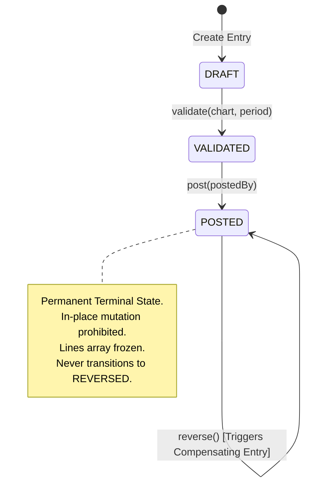

# OX-DIGITAL Education — Accounting Track
# Phase 1.1: Append-Only General Ledger Integrity & Immutability Architecture

**Author:** Independent Senior Financial Systems Architect  
**Project:** OX-DIGITAL Education  
**Baseline Commit:** `0500b93e65c24ed881349c4acea7f523332c5e9f` on branch `main`  
**Standard Compliance:** OD-723 (Pure Append-Only Versioning & Journal Invariants)  
**Document Status:** Complete & Verified  
**Date:** November 3, 2026

---

## 1. Fundamental Principle of Pure Append-Only Accounting

In double-entry financial accounting, the General Ledger is a record of historical reality. Once a transaction is validated and posted, it ceases to be an editable proposal; it becomes a legally and mathematically binding historical fact.

Traditional CRUD systems typically employ a mutable status flag:
```sql
-- DANGEROUS CRUD ANTI-PATTERN (VIOLATES OD-723):
UPDATE journal_entries SET status = 'REVERSED', updated_at = NOW() WHERE id = 'je_1001';
```

Such patterns introduce critical vulnerabilities:
1. **Loss of Historical Reproducibility:** Point-in-time financial queries ("What was the ledger balance on October 31 at 23:59:59?") become unreliable if historical records change status in place.
2. **Audit Tampering Risk:** Mutating rows in place prevents cryptographic sealing (hash chains or block headers) and compromises SOC 1 / SOC 2 Type II auditability.
3. **Database Write Concurrency Conflicts:** Updating existing rows introduces row-level lock contention and deadlocks in high-throughput payment processing environments.

Under **Pure Append-Only Accounting (OD-723)**:
- Ledger records are written strictly via `INSERT`.
- `UPDATE` and `DELETE` statements are prohibited on posted transactions at both domain and database levels.
- Corrections, reversals, cancellations, and write-offs are performed exclusively by appending **compensating transactions**.

---

## 2. In-Memory Architectural Remediation in Phase 1.1

### 2.1 The Phase 1 Vulnerability
In Phase 1, the `JournalEntry` lifecycle included:
```typescript
export type EntryStatus = 'DRAFT' | 'VALIDATED' | 'POSTED' | 'REVERSED';
```
When `reverse()` was invoked:
```typescript
this._status = 'REVERSED';
this._reversedAt = new Date();
this._reversedBy = reversedBy;
this._reversalEntryId = revId;
```
This violated the core immutable ledger invariant because a posted entry transitioned to a new state and mutated its internal properties in memory.

### 2.2 The Phase 1.1 Pure Append-Only Architecture

In Phase 1.1, the domain model was refactored as follows:



#### A. Entry Status Domain Type
```typescript
export type EntryStatus = 'DRAFT' | 'VALIDATED' | 'POSTED';
```
`'REVERSED'` is completely removed as a journal entry status. `POSTED` is the sole terminal status of an active or historically reversed entry.

#### B. Compensating Journal Entry
When an entry is reversed, the domain engine creates a new, independent `JournalEntry`:
- **ID:** New deterministic or UUID identifier (e.g., `rev_je_1001_...`).
- **Accounting & Transaction Date:** Date of the reversal operation.
- **Reference ID:** Retains original entry ID.
- **`reversalOfEntryId`:** Points explicitly to the original entry ID (`je_1001`).
- **Inverted Lines:** Debits become Credits; Credits become Debits. Line amounts, branch dimensions, and accounts remain identical.
- **Status:** Begins as `DRAFT` (or can be validated and posted immediately).

#### C. Derived Reversal State via Immutable Audit Log
The original entry does not store mutable reversal pointers. Instead, `AuditEventCollector` stores an immutable `ENTRY_REVERSED` event:
```typescript
public get isReversed(): boolean {
  return this.auditCollector.isEntryReversed(this.id);
}

public get reversalEntryId(): string | undefined {
  const revEvent = this.auditCollector.getReversalEvent(this.id);
  return revEvent ? (revEvent.details.reversalEntryId as string | undefined) : undefined;
}
```

---

## 3. Deep Runtime Immutability

### 3.1 Frozen Journal Lines
To guarantee that journal lines cannot be pushed, popped, spliced, or modified after retrieval:
```typescript
public get lines(): readonly JournalLine[] {
  return Object.freeze([...this._lines]);
}
```
Any caller attempting `entry.lines.push(...)` or modifying elements encounters a runtime exception or immediate block.

### 3.2 Frozen Audit Event Logs
In `packages/shared/src/accounting/audit.ts`, all audit events and payload dictionaries are frozen upon creation:
```typescript
const sanitizedDetails = Object.freeze({ ...details });
const event: AccountingAuditEvent = Object.freeze({
  id: `aud_${Date.now()}_${Math.random().toString(36).substring(2, 9)}`,
  eventType,
  institutionId,
  entryId,
  actorId,
  timestamp: new Date(),
  details: sanitizedDetails
});
this.events.push(event);
```
Runtime tests confirm that modifying `event.actorId` in strict mode throws a `TypeError: Cannot assign to read only property`.

---

## 4. Idempotency & Defense Against Duplicate Reversals

In high-concurrency environments, double-clicking a "Reverse" button or network retries must never create duplicate reversal entries.

Phase 1.1 enforces duplicate reversal defense:
```typescript
const existingReversal = this.auditCollector.getReversalEvent(this.id);
if (existingReversal) {
  const existingRevId = (existingReversal.details.reversalEntryId as string) || '';
  throw new DuplicateReversalError(this.id, existingRevId);
}
```
Calling `reverse()` a second time immediately throws `DuplicateReversalError`, preventing double-crediting or balance divergence.

---

## 5. Architectural Implications for Downstream Database Design (Phase 2)

When database persistence is authorized by the Product Owner in Phase 2, the following append-only schema constraints must be implemented:

1. **Table Design:**
   - Table `journal_entries` column `status` will have check constraint: `status IN ('DRAFT', 'VALIDATED', 'POSTED')`.
   - Table `journal_lines` will have foreign key `entry_id REFERENCES journal_entries(id) ON DELETE RESTRICT`.
2. **PostgreSQL Row-Level Triggers:**
   ```sql
   CREATE OR REPLACE FUNCTION enforce_posted_entry_immutability()
   RETURNS TRIGGER AS $$
   BEGIN
     IF OLD.status = 'POSTED' THEN
       RAISE EXCEPTION 'OD-723 Invariant: Cannot update or delete a POSTED journal entry.';
     END IF;
     RETURN NEW;
   END;
   $$ LANGUAGE plpgsql;
   ```
3. **Ledger Balance View:**
   Account balances will be computed via append-only aggregation:
   ```sql
   SELECT account_id, SUM(debit - credit) as net_balance
   FROM journal_lines
   JOIN journal_entries ON journal_lines.entry_id = journal_entries.id
   WHERE journal_entries.status = 'POSTED'
   GROUP BY account_id;
   ```
   Because reversed entries and their compensating reversal entries have exact opposite debit/credit values, their sum naturally resolves to zero without mutating historical rows.

