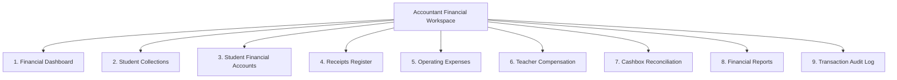

# OX-DIGITAL Education — Accounting Track
# Phase 1.2: Accountant Workspace Specification & UI Blueprint

**Author:** Senior UX Architect & Accounting Domain Specialist  
**Project:** OX-DIGITAL Education  
**Document Classification:** UI/UX Functional Specification (Non-Implemented Design Blueprint)  
**Baseline Commit:** `0500b93e65c24ed881349c4acea7f523332c5e9f` on branch `main`  
**Date:** November 3, 2026

---

## 1. Executive Purpose & Workspace Architecture

The **Accountant Workspace** is designed as a focused, high-efficiency operational command center for center financial officers. It empowers the Accountant to maintain accurate records, track collections, monitor receivables, reconcile daily cash, and prepare teacher compensation statements while preserving strict segregation of duties under Primary Manager governance.

---

## 2. Nine Core Navigation Sections

### 2.1 Section 1: Financial Dashboard (لوحة المتابعة المالية)
- **Daily Quick Metric Cards:**
  - *Today's Collections (تحصيلات اليوم):* Total cash and bank transfers received across assigned branches today.
  - *Pending Reconciliations (مطابقات قيد الإجراء):* Number of open tills awaiting end-of-shift count verification.
  - *Overdue Receivables (متأخرات مستحقة):* Total overdue balances exceeding payment grace periods.
  - *Earned Revenue Month-to-Date (الإيراد المحقق لهذا الشهر):* Delivered instructional revenue recognized under policy.
- **Action Alerts:** Highlights un-reconciled cash discrepancies, pending teacher statement sign-offs, and students with mature installments.

### 2.2 Section 2: Student Collections (تحصيل الرسوم الدراسية)
- **Rapid Collection Entry Form:**
  - Student search (by National ID, Student Phone, Parent Phone, or Student Name).
  - Active group enrollment details (Educational Group, Schedule, Agreed Pricing Strategy).
  - Mature installment schedule (المبالغ المستحقة).
  - Collection fields: Amount Collected (المبلغ المحصّل), Payment Method (Cash, POS Card Swipe, Bank Transfer Proof), Receipt Memo.
  - Instant receipt generation button.
- **Recent Collections Feed:** Live chronological list of collections processed during the current shift.

### 2.3 Section 3: Student Financial Accounts (الحسابات المالية للطلاب)
- **Student Sub-Ledger Directory:**
  - Master list of all registered center students with real-time financial balances:
    - Agreed Total (إجمالي الاتفاق)
    - Amount Due (المستحق حتى تاريخه)
    - Amount Collected (المحصل)
    - Outstanding Balance (الرصيد المتبقي)
    - Overdue Amount (المتأخرات)
- **Account Detail Drill-Down:**
  - Complete chronological statement of charges, attendance deductions, and collection receipts.
  - Option to apply discounts, scholarships, or credit adjustments with Primary Manager approval.

### 2.4 Section 4: Receipts Register (سجل الإيصالات المالية)
- **Tamper-Evident Receipt Journal:**
  - Sequential receipt number (e.g., `REC-CAI-2026-00452`).
  - Date and timestamp of collection.
  - Cashier/Accountant who collected the funds.
  - Student and group reference.
  - Re-print receipt copy (watermarked with `DUPLICATE / نسخة ثانية`).
  - Voided receipt register (shows cancelled receipts with required reason and authorization).

### 2.5 Section 5: Operating Expenses (المصروفات التشغيلية)
- **Expense Recording Form:**
  - Expense Category dropdown (Facility Rent, Utilities, Educational Materials, Cleaning Supplies, Maintenance).
  - Branch dimension selector (which campus incurred the cost).
  - Supporting Document Upload (PDF / Image of vendor receipt or tax invoice).
  - Payment Source (Petty Cash Till, Main Safe, Institutional Bank Account).
- **Approval Queue:** Flags expenses exceeding the Accountant's spending limit for Primary Manager digital sign-off.

### 2.6 Section 6: Teacher Compensation (مستحقات المعلمين)
- **Teacher Monthly Statement Generator:**
  - Filter by Teacher and Academic Month.
  - System aggregates completed lessons and verified attendance manifests from `services/user-service`.
  - Calculates compensation based on the teacher's approved contract (Fixed salary, Per-lesson fee, Per-student fee, or Revenue share under UP-704).
  - Deductions and adjustments table (advances, equipment penalties).
  - Generates draft Compensation Statement for Primary Manager authorization.

### 2.7 Section 7: Cashbox & Till Reconciliation (الخزينة والمطابقة اليومية)
- **Cashbox Shift Management:**
  - *Shift Opening:* Records starting cash float (e.g., 500.00 EGP).
  - *Intra-Day Running Balance:* System calculates `Opening Float + Cash Collections - Cash Expenses`.
  - *End-of-Day Physical Count Sheet:* Cashier enters physical denomination counts (200, 100, 50, 20, 10, 5 EGP bills).
  - *Variance Calculator:* Automatically computes Over/Short (عجز / زيادة).
  - *Cash Transfer Module:* Records physical transfer of reconciled cash to the Center Safe or Bank Deposit Envelope.

### 2.8 Section 8: Financial Reports (التقارير المالية)
- **Operational & Management Reports:**
  - Daily Collection Summary by Branch & Cashier.
  - Student Balance Aging Report (30 / 60 / 90 days overdue).
  - Branch Profit & Loss Statement (Earned Tuition Revenue minus Direct Branch Expenses).
  - Teacher Compensation Summary.
  - Cashbox Reconciliation & Discrepancy Log.

### 2.9 Section 9: Transaction Audit Log (سجل العمليات والتدقيق)
- **Immutable Forensic Event Viewer:**
  - Streams events from `AuditEventCollector` (`ENTRY_CREATED`, `ENTRY_POSTED`, `ENTRY_REVERSED`, `TRANSITION_REJECTED`).
  - Searchable by Entry ID, Student ID, or User ID.
  - Displays immutable event timestamp, actor ID, and sanitized payload details.

---

## 3. Workspace Differentiation Across Roles

| Architectural Aspect | Accountant Workspace | Primary Manager Workspace | Cashier Workspace | Teacher View |
| :--- | :--- | :--- | :--- | :--- |
| **Primary Focus** | Ledger fidelity, reconciliations, statements | Governance, policy approval, institutional P&L | Fast collection, receipt printing, till count | Personal earnings, lesson attendance logs |
| **Expense Entry** | Full entry with attachments | Approve large expenses | BLOCKED | BLOCKED |
| **Pricing Policy** | Read-only | Create, edit, publish pricing | BLOCKED | BLOCKED |
| **Cashbox Handling**| Reconcile & transfer | Audit discrepancy reports | Physical count entry only | BLOCKED |
| **Period Closure** | Prepare trial balance | Sole closing authority | BLOCKED | BLOCKED |

---

## 4. Implementation Boundary

> [!NOTE]
> This specification is a non-implemented UI and workflow blueprint. No React components, API controllers, or frontend routes are authorized for creation during Phase 1.2.

