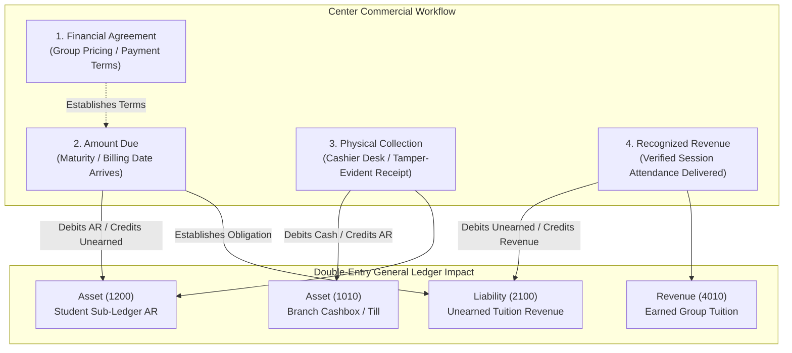

# OX-DIGITAL Education — Accounting Track
# Phase 1.2: Physical Center Integration Contract & Operational Blueprint

**Author:** Senior Financial Systems Architect & Integration Engineer  
**Project:** OX-DIGITAL Education  
**Document Classification:** Technical Integration Contract (Design-Only Blueprint)  
**Baseline Commit:** `0500b93e65c24ed881349c4acea7f523332c5e9f` on branch `main`  
**Date:** November 3, 2026

---

## 1. Physical Center Operating Reality & Baseline Evidence

### 1.1 The Operational Center-First Context
OX-DIGITAL Education operates **physical educational centers** (brick-and-mortar campuses). Students attend in person, enroll in educational cohorts, pay tuition at physical reception desks, and have attendance marked in classrooms.
- **Online Subscriptions Absent:** Recurring digital course subscriptions, automated recurring card billing, and public payment gateway access checkout do NOT exist in the platform.
- **First Commercial Target:** The Accounting Implementation Track must integrate with existing physical educational-center workflows before any digital subscription model is contemplated.

### 1.2 Codebase Audit of Existing Center Entities

The following exact models and service files were audited in the existing codebase:

| Entity / Concept | Source File Path | Exact Model / Symbol | Current Fields & Limitations |
| :--- | :--- | :--- | :--- |
| **Students** | [`packages/database/prisma/schema.prisma`](file:///D:/OX-DIGITAL/Mathe/OX-DIGITAL-GITHUB/packages/database/prisma/schema.prisma#L79-L125) | `model User` | Fields: `id`, `name`, `email`, `role`, `centerGroupId`, `institutionId`, `branchId`. Roles include `CENTER_STUDENT`. Has NO financial balance or ledger account fields. |
| **Educational Groups** | [`packages/database/prisma/schema.prisma`](file:///D:/OX-DIGITAL/Mathe/OX-DIGITAL-GITHUB/packages/database/prisma/schema.prisma#L127-L142) | `model CenterGroup` | Fields: `id`, `name`, `schedule`, `institutionId`, `branchId`, `students: User[]`. Has NO pricing method, fee schedule, or billing frequency. |
| **Courses & Subjects**| [`packages/database/prisma/schema.prisma`](file:///D:/OX-DIGITAL/Mathe/OX-DIGITAL-GITHUB/packages/database/prisma/schema.prisma#L144-L175) | `model Course` | Fields: `id`, `title`, `price: Float`, `teacherId`, `institutionId`, `branchId`. Simple flat price; does not support group pricing or center session packages. |
| **Lessons** | [`packages/database/prisma/schema.prisma`](file:///D:/OX-DIGITAL/Mathe/OX-DIGITAL-GITHUB/packages/database/prisma/schema.prisma#L189-L214) | `model Lesson` | Fields: `id`, `title`, `courseId`, `activeMediaId`. Represents academic curriculum content; not connected to physical classroom attendance. |
| **Attendance** | [`packages/database/prisma/schema.prisma`](file:///D:/OX-DIGITAL/Mathe/OX-DIGITAL-GITHUB/packages/database/prisma/schema.prisma#L291-L302) | `model Attendance` | Fields: `id`, `studentId`, `date`, `status: String` ('PRESENT', 'ABSENT', 'LATE'). Has NO `branchId`, `courseId`, or `centerGroupId` link! |
| **Attendance Service** | [`services/user-service/src/controllers/attendance.controller.ts`](file:///D:/OX-DIGITAL/Mathe/OX-DIGITAL-GITHUB/services/user-service/src/controllers/attendance.controller.ts#L6-L74) | `markAttendance`, `bulkMarkAttendance` | Validates student existence and date range. Authorizes `ADMIN` or `TEACHER`. Does NOT generate financial events. |
| **Payments** | [`packages/database/prisma/schema.prisma`](file:///D:/OX-DIGITAL/Mathe/OX-DIGITAL-GITHUB/packages/database/prisma/schema.prisma#L304-L325) | `model Payment` | Fields: `id`, `userId`, `amount: Float`, `currency`, `status`, `provider`, `institutionId`, `branchId`. Simple transaction row; no sub-ledger association. |
| **Payment Service** | [`services/course-service/src/controllers/payment.controller.ts`](file:///D:/OX-DIGITAL/Mathe/OX-DIGITAL-GITHUB/services/course-service/src/controllers/payment.controller.ts#L10-L158) | `createPayment`, `handleWebhook` | Handles one-off online gateway intents (Paymob/Stripe). Does NOT handle physical desk collections, cash receipts, or installments. |
| **Branches** | [`packages/database/prisma/schema.prisma`](file:///D:/OX-DIGITAL/Mathe/OX-DIGITAL-GITHUB/packages/database/prisma/schema.prisma#L35-L49) | `model Branch` | Fields: `id`, `institutionId`, `name`, `code`, `isOnline`. Physical campus or digital branch container. |

---

## 2. Future Center Financial Capabilities & Domain Architecture

### 2.1 Group Pricing Strategies (Strategy Pattern)
The Primary Manager selects the pricing method separately for each educational group (`CenterGroup`). The integration layer will implement an extensible strategy:
1. **Term Fixed Fee:** A lump-sum price covering an entire academic term (e.g., 2,500 EGP for the fall semester).
2. **Monthly Group Fee:** Fixed tuition billed on a monthly cycle (e.g., 600 EGP / calendar month).
3. **Per-Session Pricing:** Tuition determined strictly by the number of physical classroom sessions scheduled or attended (e.g., 80 EGP / 2-hour session).
4. **Session Package:** Prepaid block of attendances (e.g., 10-session package for 750 EGP).

### 2.2 Flexible Payment Arrangements (نظام السداد)
Center students rarely settle annual tuition in one payment. The system must support flexible settlement structures:
- **Product Terminology Standard:** All Arabic UI and documentation must strictly employ approved terminology:
  - **نظام السداد** (Payment Arrangement)
  - **دفعة واحدة** (Single Payment)
  - **دفعات متعددة** (Multiple Installments / Scheduled Payments)
  - **المبلغ المستحق** (Amount Due)
  - **المبلغ المحصّل** (Amount Collected)
  - **المتأخرات** (Overdue Balances)
  - **الرصيد المتبقي** (Remaining Balance)
- **Prohibited Product Terminology:** The Arabic word **"أقساط"** must NEVER be used in user-facing labels or customer invoices to avoid commercial ambiguity with retail financing/interest.

### 2.3 The Four Distinct Financial Concepts
To prevent accounting distortion, the integration design strictly decouples four concepts that must never be conflated:
1. **Financial Agreement:** The contractual commitment established when a student registers in a group (e.g., Total Fee = 3,000 EGP). *Financial impact: None on General Ledger (memorandum only).*
2. **Amount Due (المبلغ المستحق):** The portion of the agreement whose payment maturity date has arrived (e.g., Term 1 Payment = 1,000 EGP due Oct 1). *Financial impact: Debits Student Sub-Ledger AR (`1200`), Credits Unearned Tuition (`2100`).*
3. **Actual Collection (المبلغ المحصّل):** Real money physically received and recorded at the cashier desk. *Financial impact: Debits Branch Cashbox (`1010`), Credits Student Sub-Ledger AR (`1200`).*
4. **Recognized Revenue (الإيراد المحقق):** The monetary value of educational sessions delivered and verified by attendance. *Financial impact: Debits Unearned Tuition (`2100`), Credits Earned Tuition Revenue (`4010`).*

> [!WARNING]
> Contractual agreements, expected future attendances, and unpaid student balances must NEVER be recognized as realized income. Projected revenue does not enter the General Ledger.

### 2.4 Attendance-Based Revenue Recognition Policies
Cash collected at physical centers represents unearned prepayment until classroom instruction occurs:
- **Operational Evidence:** When a teacher submits a session attendance roster, the system verifies student attendance.
- **Accounting Policy Engine:** An extensible policy maps attendance events into revenue recognition journal entries:
  - *Standard Session Policy:* For present students, unearned revenue is recognized immediately.
  - *Excused Absence Policy:* Depending on institution policy, credited to future sessions or retained as a session fee.
  - *Forfeited Absence Policy:* Unexcused absences recognize revenue without delivering make-up instruction, if stipulated in the student agreement.

### 2.5 Student Renewal & Access Suspension Workflow
Controlled entirely by the Primary Manager:
- **Automated Overdue Detection:** Flags students whose `Amount Due > Amount Collected` beyond policy grace periods (e.g., 7 days overdue).
- **Grace Period Configuration:** Configurable per institution and branch.
- **Optional Access Suspension:** Primary Manager may toggle automated suspension of class enrollment manifests or exam eligibility.
- **Zero Data Loss Guarantee:** Suspension NEVER deletes student academic records, exam attempts, historical attendances, or ledger balances. Full account restoration occurs upon recording settlement collections.

### 2.6 Teacher Compensation Models
The integration design specifies support for five teacher compensation schemes:
1. **Fixed Monthly Salary:** Fixed periodic expense posted to Teacher Payroll (`5010`).
2. **Per Completed Lesson:** Fixed fee per scheduled lesson conducted (e.g., 200 EGP / class).
3. **Per Eligible Student:** Piece-rate compensation per student attending the session (e.g., 25 EGP / student).
4. **Revenue-Share Percentage:** Percentage of tuition collected or recognized for that group (e.g., 60% teacher / 40% center split).
5. **Hybrid Model:** Base salary plus per-student attendance incentive.
- *Open Policy Gate:* The calculation base under revenue share (Gross collections vs Net of sibling discounts) remains an open Product Owner decision under **UP-704**.

### 2.7 Branch Cashbox & Till Management
Physical reception desks operate daily cashboxes:
- **Shift Opening Float:** Petty cash float recorded on shift opening.
- **Collection Receipts:** Sequential, tamper-evident physical receipt issued upon collection.
- **Direct Expenses:** Petty cash disbursements (e.g., whiteboard markers, cleaning supplies) requiring receipt attachment.
- **End-of-Day Till Reconciliation:** Physical cash count compared against system receipts.
- **Shortage / Surplus Protocol:** Cash Over/Short (`5900`) automatically posted, requiring Branch Supervisor sign-off.
- **Vault Transfer:** Reconciled cash transferred to the center safe or deposited via bank courier.

