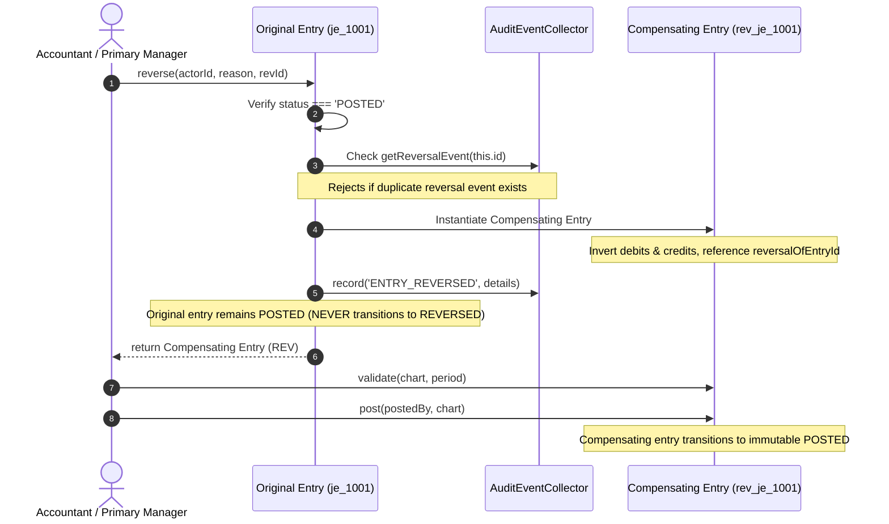

# OX-DIGITAL Education — Accounting Track
# Phase 1.2: Deep Immutability, Reversal Mechanics & Idempotency Architecture

**Author:** Independent Senior Financial Systems Architect  
**Project:** OX-DIGITAL Education  
**Baseline Commit:** `0500b93e65c24ed881349c4acea7f523332c5e9f` on branch `main`  
**Standard Compliance:** OD-723 (Pure Append-Only General Ledger Invariant)  
**Date:** November 3, 2026

---

## 1. Deep Immutability Verification (Audit A)

### 1.1 The Vulnerability of Shallow Freezing & JavaScript Date Mutability
In JavaScript runtimes (V8/Node.js), calling `Object.freeze(obj)` creates a shallow freeze:
1. It prevents adding, removing, or reassigning direct own properties.
2. It does **NOT** freeze nested objects, nested arrays, or referenced collections (e.g., `Map` or `Set`).
3. **The Date Setter Trap:** Freezing a JavaScript `Date` object (`Object.freeze(new Date())`) prevents modifying its prototype or setting new properties, but **its internal slot `[[DateValue]]` remains mutable via Date prototype methods!**
   ```javascript
   const d = Object.freeze(new Date('2026-11-03'));
   d.setFullYear(2099); // SUCCEEDS! d.getFullYear() is now 2099!
   ```
If an accounting domain model returns internal Date instances directly, an external caller (or malicious script) could invoke `entry.transactionDate.setFullYear(1990)`, silently corrupting the in-memory financial evidence.

### 1.2 The Phase 1.2 Defense: Defensive Copying & Deep Freeze
In Phase 1.2, deep immutability was certified across all financial domain entities:

#### A. Date Setter Defense via Defensive Copy Getters
In `packages/shared/src/accounting/journalEntry.ts`, all internal date references are stored in private backing variables (`_transactionDate`, `_accountingDate`, `_createdAt`, `_postedAt`). All public accessors return independent clones:
```typescript
public get transactionDate(): Date {
  return new Date(this._transactionDate.getTime());
}

public get accountingDate(): Date {
  return new Date(this._accountingDate.getTime());
}

public get createdAt(): Date {
  return new Date(this._createdAt.getTime());
}

public get postedAt(): Date | undefined {
  return this._postedAt ? new Date(this._postedAt.getTime()) : undefined;
}
```
If a caller executes `const d = entry.transactionDate; d.setFullYear(2099);`, only their isolated clone is modified. Calling `entry.transactionDate.getFullYear()` continues to return the authentic, immutable transaction date (`2026`).

#### B. Recursive Deep Freeze for Nested Audit Payloads
In `packages/shared/src/accounting/audit.ts`, a recursive `deepFreeze()` utility is applied to all incoming audit payloads:
```typescript
export function deepFreeze<T>(obj: T): T {
  if (obj === null || typeof obj !== 'object') {
    return obj;
  }
  Object.freeze(obj);
  for (const key of Object.keys(obj)) {
    const value = (obj as any)[key];
    if (value !== null && typeof value === 'object' && !Object.isFrozen(value)) {
      deepFreeze(value);
    }
  }
  return obj;
}
```
`AccountingAuditEvent` instances are frozen upon construction, deep-freezing nested metadata, details dictionaries, and returning a defensive copy for `timestamp`. Attempting to modify properties on an audit event throws a `TypeError` in strict mode.

#### C. Domain Component Freezing
- **`JournalLine`:** `Object.freeze(this)` in constructor. Debits, credits (`Money`), and branch dimensions are immutable.
- **`BranchDimension`:** `Object.freeze(this)` in constructor.
- **`Account`:** `Object.freeze(this)` in constructor. Metadata is deep-frozen.
- **`JournalEntry.lines`:** Returns `Object.freeze([...this._lines])`.

---

## 2. Append-Only Reversal Mechanics (Audit B — OD-723)

### 2.1 The Nine Invariant Rules of Append-Only Reversal
Under pure append-only accounting (OD-723), modifying a posted ledger record in place is prohibited. The Financial Core Engine enforces the nine mandatory lifecycle rules:



1. **Original Entry Remains `POSTED`:** `entry.status` remains `'POSTED'` indefinitely. The union type `EntryStatus` does not include `'REVERSED'`.
2. **Original Header & Lines Preserved:** `entry.lines`, `debit`, `credit`, `accountingDate`, and descriptions remain 100% identical to the moment of posting.
3. **Distinct Compensating Entry Created:** A new `JournalEntry` instance is instantiated with unique identity `rev_${id}_${timestamp}`.
4. **Authoritative Lineage Pointer:** The compensating entry explicitly sets `reversalOfEntryId = originalEntry.id` and `referenceId = originalEntry.id`.
5. **Exact Debit/Credit Inversion:** Every journal line is mapped such that `reversalLine.debit = originalLine.credit` and `reversalLine.credit = originalLine.debit`.
6. **Immutable Audit Record:** An `ENTRY_REVERSED` event is permanently recorded in `AuditEventCollector`, capturing `reversedAt`, `reversalEntryId`, actor, and operational reason.
7. **Replay & Duplicate Reversal Defense:** Calling `entry.reverse()` a second time queries `auditCollector.getReversalEvent(this.id)` and throws `DuplicateReversalError(this.id, existingReversalId)`.
8. **Compensating Entry Immutability:** Once the compensating entry is posted, it enters the permanent `POSTED` state and cannot have lines added or modified.
9. **Reversal of a Reversal (Compensating Correction):** If a reversal was performed by mistake, the posted reversal entry can itself be reversed by issuing a third compensating entry referencing the reversal's ID. This restores the net balance purely through append-only operations without deleting historical audit trails.

---

## 3. Idempotency & Concurrency Boundaries (Audit C)

### 3.1 Domain-Level In-Memory Guarantees
Within the isolated TypeScript domain engine:
- **Idempotent Duplicate Posting:** Invoking `entry.post(actor, chart)` on an already `POSTED` instance returns immediately without side effects or errors.
- **Duplicate Reversal Rejection:** Attempting to reverse an entry that already has a recorded reversal event throws `DuplicateReversalError`.
- **Pre-Posting State Guards:** Calling `reverse()` on a `DRAFT` or `VALIDATED` entry throws `InvalidLifecycleTransitionError`.

### 3.2 Concurrency & Persistence Boundary Contract for Phase 2
The in-memory domain engine cannot, by itself, coordinate distributed workers or guarantee atomic uniqueness across database clusters. When database persistence is authorized in Phase 2, the following persistence guarantees must be implemented:

```sql
-- Phase 2 Persistence Invariant Contract (Draft Architecture):

-- 1. Ledger Entry Table with Terminal Status Check
CREATE TABLE accounting_journal_entries (
    id VARCHAR(64) PRIMARY KEY,
    institution_id VARCHAR(64) NOT NULL,
    transaction_date TIMESTAMPTZ NOT NULL,
    accounting_date DATE NOT NULL,
    currency VARCHAR(3) NOT NULL DEFAULT 'EGP',
    description TEXT NOT NULL,
    status VARCHAR(20) NOT NULL CHECK (status IN ('DRAFT', 'VALIDATED', 'POSTED')),
    reference_id VARCHAR(64),
    reversal_of_entry_id VARCHAR(64) REFERENCES accounting_journal_entries(id),
    idempotency_key VARCHAR(128) UNIQUE, -- Protects against network duplicate dispatch
    created_by VARCHAR(64) NOT NULL,
    posted_at TIMESTAMPTZ,
    posted_by VARCHAR(64),
    created_at TIMESTAMPTZ NOT NULL DEFAULT NOW()
);

-- 2. Partial Unique Index: Exactly One Reversal per Journal Entry
CREATE UNIQUE INDEX idx_unique_active_reversal 
ON accounting_journal_entries (reversal_of_entry_id) 
WHERE reversal_of_entry_id IS NOT NULL;

-- 3. Row-Level Immutability Trigger
CREATE OR REPLACE FUNCTION trg_prevent_posted_entry_update()
RETURNS TRIGGER AS $$
BEGIN
    IF OLD.status = 'POSTED' THEN
        RAISE EXCEPTION 'OD-723 Security Invariant: Posted general ledger entries cannot be updated or deleted.';
    END IF;
    RETURN NEW;
END;
$$ LANGUAGE plpgsql;

CREATE TRIGGER trg_enforce_posted_immutability
BEFORE UPDATE OR DELETE ON accounting_journal_entries
FOR EACH ROW EXECUTE FUNCTION trg_prevent_posted_entry_update();
```

---

## 4. Money Engine & Allocation Conservation (Audit D)

### 4.1 Precision & Integer Arithmetic
- **Minor-Unit Representation:** Currency amounts are anchored in EGP piasters (`BigInt`). Floating-point numbers (`number`) are prohibited from calculations.
- **`DecimalValue` Engine:** Performs fixed-point integer scaling (10^4 internal precision) to prevent IEEE 754 precision traps (e.g., `0.1 + 0.2 === 0.30000000000000004`).
- **Rounding Modes:** `HALF_UP`, `HALF_EVEN` (Banker's rounding), `FLOOR`, `CEILING`, `TRUNCATE` all strictly verified against standard test vectors.

### 4.2 Allocation Conservation Invariant
When distributing tuition fees across multiple branches, accounts, or payment installments:
$$\sum_{i=1}^{n} \text{AllocatedPart}_i \equiv \text{OriginalAmount}$$
The `Money.allocate([ratios])` method utilizes integer remainder distribution to guarantee that zero piasters are lost or gained due to division remainders. Tested and verified in `tests/accounting/money.test.ts`.

