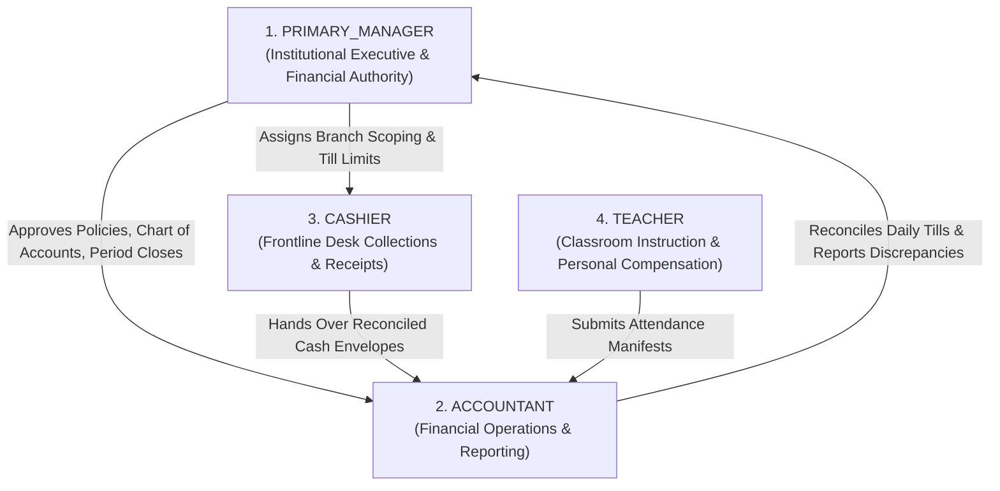

# OX-DIGITAL Education — Accounting Track
# Phase 1.2: Role & Permission Governance Specification

**Author:** Senior Security Architect & Financial Systems Governance Lead  
**Project:** OX-DIGITAL Education  
**Document Classification:** Role-Based Access Control (RBAC) Specification & Governance Contract  
**Baseline Commit:** `0500b93e65c24ed881349c4acea7f523332c5e9f` on branch `main`  
**Date:** November 3, 2026

---

## 1. Approved Target Roles & Institutional Governance

The financial operating model for OX-DIGITAL Education establishes **four approved target roles**:



> [!IMPORTANT]
> **GOVERNANCE DIRECTIVE ON BRANCH SUPERVISION:**  
> `BRANCH_MANAGER` is **NOT** an approved role in the current architecture.  
> If operational scaling requires a dedicated branch-level supervisor role between the Primary Manager and the Accountant/Cashier, that role must be formally reviewed and approved as a dedicated Product Owner decision. Until such a decision is rendered, institutional financial authority rests solely with the `PRIMARY_MANAGER`.

---

## 2. Role Definitions & Segregation of Duties (SoD)

### 2.1 Primary Manager (`PRIMARY_MANAGER`)
- **Authority:** Chief institutional administrator under OD-701, OD-718, and OD-721.
- **Scope:** Institution-wide across all physical campuses and online branches.
- **Core Financial Powers:**
  1. Sole authority to approve and publish master group pricing strategies and fee structures.
  2. Sole authority to configure and modify the institutional Chart of Accounts (`ChartOfAccounts`).
  3. Authorizes accounting period closures and exceptional re-openings (OD-710).
  4. Approves write-offs, scholarship subsidies, and cashbox shortage adjustments exceeding policy thresholds.
  5. Reviews consolidated financial statements, balance sheets, and branch P&L reports.
  6. Configures branch-scoping permissions for Accountants and Cashiers.

### 2.2 Accountant (`ACCOUNTANT`)
- **Authority:** Professional financial operator managing day-to-day ledger fidelity.
- **Scope:** Configurable by Primary Manager (institution-wide or assigned to specific branches).
- **Core Financial Powers:**
  1. Records student collections, verifies bank transfer proofs, and reviews installment schedules.
  2. Records branch and institutional operating expenses with attached invoice/receipt metadata.
  3. Reviews student accounts receivable aging (30/60/90 days) and flags collection delinquency.
  4. Computes teacher compensation statements based on attendance rosters and compensation rules.
  5. Performs end-of-day till reconciliations and processes cashbox transfers to vaults/bank couriers.
  6. Prepares draft financial statements, trial balances, and tax schedules.
- **Segregation of Duties Invariant:** An Accountant **CANNOT** approve their own approval-required actions (e.g., cannot approve exceptional price overrides, period closures, or bad-debt write-offs).

### 2.3 Cashier (`CASHIER`)
- **Authority:** Frontline reception desk staff responsible for cash handling.
- **Scope:** Strictly bound to a specific physical branch and assigned cashbox/till.
- **Core Financial Powers:**
  1. Collection-only access: Records student tuition cash, card swipes, or POS payments.
  2. Generates and prints official, sequential collection receipts.
  3. Records petty cash shift opening floats and daily closing cash counts.
- **Strict Isolation Constraints:**
  - Zero access to general ledger accounts or chart of accounts.
  - Zero access to operating expense entry, teacher payroll, or bank accounts.
  - Zero access to institutional financial reports, profit & loss, or balance sheets.

### 2.4 Teacher (`TEACHER`)
- **Authority:** Instructional staff delivering educational lessons.
- **Scope:** Limited to assigned educational groups and personal classroom rosters.
- **Core Financial Powers:**
  1. Views personal compensation statements, calculated attendance fees, and payment vouchers.
  2. Submits session attendance manifests (which triggers operational revenue recognition).
- **Strict Isolation Constraints:**
  - Zero access to student billing balances, tuition receipts, or peer teacher compensation.
  - Zero access to institutional ledgers, branch revenues, or expense accounts.

---

## 3. Financial Permission Matrix

| Financial Capability / Operation | Primary Manager | Accountant | Cashier | Teacher |
| :--- | :---: | :---: | :---: | :---: |
| **Manage Chart of Accounts** | **APPROVE & EDIT** | READ ONLY | NONE | NONE |
| **Set Group Pricing Strategy** | **APPROVE & EDIT** | READ ONLY | NONE | NONE |
| **Record Cash Collection** | YES | YES | **PRIMARY** | NONE |
| **Issue Student Receipt** | YES | YES | **PRIMARY** | NONE |
| **Record Operating Expense** | YES | **PRIMARY** | NONE | NONE |
| **Approve Expense > Limit** | **MANDATORY** | BLOCKED | BLOCKED | NONE |
| **Reconcile Daily Cashbox Till** | AUDIT & SIGN-OFF | **PRIMARY** | COUNT ONLY | NONE |
| **Approve Cash Shortage/Surplus** | **MANDATORY** | DRAFT ONLY | BLOCKED | NONE |
| **Prepare Teacher Compensation** | APPROVE | **PRIMARY** | NONE | NONE |
| **View Personal Teacher Statement**| YES (ALL) | YES (ALL) | NONE | **OWN ONLY** |
| **Close Accounting Period (OD-710)**| **SOLE AUTHORITY** | BLOCKED | BLOCKED | NONE |
| **Post Compensating Reversal** | **APPROVE** | DRAFT ONLY | BLOCKED | NONE |
| **View Branch P&L & Balance Sheet**| YES | YES | BLOCKED | NONE |

---

## 4. Primary Manager Branch Scoping Configuration

The Primary Manager controls how Accountants and Cashiers access branches:
```typescript
interface StaffBranchScope {
  userId: string;
  role: 'ACCOUNTANT' | 'CASHIER';
  institutionId: string;
  allowedBranchIds: string[]; // Empty array denotes Institution-Wide (Accountants only)
  canAccessHeadOffice: boolean;
  assignedTillId?: string;     // Mandatory for Cashiers
}
```
- **Cashier Scoping:** Must always be bound to exactly one `branchId` and one `tillId`.
- **Accountant Scoping:** May be granted single-branch or multi-branch oversight by the Primary Manager.

---

## 5. Explicit Governance Boundary

> [!NOTE]
> This document defines the future authorization contract for the Accounting Implementation Track. It does **NOT** authorize modifying JWT payloads, authentication middleware, or Prisma schema role enums during Phase 1.2.

