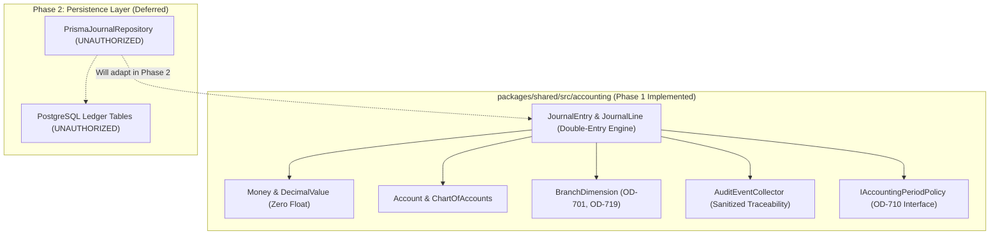
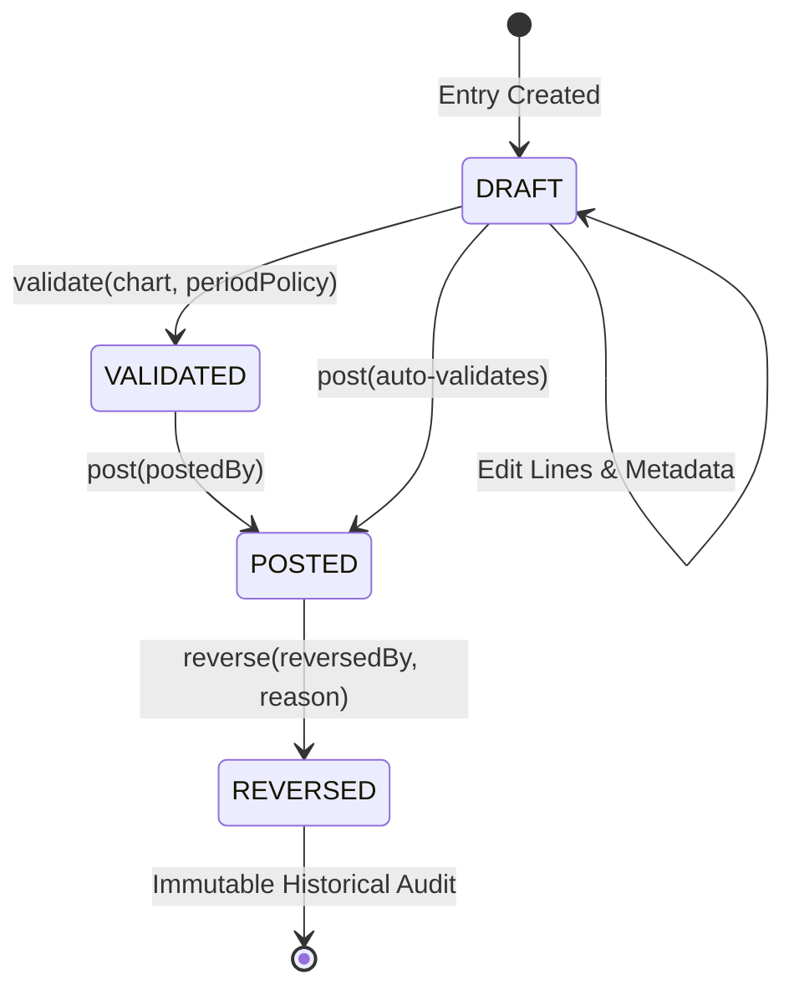

# OX-DIGITAL Education — Accounting Implementation Track
## Phase 1 — Financial Core Engine: Domain Architecture Specification

**Workspace:** `D:\OX-DIGITAL\Mathe\OX-DIGITAL-GITHUB`  
**Git HEAD:** `0500b93e65c24ed881349c4acea7f523332c5e9f` on branch `main`  
**Module Location:** `packages/shared/src/accounting/`  
**Scope:** Core Financial Domain Architecture & Invariant Specifications  
**Date:** November 3, 2026  

---

## 1. Architectural Philosophy: Decoupled Pure Domain Logic

The OX-DIGITAL Education Accounting Engine is designed as a **pure, database-independent domain model**. Following Clean Architecture and Domain-Driven Design (DDD) principles:
1. **Zero External Persistence Dependencies:** The core accounting engine does not depend on Prisma, PostgreSQL, TypeORM, or any ORM. All business invariants, double-entry balance checks, and lifecycle transitions execute in memory.
2. **Deterministic & Auditable:** Financial computations are pure functions of their inputs. Given identical journal entries, the engine will produce identical validation and posting results across any platform.
3. **Pluggable Persistence Boundary:** When database persistence is authorized in Phase 2, repositories and Prisma mappers will wrap this domain model without requiring alterations to core accounting logic.

---

## 2. Module A — Money & Exact Decimal Foundation

### 2.1 The Floating-Point Hazard
JavaScript `number` uses IEEE 754 double-precision binary floating-point representation. This introduces catastrophic rounding errors in financial transactions (e.g., `0.1 + 0.2 === 0.30000000000000004`). In a double-entry general ledger, even a 1-piaster ($0.01\text{ EGP}$) discrepancy violates mathematical balance and invalidates the ledger.

### 2.2 `DecimalValue` BigInt Architecture
`DecimalValue` implements exact, arbitrary-scale decimal arithmetic using native JavaScript `bigint`:
$$\text{DecimalValue} = \text{unscaled} \times 10^{-\text{scale}}$$
- Example: $100.25\text{ EGP}$ is stored as $\text{unscaled} = 10025\text{n}$, $\text{scale} = 2$.
- **Addition/Subtraction:** Aligns decimal scales to $\max(\text{scale}_A, \text{scale}_B)$ before performing exact integer addition/subtraction.
- **Multiplication:** Multiplies unscaled BigInts; sums the scales ($\text{scale}_{\text{new}} = \text{scale}_A + \text{scale}_B$).
- **Division:** Scales the dividend up by an extra precision factor, performs integer division, and computes exact remainder.

### 2.3 Rounding Policies
`DecimalValue` provides five explicit rounding modes:
- `HALF_UP`: Traditional commercial rounding (rounds toward nearest neighbor; rounds up if equidistant).
- `HALF_EVEN`: Banker's rounding (rounds toward nearest neighbor; rounds to nearest even integer if equidistant to eliminate statistical bias).
- `CEILING`: Rounds toward positive infinity.
- `FLOOR`: Rounds toward negative infinity.
- `TRUNCATE`: Discards all fractional digits beyond target scale.

### 2.4 Hare-Niemeyer Proportional Allocation (Zero Penny-Loss)
When allocating an amount proportionally (e.g., distributing tuition across multiple revenue sharing accounts or VAT splits), standard division frequently generates fractional remainder piasters.
- The engine implements the **Hare-Niemeyer largest-remainder method** (`Money.allocate(ratios)`).
- It calculates integer minor units for each share, tracks remainders, and distributes the exact remaining unallocated minor units to the largest fractional remainders.
- **Guaranteed Invariant:** $\sum_{i=1}^n \text{Allocated}_i \equiv \text{Original Total}$ to the exact minor unit.

---

## 3. Module B — Account Domain & Hierarchical Chart of Accounts

### 3.1 Five Fundamental Account Classifications
Every account belongs to exactly one of the five canonical accounting classes:
1. **Asset:** Economic resources owned by the institution. (Normal balance: `DEBIT`).
2. **Liability:** Economic obligations owed to external parties. (Normal balance: `CREDIT`).
3. **Equity:** Residual interest in the assets after deducting liabilities. (Normal balance: `CREDIT`).
4. **Revenue:** Inflows from educational services and subscriptions. (Normal balance: `CREDIT`).
5. **Expense:** Outflows and operational costs incurred. (Normal balance: `DEBIT`).

### 3.2 Hierarchy & Posting Constraints
- **Header vs. Postable Accounts:** Accounts with `isPostable: false` serve as reporting headers/categories (e.g., `1000 Current Assets`). Direct posting to non-postable accounts is rejected (`NonPostableAccountError`).
- **Active/Inactive Status:** Inactive accounts are blocked from receiving new postings (`InactiveAccountError`).
- **Parent-Child Type Consistency:** A child account must share its parent's fundamental classification (e.g., an `ASSET` account cannot be placed under a `LIABILITY` parent).
- **Circular Hierarchy Detection:** During account registration, the `ChartOfAccounts` traverses parent links to assert that no cycle exists (e.g., $A \to B \to A$), throwing `CircularHierarchyError` on cycle detection.
- **Unique Account Codes:** Account codes must be unique within an institution's chart (`DuplicateAccountCodeError`).

---

## 4. Module C & D — Double-Entry Journal Engine & Lifecycle

### 4.1 Double-Entry Core Invariants
A `JournalEntry` enforces the following mathematical and structural invariants:
1. **Mathematical Balance:** Total Debits must equal Total Credits ($\sum \text{Debit} \equiv \sum \text{Credit}$).
2. **Line Structure:** An entry must contain at least two lines (at least one positive debit and at least one positive credit).
3. **Positive Amounts Only:** Individual line debit and credit amounts must be strictly non-negative. Exactly one side (debit or credit) must be positive; the other must be zero.
4. **Single Currency:** All lines in an entry must share the entry's declared currency (e.g., `EGP`).
5. **Single Tenant Root (OD-701, OD-703):** All accounts and branch dimensions referenced in lines must belong strictly to the same `institutionId`. Cross-institution mixing throws `CrossInstitutionError`.

### 4.2 Journal Lifecycle State Machine

- **Draft State:** Lines may be added or modified. Entry is not yet posted to the general ledger.
- **Validated State:** Invariants, chart accounts, and period policy have been verified.
- **Posted State (Immutable):** The entry is legally locked. Any attempt to modify lines, amounts, or accounts throws `ImmutablePostedEntryError`.
- **Reversed State:** Posted entries can **never** be deleted or silently modified. Corrections require creating an exact compensating entry via `entry.reverse()`. The original entry transitions to `REVERSED` with a pointer to `reversalEntryId`, and the newly created compensating entry contains inverted debits/credits referencing `reversalOfEntryId`.
- **Idempotency:** Calling `post()` on an already `POSTED` entry by the same actor returns cleanly without duplicate postings.
- **Duplicate Reversal Rejection:** An entry can only be reversed once; subsequent calls throw `DuplicateReversalError`.

---

## 5. Module E — Branch & Operational Reporting Dimensions

Under approved decisions **OD-701, OD-703, and OD-719**:
1. **Single Institutional General Ledger:** The institution is the sovereign accounting tenant root. An institution maintains exactly one general ledger.
2. **Branch Dimensions (`BranchDimension`):** Instead of fragmented, separate ledgers per branch, journal lines are tagged with dimension attributes:
   - **Physical Campus:** Tagged with `branchId` (e.g., Cairo, Alexandria, Giza).
   - **Online Educational Branch:** Tagged with `branchId` and `isOnline: true` (OD-719).
   - **Institutional Head Office:** Tagged with `branchId: null` (OD-701).
3. **Institutional Boundary Enforcement:** Branch dimensions assert `dimension.institutionId === entry.institutionId`. Cross-tenant branch references are rejected at creation time.

---

## 6. Module F — Domain Auditability & Period Boundary Policies

### 6.1 Domain Audit Event Trail (OD-708)
The `AuditEventCollector` captures fine-grained in-memory domain events for financial traceability:
- `ENTRY_CREATED`
- `ENTRY_VALIDATED`
- `ENTRY_POSTED`
- `ENTRY_REVERSED`
- `TRANSITION_REJECTED`
- **Sanitization Invariant:** The collector automatically scrubs sensitive attributes (`password`, `secret`, `token`, `key`, `credential`) from event payloads before storage.

### 6.2 Period Policy Boundary (OD-710)
Because Product Owner decision OD-710 (Accounting Period Close/Reopen Policy) remains unresolved:
- The engine defines the `IAccountingPeriodPolicy` interface.
- It supplies `PermissivePeriodPolicy` (for unblocked domain testing) and `ExplicitPeriodPolicy` (for testing closure barriers).
- Production closing workflows remain decoupled until OD-710 is formally approved.

