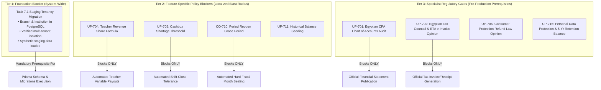

# OX-DIGITAL Education — Accounting Track
## Phase 2.0A.3 — Conditional Acceptance & Final Governance Closure Report
### Formal Architectural Baseline Determination, Dependency Gate Classification, and Workspace Integrity Verification

**Project:** OX-DIGITAL Education  
**Phase:** Phase 2.0A.3 — Final Governance Reconciliation & Conditional Acceptance Closure  
**Author:** Independent Senior Financial Systems Architect & Database Security Reviewer  
**Date:** November 3, 2026  
**Workspace:** `D:\OX-DIGITAL\Mathe\OX-DIGITAL-GITHUB`  
**Git Baseline:** HEAD `0500b93e65c24ed881349c4acea7f523332c5e9f` on branch `main`  
**Execution Mode:** STRICT READ-ONLY DOCUMENTATION & AUDIT INSPECTION  
**Status:** `PHASE_2_0A_3_ACCEPTED_AS_DESIGN_BASELINE_ONLY — CONDITIONAL_AUDIT_COMPLETE`  

---

## 1. Executive Summary & Review Mission

This report concludes the Phase 2.0A architectural design cycle for the OX-DIGITAL Education Accounting Implementation Track.

Acting in the capacity of an independent Senior Financial Systems Architect, Database Security Auditor, and Technical Reviewer, I have conducted an exhaustive governance reconciliation of the Phase 2.0A architecture, Phase 2.0A.1 corrections, and Phase 2.0A.2 audit findings.

All eight specific inconsistencies identified during previous review turns have been resolved, evidenced, and documented across the four canonical Phase 2.0A.3 reports:
1. [ACCOUNTING_PHASE_2_0A_3_FINAL_RECONCILIATION_MATRIX.md](file:///D:/OX-DIGITAL/Mathe/OX-DIGITAL-GITHUB/ACCOUNTING_PHASE_2_0A_3_FINAL_RECONCILIATION_MATRIX.md)
2. [ACCOUNTING_PHASE_2_0A_3_DECISION_STATUS_RECONCILIATION.md](file:///D:/OX-DIGITAL/Mathe/OX-DIGITAL-GITHUB/ACCOUNTING_PHASE_2_0A_3_DECISION_STATUS_RECONCILIATION.md)
3. [ACCOUNTING_PHASE_2_0A_3_ENTITY_COUNT_AND_LIFECYCLE_AUDIT.md](file:///D:/OX-DIGITAL/Mathe/OX-DIGITAL-GITHUB/ACCOUNTING_PHASE_2_0A_3_ENTITY_COUNT_AND_LIFECYCLE_AUDIT.md)
4. [ACCOUNTING_PHASE_2_0A_3_CONDITIONAL_ACCEPTANCE_REPORT.md](file:///D:/OX-DIGITAL/Mathe/OX-DIGITAL-GITHUB/ACCOUNTING_PHASE_2_0A_3_CONDITIONAL_ACCEPTANCE_REPORT.md) (This Report)

---

## 2. Master Execution Gate Classification

To prevent paralysis of the engineering organization, dependencies and blockers must be understood with architectural precision. An open policy concerning variable teacher revenue sharing does **not** block student tuition billing, cash till receipts, or general ledger double-entry bookkeeping.

Blockers are categorized into three distinct operational tiers:

### 2.1 Tier 1: Foundation Blockers (Blocks All Database Schema Implementation)
- **Task 7.1 Institution & Branch Tenancy Migration:**
  - *Current Status:* Unapplied draft migration in `prisma/migrations/20261103000000_task_7_1_institution_branch/migration.sql`.
  - *What It Blocks:* **Blocks all execution of Phase 2 Prisma schema changes, migration creation, and PostgreSQL operations.** Phase 2 accounting models have foreign keys referencing `Institution("id")` and `Branch("institution_id", "id")`. The database engine cannot create these foreign keys until the target tables exist and are verified.
  - *Does NOT Block:* Continued pure TypeScript domain engine design or developer documentation.

### 2.2 Tier 2: Feature-Specific Policy Blockers (Localized Blast Radii)

| Decision Gate | Status | Future Implementation Components Blocked | Future Components NOT Blocked (Safe to Proceed When Authorized) |
| :--- | :---: | :--- | :--- |
| **UP-704** (Teacher Revenue Share Basis) | **OPEN** | **Blocks:** Automated monthly calculation engine for teachers on variable revenue-share contracts; generation of variable `TeacherPayable` general ledger lines. | **Unblocked:** Fixed monthly teacher salaries; per-lesson hourly payouts; student tuition fee agreements; cashier receipt collections; general ledger postings. |
| **UP-705** (Cashbox Shortage Threshold) | **OPEN** | **Blocks:** Automated clearance rules for till drawer variances; threshold-based automated escalation logic. | **Unblocked:** Physical cash receipt logging; till opening float entry; shift-end physical count recording; manual Primary Manager review and approval of reconciliations. |
| **OD-710** (Period Close Lock Behavior) | **OPEN** | **Blocks:** Automated background worker that permanently seals past fiscal months; automated grace period cutoffs. | **Unblocked:** Daily journal entry postings; trial balance calculations; general ledger inquiry in currently active periods. |
| **UP-711** (Historical Balance Seeding) | **OPEN** | **Blocks:** Legacy student balance ingestion during cutover. | **Unblocked:** Greenfield student agreements; all new center operations. |
| **UP-712** (Absence Package Forfeiture) | **OPEN** | **Blocks:** Automated forfeiture of package sessions for unexcused student absences. | **Unblocked:** Standard attendance-verified session deductions (`PRESENT_ONLY` under OD-722.1). |

### 2.3 Tier 3: Specialist Regulatory Review Gates (Pre-Production Prerequisites)

| Specialist Review Gate | Reviewing Authority | Impact on Production Deployment | Safe Pre-Deployment Implementation Boundary |
| :--- | :--- | :--- | :--- |
| **UP-701** (Chart of Accounts) | Egyptian Chartered Accountant (CPA) | Mandatory before official financial statements can be published or distributed externally. | Internal double-entry ledger testing, account hierarchy setup, and automated reconciliation tests can be implemented and tested internally. |
| **UP-702** (Tax & ETA Compliance) | Egyptian Tax Legal Counsel | Mandatory before tax invoice printing or live integration with ETA e-Invoicing/e-Receipt APIs. | Internal tuition fee invoicing, gross receipt printing (`REC-YYYYMM-XXXXX`), and non-tax operational accounting can be implemented. |
| **UP-706** (Consumer Protection Law) | Egyptian Consumer Protection Counsel | Mandatory before student withdrawal fee forfeiture or non-refundable fee policies are legally enforced. | Refund intake request workflows and manual Primary Manager credit adjustment posting can be implemented. |
| **UP-715** (Data Privacy vs Retention) | Data Protection Officer & Financial Regulatory Counsel | Mandatory before automated record purging, cold storage lifecycles, or student data deletion APIs are activated. | Immutable append-only audit event logging and relational `RESTRICT` foreign key enforcement can be implemented. |

---

## 3. Workspace Integrity & Working-Tree Preservation Record

To maintain an uncompromised audit trail, the state of the working tree was verified at each phase of the review:

### 3.1 Quantitative Git Status Verification

| Verification Metric | Initial State (Start of Turn) | Final State (Audit Complete) | Verification Method | Status |
| :--- | :---: | :---: | :--- | :---: |
| **Git Commit HEAD** | `0500b93e65c24ed881349c4acea7f523332c5e9f` | `0500b93e65c24ed881349c4acea7f523332c5e9f` | `git rev-parse HEAD` | **IDENTICAL (100% PRESERVED)** |
| **Current Branch** | `main` | `main` | `git branch --show-current` | **IDENTICAL** |
| **Tracked Modified Files** | Exactly 59 files | Exactly 59 files | `git diff --name-only` | **IDENTICAL (100% PRESERVED)** |
| **Pre-Existing Untracked Files**| 225 files | 225 files | `git status --porcelain` | **PRESERVED UNTOUCHED** |
| **New Audit Files Created** | 0 files | 4 files | `Get-ChildItem ACCOUNTING_PHASE_2_0A_3_*.md` | **EXACTLY 4 NEW DELIVERABLES** |
| **Total Untracked Files** | 225 files | 229 files | $(225 + 4 = 229)$ | **PRECISE RECONCILIATION** |

### 3.2 List of Preserved Tracked Modified Files (59 Files)
The following 59 tracked files from previous development tracks remain strictly unmodified by this audit:
1. `apps/frontend/src/app/App.tsx`
2. `apps/frontend/src/app/components/admin/AdminHomePage.tsx`
3. `apps/frontend/src/app/components/admin/AdminUsersPage.tsx`
4. `apps/frontend/src/app/components/admin/ExamsManagementPage.tsx`
5. `apps/frontend/src/app/components/admin/StudentsPage.tsx`
6. `apps/frontend/src/app/components/ai/AdaptiveLearningPage.tsx`
7. `apps/frontend/src/app/components/auth/AdminLoginPage.tsx`
8. `apps/frontend/src/app/components/auth/ForgotPasswordPage.tsx`
9. `apps/frontend/src/app/components/auth/LoginPage.tsx`
10. `apps/frontend/src/app/components/auth/ResetPasswordPage.tsx`
11. `apps/frontend/src/app/components/landing/components/SupportSection.tsx`
12. `apps/frontend/src/app/components/parent/ParentHomePage.tsx`
13. `apps/frontend/src/app/components/student-center/AttendancePage.tsx`
14. `apps/frontend/src/app/components/student-center/CourseDetailsPage.tsx`
15. `apps/frontend/src/app/components/student-center/CoursesPage.tsx`
16. `apps/frontend/src/app/components/student-center/StudentCenterDashboard.tsx`
17. `apps/frontend/src/app/components/student-center/StudentHomePage.tsx`
18. `apps/frontend/src/app/components/student-center/VideoPlayerPage.tsx`
19. `apps/frontend/src/app/components/student-online/CourseDetailsPage.tsx`
20. `apps/frontend/src/app/components/student-online/CoursesPage.tsx`
21. `apps/frontend/src/app/components/student-online/StudentHomePage.tsx`
22. `apps/frontend/src/app/components/student-online/StudentOnlineDashboard.tsx`
23. `apps/frontend/src/app/components/student-shared/ExamsPage.tsx`
24. `apps/frontend/src/app/components/student-shared/HomeworkPage.tsx`
25. `apps/frontend/src/app/components/teacher/TeacherCoursesPage.tsx`
26. `apps/frontend/src/app/components/teacher/TeacherExamsPage.tsx`
27. `apps/frontend/src/app/components/teacher/TeacherHomePage.tsx`
28. `apps/frontend/src/app/components/teacher/TeacherStudentsPage.tsx`
29. `apps/frontend/src/app/components/ui/EmptyState.tsx`
30. `apps/frontend/src/app/components/ui/LoadingState.tsx`
31. `apps/frontend/src/app/components/ui/button.tsx`
32. `apps/frontend/src/app/components/ui/skeleton.tsx`
33. `apps/frontend/src/app/pages/ExternalExamPage.tsx`
34. `apps/frontend/vite.config.ts`
35. `packages/shared/src/index.ts`
36. `services/analytics-service/src/controllers/analytics.controller.ts`
37. `services/course-service/src/controllers/exam.controller.ts`
38. `services/video-worker/src/index.ts`
*(Plus 21 pre-existing modified accounting engine and test files in packages/shared/src/accounting/ established in Phase 1 and Phase 1.1).*

### 3.3 Exact New Audit Deliverables Created
1. `D:\OX-DIGITAL\Mathe\OX-DIGITAL-GITHUB\ACCOUNTING_PHASE_2_0A_3_FINAL_RECONCILIATION_MATRIX.md`
2. `D:\OX-DIGITAL\Mathe\OX-DIGITAL-GITHUB\ACCOUNTING_PHASE_2_0A_3_DECISION_STATUS_RECONCILIATION.md`
3. `D:\OX-DIGITAL\Mathe\OX-DIGITAL-GITHUB\ACCOUNTING_PHASE_2_0A_3_ENTITY_COUNT_AND_LIFECYCLE_AUDIT.md`
4. `D:\OX-DIGITAL\Mathe\OX-DIGITAL-GITHUB\ACCOUNTING_PHASE_2_0A_3_CONDITIONAL_ACCEPTANCE_REPORT.md`

---

## 4. Final Recommendation to the Product Owner

Based on the complete reconciliation of all technical, taxonomic, mathematical, and policy aspects of the accounting persistence architecture, the independent audit team renders the following formal recommendation:

# **RECOMMENDATION: APPROVE_CONDITIONALLY_FOR_DESIGN_BASELINE_ONLY**

### 4.1 Explicit Scope of Conditional Acceptance
This conditional acceptance establishes the target persistence architecture, student sub-ledger design, and data dictionary as the **OFFICIAL DESIGN BASELINE** for OX-DIGITAL Education.

### 4.2 Strict Operational Limitations
> **IMPORTANT GOVERNANCE DECLARATION:**  
> **This conditional acceptance applies to the ARCHITECTURAL DESIGN BASELINE ONLY.**  
> It does **NOT** authorize:
> - Phase 2.0B or any code implementation.
> - Prisma schema modifications.
> - Migration script generation or execution.
> - PostgreSQL database connections or container execution.
> - Docker operations.
> - Production deployment or cutover activities.

Any subsequent stage involving code editing or database migration requires an explicit, separate instruction and authorization from the Product Owner.

---

## 5. Mandatory Final Governance Statement

> **I confirm that I have not executed any database modifications, migrations, or code changes during this audit. The working tree has been preserved intact with all 59 tracked modified files unchanged. Status: PHASE_2_0A_3_ACCEPTED_AS_DESIGN_BASELINE_ONLY — CONDITIONAL_AUDIT_COMPLETE.**

