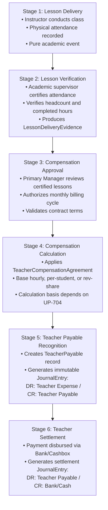

# OX-DIGITAL Education — Accounting Track
## Phase 2.0A.3 — Decision Status & Governance Register Reconciliation
### Full Recalibration of Approved Decisions, Unresolved Operational Policies, and Specialist Review Gates

**Project:** OX-DIGITAL Education  
**Phase:** Phase 2.0A.3 — Final Governance Reconciliation & Conditional Acceptance Closure  
**Author:** Independent Senior Financial Systems Architect & Database Security Reviewer  
**Date:** November 3, 2026  
**Workspace:** `D:\OX-DIGITAL\Mathe\OX-DIGITAL-GITHUB`  
**Git Baseline:** HEAD `0500b93e65c24ed881349c4acea7f523332c5e9f` on branch `main`  
**Execution Mode:** STRICT READ-ONLY DOCUMENTATION & AUDIT INSPECTION  
**Status:** COMPLETE — CANONICAL GOVERNANCE ARTIFACT  

---

## 1. Executive Summary & Objective

Accurate governance tracking is essential to prevent architectural drift. In complex enterprise platforms, confusing commercial subscription rules with educational center operations leads to incorrect data models, invalid constraints, and premature implementation assumptions.

This document formally:
1. **Rectifies Decision OD-726:** Removes the false attribution of the teacher compensation lifecycle to OD-726, re-establishing OD-726's true definition as the Subscription Renewal Model, and separates teacher compensation governance into its six distinct operational sub-stages under UP-704 and educational center operational design.
2. **Deconstructs Decision OD-724:** Disaggregates the Legacy Transition Policy into its approved operational sub-decisions (`OD-724.1` through `OD-724.4`) versus its strictly unresolved platform outage extension rules (`OD-724.5`).
3. **Reconciles the Master Decision Inventory:** Categorizes every decision into Approved Baseline Decisions, Open Technical Policies, and Mandatory Specialist Review Gates.

---

## 2. Decision Reference Correction: The True Scope of OD-726

### 2.1 What OD-726 Actually Governs
Inspection of the canonical decision registers (`PHASE_7_2_PRODUCT_OWNER_DECISIONS_REGISTER_B4.md#L141-L160`, `PHASE_7_2_STAGE_B4_FINAL_WORKSHOP_REPORT.md#L33-L37`) demonstrates that **OD-726 strictly governs Subscription Renewal Models** for digital/online enrollments.

The approved sub-decisions under OD-726 are:
- **`OD-726.1` (Customer Acceptance Policy):** Recurring auto-renewal is permitted **only** with an explicit affirmative opt-in checkbox during customer checkout. Pre-checked boxes or silent auto-renewals are prohibited.
- **`OD-726.2` (Renewal Pricing Rule):** Renewals apply the *current published catalog price* active at the renewal timestamp, rather than grandfathered rates.
- **`OD-726.3` (Early Renewal Service Period):** Early renewals contiguously extend the service period from the previous agreement's expiration date (`endsAt`), ensuring zero lost service days.

### 2.2 Teacher Compensation Is Decoupled from OD-726
**OD-726 has no relationship whatsoever to teacher compensation.**
In the Phase 2.0A.2 audit, the phrase "Teacher Compensation 4-Stage Lifecycle under OD-726" was cited erroneously.

Teacher compensation is an internal operational and financial commitment governed by **UP-704** and educational center management policy. To prevent cross-functional confusion, teacher compensation is decomposed into six distinct operational and accounting stages:

#### Detailed Breakdown of Teacher Compensation Stages:
1. **Lesson Delivery Lifecycle:** The physical conduct of instruction in a physical classroom or designated center branch. Handled by the academic schedule module.
2. **Lesson Verification:** An operational supervisory control where branch administrators verify that instruction took place and certify student headcount, generating immutable `LessonDeliveryEvidence`.
3. **Compensation Approval:** An executive authorization control where the `PRIMARY_MANAGER` reviews verified deliveries for the billing month and approves the generation of teacher compensation statements.
4. **Compensation Calculation:** The algorithmic computation of gross pay. For fixed salary or per-lesson models, calculation is deterministic. For variable revenue sharing, **it is blocked until the Product Owner resolves UP-704**.
5. **Teacher Payable Recognition:** The double-entry general ledger posting that formally creates an institutional liability:
   - Debit: Account `5100` (Teacher Compensation Expense)
   - Credit: Account `2150` (Accrued Teacher Payables)
6. **Teacher Settlement:** The final disbursement of funds to the teacher via electronic bank transfer or cash till payout:
   - Debit: Account `2150` (Accrued Teacher Payables)
   - Credit: Account `1010` (Cashbox) or Account `1020` (Bank Account)

---

## 3. Decision Reference Correction: Deconstruction of OD-724

### 3.1 Approved Transition Sub-Decisions
In the Stage E and Stage B4 baseline registers, four specific transition parameters were provisionally selected and approved:

| Sub-Decision | Parameter | Approved Specification | Architectural & Technical Impact |
| :--- | :--- | :--- | :--- |
| **`OD-724.1`** | **Grace Period Duration** | **`60_DAYS`** | Grandfathered legacy enrollments are granted exactly 60 calendar days of transition access. |
| **`OD-724.2`** | **Grace Period Start Date** | **`INSTITUTION_MIGRATION_DATE`** | Uniform start timestamp synchronized to the official migration activation of the educational center. |
| **`OD-724.3`** | **Expiration Access Behavior** | **`AUTOMATIC_HARD_CUTOFF`** | Access automatically terminates at the 60-day deadline unless a new `SubscriptionAgreement` is active. Dynamic access check `checkLmsAccess` enforces hard cutoff. |
| **`OD-724.4`** | **Unmapped Legacy Records** | **`COLD_ARCHIVE_WITH_MANUAL_REVIEW`** | Ambiguous legacy data is segregated into an inaccessible cold archive. Restoration requires explicit Primary Manager mapping. Zero synthetic accounts created. |

### 3.2 Unresolved Outage Policy Sub-Decision (`OD-724.5`)
While the transition parameters above are approved, the **Outage Policy Extension component remains strictly UNRESOLVED**:

- **Core Dilemma:** The Product Owner indicated that the 60-day grace period should be extended by a duration equal to verified platform outages.
- **Why It Is Unresolved:** The following mandatory governance specifications have not been defined or approved:
  1. **Qualifying Outage Definition:** Does an outage require total platform unavailability across all services, or does severe video streaming degradation / gateway downtime qualify?
  2. **Evidence Standard:** What monitoring data (e.g., Datadog SLA logs, AWS CloudWatch health metrics) serves as the legal and technical standard of proof?
  3. **Calculation Formula:** Is the extension calculated calendar-day-for-calendar-day (e.g., 2 hours downtime = 1 extra day), or minute-for-minute aggregated into whole days?
  4. **Approval & Audit Workflow:** What is the formal workflow for the Primary Manager or System Administrator to submit, audit, and log the extension in `FinancialAuditEvent`?
- **Governance Mandate:** The entire OD-724 policy must **not** be marked as "Fully Approved" until `OD-724.5` is documented, reviewed, and signed off.

---

## 4. Reconciled Master Decision & Governance Inventory

### 4.1 Category A: Approved Baseline Decisions (Foundational)

| Decision ID | Canonical Title | Governance Scope & Principle | Impact on Persistence Architecture |
| :--- | :--- | :--- | :--- |
| **OD-701** | Multi-Tenant Root Boundary | All data, configurations, and ledgers are strictly partitioned by `Institution`. | Mandatory `institutionId` on all 20 tables; composite unique indexes. |
| **OD-702** | Base Currency Policy | Base functional currency is Egyptian Pound (`EGP`); multi-currency supported via ISO-4217. | Currency code on accounts and ledgers; exchange rate snapshotting. |
| **OD-703** | Branch Dimensional Container | Operating campuses are modeled as reporting dimensions under a single institutional GL. | `JournalLine.(dimensionType, branchId)` composite foreign key structure. |
| **OD-718** | Primary Manager Exclusive Authority | Primary Manager holds sole authority over fiscal periods, published pricing, and manual write-offs. | Role guard in domain services; exclusive mutation rights on sensitive models. |
| **OD-719** | Campus Multiplicity Scope | Institutions operate physical campuses and optional online virtual branches. | `Branch.isOnline` boolean; till assignment restricted to physical branches. |
| **OD-723** | Pure Append-Only Versioning | Published prices and journal entries are strictly immutable. Corrections require reversals. | `JournalEntry.reversalOfEntryId`; version increments on agreements. |
| **OD-724.1-4**| Legacy Transition Baseline | 60-day grace period, migration-date start, hard cutoff, and cold archive for unmapped records. | Transition cutoff scheduler; `SubscriptionAgreement.endsAt` computation. |
| **OD-725** | Center-First Implementation Rollout | Accounting architecture prioritizes physical center classroom and cash desk operations first. | Centers prioritized before recurring online digital subscriptions. |
| **OD-726** | Subscription Renewal Model | Explicit opt-in checkbox (`OD-726.1`), current catalog pricing (`OD-726.2`), contiguous extension (`OD-726.3`). | Renewal generator service; `previousAgreementId` linkage. |
| **UP-709** | Frontline Cashier Till Float | Cashiers open shifts with recorded opening float; cashbox reconciled at shift close. | `CashboxTransaction(FLOAT_IN)`; mandatory `CashboxReconciliation`. |
| **UP-714** | Receipt Sequence Numbering | Physical cash receipts numbered sequentially in human-readable format: `REC-YYYYMM-XXXXX`. | `Collection.receiptNumber` unique constraint and sequence generator. |

---

### 4.2 Category B: Unresolved Technical Policies (Feature-Specific Blockers)

| Decision ID | Canonical Title | Open Question & Decision Required | Blast Radius / What It Actually Blocks | Status |
| :--- | :--- | :--- | :--- | :---: |
| **OD-710** | Accounting Period Close Policy | May a closed accounting period ever be reopened, or is closure permanent? What is the grace period? | **Blocks:** Task 7.4 automated period closure and hard sealing. **Does NOT Block:** Normal daily journal posting in open periods. | **OPEN** |
| **OD-724.5** | Outage Extension Governance | What is the qualifying outage definition, evidence standard, and calculation formula? | **Blocks:** Stage D transition extension automation. **Does NOT Block:** Standard 60-day transition access. | **OPEN** |
| **UP-704** | Variable Teacher Revenue Basis | Is variable teacher revenue share computed against: (A) Gross Catalog, (B) Net Agreed Tuition, (C) Recognized Revenue, or (D) Collected Cash? | **Blocks:** Task 7.4 variable teacher statement calculation engine. **Does NOT Block:** Student billing, collections, fixed teacher salaries, or general ledger. | **OPEN** |
| **UP-705** | Cashbox Discrepancy Tolerance | What is the monetary threshold (EGP) requiring mandatory Primary Manager escalation? | **Blocks:** Automated shift clearance rules. **Does NOT Block:** Cashier count logging, till transactions, or manual manager sign-off. | **OPEN** |
| **UP-711** | Opening Balance Seeding | How are pre-system historical student debts/credits ingested into the general ledger? | **Blocks:** Final production cutover & historical data migration. **Does NOT Block:** Greenfield center onboarding or new student agreements. | **OPEN** |
| **UP-712** | Absence Package Consumption | Does an unexcused student absence consume a prepaid package session? | **Blocks:** Automated attendance-to-session consumption rules. **Does NOT Block:** Present attendance consumption (`PRESENT_ONLY`). | **OPEN** |
| **UP-713** | Campus Legal Structure | Are branches independent legal entities or internal operating locations? | **RESOLVED VIA OD-703:** Informational confirmation that branches are internal reporting dimensions under a single GL. | **CLOSED** |

---

### 4.3 Category C: Mandatory Specialist Review Gates (Pre-Production Prerequisites)

| Gate ID | Specialist Role Required | Scope of Statutory Review | Mandatory Deliverable Before Staging/Production |
| :--- | :--- | :--- | :--- |
| **UP-701** | Egyptian Certified Public Accountant (Chartered Accountant / محاسب قانوني) | Audit the 4-digit standardized Chart of Accounts against the Egyptian Uniform Accounting System (نظام المحاسبة الموحد) and Egyptian Accounting Standards (EAS). | Signed Chart of Accounts Audit Certification Report. |
| **UP-702** | Egyptian Tax Legal Counsel / Tax Compliance Specialist | Review Value Added Tax (Law No. 67/2016), withholding tax (خصم وتحصيل), and technical integration readiness for the Egyptian Tax Authority (ETA) e-Invoicing & e-Receipt APIs. | Written Tax Counsel Opinion & Integration Compliance Brief. |
| **UP-706** | Egyptian Consumer Protection Legal Counsel | Review student withdrawal rules, fee forfeiture, and cancellation policies against Egyptian Consumer Protection Law No. 181/2018. | Legal Opinion on Student Contract & Refund Policies. |
| **UP-715** | Data Protection Officer & Financial Regulatory Counsel | Reconcile the mandatory 5-year commercial and tax record retention requirements under Egyptian Commercial Code (Law No. 17/1999) with student right-to-be-forgotten rights under Egyptian Personal Data Protection Law (Law No. 151/2020). | Privacy & Financial Record Retention Balancing Specification. |

---

## 5. Governance Audit Verdict

1. **OD-726 Attribution Corrected:** OD-726 is confirmed as Subscription Renewal Model; teacher compensation is decoupled into its own 6-stage operational model.
2. **OD-724 Status Disaggregated:** Transition access parameters are recognized as approved, while the outage policy extension (`OD-724.5`) remains strictly open.
3. **Decision Blast Radii Clarified:** Open technical policies are localized to their specific functional modules without impeding unrelated accounting tracks.

