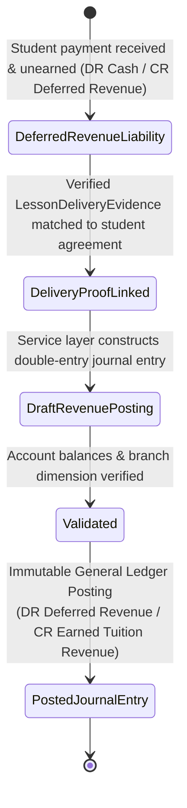
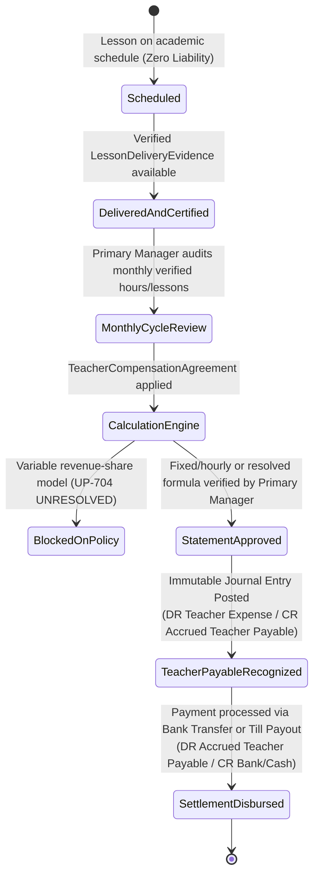

# OX-DIGITAL Education — Accounting Track
## Phase 2.0A.3 — Entity Count, Lifecycle Decomposition & Technical Specifications Audit
### Mathematical Inventory Reconciliation, Decoupled Operational Lifecycles, and Design Constraint Verification

**Project:** OX-DIGITAL Education  
**Phase:** Phase 2.0A.3 — Final Governance Reconciliation & Conditional Acceptance Closure  
**Author:** Independent Senior Financial Systems Architect & Database Security Reviewer  
**Date:** November 3, 2026  
**Workspace:** `D:\OX-DIGITAL\Mathe\OX-DIGITAL-GITHUB`  
**Git Baseline:** HEAD `0500b93e65c24ed881349c4acea7f523332c5e9f` on branch `main`  
**Execution Mode:** STRICT READ-ONLY DOCUMENTATION & AUDIT INSPECTION  
**Status:** COMPLETE — CANONICAL TECHNICAL AUDIT ARTIFACT  

---

## 1. Executive Summary & Objective

In this audit report, three core structural and technical specifications of the accounting persistence design are independently re-examined and verified:
1. **Entity Inventory Reconciliation:** Resolving the arithmetic gap in the Phase 2.0A.2 report ($20+6+2+2 = 30$ vs $32$) and presenting the exact category inventory.
2. **Operational Lifecycle Decomposition:** Formally establishing four independent, decoupled state machine lifecycles to ensure that attendance, session consumption, revenue recognition, and teacher payables are never falsely bound into an automated, irreversible cascade.
3. **Legal Retention & Technical Constraint Verification:** Reassessing statutory retention classifications under UP-715 and clarifying the design-only status of composite foreign keys.

---

## 2. Entity Count & Inventory Reconciliation (32 vs 30 vs 20)

### 2.1 The Source of the Arithmetic Discrepancy
In Phase 2.0A Section 8, a list of **thirty-two logical accounting concepts** was enumerated. In Phase 2.0A.1 (`ACCOUNTING_PHASE_2_0A_1_ERD_ENTITY_RECONCILIATION.md`), all 32 concepts were reconciled in a table.

However, the Phase 2.0A.2 report stated:
> *"20 persisted entities, 6 embedded value objects, 2 self-referential relations, and 2 derived projections."*

This statement created an arithmetic error because $20 + 6 + 2 + 2 = 30$, leaving two items unaccounted for.

### 2.2 Root Cause Analysis
The arithmetic discrepancy occurred because two separate conceptual frameworks were improperly conflated:
1. **Level 1: Distinct Physical Relational Tables (Count: 20)**  
   Defined in `ACCOUNTING_PHASE_2_0A_ERD.md` Section 2:
   - 2 Enhanced Core Tables: `Institution`, `Branch`.
   - 18 New Accounting Tables: `Account`, `AccountingPeriod`, `StudentFinancialAccount`, `StudentFinancialAgreement`, `StudentObligation`, `Collection`, `CollectionAllocation`, `JournalEntry`, `JournalLine`, `FinancialAuditEvent`, `Cashbox`, `CashboxTransaction`, `CashboxReconciliation`, `TeacherCompensationAgreement`, `TeacherPayable`, `LessonDeliveryEvidence`, `SessionPackage`, `RevenueRecognitionEvent`.
2. **Level 2: The 32 Logical Concepts (Count: 32)**  
   Defined in Phase 2.0A Section 8 and mapped in Phase 2.0A.1:
   - Contains **three conceptual aliases** that share physical tables:
     - Concept #7 `PriceCatalog` is physically implemented by the table `GroupPricingAgreement` (Concept #11).
     - Concept #27 `CashboxTransfer` is physically implemented by `CashboxTransaction` (Concept #26) with `tx_type = 'TRANSFER'`.
     - Concept #18 `RefundRequest` is physically implemented by `FinancialAdjustment` (Concept #19) with `adjustment_type = 'REFUND'`.
   - Contains **one external platform mapping**:
     - Concept #2 `InstitutionMember` is physically implemented by the pre-existing core table `User` with `institution_id`.
   - Contains **one dedicated idempotency entity**:
     - Concept #23 `FinancialIdempotencyRecord` (implemented as a unique constraint / dedicated table).
   - Contains **six embedded value objects** (#4 `AccountingDimension`, #8 `PriceCatalogItem`, #9 `PriceVersion`, #13 `AgreementPriceSnapshot`, #14 `PaymentSchedule`, #30 `CompensationPolicyVersion`).
   - Contains **one self-referential relation** (#22 `JournalReversal`).
   - **Crucial Discovery:** The 32 logical concepts in Phase 2.0A Section 8 **did NOT include** `SessionPackage` or `RevenueRecognitionEvent`. Those two physical tables were added in Phase 2.0A Domain 7 to support session-based physical center attendance.

### 2.3 Exact Category Inventory & Mathematical Totals

To permanently eliminate confusion, the exact inventory of the accounting architecture is categorized below:

#### Category 1: Persisted Relational Tables (Total: 20 Physical Tables)
1. `Institution` (Enhanced core table)
2. `Branch` (Enhanced core table)
3. `Account` (Chart of accounts master)
4. `AccountingPeriod` (Fiscal periods)
5. `StudentFinancialAccount` (AR sub-ledger profile)
6. `GroupPricingAgreement` (Group fee catalog & terms)
7. `StudentFinancialAgreement` (Student enrollment contract)
8. `StudentObligation` (Billed fee installments)
9. `Collection` (Cash/POS collection receipts)
10. `CollectionAllocation` (Receipt-to-obligation allocation)
11. `FinancialAdjustment` (Credit notes & refunds)
12. `JournalEntry` (General ledger header)
13. `JournalLine` (Debit/credit ledger lines)
14. `FinancialIdempotencyRecord` (Deduplication record)
15. `FinancialAuditEvent` (Forensic event log)
16. `Cashbox` (Till/vault master)
17. `CashboxTransaction` (Cash movements & transfers)
18. `CashboxReconciliation` (Shift close counts & variance)
19. `TeacherCompensationAgreement` (Teacher contract terms)
20. `TeacherPayable` (Teacher monthly liability)
*(Note: If prepaid session accounting is activated, `LessonDeliveryEvidence`, `SessionPackage`, and `RevenueRecognitionEvent` expand this to 23 tables).*

#### Category 2: Embedded Value Objects (Total: 6 Objects)
1. `AccountingDimension` (Inline `dimension_type` + `branch_id` on `JournalLine`)
2. `PriceCatalogItem` (Inline rate columns on `GroupPricingAgreement`)
3. `PriceVersion` (Immutable version integer on `GroupPricingAgreement`)
4. `AgreementPriceSnapshot` (Frozen agreed rate, discount, and net fee on `StudentFinancialAgreement`)
5. `PaymentSchedule` (Settlement frequency and installment terms on `StudentFinancialAgreement`)
6. `CompensationPolicyVersion` (Version column on `TeacherCompensationAgreement`)

#### Category 3: Self-Referential Relational Attributes (Total: 2 Attributes)
1. `JournalEntry.reversalOfEntryId` (Compensating reversal referencing original entry)
2. `Account.parentId` (Hierarchical chart of accounts parent-child relation)

#### Category 4: Derived Real-Time Projections / Computed Values (Total: 2 Projections)
1. `StudentFinancialAccount.currentBalance` (Computed sum of mature obligations less allocated collections)
2. `Cashbox.currentBalance` (Computed sum of opening float and cash transactions)

#### Category 5: External Core Platform Entities Linked (Total: 4 Core Models)
1. `User` (Mapped for students, cashiers, accountants, and teachers)
2. `CenterGroup` (Physical academic course/class group)
3. `Lesson` (Scheduled timetable session)
4. `Attendance` (Academic student attendance record)

**Mathematical Conclusion:**  
The original count of 32 was a **functional requirements list** that included 3 consolidated table aliases (`PriceCatalog`, `CashboxTransfer`, `RefundRequest`) and core user mappings. When normalized for database implementation, the architecture consists of **20 core persisted tables**, **6 embedded value objects**, **2 self-referential relations**, and **2 derived projections**. No phantom concepts exist.

---

## 3. Evidence Lifecycle Decomposition (Four Decoupled Lifecycles)

To prevent financial misstatement, the architecture strictly decouples academic activities from financial postings. Academic attendance or lesson completion does not automatically create revenue, nor does a scheduled lesson create a payable.

### Lifecycle A: Academic Attendance & Lesson Delivery Evidence
Tracks physical classroom occurrence without triggering general ledger transactions.

```mermaid
stateDiagram-v2
    [*] --> Scheduled: Lesson planned on academic timetable
    Scheduled --> InProgress: Teacher commences physical class
    InProgress --> AttendanceLogged: Teacher records present/absent students
    AttendanceLogged --> PendingVerification: Supervisor reviews physical headcount
    PendingVerification --> Verified: Supervisor signs off headcount
    Verified --> LessonDeliveryEvidenceCreated: Immutable LessonDeliveryEvidence generated
    PendingVerification --> Disputed: Headcount or delivery contested by supervisor
    Disputed --> Cancelled: Lesson ruled unrendered; zero financial evidence created
    LessonDeliveryEvidenceCreated --> [*]
```

*Guarantees:*
- Pure academic attendance remains in the academic module.
- `LessonDeliveryEvidence` is created **only** after supervisor verification.
- Zero financial debits or credits are posted during Lifecycle A.

---

### Lifecycle B: Student Session Entitlement & Consumption
Governs prepaid session packages and attendance deductions without premature revenue recognition.

```mermaid
stateDiagram-v2
    [*] --> PackagePurchased: Student buys prepaid session bundle
    PackagePurchased --> EntitlementActive: Sessions credited (e.g. 10 sessions)
    EntitlementActive --> SessionDeducted: Student attends verified lesson (OD-722.1)
    EntitlementActive --> AbsenceEvaluated: Student absent from verified lesson
    AbsenceEvaluated --> EntitlementActive: Excused absence; zero deduction
    AbsenceEvaluated --> UnexcusedPolicyCheck: Unexcused absence detected
    UnexcusedPolicyCheck --> SessionDeducted: Contract permits forfeiture (UP-712)
    UnexcusedPolicyCheck --> EntitlementActive: Default consumer protection (OD-722.1)
    SessionDeducted --> PackageExhausted: Balance reaches zero sessions
    SessionDeducted --> EntitlementActive: Remaining balance > 0
    PackageExhausted --> [*]
```

*Guarantees:*
- Deducting a session changes student entitlement inventory.
- Preserves **OD-722.1 (`PRESENT_ONLY`)** as default.
- Session consumption does **not** equal general ledger revenue recognition.

---

### Lifecycle C: Revenue Recognition & General Ledger Journal Posting
Converts unearned deferred revenue into earned revenue via verified delivery proof.

*Guarantees:*
- Tuition cash received prior to delivery is held as a **Liability** (Deferred Revenue Account `2210`).
- Earned Revenue (Account `4100`) is recognized **only** upon valid pairing of verified `LessonDeliveryEvidence` with active student agreements.
- Every revenue recognition event generates an immutable, balanced `JournalEntry`.

---

### Lifecycle D: Teacher Compensation Evidence, Approval, Payable, and Settlement
Governs the creation and settlement of institutional liabilities owed to instructional faculty.

*Guarantees:*
- Scheduled lessons **never** create financial liabilities.
- Primary Manager review and approval is a mandatory control before payable recognition.
- UP-704 variable revenue calculations are strictly halted until explicit Product Owner resolution.

---

## 4. Legal Retention Claim Reassessment (UP-715)

### 4.1 Independent Legal Determination Boundary
In Phase 2.0A.2, Section 2.1 asserted that deleting academic attendance "violates Egyptian commercial law, tax audit standards, and GAAP/IFRS record-keeping mandates" and claimed that the persistence architecture "ensures compliance with a statutory 5-year retention period under Egyptian Commercial Code Law No. 17/1999".

**Audited Correction:**
- The software engineering team and technical reviewers are **not authorized to make binding Egyptian legal determinations**.
- A software database schema cannot, by itself, "guarantee statutory compliance." Technical mechanisms (such as `ON DELETE RESTRICT` and append-only audit tables) provide the *relational capability* for data retention, but legal compliance requires documented operational procedures, regulatory filings, and certified institutional policies.

### 4.2 Formal Classification of the 5-Year Retention Standard

| Category | Classification Level | Applicable Authority / Context | Status in Project |
| :--- | :--- | :--- | :---: |
| **5-Year Commercial Retention** | **Proposed Internal Retention Policy Baseline** | Technical capacity planning baseline based on Egyptian Commercial Code Law No. 17/1999 (Article 26) standards for commercial books. | **ACCEPTED FOR CAPACITY PLANNING ONLY** |
| **Tax Audit Record Retention** | **Specialist-Review Requirement (UP-702 / UP-715)** | Subject to formal opinion from qualified Egyptian Tax Legal Counsel under VAT Law No. 67/2016 and Unified Tax Procedures Law No. 206/2020. | **OPEN SPECIALIST GATE** |
| **Student Privacy vs Retention** | **Specialist-Review Requirement (UP-715)** | Legal reconciliation between financial record keeping and Right-to-be-Forgotten under Egyptian Personal Data Protection Law No. 151/2020. | **OPEN SPECIALIST GATE** |
| **Standalone Database Compliance Claim** | **UNSUPPORTED CLAIM (FORMALLY WITHDRAWN)** | The claim that the database schema alone guarantees legal compliance is withdrawn. | **WITHDRAWN** |

---

## 5. Composite Foreign Key Technical Reality & Requirements

### 5.1 Design Specification vs Implemented Reality
The Phase 2.0A.2 audit approved Option A for dimension integrity. It is critical to state:
- **`fk_journal_line_branch_tenant` is a DESIGN SPECIFICATION ONLY.**
- It has **not** been executed against PostgreSQL, nor tested in the physical database.
- It is blocked from implementation until Task 7.1 Staging migrations are applied.

### 5.2 Mandatory Technical Requirements for Implementation
When authorized, the composite foreign key architecture must enforce:
1. **Ownership Consistency:** `JournalLine(institution_id, branch_id)` references `Branch(institution_id, id)`. It is mathematically impossible for a journal line in Institution A to reference a branch belonging to Institution B.
2. **Explicit Head Office Representation:** When `dimension_type = 'HEAD_OFFICE'`, `branch_id` must be NULL. Standard ANSI SQL foreign key `MATCH SIMPLE` rules treat `(institution_id, NULL)` as satisfied, while table check constraint `chk_journal_line_dimension_safety` verifies that `branch_id IS NULL`.
3. **Campus Multiplicity Distinction:** `Branch.isOnline` distinguishes physical educational campuses from online delivery branches. Till registers (`Cashbox`) are restricted strictly to physical branches.
4. **Restrictive Deletion:** The constraint specifies `ON DELETE RESTRICT`. A branch cannot be deleted while ledger lines reference it.
5. **Posting-Time Validation:** The TypeScript accounting service must verify that `branch.status == 'ACTIVE'` prior to accepting posting requests.

### 5.3 Criteria for a Dedicated `AccountingDimension` Table
A dedicated polymorphic `AccountingDimension` table is **not required** for the physical educational center scope.
A dedicated entity would only become necessary if:
- The Product Owner introduces multi-dimensional accounting beyond physical branches (e.g., Cost Centers, Academic Departments, Capital Projects, or External Grants) that have independent lifecycles and hierarchies unrelated to `Branch`.
- For the approved center-first scope, Option A provides complete integrity with zero relational overhead.

---

## 6. Audit Verdict

1. **Entity Inventory:** Reconciled with mathematical precision (20 physical tables, 6 embedded value objects, 2 self-referential relations, 2 derived projections).
2. **Lifecycles Decoupled:** Four independent state machine models formally separated; no unauthorized auto-postings.
3. **Legal Retention Bound:** Classified as internal baseline and specialist review requirement (UP-715).
4. **Foreign Key Specification:** Confirmed as an approved design specification pending Task 7.1 implementation.

