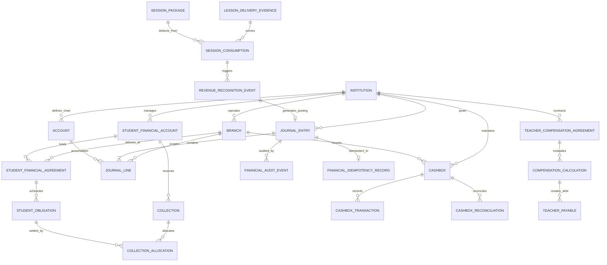

# OX-DIGITAL Education — Accounting Track
# Phase 2.0A: Target Entity-Relationship Diagram & Data Dictionary

**Author:** Senior Principal Database Architect & Data Modeler  
**Project:** OX-DIGITAL Education  
**Document Classification:** Complete Enterprise Entity-Relationship Architecture (Design-Only Blueprint)  
**Baseline Commit:** `0500b93e65c24ed881349c4acea7f523332c5e9f` on branch `main`  
**Date:** November 3, 2026

---

## 1. Enterprise Entity-Relationship Overview

---

## 2. Comprehensive Data Dictionary by Logical Domain

### Domain 1: Institution & Organization

#### 1. `Institution` (Existing Model Enhanced)
- **Purpose:** Root multi-tenant boundary for legal and financial accounting.
- **Key Fields:** `id (UUID)`, `name (VARCHAR 255)`, `code (VARCHAR 100 UNIQUE)`, `status (ENUM)`, `primaryManagerId (UUID UNIQUE)`, `createdAt (TIMESTAMPTZ)`.
- **Tenant Key:** Self (`id`).
- **Delete Policy:** `RESTRICT`. Tenant roots are never deleted while financial records exist.
- **Immutability:** Mutable operational status; code and primaryManagerId governed by OD-701/OD-718.

#### 2. `Branch` (Existing Model Enhanced)
- **Purpose:** Campus operating unit and dimensional reporting container.
- **Key Fields:** `id (UUID)`, `institutionId (UUID FK)`, `name (VARCHAR 255)`, `code (VARCHAR 100)`, `isOnline (BOOLEAN)`, `status (ENUM)`.
- **Tenant Key:** `institutionId`.
- **Delete Policy:** `RESTRICT`.
- **Immutability:** Mutable address/name; historical code immutable.

---

### Domain 2: Financial Master Data

#### 3. `Account` (Proposed Model)
- **Purpose:** General Ledger Chart of Accounts master definition.
- **Key Fields:** `id (UUID)`, `institutionId (UUID FK)`, `code (VARCHAR 50)`, `name (VARCHAR 255)`, `category (ENUM: ASSET, LIABILITY, EQUITY, REVENUE, EXPENSE)`, `normalBalance (ENUM: DEBIT, CREDIT)`, `parentId (UUID NULL FK)`, `isPostable (BOOLEAN)`, `isActive (BOOLEAN)`.
- **Tenant Key:** `institutionId`.
- **Unique Constraint:** `(institutionId, code)`.
- **Delete Policy:** `RESTRICT`. Accounts with posted journal lines cannot be deleted.

#### 4. `AccountingPeriod` (Proposed Model)
- **Purpose:** Fiscal calendar tracking and period closure management (OD-710).
- **Key Fields:** `id (UUID)`, `institutionId (UUID FK)`, `fiscalYear (INT)`, `periodNumber (INT: 1..12)`, `startDate (DATE)`, `endDate (DATE)`, `status (ENUM: OPEN, CLOSED, SEALED)`.
- **Tenant Key:** `institutionId`.
- **Unique Constraint:** `(institutionId, fiscalYear, periodNumber)`.
- **Delete Policy:** `RESTRICT`.

---

### Domain 3: Student Finance & Sub-Ledger

#### 5. `StudentFinancialAccount` (Proposed Model)
- **Purpose:** Master student accounts receivable sub-ledger profile.
- **Key Fields:** `id (UUID)`, `institutionId (UUID FK)`, `studentId (UUID FK to User)`, `currentBalance (DECIMAL 12,2)`, `currency (VARCHAR 3: 'EGP')`.
- **Tenant Key:** `institutionId`.
- **Unique Constraint:** `(institutionId, studentId)`.
- **Delete Policy:** `RESTRICT`. Student account cannot be deleted if transactions exist.

#### 6. `StudentFinancialAgreement` (Proposed Model)
- **Purpose:** Contractual tuition commitment and pricing snapshot.
- **Key Fields:** `id (UUID)`, `institutionId (UUID FK)`, `accountId (UUID FK)`, `studentId (UUID FK)`, `centerGroupId (UUID FK)`, `branchId (UUID FK)`, `pricingMethod (VARCHAR 50)`, `finalAgreedAmount (DECIMAL 12,2)`, `status (VARCHAR 50)`.
- **Tenant Key:** `institutionId`.
- **Delete Policy:** `RESTRICT`.

#### 7. `StudentObligation` (Proposed Model)
- **Purpose:** Individual mature fee charge / scheduled due amount (نظام السداد).
- **Key Fields:** `id (UUID)`, `institutionId (UUID FK)`, `agreementId (UUID FK)`, `studentId (UUID FK)`, `dueDate (DATE)`, `amountDue (DECIMAL 12,2)`, `amountCollected (DECIMAL 12,2)`, `status (VARCHAR 50)`.
- **Tenant Key:** `institutionId`.
- **Delete Policy:** `RESTRICT`.

#### 8. `Collection` (Proposed Model)
- **Purpose:** Physical collection receipt issued at center reception desk.
- **Key Fields:** `id (UUID)`, `institutionId (UUID FK)`, `branchId (UUID FK)`, `studentId (UUID FK)`, `receiptNumber (VARCHAR 64 UNIQUE)`, `amount (DECIMAL 12,2)`, `paymentMethod (VARCHAR 50)`, `collectedBy (VARCHAR 64)`.
- **Tenant Key:** `institutionId`.
- **Delete Policy:** `RESTRICT`.
- **Immutability:** Append-only. Receipts are immutable once printed. Reversals require credit adjustments.

#### 9. `CollectionAllocation` (Proposed Model)
- **Purpose:** Maps received cash collections to specific mature student obligations.
- **Key Fields:** `id (UUID)`, `institutionId (UUID FK)`, `collectionId (UUID FK)`, `obligationId (UUID FK)`, `allocatedAmount (DECIMAL 12,2)`.
- **Tenant Key:** `institutionId`.
- **Delete Policy:** `RESTRICT`.

---

### Domain 4: General Ledger Accounting (OD-723 Append-Only)

#### 10. `JournalEntry` (Proposed Model)
- **Purpose:** Immutable double-entry general ledger journal header.
- **Key Fields:** `id (UUID)`, `institutionId (UUID FK)`, `transactionDate (TIMESTAMPTZ)`, `accountingDate (DATE)`, `currency (VARCHAR 3)`, `status (ENUM: DRAFT, VALIDATED, POSTED)`, `reversalOfEntryId (UUID UNIQUE NULL FK)`, `idempotencyKey (VARCHAR 128 UNIQUE NULL)`.
- **Tenant Key:** `institutionId`.
- **Delete Policy:** `RESTRICT` (Blocked by PostgreSQL triggers once in `POSTED` status).
- **Immutability:** Strictly append-only.

#### 11. `JournalLine` (Proposed Model)
- **Purpose:** Individual debit or credit line tagged with an explicit accounting dimension (Correction D).
- **Key Fields:** `id (UUID)`, `entryId (UUID FK)`, `institutionId (UUID FK)`, `accountId (UUID FK)`, `dimensionType (ENUM: HEAD_OFFICE, BRANCH)`, `branchId (UUID NULL FK: Required if dimensionType=BRANCH; Strictly NULL if dimensionType=HEAD_OFFICE)`, `debit (DECIMAL 14,2)`, `credit (DECIMAL 14,2)`.
- **Tenant Key:** `institutionId`.
- **Integrity Constraints:** Database check constraint `chk_journal_line_dimension_safety CHECK ((dimension_type = 'HEAD_OFFICE' AND branch_id IS NULL) OR (dimension_type = 'BRANCH' AND branch_id IS NOT NULL))`.
- **Delete Policy:** `RESTRICT` (Blocked by trigger if parent entry is `POSTED`).

#### 12. `FinancialAuditEvent` (Proposed Model)
- **Purpose:** Immutable forensic audit event trail (OD-708).
- **Key Fields:** `id (UUID)`, `institutionId (UUID FK)`, `entryId (UUID FK)`, `eventType (VARCHAR 50)`, `actorId (VARCHAR 64)`, `timestamp (TIMESTAMPTZ)`, `details (JSONB)`.
- **Tenant Key:** `institutionId`.
- **Delete Policy:** `RESTRICT`. Audit rows cannot be updated or deleted.

---

### Domain 5: Cash Management & Cashboxes

#### 13. `Cashbox` (Proposed Model)
- **Purpose:** Physical cash till or campus vault.
- **Key Fields:** `id (UUID)`, `institutionId (UUID FK)`, `branchId (UUID FK)`, `code (VARCHAR 50)`, `name (VARCHAR 255)`, `cashboxType (ENUM: TILL, VAULT, PETTY_CASH)`, `currentBalance (DECIMAL 12,2)`.
- **Tenant Key:** `institutionId`.
- **Delete Policy:** `RESTRICT`.

#### 14. `CashboxTransaction` (Proposed Model)
- **Purpose:** Individual movement of cash in or out of a specific till.
- **Key Fields:** `id (UUID)`, `institutionId (UUID FK)`, `cashboxId (UUID FK)`, `txType (ENUM: FLOAT_IN, COLLECTION_IN, EXPENSE_OUT, TRANSFER_OUT, TRANSFER_IN, SHORTAGE_ADJ)`, `amount (DECIMAL 12,2)`, `performedBy (VARCHAR 64)`.
- **Tenant Key:** `institutionId`.
- **Delete Policy:** `RESTRICT`.

#### 15. `CashboxReconciliation` (Proposed Model)
- **Purpose:** End-of-shift physical cash count, recorded discrepancy tracking, and managerial approval (UP-705, Correction C).
- **Key Fields:** `id (UUID)`, `institutionId (UUID FK)`, `cashboxId (UUID FK)`, `shiftDate (DATE)`, `openingFloat (DECIMAL 12,2)`, `systemExpectedBalance (DECIMAL 12,2)`, `physicalCountedBalance (DECIMAL 12,2)`, `varianceAmount (DECIMAL 12,2)`, `reconciliationStatus (ENUM: BALANCED, DISCREPANCY_PENDING, APPROVED, INVESTIGATING)`, `approvedBy (VARCHAR 64 NULL)`.
- **Tenant Key:** `institutionId`.
- **Policy Gate:** Shortage/surplus threshold is completely UNRESOLVED under UP-705. No default threshold assumed.
- **Delete Policy:** `RESTRICT`.

---

### Domain 6: Teacher Compensation Sub-Ledger

#### 16. `TeacherCompensationAgreement` (Proposed Model)
- **Purpose:** Contractual compensation terms between institution and teacher (Correction B).
- **Key Fields:** `id (UUID)`, `institutionId (UUID FK)`, `teacherId (UUID FK)`, `compensationModel (ENUM: SALARY, PER_LESSON, PER_STUDENT, REVENUE_SHARE, HYBRID)`, `baseRate (DECIMAL 12,2)`, `sharePercentage (DECIMAL 5,2 NULL)`, `calculationBasis (VARCHAR 50 NULL)`.
- **Tenant Key:** `institutionId`.
- **Policy Gate:** Qualifying calculation basis for variable revenue share is completely UNRESOLVED under UP-704. No default selected.
- **Delete Policy:** `RESTRICT`.

#### 17. `TeacherPayable` (Proposed Model)
- **Purpose:** Approved monthly compensation obligation payable to the teacher.
- **Key Fields:** `id (UUID)`, `institutionId (UUID FK)`, `teacherId (UUID FK)`, `periodMonth (VARCHAR 7: '2026-11')`, `grossPayable (DECIMAL 12,2)`, `deductions (DECIMAL 12,2)`, `netPayable (DECIMAL 12,2)`, `status (ENUM: DRAFT, APPROVED, SETTLED)`.
- **Tenant Key:** `institutionId`.
- **Delete Policy:** `RESTRICT`.

---

### Domain 7: Service Delivery Evidence & Revenue Recognition

#### 18. `LessonDeliveryEvidence` (Proposed Model)
- **Purpose:** Operational confirmation of completed classroom instruction.
- **Key Fields:** `id (UUID)`, `institutionId (UUID FK)`, `branchId (UUID FK)`, `centerGroupId (UUID FK)`, `lessonId (UUID NULL FK)`, `deliveryDate (DATE)`, `verifiedHeadcount (INT)`, `teacherId (UUID FK)`.
- **Tenant Key:** `institutionId`.
- **Delete Policy:** `RESTRICT`.

#### 19. `SessionPackage` (Proposed Model)
- **Purpose:** Prepaid multi-session package ledger (OD-706, OD-722).
- **Key Fields:** `id (UUID)`, `institutionId (UUID FK)`, `studentId (UUID FK)`, `agreementId (UUID FK)`, `totalSessions (INT)`, `consumedSessions (INT @default(0))`, `perSessionRate (DECIMAL 12,2)`, `expiresAt (DATE)`.
- **Tenant Key:** `institutionId`.
- **Delete Policy:** `RESTRICT`.

#### 20. `RevenueRecognitionEvent` (Proposed Model)
- **Purpose:** Financial event linking verified attendance to earned general ledger revenue.
- **Key Fields:** `id (UUID)`, `institutionId (UUID FK)`, `branchId (UUID FK)`, `studentId (UUID FK)`, `deliveryEvidenceId (UUID FK)`, `recognizedAmount (DECIMAL 12,2)`, `journalEntryId (UUID UNIQUE FK)`.
- **Tenant Key:** `institutionId`.
- **Delete Policy:** `RESTRICT`.

