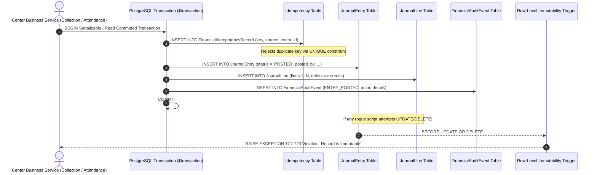

# OX-DIGITAL Education — Accounting Track
# Phase 2.0A: General Ledger Journal & Idempotency Persistence Architecture

**Author:** Senior Database Architect & Systems Reliability Engineer  
**Project:** OX-DIGITAL Education  
**Document Classification:** Technical Architecture & Concurrency Contract (Design-Only Blueprint)  
**Baseline Commit:** `0500b93e65c24ed881349c4acea7f523332c5e9f` on branch `main`  
**Date:** November 3, 2026

---

## 1. Executive Purpose & General Ledger Immutability (OD-723)

Under **OD-723**, the general ledger is an immutable, append-only chronological record of financial events. Once a journal entry is posted, it represents a permanent legal and historical fact.

Application-level checks (e.g., in TypeScript) are necessary but insufficient for enterprise financial integrity. Database persistence must enforce immutability, idempotency, and concurrency safety at the PostgreSQL storage engine level.



---

## 2. Database-Level Invariant Enforcement Mechanisms

### 2.1 Pure Append-Only Triggers (PostgreSQL PL/pgSQL)
Application code bugs, manual DBA queries, or rogue migration scripts must be blocked from modifying posted records:
```sql
-- 1. Enforce JournalEntry Immutability
CREATE OR REPLACE FUNCTION trg_enforce_journal_entry_immutability()
RETURNS TRIGGER AS $$
BEGIN
    IF OLD.status = 'POSTED' THEN
        RAISE EXCEPTION 'OD-723 Security Invariant: Posted general ledger entry % cannot be modified or deleted.', OLD.id
            USING ERRCODE = '23505'; -- Unique/Integrity Violation
    END IF;
    RETURN NEW;
END;
$$ LANGUAGE plpgsql;

CREATE TRIGGER trg_protect_posted_journal_entry
BEFORE UPDATE OR DELETE ON "JournalEntry"
FOR EACH ROW EXECUTE FUNCTION trg_enforce_journal_entry_immutability();

-- 2. Enforce JournalLine Immutability
CREATE OR REPLACE FUNCTION trg_enforce_journal_line_immutability()
RETURNS TRIGGER AS $$
DECLARE
    entry_status VARCHAR(20);
BEGIN
    SELECT status INTO entry_status FROM "JournalEntry" WHERE id = OLD.entry_id;
    IF entry_status = 'POSTED' THEN
        RAISE EXCEPTION 'OD-723 Security Invariant: Journal lines belonging to posted entry % cannot be modified or deleted.', OLD.entry_id
            USING ERRCODE = '23505';
    END IF;
    RETURN NEW;
END;
$$ LANGUAGE plpgsql;

CREATE TRIGGER trg_protect_posted_journal_lines
BEFORE UPDATE OR DELETE ON "JournalLine"
FOR EACH ROW EXECUTE FUNCTION trg_enforce_journal_line_immutability();
```

### 2.2 Reversal Lineage & Partial Unique Indexes
To guarantee that a posted journal entry can have **at most one** active reversal entry:
```sql
-- Guarantees that reversal_of_entry_id cannot be duplicated across multiple reversal entries:
CREATE UNIQUE INDEX unq_active_journal_reversal
ON "JournalEntry" (institution_id, reversal_of_entry_id)
WHERE reversal_of_entry_id IS NOT NULL;
```
If two cashiers simultaneously click "Reverse" on the same journal entry, PostgreSQL rejects the second insertion with a unique constraint violation (`23505`), preventing duplicate compensating transactions.

### 2.3 Explicit Dimension Integrity & Head Office Safety (Correction D)
To prevent `branch_id = NULL` from ambiguously representing a missing branch or bypassing validation:
```sql
-- Enforces that NULL branchId is strictly valid ONLY for explicit HEAD_OFFICE dimensions:
ALTER TABLE "JournalLine" ADD CONSTRAINT chk_journal_line_dimension_safety CHECK (
  (dimension_type = 'HEAD_OFFICE' AND branch_id IS NULL) OR
  (dimension_type = 'BRANCH' AND branch_id IS NOT NULL)
);
```

---

## 3. Distributed Idempotency & Source-Event Deduplication

In modern web systems, network retries, timeout reconnections, or rapid button clicks can dispatch identical API requests multiple times. To guarantee **exactly-once accounting execution**:

```prisma
// PROPOSED TARGET MODEL (DESIGN-ONLY):
model FinancialIdempotencyRecord {
  id              String      @id @default(uuid())
  institutionId   String
  idempotencyKey  String      @unique @db.VarChar(128)
  sourceEventType String      @db.VarChar(64) // STUDENT_COLLECTION, REVENUE_RECOGNITION, CASHBOX_TRANSFER
  sourceEntityId  String      @db.VarChar(64) // e.g. collectionId, attendanceId
  journalEntryId  String      @unique @db.VarChar(64)
  createdAt       DateTime    @default(now()) @db.Timestamptz(3)

  institution     Institution @relation(fields: [institutionId], references: [id], onDelete: Restrict)

  @@index([institutionId, sourceEventType, sourceEntityId])
}
```

### 3.1 Deterministic Idempotency Key Generation
Keys are constructed deterministically from source operational events:
- For Student Collection: `IDEM_COLL_${collectionId}`
- For Session Revenue: `IDEM_REV_${attendanceId}_${sessionDate}`
- For Daily Cashbox Closing: `IDEM_CASHBOX_CLOSE_${cashboxId}_${date}`

When an operation executes within a Prisma transaction (`db.$transaction`), it attempts to write the `FinancialIdempotencyRecord`. If a record with that key already exists, the database rejects the duplicate transaction atomically, and the service returns the existing journal entry without duplicating postings.

---

## 4. Transaction Boundaries & Atomic All-or-Nothing Posting

Posting financial entries into the database must encompass four atomic operations within a single database transaction:

```typescript
// PHASE 2 TARGET SERVICE WORKFLOW (DESIGN BLUEPRINT):
export async function postFinancialEventToLedger(
  tx: PrismaTransactionClient,
  institutionId: string,
  idempotencyKey: string,
  entryProps: JournalEntryProps,
  lines: JournalLineProps[],
  auditDetails: Record<string, any>
): Promise<string> {
  // 1. Verify and record Idempotency
  await tx.financialIdempotencyRecord.create({
    data: {
      institutionId,
      idempotencyKey,
      sourceEventType: auditDetails.sourceEventType,
      sourceEntityId: auditDetails.sourceEntityId,
      journalEntryId: entryProps.id
    }
  });

  // 2. Validate double-entry equality (Debit == Credit)
  const totalDebit = lines.reduce((acc, l) => acc + Number(l.debit), 0);
  const totalCredit = lines.reduce((acc, l) => acc + Number(l.credit), 0);
  if (Math.abs(totalDebit - totalCredit) > 0.001) {
    throw new UnbalancedJournalEntryError(totalDebit.toFixed(2), totalCredit.toFixed(2));
  }

  // 3. Insert Journal Entry (POSTED status)
  const entry = await tx.journalEntry.create({
    data: {
      id: entryProps.id,
      institutionId,
      transactionDate: entryProps.transactionDate,
      accountingDate: entryProps.accountingDate,
      currency: 'EGP',
      description: entryProps.description,
      status: 'POSTED',
      referenceId: entryProps.referenceId,
      reversalOfEntryId: entryProps.reversalOfEntryId,
      createdBy: entryProps.createdBy,
      postedBy: entryProps.createdBy,
      postedAt: new Date()
    }
  });

  // 4. Batch Insert Journal Lines with Explicit Dimension Discriminator
  await tx.journalLine.createMany({
    data: lines.map(line => ({
      id: line.id,
      entryId: entry.id,
      institutionId,
      accountId: line.accountId,
      dimensionType: line.branchId ? 'BRANCH' : 'HEAD_OFFICE',
      branchId: line.branchId || null, // NULL is valid strictly when dimensionType === 'HEAD_OFFICE'
      debit: line.debit,
      credit: line.credit,
      description: line.description
    }))
  });

  // 5. Append-Only Financial Audit Event
  await tx.financialAuditEvent.create({
    data: {
      institutionId,
      entryId: entry.id,
      eventType: 'ENTRY_POSTED',
      actorId: entryProps.createdBy,
      details: auditDetails
    }
  });

  return entry.id;
}
```

---

## 5. Source of Truth & Controlled Account Balances

### 5.1 The Immutable Journal as the Sole Authority
In this architecture, **the immutable general ledger journal lines are the ultimate mathematical source of truth**.
Account balances are derived by aggregating posted journal lines:
$$\text{Balance}(\text{AccountId}) = \sum \text{Debits} - \sum \text{Credits}$$

### 5.2 Materialized Read Projections (Performance Optimization)
For real-time operational reporting (e.g., student balance on cashier collection screen):
- Read projections (such as `StudentFinancialAccount.currentBalance`) are maintained as **cached summaries**.
- In the event of any cache inconsistency, an audit script can recompute balances from zero by summing raw immutable journal lines, ensuring complete self-healing capability.

