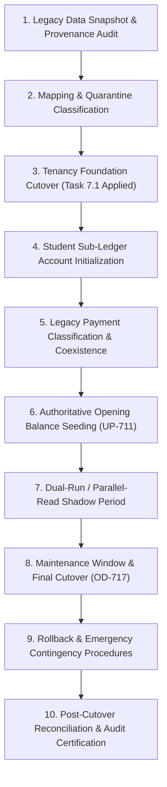

# OX-DIGITAL Education — Accounting Track
# Phase 2.0A: Migration & Legacy Coexistence Strategy

**Author:** Principal Migration Architect & Release Engineer  
**Project:** OX-DIGITAL Education  
**Document Classification:** Cutover Strategy & Data Coexistence Protocol (Design-Only Blueprint)  
**Baseline Commit:** `0500b93e65c24ed881349c4acea7f523332c5e9f` on branch `main`  
**Date:** November 3, 2026

---

## 1. Executive Migration Governance & Baseline Reality

Transitioning to enterprise double-entry accounting in OX-DIGITAL Education requires an evidence-based migration and coexistence protocol that guarantees zero data loss (OD-708) and avoids disruption to existing students and teachers.

### 1.1 Verified Current Prerequisites State
1. **Task 7.1 Migration Status:**
   - Migration `20261102_task_7_1_institution_branch_foundation` is **drafted** in source code, but **has not been applied** to the live production database.
   - Tenancy backfill (`scripts/backfill_task_7_1_tenancy.ts`) has only been simulated via in-memory regression tests (`tests/task_7_1/backfill_simulation.test.ts`).
2. **Authoritative Backfill Policy (OD-716 & OD-717):**
   - Under OD-716, Alternative B (**Authoritative Full Offline Backfill**) was selected.
   - Execution occurs during a scheduled maintenance window (OD-717), benchmarked in staging prior to production cutover.
3. **No Synthetic Entities (OD-724.4):**
   - Unmapped legacy records that cannot be proven to belong to an institution or branch are routed to **Quarantine / Cold Archival (OD-720)**; synthetic placeholder institutions or fake branches must **NEVER** be created.
4. **Opening Balance Invariant (UP-711):**
   - Opening general ledger balances must **NOT** be invented or synthesized by engineering. They require formal sign-off by the institution's Primary Manager and external auditor prior to ledger opening entries.

---

## 2. Ten-Stage Phased Migration & Coexistence Roadmap

### Stage 1: Legacy Data Snapshot & Provenance Audit
- Prior to touching the database, take a point-in-time snapshot of:
  - `User` table (count, roles, centerGroupId).
  - `CenterGroup` table.
  - `Payment` table (preserve all historical payment IDs under OD-708).
  - `Attendance` records.
- Compute SHA-256 integrity checksums across the entire dataset.

### Stage 2: Mapping & Quarantine Classification
- Evaluate each student and center group against the approved `mapping.json` rules:
  - Users with explicit branch assignments map to the authoritative `Institution` and `Branch`.
  - Unmapped legacy users or abandoned courses route to Quarantine Cold Storage without synthetic defaults (OD-724.4).

### Stage 3: Tenancy Foundation Cutover (Task 7.1)
- Apply the drafted Task 7.1 migration (`Institution`, `Branch`, `PrimaryManagerInvitation`).
- Execute `scripts/backfill_task_7_1_tenancy.ts` in production during the scheduled offline window.
- Verify Primary Manager Option 3B invitation issuance.

### Stage 4: Student Sub-Ledger Account Initialization
- Instantiate a `StudentFinancialAccount` for each active center student (`role = 'CENTER_STUDENT'`).
- Populate `StudentGroupMembershipHistory` linking the student to their current `centerGroupId` with `startDate = User.createdAt`.

### Stage 5: Legacy Payment Classification & Coexistence
- **The Coexistence Principle:** Historical `Payment` rows represent online course gateway purchases (Paymob/Stripe). They must **NOT** be converted or forced into center tuition receipts.
- **Handling Strategy:**
  - Existing `Payment` table remains operational for legacy digital course purchases.
  - New physical center collections are written exclusively to the new `Collection` table with tamper-evident receipt numbers.
  - Both tables coexist safely during the transition period.

### Stage 6: Authoritative Opening Balance Seeding (UP-711)
- If an educational center has pre-existing historical student balances (arrears or prepayments):
  - Primary Manager provides a verified Opening Balance Schedule.
  - An initial `JournalEntry` is posted with description: `"OPENING BALANCE SEEDING AS OF CUTOVER DATE"`.
  - Debits/Credits offset against `Account(3000) - Opening Equity Balance`.
  - Zero synthetic balances are invented by automated scripts.

### Stage 7: Dual-Run / Parallel-Read Shadow Period
- For a defined operational window (e.g., 14 calendar days):
  - Frontline receptionists use the new Cashier Workspace to issue physical receipts.
  - Background shadow monitors verify that `sum(Collection.amount) === sum(JournalLine(1010).debit)`.
  - Read queries compare sub-ledger balances against physical cash counts.

### Stage 8: Maintenance Window & Final Cutover (OD-717)
- System enters maintenance mode.
- Final sync of active enrollment manifests.
- Sealing of legacy direct status updates.
- Activation of general ledger immutability triggers (`trg_protect_posted_journal_entry`).

### Stage 9: Rollback & Recovery Contingency Protocol
- If a catastrophic integrity failure occurs during cutover:
  1. Abort transaction.
  2. Restore database to pre-migration physical backup snapshot.
  3. Re-enable standard legacy service controllers.
  4. Post-mortem log created in `ACCOUNTING_ROLLBACK_INCIDENT_REPORT.md`.

### Stage 10: Post-Cutover Reconciliation & Audit Certification
- Run comprehensive reconciliation script checking:
  - Exact Primary Key Set Equality across all Users, Courses, and Payments.
  - Zero deletion verification (OD-708).
  - General Ledger Trial Balance equality ($\sum \text{Debits} \equiv \sum \text{Credits}$).
  - Issue formal Cutover Certificate signed by the Primary Manager.

