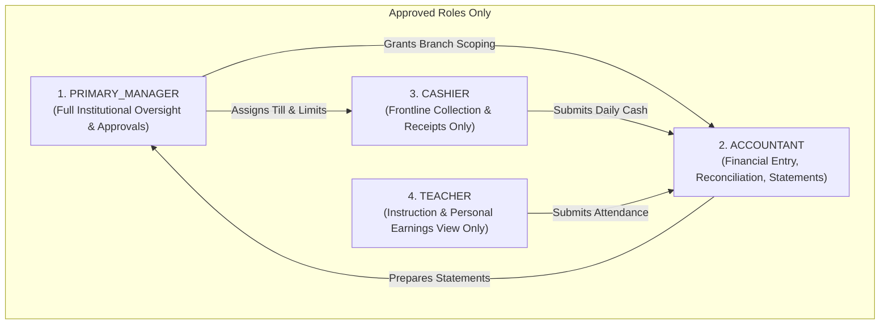
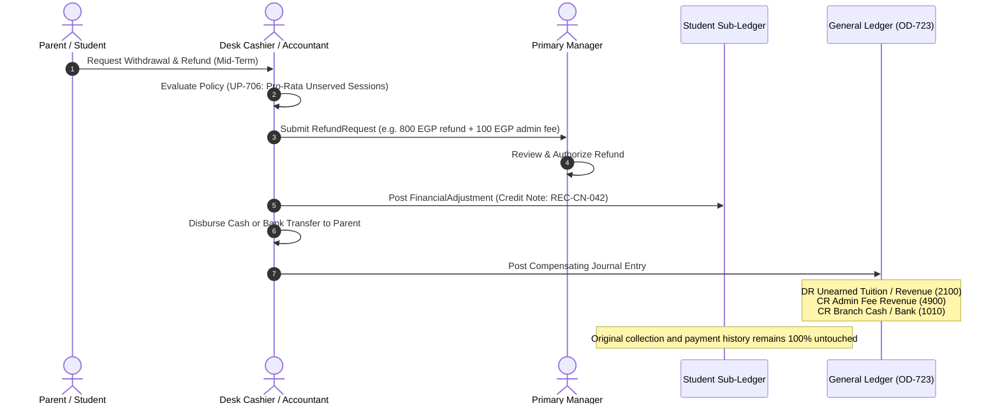

# OX-DIGITAL Education — Accounting Track
# Phase 2.0A: Role Security, Financial Controls & Data Retention Architecture

**Author:** Chief Information Security Officer & Data Governance Lead  
**Project:** OX-DIGITAL Education  
**Document Classification:** Security Architecture & Compliance Blueprint (Design-Only Blueprint)  
**Baseline Commit:** `0500b93e65c24ed881349c4acea7f523332c5e9f` on branch `main`  
**Date:** November 3, 2026

---

## 1. Role-Based Access Control & Segregation of Duties (Stage J)

The target security architecture enforces strict principle-of-least-privilege access across the four approved institutional roles:

> [!WARNING]
> **GOVERNANCE CONSTRAINT ON ROLES:**  
> The role `BRANCH_MANAGER` is **NOT** an approved role. All institutional approvals (pricing changes, period closures, write-offs, shortage adjustments) require authorization by the `PRIMARY_MANAGER`. Branch supervisors or campus coordinators remain operational roles without independent financial approval authority unless explicitly enacted by a future Product Owner decision.

### 1.1 Enforcement of Segregation of Duties (SoD)
1. **Self-Approval Prohibition:** An Accountant cannot approve their own high-value operating expense entries, bad-debt write-offs, or accounting period closures.
2. **Cashier Isolation:** Cashiers possess **collection-only** access. They cannot query the General Ledger, view institution-wide financial reports, edit student agreements, or disburse petty cash beyond their assigned shift limits.
3. **Teacher Confidentiality:** Teachers have zero visibility into other teachers' compensation contracts, student tuition collection totals, or center profit margins. Access is strictly scoped to their personal compensation statements and assigned group rosters.

---

## 2. Refunds, Withdrawals & Adjustments Architecture (Stage I)

In compliance with **OD-708** and double-entry accounting standards, financial history is permanent. Deleting an invoice, voiding a payment record in place, or erasing a student account is strictly prohibited.

### 2.1 Invariant Rules of Financial Adjustments
1. **Zero Deletion (OD-708):** Original collections, obligations, and journal lines remain in the database forever.
2. **Compensating Adjustments:** When tuition is refunded or reduced, a `FinancialAdjustment` (Credit Note) is generated, linking to the original agreement.
3. **Pro-Rata Valuation (UP-706):** Under UP-706, refund calculations evaluate the proportion of unserved educational sessions minus a documented administrative fee.
4. **Statutory Law Supremacy:** Institutional terms or center registration forms that purport to forbid refunds are legally void under Egyptian Consumer Protection Law (Law No. 181 of 2018). The system must enforce compliant refund paths regardless of private contracts.

---

## 3. Financial Evidence Retention & Delete-Policy Matrix (Correction A)

### 3.1 Five-Stage Evidence Distinction
To prevent loss of legal or financial provenance, the architecture strictly decouples five operational and financial stages:
1. **Academic Attendance Record (`Attendance`):** Real-time classroom presence marked by the teacher (`PRESENT`, `ABSENT`, `LATE`). Represents academic evidence.
2. **Lesson Delivery Evidence (`LessonDeliveryEvidence`):** Center operational confirmation that a specific classroom cohort session was physically conducted.
3. **Session Consumption Record (`SessionConsumption`):** Contractual deduction of an eligible attendance from a student's package or agreement (OD-706, OD-722.1).
4. **Revenue Recognition Event (`RevenueRecognitionEvent`):** Valuation event connecting delivered instruction to earned general ledger recognition.
5. **Posted Accounting Journal Entry (`JournalEntry`):** Immutable double-entry financial record (`DR Unearned, CR Revenue`).

### 3.2 Delete-Policy Matrix Across All Financial & Operational Relationships
The existing Prisma schema's use of `onDelete: Cascade` on `Attendance -> User` presents a critical data loss risk. The target architecture establishes a strict delete-policy matrix:

| Source Entity | Target / Parent Entity | Existing Schema Behavior | Target Phase 2 Delete Policy | Rationale & Protection Rule |
| :--- | :--- | :--- | :--- | :--- |
| **`Attendance`** | `User` (Student) | `Cascade` ([schema.prisma#L297](file:///D:/OX-DIGITAL/Mathe/OX-DIGITAL-GITHUB/packages/database/prisma/schema.prisma#L297)) | **`Restrict`** (if financially referenced) | Historical attendance referenced by financial recognition must NEVER be physically deleted. |
| **`CourseEnrollment`** | `User` / `Course` | `Cascade` ([schema.prisma#L181](file:///D:/OX-DIGITAL/Mathe/OX-DIGITAL-GITHUB/packages/database/prisma/schema.prisma#L181)) | **`Restrict`** | Academic enrollment history preserved under OD-708. |
| **`Payment`** | `User` (Student) | `Restrict` ([schema.prisma#L319](file:///D:/OX-DIGITAL/Mathe/OX-DIGITAL-GITHUB/packages/database/prisma/schema.prisma#L319)) | **`Restrict`** | Legacy payments cannot be deleted if user is deleted. |
| **`StudentFinancialAccount`** | `User` (Student) | *(New Table)* | **`Restrict`** | Student identity cannot be deleted while financial sub-ledger exists. |
| **`StudentFinancialAgreement`**| `StudentFinancialAccount` | *(New Table)* | **`Restrict`** | Agreements cannot be deleted; cancellation requires explicit status change. |
| **`StudentObligation`** | `StudentFinancialAgreement` | *(New Table)* | **`Restrict`** | Scheduled due charges are permanent historical records. |
| **`Collection`** | `Branch` / `StudentAccount` | *(New Table)* | **`Restrict`** | Cash collections are permanent historical records. |
| **`JournalEntry`** | `Institution` | *(New Table)* | **`Restrict`** | General Ledger entries cannot be deleted (OD-723). |
| **`JournalLine`** | `JournalEntry` / `Account` | *(New Table)* | **`Restrict`** | Lines cannot be orphaned or deleted from an entry. |
| **`FinancialAuditEvent`** | `JournalEntry` | *(New Table)* | **`Restrict`** | Forensic audit trail is strictly append-only. |

### 3.3 Academic Record Correction vs Post-Financial Recognition Compensating Workflow
1. **Pre-Recognition Correction:** If a teacher accidentally marks a student `PRESENT` instead of `ABSENT`, and the error is caught *before* session consumption or financial revenue recognition has executed, the teacher or supervisor may correct the academic record with an audit log entry.
2. **Post-Recognition Correction:** If an attendance record has *already been consumed* by `RevenueRecognitionEvent` and posted to the General Ledger (`DR 2100, CR 4010`), **physical deletion or in-place edit of the attendance record is strictly forbidden**.
   - A compensating adjustment event is generated (`AttendanceCorrectionEvent`).
   - A compensating journal entry is posted to reverse the earned revenue (`DR 4010, CR 2100`).
   - The session credit is restored to the student's sub-ledger (`SessionPackage.consumedSessions -= 1`).
   - Both original and compensating records are preserved with full audit traceability.

---

## 4. Data Retention & Archival Policies (OD-720 & UP-715)
- Data in cold storage is retained indefinitely in read-only partitions with cryptographic checksums.

### 3.3 Statutory Retention & PII Scrubbing (UP-715 Gate)
- Under Egyptian Commercial and Tax Law, accounting ledgers, invoices, and receipts must be retained for a minimum statutory period (typically 5 to 10 years depending on tax filing status).
- **The UP-715 Review Gate:** When a student requests account erasure under data privacy regulations, the system scrubs personally identifiable information (PII: phone, personal national ID, email) from the user profile, but **permanently preserves the anonymized financial ledger transactions and journal entries**.
- Full retention schedules remain subject to formal review by Egyptian tax and legal counsel.

