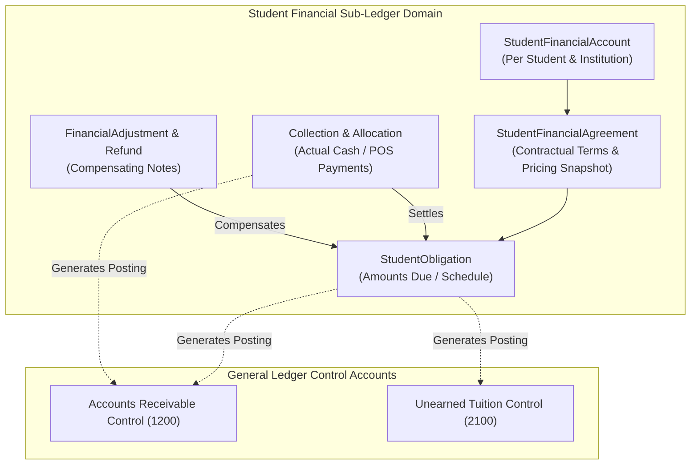
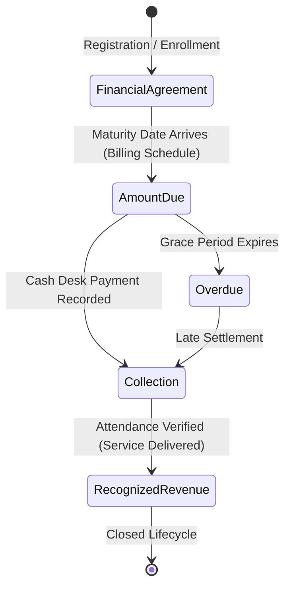

# OX-DIGITAL Education — Accounting Track
# Phase 2.0A: Student Financial Sub-Ledger & Group Pricing Architecture

**Author:** Senior Financial Systems Architect & Student Sub-Ledger Specialist  
**Project:** OX-DIGITAL Education  
**Document Classification:** Student Financial Accounting & Pricing Architecture (Design-Only Blueprint)  
**Baseline Commit:** `0500b93e65c24ed881349c4acea7f523332c5e9f` on branch `main`  
**Date:** November 3, 2026

---

## 1. Executive Purpose & Sub-Ledger Separation Invariant

In standard accounting systems, Accounts Receivable (`1200`) and Unearned Revenue (`2100`) in the General Ledger act as **Control Accounts**. They store the consolidated aggregate balances for the entire institution.

To track what each individual student owes, what they have paid, and what services have been delivered to them, the system requires an independent, fully auditable **Student Financial Sub-Ledger**.

$$\sum_{\text{All Students}} \text{StudentSubLedger.balance} \equiv \text{GeneralLedger.Account(1200).balance}$$



---

## 2. Decoupling Group Membership from Financial History

### 2.1 The Current Database Flaw
In the current schema ([`packages/database/prisma/schema.prisma#L85`](file:///D:/OX-DIGITAL/Mathe/OX-DIGITAL-GITHUB/packages/database/prisma/schema.prisma#L85)), group association is stored as a direct foreign key on `model User`:
```prisma
model User {
  centerGroupId  String?
  centerGroup    CenterGroup? @relation(fields: [centerGroupId], references: [id])
}
```
When an administrator moves a student from "Group A (Monday 5 PM)" to "Group B (Tuesday 7 PM)", [`user.controller.ts#L535`](file:///D:/OX-DIGITAL/Mathe/OX-DIGITAL-GITHUB/services/user-service/src/controllers/user.controller.ts#L535) simply updates `user.centerGroupId = newGroupId`. This wipes out historical membership!

### 2.2 The Target Historical Group Architecture
In Phase 2, a student's financial obligations and past agreements must **NEVER** depend on their current group pointer. A dedicated membership history entity preserves historical lineage:

```prisma
// PROPOSED TARGET MODEL (DESIGN-ONLY):
model StudentGroupMembershipHistory {
  id             String       @id @default(uuid())
  institutionId  String
  studentId      String
  centerGroupId  String
  startDate      DateTime     @db.Date
  endDate        DateTime?    @db.Date
  status         String       @db.VarChar(50) // ACTIVE, TRANSFERRED, COMPLETED, WITHDRAWN
  reason         String?      @db.Text
  createdAt      DateTime     @default(now())

  institution    Institution  @relation(fields: [institutionId], references: [id], onDelete: Restrict)
  student        User         @relation(fields: [studentId], references: [id], onDelete: Restrict)
  centerGroup    CenterGroup  @relation(fields: [centerGroupId], references: [id], onDelete: Restrict)

  @@index([institutionId, studentId])
  @@index([centerGroupId])
}
```
If a student transfers groups or withdraws:
1. The previous `StudentFinancialAgreement` remains active or is reconciled via a credit note/adjustment.
2. Historical attendances and receipts are 100% preserved.
3. The new group enrollment instantiates a distinct new agreement.

---

## 3. The Four Core Financial Concepts Decoupled

The sub-ledger architecture strictly enforces the distinction between the four financial states:



| Concept | Domain Entity | Definition | Ledger Impact | Timing |
| :--- | :--- | :--- | :--- | :--- |
| **1. Financial Agreement**<br>(الاتفاق المالي) | `StudentFinancialAgreement`<br>`AgreementPriceSnapshot` | The agreed total price, payment arrangement, and group terms. | **None** (Memorandum/Contractual commitment). | Registration date. |
| **2. Amount Due**<br>(المبلغ المستحق) | `StudentObligation` | The installment or session charge whose payment due date has arrived. | Debits AR Control (`1200`)<br>Credits Unearned Revenue (`2100`). | Scheduled due date (`dueDate`). |
| **3. Collection**<br>(المبلغ المحصّل) | `Collection`<br>`CollectionAllocation` | Real cash or POS card swipe physically received and verified at the desk. | Debits Branch Cash (`1010`)<br>Credits AR Control (`1200`). | Moment cash is handed to cashier. |
| **4. Recognized Revenue**<br>(الإيراد المحقق) | `RevenueRecognitionEvent` | The monetary value of instructional classroom sessions verified by attendance. | Debits Unearned Revenue (`2100`)<br>Credits Earned Tuition (`4010`). | Attendance roster submission. |

> [!CAUTION]
> **STRICT REVENUE INVARIANT:**  
> Contractual amounts are NOT revenue. Expected future attendances are NOT revenue. Unpaid balances are NOT revenue. Cash collected is initially Unearned Prepayment (Liability) until classroom delivery occurs!

---

## 4. Group Pricing Models & Student Price Snapshots

### 4.1 Extensible Group Pricing Strategies
Each educational group (`CenterGroup`) has an independent pricing model selected by the Primary Manager:
1. **`TERM_FIXED` (سعر الفصل الدراسي الثابت):** Single lump sum covering a semester or educational term (e.g., 2,500.00 EGP).
2. **`MONTHLY_FEE` (الاشتراك الشهري للمجموعة):** Fixed monthly fee payable on the 1st of each month (e.g., 600.00 EGP).
3. **`PER_SESSION` (محاسبة بالحصة):** Tuition calculated per delivered physical session (e.g., 75.00 EGP / session).
4. **`SESSION_PACKAGE` (باقة حصص محددة):** Block of prepaid physical attendances (e.g., 8-session package for 550.00 EGP).

### 4.2 Immutable Price Snapshots
When a student accepts an enrollment agreement, the system writes an **`AgreementPriceSnapshot`**:
- Changing the group's master catalog price for next term **NEVER** mutates or recalculates existing student agreements.
- The snapshot freezes: `baseAmount`, `discountAmount`, `discountReason`, `finalAgreedAmount`, `pricingMethod`, and `currency`.

---

## 5. Flexible Payment Arrangements (نظام السداد)

### 5.1 Standard Product Terminology (Arabic)
The platform strictly mandates standard commercial Arabic terminology across all interfaces, receipts, and customer statements:
- **نظام السداد** (Payment Arrangement)
- **دفعة واحدة** (Single Lump-Sum Payment)
- **دفعات متعددة** (Multiple Scheduled Payments)
- **المبلغ المستحق** (Amount Due)
- **المبلغ المحصّل** (Amount Collected)
- **المتأخرات** (Overdue Balances)
- **الرصيد المتبقي** (Remaining Balance)
- **موعد الاستحقاق** (Payment Due Date)

> [!WARNING]
> **PROHIBITED TERM:** The word **"أقساط"** is strictly forbidden in all user-facing labels, invoices, and customer receipts to prevent commercial confusion with commercial retail credit/interest.

### 5.2 Partial Payments & Collection Allocation
When a student brings a partial payment (e.g., owes 1,000.00 EGP, but pays 400.00 EGP in cash):
1. A `Collection` is created for 400.00 EGP.
2. A `CollectionAllocation` links the 400.00 EGP against the mature `StudentObligation`.
3. The obligation updates its `collectedAmount = 400.00`, leaving `remainingAmount = 600.00`.
4. Overdue aging reports automatically track the remaining 600.00 EGP without breaking the agreement.

---

## 6. Target Sub-Ledger Prisma Schema Design (Design Proposal)

```prisma
// ==============================================================================
// STUDENT FINANCIAL SUB-LEDGER MODELS (PROPOSED TARGET - DESIGN ONLY)
// ==============================================================================

model StudentFinancialAccount {
  id             String          @id @default(uuid())
  institutionId  String
  studentId      String          @unique
  currentBalance Decimal         @default(0) @db.Decimal(12, 2) // Derived sum of due minus collected
  currency       String          @default("EGP") @db.VarChar(3)
  createdAt      DateTime        @default(now())
  updatedAt      DateTime        @updatedAt

  institution    Institution     @relation(fields: [institutionId], references: [id], onDelete: Restrict)
  student        User            @relation(fields: [studentId], references: [id], onDelete: Restrict)
  agreements     StudentFinancialAgreement[]
  obligations    StudentObligation[]
  collections    Collection[]

  @@index([institutionId, studentId])
}

model StudentFinancialAgreement {
  id                 String          @id @default(uuid())
  institutionId      String
  accountId          String
  studentId          String
  centerGroupId      String
  branchId           String
  pricingMethod      String          @db.VarChar(50) // TERM_FIXED, MONTHLY_FEE, PER_SESSION, SESSION_PACKAGE
  settlementType     String          @db.VarChar(50) // SINGLE_PAYMENT, MULTIPLE_PAYMENTS
  baseAmount         Decimal         @db.Decimal(12, 2)
  discountAmount     Decimal         @default(0) @db.Decimal(12, 2)
  discountReason     String?         @db.Text
  finalAgreedAmount  Decimal         @db.Decimal(12, 2)
  effectiveDate      DateTime        @db.Date
  status             String          @default("ACTIVE") @db.VarChar(50) // ACTIVE, COMPLETED, CANCELLED
  createdAt          DateTime        @default(now())

  institution        Institution     @relation(fields: [institutionId], references: [id], onDelete: Restrict)
  account            StudentFinancialAccount @relation(fields: [accountId], references: [id], onDelete: Restrict)
  branch             Branch          @relation(fields: [branchId], references: [id], onDelete: Restrict)
  obligations        StudentObligation[]

  @@index([institutionId, studentId])
  @@index([centerGroupId])
}

model StudentObligation {
  id             String          @id @default(uuid())
  institutionId  String
  agreementId    String
  accountId      String
  studentId      String
  branchId       String
  obligationType String          @db.VarChar(50) // TUITION_FEE, PACKAGE_FEE, SESSION_CHARGE
  dueDate        DateTime        @db.Date
  amountDue      Decimal         @db.Decimal(12, 2)
  amountCollected Decimal        @default(0) @db.Decimal(12, 2)
  status         String          @default("PENDING") @db.VarChar(50) // PENDING, PARTIALLY_PAID, SETTLED, OVERDUE
  createdAt      DateTime        @default(now())

  institution    Institution     @relation(fields: [institutionId], references: [id], onDelete: Restrict)
  agreement      StudentFinancialAgreement @relation(fields: [agreementId], references: [id], onDelete: Restrict)
  account        StudentFinancialAccount @relation(fields: [accountId], references: [id], onDelete: Restrict)
  allocations    CollectionAllocation[]

  @@index([institutionId, studentId, status])
  @@index([institutionId, dueDate])
}

model Collection {
  id             String          @id @default(uuid())
  institutionId  String
  branchId       String
  accountId      String
  studentId      String
  cashboxId      String?         // FK to Cashbox
  receiptNumber  String          @unique @db.VarChar(64) // e.g. REC-CAI-2026-00104
  collectionDate DateTime        @db.Date
  amount         Decimal         @db.Decimal(12, 2)
  paymentMethod  String          @db.VarChar(50) // CASH, POS_CARD, BANK_TRANSFER
  referenceNote  String?         @db.Text
  collectedBy    String          @db.VarChar(64)
  createdAt      DateTime        @default(now()) @db.Timestamptz(3)

  institution    Institution     @relation(fields: [institutionId], references: [id], onDelete: Restrict)
  branch         Branch          @relation(fields: [branchId], references: [id], onDelete: Restrict)
  account        StudentFinancialAccount @relation(fields: [accountId], references: [id], onDelete: Restrict)
  allocations    CollectionAllocation[]

  @@index([institutionId, branchId])
  @@index([institutionId, studentId])
  @@index([receiptNumber])
}

model CollectionAllocation {
  id             String          @id @default(uuid())
  institutionId  String
  collectionId   String
  obligationId   String
  allocatedAmount Decimal        @db.Decimal(12, 2)
  createdAt      DateTime        @default(now())

  collection     Collection      @relation(fields: [collectionId], references: [id], onDelete: Restrict)
  obligation     StudentObligation @relation(fields: [obligationId], references: [id], onDelete: Restrict)

  @@index([collectionId])
  @@index([obligationId])
}
```

