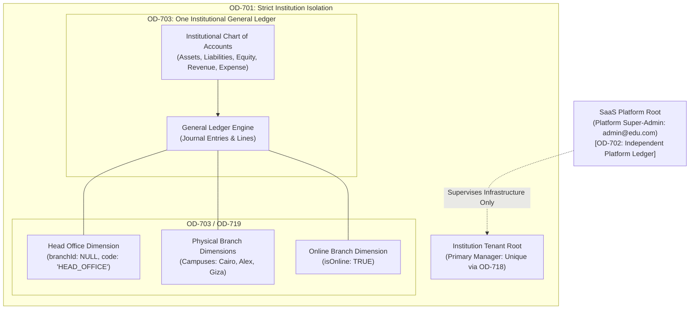

# OX-DIGITAL Education — Accounting Track
# Phase 2.0A: Target Tenancy & General Ledger Persistence Architecture

**Author:** Senior Database Architect & Principal Financial Systems Engineer  
**Project:** OX-DIGITAL Education  
**Document Classification:** Database Architecture & Schema Specification (Design-Only Blueprint)  
**Baseline Commit:** `0500b93e65c24ed881349c4acea7f523332c5e9f` on branch `main`  
**Date:** November 3, 2026

---

## 1. Tenancy Governance & Multi-Tenant Invariants

The accounting database architecture is anchored in the foundational governance decisions established in Tasks 7.0 and 7.1:



### 1.1 Invariant Rules of Tenancy
1. **OD-701 (Single Tenant Root & Single Primary Manager):** Every financial record belongs to exactly one `Institution`. An institution possesses exactly one designated `PrimaryManagerId` (enforced via unique constraint).
2. **OD-702 (SaaS Platform Independence):** OX-DIGITAL SaaS platform accounting (subscription billing, platform infrastructure fees) is completely separate from tenant institutional ledgers. SaaS super-admins have zero operational financial roles within tenant general ledgers.
3. **OD-703 (Single Institutional General Ledger with Branch Dimensions):** Each institution maintains **exactly one** General Ledger and one Chart of Accounts. Branches are **NOT** separate ledgers; they are analytical reporting dimensions on journal lines.
4. **OD-718 (Cryptographic Primary Manager Onboarding):** The Primary Manager is bound to an institution solely through the verified acceptance of an invitation token (Option 3B: 32 bytes entropy, SHA-256 hash).
5. **OD-719 (Physical vs Online Campus Scoping):** Digital branches are represented by `Branch.isOnline = true`. Physical centers have `Branch.isOnline = false`.
6. **Head Office Dimension:** Institutional administrative expenses and capital investments that do not belong to a specific campus are tagged with the Head Office dimension (`branchId: null`, `branchCode: 'HEAD_OFFICE'`). Head Office is an accounting dimension, **not** a physical branch.
7. **Strict Non-Bypass Isolation:** No financial query, journal posting, or sub-ledger balance aggregation may execute without a non-null `institution_id` parameter.

---

## 2. Target Database Schema Design (Prisma Specification)

> [!NOTE]
> The following schema definitions represent the target architectural specification for Phase 2. They are documented here for design review and must **NOT** be added to `schema.prisma` until implementation authorization is granted.

```prisma
// ==============================================================================
// 1. FINANCIAL MASTER DATA & CHART OF ACCOUNTS (PROPOSED TARGET)
// ==============================================================================

enum AccountCategory {
  ASSET
  LIABILITY
  EQUITY
  REVENUE
  EXPENSE
}

enum NormalBalanceDirection {
  DEBIT
  CREDIT
}

model Account {
  id             String                 @id @default(uuid())
  institutionId  String
  code           String                 @db.VarChar(50)
  name           String                 @db.VarChar(255)
  category       AccountCategory
  normalBalance  NormalBalanceDirection
  parentId       String?
  isActive       Boolean                @default(true)
  isPostable     Boolean                @default(true)
  currency       String                 @default("EGP") @db.VarChar(3)
  description    String?                @db.Text
  metadata       Json?
  createdAt      DateTime               @default(now())
  updatedAt      DateTime               @updatedAt

  institution    Institution            @relation(fields: [institutionId], references: [id], onDelete: Restrict)
  parent         Account?               @relation("AccountHierarchy", fields: [parentId], references: [id], onDelete: Restrict)
  children       Account[]              @relation("AccountHierarchy")
  journalLines   JournalLine[]

  @@unique([institutionId, code], name: "unq_account_institution_code")
  @@index([institutionId, category])
  @@index([institutionId, isActive, isPostable])
}

// ==============================================================================
// 2. GENERAL LEDGER JOURNAL persistence (OD-723 APPEND-ONLY TARGET)
// ==============================================================================

enum JournalEntryStatus {
  DRAFT
  VALIDATED
  POSTED
}

model JournalEntry {
  id                 String             @id @default(uuid())
  institutionId      String
  transactionDate    DateTime           @db.Timestamptz(3)
  accountingDate     DateTime           @db.Date
  currency           String             @default("EGP") @db.VarChar(3)
  description        String             @db.Text
  status             JournalEntryStatus @default(DRAFT)
  referenceId        String?            @db.VarChar(128)
  reversalOfEntryId  String?            @unique
  idempotencyKey     String?            @unique @db.VarChar(128)
  createdBy          String             @db.VarChar(64)
  postedBy           String?            @db.VarChar(64)
  postedAt           DateTime?          @db.Timestamptz(3)
  createdAt          DateTime           @default(now()) @db.Timestamptz(3)

  institution        Institution        @relation(fields: [institutionId], references: [id], onDelete: Restrict)
  reversalOf         JournalEntry?      @relation("JournalReversals", fields: [reversalOfEntryId], references: [id], onDelete: Restrict)
  reversalEntry      JournalEntry?      @relation("JournalReversals")
  lines              JournalLine[]
  auditEvents        FinancialAuditEvent[]

  @@index([institutionId, accountingDate])
  @@index([institutionId, status])
  @@index([referenceId])
}

enum DimensionType {
  HEAD_OFFICE
  BRANCH
}

model JournalLine {
  id             String          @id @default(uuid())
  entryId        String
  institutionId  String
  accountId      String
  dimensionType  DimensionType   @default(BRANCH)
  branchId       String?         // Allowed ONLY when dimensionType === BRANCH. Strictly NULL when dimensionType === HEAD_OFFICE.
  debit          Decimal         @default(0) @db.Decimal(14, 2)
  credit         Decimal         @default(0) @db.Decimal(14, 2)
  currency       String          @default("EGP") @db.VarChar(3)
  description    String?         @db.Text
  createdAt      DateTime        @default(now()) @db.Timestamptz(3)

  entry          JournalEntry    @relation(fields: [entryId], references: [id], onDelete: Restrict)
  institution    Institution     @relation(fields: [institutionId], references: [id], onDelete: Restrict)
  account        Account         @relation(fields: [accountId], references: [id], onDelete: Restrict)
  branch         Branch?         @relation(fields: [branchId], references: [id], onDelete: Restrict)

  @@index([institutionId, accountId])
  @@index([institutionId, branchId])
  @@index([institutionId, dimensionType])
  @@index([entryId])
}

// ==============================================================================
// 3. FINANCIAL AUDIT & REASON LOGGING (OD-708 TARGET)
// ==============================================================================

model FinancialAuditEvent {
  id             String          @id @default(uuid())
  institutionId  String
  entryId        String
  eventType      String          @db.VarChar(50) // ENTRY_CREATED, ENTRY_POSTED, ENTRY_REVERSED
  actorId        String          @db.VarChar(64)
  timestamp      DateTime        @default(now()) @db.Timestamptz(3)
  details        Json

  entry          JournalEntry    @relation(fields: [entryId], references: [id], onDelete: Restrict)
  institution    Institution     @relation(fields: [institutionId], references: [id], onDelete: Restrict)

  @@index([institutionId, entryId])
  @@index([institutionId, timestamp])
}
```

---

## 3. Tenancy Integrity & Isolation Guardrails

### 3.1 Composite Foreign Key & Dimension Integrity Constraint
To prevent data contamination where a journal line refers to an account belonging to Institution A while the entry belongs to Institution B:
1. **Institutional Account Constraint:** Every account query and join binds `institution_id`.
2. **Branch Belonging Validation:** In PostgreSQL, an enforce trigger or composite foreign key `FOREIGN KEY (institution_id, branch_id) REFERENCES "Branch"(institution_id, id)` guarantees that a line's branch belongs to the entry's institution.
3. **Head Office Dimension Safety (Correction D):** A `branch_id = NULL` must never ambiguously indicate a missing or unassigned branch. The database enforces an explicit discriminator check constraint:
   ```sql
   CONSTRAINT chk_journal_line_dimension_safety CHECK (
     (dimension_type = 'HEAD_OFFICE' AND branch_id IS NULL) OR
     (dimension_type = 'BRANCH' AND branch_id IS NOT NULL)
   );
   ```
   This guarantees that Head Office is an explicit, verified accounting dimension, while preventing `NULL` from bypassing branch validation.

### 3.2 Immutability Triggers (OD-723)
PostgreSQL triggers will be attached to `accounting_journal_entries` and `accounting_journal_lines` in Phase 2:
```sql
CREATE OR REPLACE FUNCTION trg_enforce_posted_immutability()
RETURNS TRIGGER AS $$
BEGIN
  IF OLD.status = 'POSTED' THEN
    RAISE EXCEPTION 'OD-723 Security Violation: Posted general ledger records are immutable and cannot be updated or deleted.';
  END IF;
  RETURN NEW;
END;
$$ LANGUAGE plpgsql;

CREATE TRIGGER trg_check_journal_entry_immutability
BEFORE UPDATE OR DELETE ON "JournalEntry"
FOR EACH ROW EXECUTE FUNCTION trg_enforce_posted_immutability();

CREATE TRIGGER trg_check_journal_line_immutability
BEFORE UPDATE OR DELETE ON "JournalLine"
FOR EACH ROW EXECUTE FUNCTION trg_enforce_posted_immutability();
```

