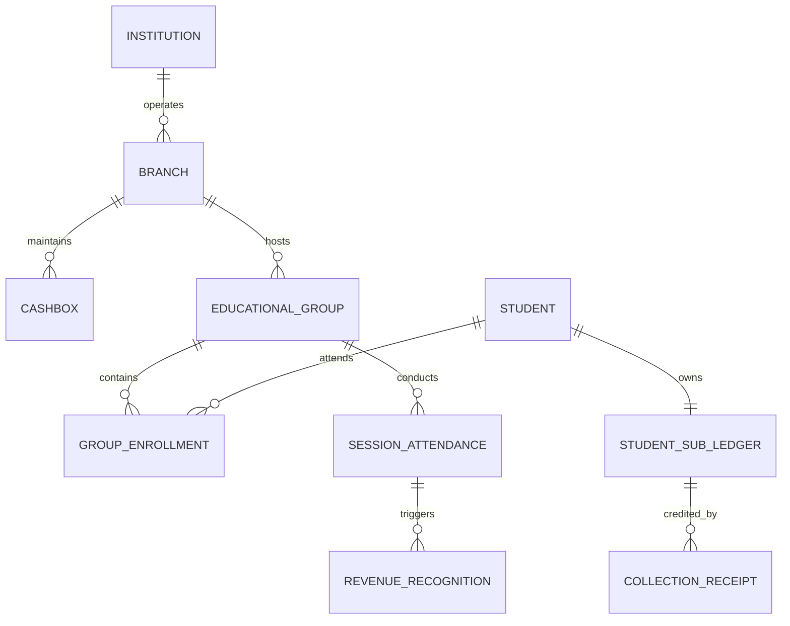
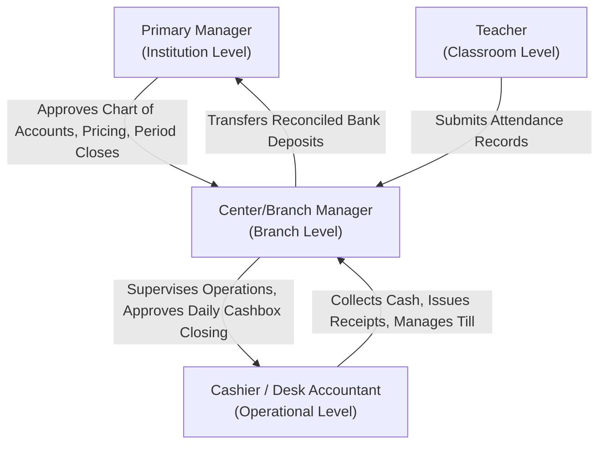

# OX-DIGITAL Education — Accounting Track
# Product Scope Architecture: Center-First Educational Operations

**Author:** Senior Financial Systems Architect & Product Strategy Lead  
**Project:** OX-DIGITAL Education  
**Document Classification:** Authoritative Product & Commercial Specification  
**Status:** Approved Product Baseline  
**Date:** November 3, 2026

---

## 1. Executive Product Context & The Center-First Reality

A foundational finding of this architectural review is the vital distinction between future aspirational features and current operational reality:

1. **Current Reality:** OX-DIGITAL Education currently serves **physical educational centers**. Students attend physical classrooms, enroll in localized educational groups, pay physical tuition at center cash desks, and have attendance taken in person.
2. **Online Subscriptions Do Not Exist Yet:** There are currently no recurring automated online course subscriptions, no digital payment gateway checkout flows for public consumers, and no autonomous digital entitlement provisioning engines active in production.
3. **First Commercial Accounting Target:** The first commercial integration of the OX-DIGITAL Accounting Track must serve **physical educational centers**.
4. **Online Scope Deferred:** Online courses and digital subscription billing models will be specified and integrated in a distinct, later phase after physical center financial operations are robust and validated.

> [!IMPORTANT]
> Any technical assumption that builds payment gateway webhooks (e.g., Stripe, Paymob, Fawry online), recurring card tokenization, or automated digital subscription access into the initial accounting engine is **OUT OF SCOPE** and strictly prohibited.

---

## 2. Center-First Operational Domain Entities

### 2.1 Center / Branch
The physical facility where educational services are delivered. Each branch represents an operational sub-unit of the Institution.
- **Accounting Dimension:** Every financial transaction occurring at a center carries `branchId` in its line dimensions for branch-level profit and loss reporting.

### 2.2 Student & Student Financial Sub-Ledger
Each enrolled student possesses a dedicated sub-ledger account mapped into the Accounts Receivable (Asset) or Unearned Revenue (Liability) control accounts.
- **Balance Tracking:** Tracks individual student charges, payments, prepayments, and outstanding balances.
- **Aging Analysis:** Provides 30/60/90-day aging reports for overdue tuition collections.

### 2.3 Educational Group (Cohorts)
A localized group of students taking a curriculum cohort together with an assigned teacher on a recurring weekly schedule.
- **Group Dimensions:** Associated with a specific branch, subject/course, and teacher.

### 2.4 Group Pricing Models
Physical educational centers employ specialized fee structures:
1. **Per-Session Pricing:** Student pays or is billed per individual physical session attended.
2. **Monthly Group Fee:** Fixed tuition billed on the 1st of each month for group enrollment.
3. **Session Package:** Student purchases a package of prepaid physical sessions (e.g., 8 sessions or 16 sessions).

### 2.5 Flexible Payment Terms
Physical center tuition is rarely paid in a single lump sum. The engine must support:
- **Installment Schedules:** Splitting course/term fees into agreed multi-stage payments.
- **Partial Payments:** Accepting whatever cash or bank transfer amount the parent brings to the desk.
- **Discounts & Sibling Concessions:** Policy-driven fee adjustments credited against charges.
- **Scholarships / Financial Aid:** Institutional subsidies allocated to specific students.

### 2.6 Cash Desk Collections & Receipt Generation
The physical moment when a student or parent pays at the center counter:
- **Immediate Receipt Issuance:** Sequential, tamper-evident physical receipt number generated upon payment.
- **Payment Method Recording:** Physical Cash, Point-of-Sale (POS) Card Swipes, or Center Bank Transfer.
- **Double-Entry Impact:** Debits Branch Cash/Bank (`1010`) and credits Student Accounts Receivable / Unearned Revenue (`1200` / `2100`).

### 2.7 Attendance-Based Revenue Recognition (Earned vs Unearned)
Tuition collected prior to classroom delivery represents **Unearned Revenue** (Liability).
- When a student or group completes a physical session verified by teacher attendance:
  1. The system determines the session valuation.
  2. A journal entry is generated debiting Unearned Revenue (`2100`) and crediting Earned Tuition Revenue (`4010`).
- If a student misses a session, the institutional attendance policy governs whether tuition is forfeited, credited, or scheduled for a make-up session.

### 2.8 Cashbox / Till Management
Physical centers maintain cash registers (tills) handled by desk cashiers:
- **Daily Shift Opening:** Recording starting petty cash / float.
- **Intra-Day Transactions:** Cash received, authorized small cash disbursements (supplies, minor maintenance).
- **Shift / Day-End Cash Count:** Physical count matched against system-calculated collections.
- **Cash Discrepancy Protocol:** Automatic posting of Cash Over/Short (`5900`) with mandatory managerial sign-off.
- **Safe Transfer:** Daily transfer of reconciled cash from desk till to branch vault or bank courier deposit.

### 2.9 Branch & Institutional Financial Reporting
- **Branch Level:** Daily collection summary, Cashbox reconciliation sheet, Student balance aging, Branch gross margin (Tuition Revenue minus Branch Direct Expenses).
- **Institution Level:** Consolidated balance sheet, institution-wide trial balance, inter-branch transfers, teacher payroll compensation schedules.

---

## 3. Physical Center Roles & Financial Responsibilities

### 3.1 Primary Manager (Institution Level)
- Governed by OD-701 and OD-721.
- Exercises sole authority to approve and publish the institutional Chart of Accounts.
- Authorizes and approves master group pricing versions.
- Approves institutional accounting period closes (OD-710).
- Holds multi-branch visibility across all center operations.

### 3.2 Center / Branch Manager
- Supervises operational and financial compliance for a single physical branch.
- Reviews and signs off on daily shift cashbox reconciliations.
- Authorizes payment plan extensions or exceptional discount requests within policy limits.
- Audits physical classroom headcounts against enrollment manifests.

### 3.3 Center Cashier / Desk Accountant
- Frontline staff operating the center reception / cashier desk.
- Collects cash, card swipes, or payment proofs from parents and students.
- Generates and signs physical collection receipts.
- Records partial payments and installment settlements.
- Performs end-of-shift till counts and submits the cash envelope to the Branch Manager.

### 3.4 Teacher
- Conducts physical classroom sessions.
- Records session attendance roster (Present, Absent, Excused) in real time.
- Note: Attendance submission is the **commercial trigger** for attendance-based revenue recognition and teacher compensation accrual.

---

## 4. Boundaries & Deferred Scope

The following capabilities are explicitly **DEFERRED** to future phases:

| Feature / Domain | Current Status | Target Phase |
| :--- | :--- | :--- |
| Physical Center Cash & Student Ledgers | **IN SCOPE** | Phase 1.1 / Phase 2+ |
| Educational Group Attendance Revenue | **IN SCOPE** | Phase 1.1 / Phase 2+ |
| Daily Cashbox Till Reconciliations | **IN SCOPE** | Phase 2+ |
| Online Course Subscription Billing | **OUT OF SCOPE** | Future Deferred Track |
| Payment Gateway Webhook Ingestion | **OUT OF SCOPE** | Future Deferred Track |
| Automated Recurring Card Tokenization | **OUT OF SCOPE** | Future Deferred Track |
| Digital Course DRM Entitlement Ingestion| **OUT OF SCOPE** | Future Deferred Track |

---

## 5. Architectural Mandate for Subsequent Phases

1. **Phase 2 (Persistence & Relational Schema):** All database entities must be designed around physical center realities (`institutions`, `branches`, `cashboxes`, `student_ledgers`, `educational_groups`, `attendance_events`, `receipts`).
2. **Phase 3 (Service Layer & Workflows):** API endpoints and business services must model physical center transactions (e.g., `POST /branches/:id/cashbox/reconcile`, `POST /students/:id/collections`, `POST /groups/:id/attendance-revenue`).
3. **Pure Double-Entry Backbone:** All the above physical center events will record their financial impact directly through the pure append-only `JournalEntry` engine verified in Phase 1.1.

