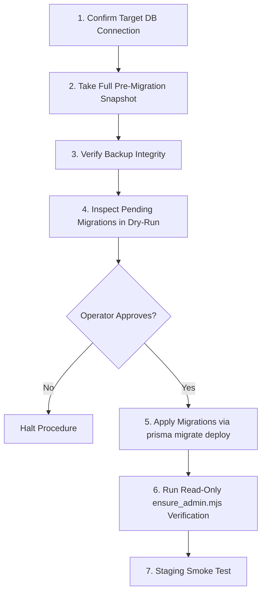

# OX-DIGITAL Education — Deployment Readiness Report
**Phase 5: Staging Preparation & Technical Architecture Inventory**

---

## 1. Executive Summary & Verdict

### Final Classification: **`READY AFTER CONFIGURATION`**

**Verdict Rationale:**
- **Codebase & Container Architecture:** The application code, frontend build pipeline, TypeScript microservices, and Docker Compose configurations are **100% structurally ready**. All 55 frontend tests pass, the production Vite bundle compiles with zero errors, backend security regression suites pass, and the Prisma schema is validated.
- **Security Hardening:** All insecure default passwords, silent administrator resets, and hardcoded fallback credentials have been completely eradicated. Production Docker Compose strictly requires `POSTGRES_PASSWORD`.
- **Operational Requirement (Why "After Configuration"):** Before services can be started in a staging or production environment, the operator must provide an environment configuration file (`.env.production` or `.env.staging`) containing the target database password, database connection string, cryptographic JWT secrets, and outbound SMTP credentials. The local PostgreSQL service is currently offline (`ECONNREFUSED`), and live records cannot be verified until the operator starts the database.

---

## 2. Technical Deployment Inventory

### 2.1 Frontend Application
- **Framework:** React 18, Vite 6.4.3, TypeScript, Tailwind CSS v4, Lucide React, Framer Motion (`motion`).
- **Build Command:** `npm run build` (invokes `vite build`).
- **Output Directory:** `apps/frontend/dist` (static SPA assets, HTML, JavaScript bundles, CSS, KaTeX web fonts).
- **Runtime Web Server:** Nginx (Alpine-based, non-root `nginxuser` UID 1001, listening on internal port `80`).
- **Browser-Facing API Routing:** In staging and production (`PROD=true`), the frontend dynamically uses relative paths (`/api/auth`, `/api/users`, `/api/ai`, `/api/courses`, `/api/analytics`). Browsers communicate solely through the public Nginx gateway, never directly exposing backend container ports or Docker hostnames.
- **Required Build-Time Environment Variables:**
  - `VITE_AUTH_API_URL` (Optional override; defaults to `/api/auth`)
  - `VITE_USER_API_URL` (Optional override; defaults to `/api/users`)
  - `VITE_AI_API_URL` (Optional override; defaults to `/api/ai`)
  - `VITE_COURSE_API_URL` (Optional override; defaults to `/api/courses`)
  - `VITE_ANALYTICS_API_URL` (Optional override; defaults to `/api/analytics`)

### 2.2 Backend Microservices Architecture

| Service Name | Internal Port | Entrypoint / Command | Inter-Service Dependencies | Healthcheck Endpoint |
|---|---|---|---|---|
| **`auth-service`** | `4001` | `node dist/services/auth-service/src/index.js` | PostgreSQL, Redis (healthy) | `http://localhost:4001/health` |
| **`user-service`** | `4002` | `node dist/services/user-service/src/index.js` | PostgreSQL, Redis | `http://localhost:4002/health` |
| **`ai-service`** | `4003` | `node dist/services/ai-service/src/index.js` | PostgreSQL, Redis, LLM APIs | `http://localhost:4003/health` |
| **`course-service`** | `4004` | `node dist/services/course-service/src/index.js` | PostgreSQL, Redis (healthy), Uploads Volume | `http://localhost:4004/health` |
| **`analytics-service`** | `4005` | `node dist/services/analytics-service/src/index.js` | PostgreSQL, Redis | `http://localhost:4005/health` |
| **`video-worker`** | N/A (Worker) | `node dist/services/video-worker/src/index.js` | PostgreSQL, Redis (healthy), Cloudflare R2 | Process check (`pgrep node`) |

### 2.3 Data Layer & Caching
- **Database Engine:** PostgreSQL 15 (Alpine).
- **ORM & Migrations:** Prisma 5.9.1 (`packages/database/prisma/schema.prisma`).
- **Migration Strategy:** `npx prisma migrate deploy` executed by the one-shot `prisma-migrate` container profile. Zero destructive resets or seeds are run automatically.
- **Caching & Session Storage:** Redis 7 (Alpine) with append-only persistence enabled (`redis-server --appendonly yes`).
- **Redis Healthcheck:** `redis-cli ping` (interval 10s, retries 5).
- **Fail-Safe Cache Fallback:** If Redis is offline, `packages/shared/src/redis.ts` transparently falls back to an in-memory `Map` with millisecond TTL validation.

### 2.4 Ingress & Network Architecture
- **Ingress Gateway:** Nginx (`nginx:alpine`), ports `80` (HTTP) and `443` (HTTPS).
- **SSL / TLS:** Mounts `./nginx/ssl:/etc/nginx/ssl:ro`.
- **Docker Network:** `platform-network` (bridge driver).
- **Host Port Isolation:** The database (`postgres`), cache (`redis`), and all six backend services have **zero host port bindings**. They are reachable strictly through the Nginx gateway over internal Docker DNS (`http://auth-service:4001`, etc.).

### 2.5 Persistent Volumes
1. `postgres-data` (`/var/lib/postgresql/data`): Primary database records.
2. `redis-data` (`/data`): Redis append-only transaction logs.
3. `course-uploads` (`/app/uploads`): User exam submissions, lesson attachments, homework assets.
4. `postgres-backups` (`/backups`): Nightly SQL dumps produced by `pg-backup`.

---

## 3. Production Configuration Review & Gap Closures

### 3.1 Gaps Identified and Closed During Audit
1. **Email Environment Variable Passthrough:**
   - *Previous Gap:* `docker-compose.production.yml` did not forward `SMTP_*` or `SENDGRID_*` variables to `auth-service`.
   - *Fix Applied:* Added `SMTP_HOST`, `SMTP_PORT`, `SMTP_SECURE`, `SMTP_USER`, `SMTP_PASS`, `SMTP_FROM`, `SENDGRID_API_KEY`, and `SENDGRID_FROM` to `auth-service` in `docker-compose.production.yml`.
2. **Clean Staging Variable Interpolation:**
   - *Previous Gap:* Optional variables for third-party integrations (`SUPABASE_*`, `PAYMOB_*`, `FAWRY_*`, `STRIPE_*`, `CLOUDFLARE_R2_*`, `GDRIVE_*`) triggered warnings during `docker compose config`.
   - *Fix Applied:* Added default empty fallbacks (`:-`) so staging deployments without paid third-party add-ons validate cleanly with exit code 0.
3. **Database Hostname Alignment Documentation:**
   - *Documentation Updated:* Added explicit guidance in `.env.production.example` clarifying that when using internal Docker Compose PostgreSQL, `DATABASE_URL` must specify host `postgres` (not `localhost`) and match `POSTGRES_PASSWORD`.

---

## 4. Database Protection Plan

> [!IMPORTANT]
> The database contains relational records across `User`, `Course`, `Enrollment`, `Attendance`, `Exam`, and `Subscription`. Destructive push commands (`prisma db push --force-reset` or `prisma migrate reset`) must **never** be used in staging or production.

### Step-by-Step Operator Procedure



1. **Snapshot & Backup:**
   Execute a point-in-time snapshot before running any container update or migration:
   ```bash
   docker exec platform-postgres pg_dump -U postgres math_platform > pre_migration_backup_$(date +%Y%m%d_%H%M%S).sql
   ```
2. **Migration Review:**
   Verify pending migration SQL files inside `packages/database/prisma/migrations/` before deployment.
3. **Safe Migration Execution:**
   Run the isolated migration runner:
   ```bash
   docker compose -f docker-compose.production.yml run --rm prisma-migrate
   ```
4. **Post-Migration Read-Only Verification:**
   Run the non-destructive verification tool:
   ```bash
   node scripts/ensure_admin.mjs
   ```

---

## 5. Authentication & Outbound Email Readiness

### 5.1 Password Reset & Activation Flow
- **Token Cryptography:** 32-byte cryptographic random secret (`crypto.randomBytes(32)`), stored as SHA-256 hash with 3600-second (1-hour) expiration.
- **Single-Use Semantics:** Upon submission of a new password, the token hash is immediately deleted from Redis / memory, preventing replay attacks.
- **Account Enumeration Protection:** `POST /api/auth/forgot-password` returns HTTP 200 with identical messages whether an account exists or not.
- **Frontend Route:** Mounted at `/reset-password?token=...` with confirmation redirect to `/login`.

### 5.2 Outbound Email Operational Limitation
- **Automated Welcome Email UX Limitation:** `user-service` does **not** dispatch automatic outbound welcome emails when an administrator creates a student linked to a new parent.
- **Operational Workaround for Staging:** The administrator or onboarding coordinator must instruct the parent to visit `/forgot-password`, enter their registered email address, and complete the password initialization link delivered to their inbox.
- **Verified Sender Prerequisite:** `noreply@ox-digital.edu` is a placeholder domain. For staging email delivery to succeed, valid SMTP credentials (or SendGrid API keys) matching a domain with authenticated SPF/DKIM/DMARC records must be configured in `.env.production`.

---

## 6. Deployment Blockers Ranked by Severity

| Severity | Blocker Description | Resolution / Required Action |
|---|---|---|
| **HIGH** | Target PostgreSQL Database is Offline (`127.0.0.1:5432`) | Operator must start PostgreSQL (`docker compose up -d postgres`) and execute read-only verification (`node scripts/ensure_admin.mjs`). |
| **HIGH** | Missing Environment Secrets File (`.env.production`) | Operator must create `.env.production` from `.env.production.example` and set `POSTGRES_PASSWORD`, `DATABASE_URL`, `JWT_SECRET`, and `REFRESH_TOKEN_SECRET`. |
| **MEDIUM** | Outbound Email Provider Not Configured | Operator must provide real SMTP or SendGrid credentials if testing password reset in staging. |
| **LOW** | SSL Certificates Not Mounted in Nginx | For HTTPS staging, valid SSL certificates must be placed in `./nginx/ssl/` (`cert.pem` and `key.pem`). |

---

## 7. Evidence-Based Verification Matrix

| Validation Check | Execution Type | Result | Exit Code |
|---|---|---|---|
| Frontend Vitest Suite (11 suites, 55 tests) | Executed Terminal Command | 55 Passed, 0 Failed | 0 |
| Frontend Production Build (`vite build`) | Executed Terminal Command | 3112 modules transformed (34.2s) | 0 |
| Backend Auth Password Change (`change_password.test.ts`) | Executed Terminal Command | 5 Passed, 0 Failed | 0 |
| Backend Auth Token Security (`sec009.test.ts`) | Executed Terminal Command | 3 Passed, 0 Failed | 0 |
| Backend User Authorization (`sec011.test.ts`) | Executed Terminal Command | 3 Passed, 0 Failed | 0 |
| Parent Activation Lifecycle Test | Executed Script | 7/7 Lifecycle Steps Passed | 0 |
| Admin Script Mode Separation Test | Executed Script | 5/5 Safety Cases Passed | 0 |
| Prisma Schema Validation (`prisma validate`) | Executed Terminal Command | Valid Schema 🚀 | 0 |
| Database Package TypeScript Compilation | Executed Terminal Command | 0 Type Errors | 0 |
| Compose Config (Missing `POSTGRES_PASSWORD`) | Executed Terminal Command | Fatal Error (Enforced) | 1 |
| Compose Config (Configured `POSTGRES_PASSWORD`) | Executed Terminal Command | Validated Cleanly | 0 |
| Live PostgreSQL Port Probe (`127.0.0.1:5432`) | Executed Socket Probe | `ECONNREFUSED` | N/A (Blocked) |
