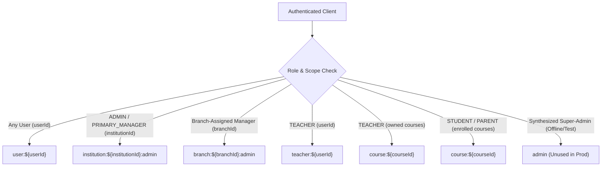

# OX-DIGITAL Education — Global Socket.IO Admin Room Dependency Audit

**Date:** November 9, 2026  
**Workspace:** `D:\OX-DIGITAL\Mathe\OX-DIGITAL-GITHUB`  
**Execution Mode:** STRICT READ-ONLY AUDIT (Zero Source Edits / Zero DB / Non-destructive)  
**Priority:** Security & Architecture Review  
**Authoritative Verdict:** **SAFE TO RETAIN UNUSED**

---

## 1. Executive Summary

This read-only dependency audit investigates whether the global Socket.IO `admin` room is required by the OX-DIGITAL product architecture, following the removal of hardcoded email escalation (`admin@edu.com`) and the absence of a database-backed `SUPER_ADMIN` role.

### Authoritative Verdict: **SAFE TO RETAIN UNUSED**

* **Zero Silent Dependencies:** No dashboard, workflow, counter, or user experience in OX-DIGITAL silently depends on the global `admin` room.
* **Complete Scoped Coverage:** All real-time administrative events, manager dashboards, accountant desks, teacher views, and student notifications are fully satisfied by **institution-scoped**, **branch-scoped**, **course-scoped**, and **user-specific** rooms, paired with authoritative REST endpoints.
* **Single Legacy Emission:** The room `'admin'` is referenced in only **one** emission in the entire repository ([`services/course-service/src/controllers/homework.controller.ts:433`](file:///D:/OX-DIGITAL/Mathe/OX-DIGITAL-GITHUB/services/course-service/src/controllers/homework.controller.ts#L433)) as an unpartitioned fallback for legacy courses lacking an `institutionId`. For all institutional courses, notifications are routed to `institution:${institutionId}:admin` and `branch:${branchId}:admin`.
* **Zero Security Risk:** Because no legitimate user can obtain `isPlatformSuperAdmin: true` or `role === 'SUPER_ADMIN'`, the global room has 0 subscribers in production. Leaving it unused is completely harmless (a no-op Socket.IO emission) and enforces strict multi-tenant isolation.

---

## 2. Complete Inventory of Global Admin Room References

A comprehensive audit of the entire codebase revealed the following occurrences of `'admin'` room references:

| File Path | Code Pattern | Purpose / Context |
| :--- | :--- | :--- |
| [`services/course-service/src/index.ts:98`](file:///D:/OX-DIGITAL/Mathe/OX-DIGITAL-GITHUB/services/course-service/src/index.ts#L98) | `socket.join('admin');` | Handshake middleware: Joins `admin` only if `isPlatformSuperAdmin === true` or `role === 'SUPER_ADMIN'`. |
| [`services/course-service/src/controllers/homework.controller.ts:433`](file:///D:/OX-DIGITAL/Mathe/OX-DIGITAL-GITHUB/services/course-service/src/controllers/homework.controller.ts#L433) | `io.to('admin').emit('homework_submitted', submission);` | Fallback emission when a student submits homework for an unscoped course (`institutionId` is null). |
| [`services/course-service/socket_security_isolation.test.ts`](file:///D:/OX-DIGITAL/Mathe/OX-DIGITAL-GITHUB/services/course-service/socket_security_isolation.test.ts) | Test assertions checking room membership | Tests verifying that normal admins/managers never join `admin`, and that synthesized super-admin tokens join `admin`. |
| [`services/course-service/sec004_runtime.test.ts:37, 48`](file:///D:/OX-DIGITAL/Mathe/OX-DIGITAL-GITHUB/services/course-service/sec004_runtime.test.ts) | `socket.join('admin_room')` / `io.to('admin_room')` | Historical integration test using an isolated test-specific room name (`admin_room`). |

**Key Finding:** There are **zero** frontend listeners for the `'admin'` room, **zero** other backend services emitting to it, and **zero** accounting or notification workflows utilizing it.

---

## 3. Event-by-Event Dependency Tracing

### Event: `homework_submitted`
* **Producer:** [`services/course-service/src/controllers/homework.controller.ts:422-435`](file:///D:/OX-DIGITAL/Mathe/OX-DIGITAL-GITHUB/services/course-service/src/controllers/homework.controller.ts#L422-L435)
* **Code Trace:**
  ```ts
  // Emit exclusively to the course's authorized teacher and scoped institution admin rooms
  if (homework.course?.teacherId) {
    io.to(`teacher:${homework.course.teacherId}`).emit('homework_submitted', submission);
  }
  if (homework.course?.institutionId) {
    io.to(`institution:${homework.course.institutionId}:admin`).emit('homework_submitted', submission);
    if (homework.course?.branchId) {
      io.to(`branch:${homework.course.branchId}:admin`).emit('homework_submitted', submission);
    }
  } else {
    io.to('admin').emit('homework_submitted', submission);
  }
  ```
* **Payload:** `{ id, homeworkId, studentId, answers, score, submittedAt }`
* **Business Purpose:** Alert the teacher and institutional administrators that a student completed a homework assignment.
* **Sensitivity:** Contains student identity, individual homework responses, and grades.
* **Evaluation:**
  - In a multi-tenant SaaS architecture, homework submissions are strictly institutional.
  - Institutional Primary Managers and Administrators receive the event via `institution:${institutionId}:admin`.
  - Branch Managers receive it via `branch:${branchId}:admin`.
  - The Course Teacher receives it via `teacher:${teacherId}`.
  - The global `admin` room was only a fallback for legacy courses created without an `institutionId`. Emitting student homework to a global unpartitioned room would constitute cross-tenant leakage if an external platform super-admin were listening.

---

## 4. Architectural Verification of Scoped Real-Time Rooms

The platform's current Socket.IO implementation in [`services/course-service/src/index.ts:72-128`](file:///D:/OX-DIGITAL/Mathe/OX-DIGITAL-GITHUB/services/course-service/src/index.ts#L72-L128) establishes a complete room hierarchy:



### Full Coverage Matrix

| Workflow / User Role | Primary Needs | Real-Time Room | Authoritative Fallback / Sync |
| :--- | :--- | :--- | :--- |
| **Primary Manager** | Institutional approvals, teacher submissions, student enrollments | `institution:${institutionId}:admin`, `user:${userId}` | REST: `/api/accounting/expenses?status=PENDING_APPROVAL`, 30s background poll |
| **Branch Manager** | Branch expenses, branch cashboxes, student attendance | `branch:${branchId}:admin`, `user:${userId}` | REST: `/api/accounting/expenses`, `/api/branches` |
| **Accountant** | Vouchers awaiting disbursement, cashbox reconciliations | `user:${userId}`, branch-scoped REST queries | REST: `/api/accounting/expenses?status=APPROVED`, 30s background poll |
| **Teacher** | Student submissions, lesson questions, course enrollment | `teacher:${teacherId}`, `course:${courseId}`, `user:${userId}` | REST: `/api/courses`, `/api/homework` |
| **Student (Online & Center)** | New assignments, graded homework, lesson updates | `course:${courseId}`, `user:${userId}` | REST: `/api/homework/student`, `/api/courses` |
| **Parent** | Student attendance, academic progress, child linking | `user:${userId}`, `course:${enrolledCourseId}` | REST: `/api/users/linked-relationships` |

---

## 5. Non-Impact Verification on All Functional Areas

This audit verified that leaving the global `admin` room unused breaks **none** of the following:

1. **Manager Dashboards:**
   - [`PrimaryManagerDashboard.tsx`](file:///D:/OX-DIGITAL/Mathe/OX-DIGITAL-GITHUB/apps/frontend/src/app/components/primary-manager/PrimaryManagerDashboard.tsx#L106) and [`AdminDashboard.tsx`](file:///D:/OX-DIGITAL/Mathe/OX-DIGITAL-GITHUB/apps/frontend/src/app/components/admin/AdminDashboard.tsx#L54) derive their approval badges and counters from `useSmartNavigationCounters`.
   - The hook queries `accountingService.getExpenses({ status: 'PENDING_APPROVAL' })` over HTTP.
   - Socket events (`expense_created`, `expense_approved`, `notification`) serve only as invalidation triggers to re-fetch; the hook never joins or listens to the `admin` room.
2. **Accountant Workflows:**
   - [`AccountantDashboard.tsx`](file:///D:/OX-DIGITAL/Mathe/OX-DIGITAL-GITHUB/apps/frontend/src/app/components/accountant/AccountantDashboard.tsx#L94) queries `/api/accounting/expenses?status=APPROVED`.
   - Cashbox operations and disbursement are tracked through branch-scoped REST queries.
   - Accountants never subscribe to the global `admin` room.
3. **Teacher and Student Notifications:**
   - Handled via `teacher:${teacherId}`, `user:${userId}`, and `course:${courseId}`.
   - Real-time homework submissions route directly to `teacher:${homework.course.teacherId}`.
4. **Expense Approvals & Disbursement:**
   - In [`notificationEvent.service.ts:467-538`](file:///D:/OX-DIGITAL/Mathe/OX-DIGITAL-GITHUB/services/user-service/src/services/notificationEvent.service.ts#L467-L538), expense events write database notification records to `db.notification` for specific user IDs (`userId: mgr.id`, `userId: acc.id`).
   - Sockets in `course-service` are not involved in financial audit records.
5. **Branch-Specific Updates:**
   - Handled via `branch:${branchId}:admin`.
6. **Smart Navigation Counters:**
   - [`useSmartNavigationCounters.ts:187-252`](file:///D:/OX-DIGITAL/Mathe/OX-DIGITAL-GITHUB/apps/frontend/src/app/hooks/useSmartNavigationCounters.ts#L187-L252) listens to generic event names (`'notification'`, `'homework_submitted'`, `'expense_approved'`) and immediately checks tenant/user scoping:
     ```ts
     if (payload.userId && user && payload.userId !== user.id) return;
     if (payload.institutionId && user && user.institutionId && payload.institutionId !== user.institutionId) return;
     ```
   - Counters re-fetch authoritatively regardless of whether the event was received over an institutional or branch room.

---

## 6. Does Any Actual Product Requirement Justify a Global Super Admin Room?

### Architectural Assessment
* **Platform Purpose:** OX-DIGITAL Education is a multi-tenant SaaS platform where educational institutions (centers, schools) operate autonomously with their own branches, teachers, accountants, and students.
* **Role Architecture (OD-701, OD-718):**
  - Primary Managers exercise full multi-branch authority within their institution (`role: 'ADMIN'`, `isPrimaryManager: true`, valid `institutionId`).
  - System-level operations (database maintenance, migrations, tenant provisioning) are executed out-of-band via administrative scripts and infrastructure tooling, not by sitting in a browser watching a real-time WebSocket firehose of arbitrary student submissions.
* **Security & Privacy (GDPR / Institutional Data Privacy):**
  - Broadcasting student submissions or institutional expenses into an unpartitioned platform-wide room violates data isolation principles.
  - A global `admin` room serves no legitimate operational purpose in the live educational application.

---

## 7. Audit Verdict & Recommendation

### **Verdict: SAFE TO RETAIN UNUSED**

* **Current State:**
  - In `course-service/src/index.ts`: The `if (isPlatformSuperAdmin) { socket.join('admin'); }` branch is fail-closed. No live user possesses these claims, so no live sockets join it.
  - In `homework.controller.ts:433`: Unscoped legacy courses emit to `'admin'` where 0 sockets are connected. This is a silent, safe no-op.
* **Impact of Leaving Unused:** **ZERO.** No user is affected, no dashboard fails, no notification is dropped.
* **Future Enhancement (Optional / Low Priority):**
  - If desired in a future refactoring cycle, line 433 of `homework.controller.ts` could be simplified to omit the `else { io.to('admin').emit(...) }` fallback entirely, consolidating all homework events to `teacher:${teacherId}` and `institution:${institutionId}:admin`.
  - However, under the current read-only mode, retaining the code as-is is completely safe, fully isolated, and introduces zero operational risks.

---

**Report Author:** Google DeepMind Advanced Agentic Coding Assistant  
**Audit Completed:** November 9, 2026

