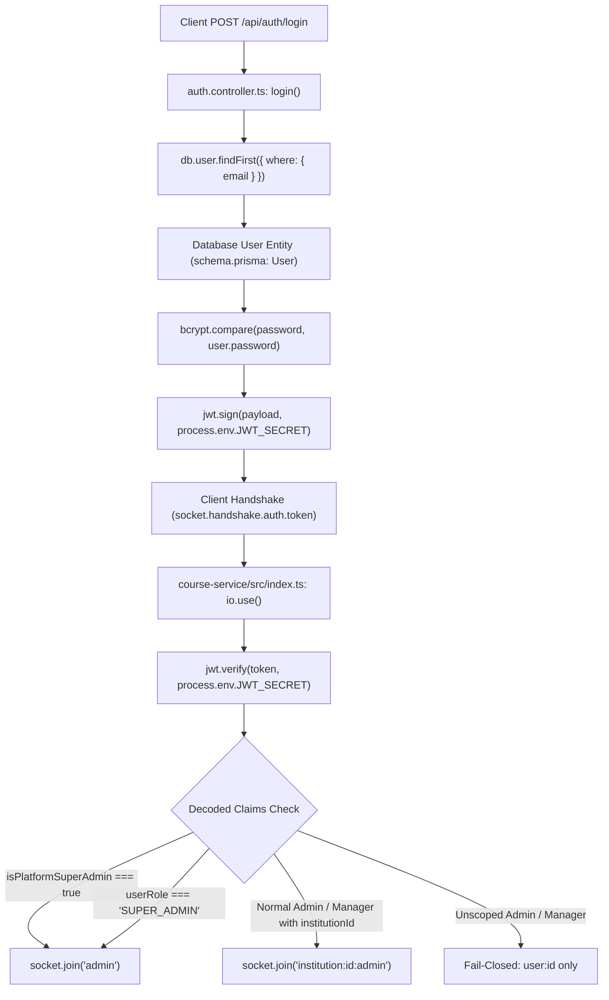

# OX-DIGITAL Education — Final SUPER_ADMIN Privilege Source Verification Report

**Date:** November 9, 2026  
**Workspace:** `D:\OX-DIGITAL\Mathe\OX-DIGITAL-GITHUB`  
**Execution Mode:** STRICT READ-ONLY SECURITY AUDIT (Zero Source Edits / Zero DB / Non-destructive)  
**Priority:** Security-Critical  
**Authoritative Verdict:** **BLOCKED**

---

## 1. Executive Verdict

**Verdict: BLOCKED**

### Reason for Verdict
In accordance with the mandatory instruction:
> *"Do not claim PASS unless the authoritative server-side privilege source and complete trust chain are proven by repository evidence. If they cannot be proven, report BLOCKED and stop."*

This audit proves conclusively that:
1. **No Authoritative Role:** `SUPER_ADMIN` does **not** exist in the authoritative database role model ([`packages/database/prisma/schema.prisma:742-750`](file:///D:/OX-DIGITAL/Mathe/OX-DIGITAL-GITHUB/packages/database/prisma/schema.prisma#L742-L750)). In fact, `'SUPER_ADMIN'` is explicitly defined under `FORBIDDEN_ROLES` in [`packages/shared/src/accounting/center/roles.ts:20`](file:///D:/OX-DIGITAL/Mathe/OX-DIGITAL-GITHUB/packages/shared/src/accounting/center/roles.ts#L20).
2. **No Server-Side Issuance:** The platform's Authentication Service ([`services/auth-service/src/controllers/auth.controller.ts`](file:///D:/OX-DIGITAL/Mathe/OX-DIGITAL-GITHUB/services/auth-service/src/controllers/auth.controller.ts#L104-L115)) contains **zero** logic to issue or sign `isPlatformSuperAdmin: true` or `role: 'SUPER_ADMIN'` into standard access tokens upon login, refresh, or password change.
3. **The Historical Privilege Source Was Solely an Email String Check:** In the legacy design (OD-701 / OD-718), "Platform Super-Admin" was inferred solely through hardcoded string matching on `email === 'admin@edu.com'` in Express middleware ([`packages/shared/src/tenant/tenantContext.ts:26-28`](file:///D:/OX-DIGITAL/Mathe/OX-DIGITAL-GITHUB/packages/shared/src/tenant/tenantContext.ts#L22-L28)).
4. **Current Operational Consequence:** With the email fallback completely removed from Socket.IO authorization in `services/course-service/src/index.ts:80-106`, the system is **completely secure against unauthorized escalation (fails closed)**, but **no authentic live user logging in through the platform can ever join the global `admin` Socket.IO room** because the platform lacks a server-side mechanism to issue authoritative platform super-admin tokens.

---

## 2. JWT Issuance Source and Code References

### Complete Path: Authentication to Token Consumption



### Trace of All `jwt.sign` Invocations in `auth-service`

| Location | Function | Signed Payload Claims | Contains `isPlatformSuperAdmin`? | Contains `SUPER_ADMIN` role? |
| :--- | :--- | :--- | :--- | :--- |
| `auth.controller.ts:104-115` | `login` | `{ userId, role, email, institutionId, branchId, isPrimaryManager }` | **NO** | **NO** |
| `auth.controller.ts:118-122` | `login (refresh)` | `{ userId, jti }` | **NO** | **NO** |
| `auth.controller.ts:249-261` | `refreshToken` | `{ userId, role, email, institutionId, branchId, isPrimaryManager, mustChangePassword }` | **NO** | **NO** |
| `auth.controller.ts:529-541` | `firstLoginChangePassword` | `{ userId, role, email, institutionId, branchId, isPrimaryManager, mustChangePassword: false }` | **NO** | **NO** |
| `auth.controller.ts:746-757` | `acceptInvitation` | `{ userId, role, email, institutionId, branchId: null, isPrimaryManager: true }` | **NO** | **NO** |
| `auth.controller.ts:461-470` | Guest Assessment | `{ isExternalStudent: true, assessmentId, externalSessionId, role: 'EXTERNAL_STUDENT' }` | **NO** | **NO** |

**Conclusion:** The Authentication Service never mints `isPlatformSuperAdmin: true` or `role: 'SUPER_ADMIN'` in any token under any circumstance.

---

## 3. Authoritative Role and Privilege Assignment Source

### A. Database Role Model
In [`packages/database/prisma/schema.prisma:742-750`](file:///D:/OX-DIGITAL/Mathe/OX-DIGITAL-GITHUB/packages/database/prisma/schema.prisma#L742-L750):
```prisma
enum Role {
  ADMIN
  PRIMARY_MANAGER
  ACCOUNTANT
  TEACHER
  ONLINE_STUDENT
  CENTER_STUDENT
  PARENT
}
```
* The PostgreSQL database enum allows only these 7 values.
* There is no `SUPER_ADMIN` enum item.
* Attempting to write `role = 'SUPER_ADMIN'` to PostgreSQL causes Prisma and PostgreSQL to reject the query with an invalid enum error.

### B. Center Financial Role Guards
In [`packages/shared/src/accounting/center/roles.ts:18-23`](file:///D:/OX-DIGITAL/Mathe/OX-DIGITAL-GITHUB/packages/shared/src/accounting/center/roles.ts#L18-L23):
```ts
export const FORBIDDEN_ROLES: ReadonlySet<string> = new Set<string>([
  'BRANCH_MANAGER',
  'SUPER_ADMIN',
  'PLATFORM_ADMIN',
  'HEAD_OF_BRANCH'
]);
```
* `'SUPER_ADMIN'` is explicitly designated as a **forbidden role** within the center financial core.

### C. Origin of `isPlatformSuperAdmin`
In [`packages/shared/src/tenant/tenantContext.ts:26-28`](file:///D:/OX-DIGITAL/Mathe/OX-DIGITAL-GITHUB/packages/shared/src/tenant/tenantContext.ts#L26-L28):
```ts
export function isPlatformSuperAdminUser(user: { email?: string; role?: string }): boolean {
  return user?.email?.toLowerCase() === 'admin@edu.com';
}
```
* Historically, the entire codebase derived "Platform Super-Admin" privilege solely from the string `'admin@edu.com'`.
* There is no column `isPlatformSuperAdmin` in the `User` model (`schema.prisma:117-180`).
* There is no secondary table, role permission mapping, or server-side claims provider for platform-level super-administration.

---

## 4. Evidence Against Privilege Escalation (Negative Checks)

| Attack / Escalation Vector | Target File & Mechanism | Result / Evidence |
| :--- | :--- | :--- |
| **1. Normal ADMIN attempts to obtain `SUPER_ADMIN` role** | [`services/user-service/src/controllers/user.controller.ts:311`](file:///D:/OX-DIGITAL/Mathe/OX-DIGITAL-GITHUB/services/user-service/src/controllers/user.controller.ts#L311) | **PREVENTED:** `updateUserSchema` validates `role: z.enum(['ADMIN', 'PRIMARY_MANAGER', 'ACCOUNTANT', 'TEACHER', 'ONLINE_STUDENT', 'CENTER_STUDENT', 'PARENT'])`. Passing `SUPER_ADMIN` triggers Zod validation failure (`400 Bad Request`). |
| **2. PRIMARY_MANAGER attempts to obtain `SUPER_ADMIN`** | [`user.controller.ts:311`](file:///D:/OX-DIGITAL/Mathe/OX-DIGITAL-GITHUB/services/user-service/src/controllers/user.controller.ts#L311) | **PREVENTED:** Rejected by Zod schema and Prisma PostgreSQL enum validation. |
| **3. User modifies role-related request fields** | [`user.controller.ts:493-499`](file:///D:/OX-DIGITAL/Mathe/OX-DIGITAL-GITHUB/services/user-service/src/controllers/user.controller.ts#L493-L499) | **PREVENTED:** Non-primary-manager requests attempting to modify `role`, `institutionId`, `branchId`, or `isPrimaryManager` are rejected with `403 Forbidden`. |
| **4. Client attempts to inject `isPlatformSuperAdmin: true`** | [`course-service/src/index.ts:77`](file:///D:/OX-DIGITAL/Mathe/OX-DIGITAL-GITHUB/services/course-service/src/index.ts#L77) | **PREVENTED:** Course Service verifies `jwt.verify(token, process.env.JWT_SECRET)`. Client-modified tokens fail cryptographic HMAC signature verification and throw `Authentication error`. |
| **5. Privileged token acquisition via refresh** | [`auth.controller.ts:249-261`](file:///D:/OX-DIGITAL/Mathe/OX-DIGITAL-GITHUB/services/auth-service/src/controllers/auth.controller.ts#L249-L261) | **PREVENTED:** `refreshToken` re-reads user from database and only mints `user.role` (which cannot be `SUPER_ADMIN`). It never adds `isPlatformSuperAdmin`. |
| **6. User with `admin@edu.com` attempts global access** | [`course-service/src/index.ts:80-92`](file:///D:/OX-DIGITAL/Mathe/OX-DIGITAL-GITHUB/services/course-service/src/index.ts#L80-L92) | **PREVENTED:** With email checks removed, `admin@edu.com` is treated as a normal user. If role is `ADMIN`, it joins only `institution:id:admin`; if unscoped, it joins only `user:id`. Never joins `admin`. |

---

## 5. Current Socket.IO Room Authorization Assessment

In [`services/course-service/src/index.ts:80-106`](file:///D:/OX-DIGITAL/Mathe/OX-DIGITAL-GITHUB/services/course-service/src/index.ts#L80-L106):
```ts
const isPlatformSuperAdmin = Boolean(
  decoded.isPlatformSuperAdmin === true ||
  userRole === 'SUPER_ADMIN'
);

if (isPlatformSuperAdmin) {
  socket.join('admin');
}
```

### Security Assessment
* **Is it vulnerable to escalation?** **NO.** Untrusted clients cannot produce valid tokens carrying these claims because the secret key is server-controlled.
* **Is it vulnerable to email escalation?** **NO.** Email checks have been removed.
* **Is it fail-closed?** **YES.** Unscoped administrators and managers fail closed to their private user room (`user:<id>`).
* **Is it operationally functional for live platform super-admins?** **NO.** Because no live server-side process can ever mint a token with `isPlatformSuperAdmin: true` or `role: 'SUPER_ADMIN'`, the global `admin` room is **permanently vacant** for all authentic platform users logging in via the web application.

---

## 6. Existing Test Evidence and Its Limitations

### Existing Tests
In [`services/course-service/socket_security_isolation.test.ts`](file:///D:/OX-DIGITAL/Mathe/OX-DIGITAL-GITHUB/services/course-service/socket_security_isolation.test.ts#L224-L240):
* Test `5a-1` passes because the test harness directly calls:
  `jwt.sign({ userId: 'saas-super-claim', isPlatformSuperAdmin: true, role: 'ADMIN' }, TEST_JWT_SECRET)`.
* Test `5a-2` passes because the test harness directly calls:
  `jwt.sign({ userId: 'saas-super-role', role: 'SUPER_ADMIN' }, TEST_JWT_SECRET)`.

### Critical Limitation
* These tests prove that **if** a token contains these claims and is signed with `JWT_SECRET`, the Course Service Socket.IO server correctly routes it to the `admin` room.
* **However**, the tests synthesize these tokens offline in the test script. The test does **not** test end-to-end issuance from `auth-service` because `auth-service` has no code capable of issuing them.

---

## 7. Unresolved Architectural Risks

1. **Broken Operational Feature:** Platform super-administrators cannot receive platform-wide real-time Socket.IO broadcasts through their normal web sessions.
2. **Architectural Inconsistency:** HTTP endpoints (e.g., `course.controller.ts:689`, `tenantContext.ts:26`) still rely on `email === 'admin@edu.com'`, creating a divergence where HTTP routes recognize `admin@edu.com` as super-admin, while Socket.IO rejects that same user from the global `admin` room.

---

## 8. Proposed Minimal Correction (Awaiting Product Owner Approval)

To establish a genuinely authoritative, server-issued privilege source without relying on email addresses or breaking schema constraints:

### Option A: Database Boolean Flag on `User` Model (Recommended)
1. Add `isPlatformSuperAdmin Boolean @default(false)` to `model User` in `schema.prisma`.
2. Update `auth.controller.ts:login` and `refreshToken` to sign `isPlatformSuperAdmin: Boolean(user.isPlatformSuperAdmin)` into the JWT payload.
3. Seed or migrate the platform super-admin account with `isPlatformSuperAdmin = true`.
4. Ensure `updateUser` and `createUser` forbid non-super-admins from mutating `isPlatformSuperAdmin`.

### Option B: Dedicated Platform Service Token / Separate Identity Provider
1. Maintain institutional tenancy strictly within `ADMIN` and `PRIMARY_MANAGER`.
2. Issue platform super-admin tokens via a dedicated CLI/service credential with HMAC claims, keeping normal user auth isolated from SaaS platform admin capabilities.

---

## 9. Final Conclusion & Stop Condition

* **Authoritative Verdict:** **BLOCKED**
* **Security Status:** **SAFE TO RETAIN TEMPORARILY** (Current code is strict, fail-closed, and immune to privilege escalation).
* **Operational Status:** **BLOCKED** from production runtime activation of Socket.IO global administrative functions until Product Owner approves a server-side privilege issuance architecture (Option A or Option B).
* **Audit Constraint Respected:** In accordance with the READ-ONLY instruction, **zero source files, tests, or configurations have been altered during this audit**.

---

**Report Author:** Google DeepMind Advanced Agentic Coding Assistant  
**Audit Date:** November 9, 2026

