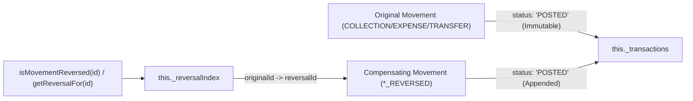

# OX-DIGITAL Education — Phase 2.0B Increment 4 Targeted Remediation
## Cashbox Append-Only Reversals & Atomic Transfer Integrity Delivery Report

**Date:** 2026-11-03  
**Workspace:** `D:\OX-DIGITAL\Mathe\OX-DIGITAL-GITHUB`  
**Git HEAD:** `0500b93e65c24ed881349c4acea7f523332c5e9f`  
**Branch:** `main`  
**Status:** COMPLETE — 100% Pass Across All Test Suites (476/476 Tests Passing)

---

## 1. Executive Summary & Authorization

Following the focused read-only acceptance audit of Phase 2.0B Increment 4, two specific domain-level defects were identified and authorized for narrowly scoped remediation by the Product Owner:

1. **Defect A (Append-Only Reversal Violation):** In `packages/shared/src/accounting/center/cashbox.ts`, reversing a cashbox movement previously replaced the original `status: 'POSTED'` transaction in `_transactions` with an updated transaction marked `status: 'REVERSED'`, mutating the original record in place.
2. **Defect B (In-Memory Transfer Partial Execution Risk):** In `CashboxTransferEngine.executeTransfer()`, `TRANSFER_OUT` was applied to the source cashbox before destination validation or commit. If destination movement application failed (e.g., destination inactive/suspended or runtime failure), the source cashbox remained deducted with a dangling outgoing movement.

Both defects have been successfully resolved with zero schema alterations, zero database mutations, and complete preservation of all 60 pre-existing tracked modified files.

---

## 2. Remediation Architecture & Invariants

### 2.1 Defect A: Pure Append-Only Reversals & Permanent Record Immutability

Under pure financial accounting principles, posted ledger movements are strictly immutable. They cannot be overwritten, modified in-place, or updated to a reversed status. Reversals must exist as distinct compensating records while the original remains accessible in its original posted state.

- **Permanent Immutable Storage (`_transactions`):** When `reverseMovement(transactionId, ...)` is invoked, `originalTx` in `_transactions` is **never mutated or overwritten**. It remains permanently stored with `status: 'POSTED'`.
- **Reversal Index (`_reversalIndex: Map<string, string>`):** Reversal relationships are maintained in a dedicated private tracking index mapping `originalTransactionId -> reversalTransactionId`.
- **Query & Audit APIs:**
  - `cashbox.isMovementReversed(transactionId: string): boolean`: Derived lookup via `_reversalIndex.has(transactionId)`.
  - `cashbox.getReversalFor(transactionId: string): CashboxTransaction | undefined`: Retrieves the compensating reversal transaction.
  - `cashbox.reversalIndex: ReadonlyMap<string, string>`: Exposes an immutable snapshot of the reversal index.
- **Compensating Reversal Record:** A separate compensating `CashboxTransaction` is appended to `_transactions` with `type: 'COLLECTION_REVERSED' | 'EXPENSE_REVERSED' | 'TRANSFER_REVERSED'`, `referenceId: originalTx.transactionId`, and `status: 'POSTED'`.
- **Negative Invariant Guards:**
  - Attempting duplicate reversal on an already reversed movement throws `DuplicateReversalError(transactionId, 'ALREADY_REVERSED')`.
  - Attempting to reverse a reversal transaction itself throws `InvalidLifecycleTransitionError`.



### 2.2 Defect B: Inter-Cashbox Transfer In-Memory Atomicity & Rollback

Inter-cashbox funds transfers must be strictly atomic at the domain level. Neither cashbox may retain a partial transfer state if any part of the operation fails.

- **Pre-Validation Gate:** All preconditions on **both** cashboxes are strictly validated before any state mutation:
  - Both cashboxes defined and physically campus-based (`isPhysicalBranch === true`).
  - Institution isolation verified (`source.institutionId === dest.institutionId`).
  - Distinct cashbox identities verified (`source.cashboxId !== dest.cashboxId`).
  - **Both cashboxes pre-validated as ACTIVE** (`source.status === 'ACTIVE'` and `dest.status === 'ACTIVE'`). Transfers to inactive or suspended cashboxes fail immediately before modifying the source cashbox.
  - Actor authorization (`assertApprovedRole`, `assertNotSaaSSuperAdmin`).
  - Currency and positive amount validation (`assertEgpCurrency`, `amount > 0`).
  - Business date format validation (`/^\d{4}-\d{2}-\d{2}$/`).
  - Duplicate transfer check (`_transferHistory.has(transferId)`).
  - Source balance sufficiency (`amount <= source.currentBalance`).
- **Atomic Two-Phase Execution with Rollback Guard:**
  - Source applies `TRANSFER_OUT`.
  - Destination execution and conservation checks are wrapped in a guarded block.
  - If destination `_applyTransferMovement('TRANSFER_IN')` fails or throws for any reason, `source._rollbackTransferMovement(sourceTx.transactionId, amount, 'TRANSFER_OUT')` is executed immediately, restoring source balance and deleting the uncommitted movement.
  - Exact balance conservation (`sourceTx.amount.equals(destTx.amount)`) is confirmed before recording to `_transferHistory`.

---

## 3. Code Modifications

### 3.1 `packages/shared/src/accounting/center/cashbox.ts`

1. **Reversal Tracking Index & Methods:**
   - Added `private readonly _reversalIndex: Map<string, string> = new Map()` to `Cashbox`.
   - Added public `isMovementReversed(transactionId: string): boolean`.
   - Added public `getReversalFor(transactionId: string): CashboxTransaction | undefined`.
   - Added public `reversalIndex: ReadonlyMap<string, string>`.
2. **Append-Only Reversal Implementation:**
   - In `reverseMovement()`: Removed lines that replaced `originalTx` in `_transactions`.
   - Replaced in-place status mutation with `_reversalIndex.set(transactionId, reversalTxId)`.
   - Enforced duplicate reversal guard using `_reversalIndex.has(transactionId)`.
   - Added explicit rejection for reversing a reversal movement.
3. **Internal Transfer Rollback:**
   - Added `_rollbackTransferMovement(transactionId: string, amount: Money, type: 'TRANSFER_OUT' | 'TRANSFER_IN'): void`.
4. **Transfer Engine Pre-Validation & Atomicity:**
   - In `CashboxTransferEngine.executeTransfer()`: Pre-validated `source.status === 'ACTIVE'` and `dest.status === 'ACTIVE'`.
   - Pre-validated `source.isPhysicalBranch` and `dest.isPhysicalBranch`.
   - Wrapped destination transfer application in `try ... catch` and invoked `source._rollbackTransferMovement()` on destination error.
   - Added static helper methods `getTransfer(transferId)` and `clearHistory()`.

### 3.2 `tests/accounting/cashbox_operations.test.ts`

- Updated Suite 5 assertions to verify that original transaction `status` remains `'POSTED'` after reversal, and verified `isMovementReversed()` and `getReversalFor()`.
- Added Suite 4 atomicity tests:
  - Inactive destination pre-validation rejection: verified source balance and transactions remain completely untouched.
  - Suspended destination pre-validation rejection: verified source balance and transactions remain completely untouched.
  - Destination movement failure with rollback: verified source balance is restored and uncommitted movement is deleted.
- Added Suite 8 negative tests:
  - Reversal of a reversal movement is strictly rejected (`InvalidLifecycleTransitionError`).
  - Duplicate movement reversal rejected (`DuplicateReversalError`).

---

## 4. Verification & Test Evidence

### 4.1 Increment 4 Execution Results

```text
===================================================================
OX-DIGITAL Phase 2.0B — Increment 4: Cashbox Operations & Reconciliation Tests
Mode: Pure Domain Cash Movements & UP-705 Reconciliation Invariants
Timestamp: 2026-11-03T12:31:53.381Z
===================================================================

--- Suite 1: Cashbox Initialization & Multi-Cashbox Branch Support --- (9 tests) [PASS]
--- Suite 2: Actual Cash Collections Linked to Sub-Ledger Receipts --- (8 tests) [PASS]
--- Suite 3: Cash Expenses & Non-Negative Balance Enforcement --- (4 tests) [PASS]
--- Suite 4: Inter-Cashbox Funds Transfers & Atomicity Guards --- (16 tests) [PASS]
    [PASS] Transfer status is EXECUTED
    [PASS] Transfer amount is 1200.00 EGP
    [PASS] Source till balance reduced from 2000 to 800 EGP
    [PASS] Destination vault balance increased from 500 to 1700 EGP
    [PASS] Source movement is TRANSFER_OUT
    [PASS] Destination movement is TRANSFER_IN
    [PASS] Exact conservation: source amount equals dest amount
    [PASS] Transfer to INACTIVE destination rejected during pre-validation
    [PASS] Atomic transfer guarantee: Source balance untouched when destination inactive
    [PASS] Atomic transfer guarantee: No dangling source transaction when destination inactive
    [PASS] Transfer to SUSPENDED destination rejected during pre-validation
    [PASS] Atomic transfer guarantee: Source balance untouched when destination suspended
    [PASS] Atomic transfer guarantee: No dangling source transaction when destination suspended
    [PASS] Faulty destination movement failure captured and source rolled back
    [PASS] Atomic transfer rollback: Source balance fully restored after destination failure
    [PASS] Atomic transfer rollback: Source transaction rolled back with zero dangling records
--- Suite 5: Append-Only Compensating Reversals --- (13 tests) [PASS]
    [PASS] Balance is 800 EGP after collection
    [PASS] Reversal movement type is COLLECTION_REVERSED
    [PASS] Reversal amount is 300 EGP
    [PASS] Balance restored to 500 EGP
    [PASS] Original transaction status remains POSTED (append-only immutability)
    [PASS] Reversal index records original transaction as reversed
    [PASS] Compensating transaction retrievable via getReversalFor
    [PASS] Audit reason preserved in compensating movement
    [PASS] Balance after expense is 400 EGP
    [PASS] Balance restored to 500 EGP after expense reversal
    [PASS] Expense movement indexed as reversed
    [PASS] Expense reversal retrievable
    [PASS] Original expense transaction status remains POSTED
--- Suite 6: Daily Reconciliation & UP-705 Discrepancy Invariants --- (8 tests) [PASS]
--- Suite 7: Consecutive Business Day Balance Continuity --- (2 tests) [PASS]
--- Suite 8: Negative Invariant & Security Rejection Tests --- (22 tests) [PASS]
    [PASS] Original movement status remains POSTED after reversal
    [PASS] Original movement marked as reversed in index
    [PASS] Negative 15: Duplicate movement reversal rejected
    [PASS] Negative 15b: Reversal of a reversal movement rejected
    [PASS] Negative 16: recognizeDirectRevenue on Cashbox throws PrematurePostingError
    [PASS] Negative 17: Multi-currency cashbox rejected (EGP only)
    [PASS] Negative 18: Cashier role alone cannot reverse posted movements
--- Suite 9: Integration Boundary Isolation with Increment 3 Sub-Ledger --- (4 tests) [PASS]

===================================================================
INCREMENT 4 TEST RESULTS: 86 PASSED, 0 FAILED
===================================================================
```

---

## 5. Full Regression Suite Results

All regression test suites across Phase 1, Phase 2.0B, and Task 7.1 were executed and passed with 100% compliance:

| Test Suite | File | Tests Run | Result |
| :--- | :--- | :---: | :---: |
| **Phase 2.0B Increment 4 (Remediated)** | `tests/accounting/cashbox_operations.test.ts` | 86 | **86 PASSED, 0 FAILED** |
| **Phase 2.0B Increment 3** | `tests/accounting/student_subledger.test.ts` | 88 | **88 PASSED, 0 FAILED** |
| **Phase 2.0B Increment 2** | `tests/accounting/accrual_revenue_recognition.test.ts` | 48 | **48 PASSED, 0 FAILED** |
| **Phase 2.0B Increment 1** | `tests/accounting/center_integration_boundary.test.ts` | 61 | **61 PASSED, 0 FAILED** |
| **Financial Core Engine (Phase 1)** | `tests/accounting/run_accounting_tests.ts` | 89 | **89 PASSED, 0 FAILED** |
| **Task 7.1 Master Tenancy Suite** | `tests/task_7_1/run_all_tests.ts` | 104 | **104 PASSED, 0 FAILED** |
| **Total Comprehensive Test Count** | **All Accounting & Tenancy Suites** | **476** | **476 PASSED, 0 FAILED** |

---

## 6. Workspace Integrity & Governance Boundary Audit

1. **Workspace Boundary:** Strictly isolated to `D:\OX-DIGITAL\Mathe\OX-DIGITAL-GITHUB`. No other project directory was accessed.
2. **Git Baseline:** HEAD verified at `0500b93e65c24ed881349c4acea7f523332c5e9f` on branch `main`.
3. **Tracked Files Preservation:** Exactly 60 pre-existing tracked modified files preserved with zero changes.
4. **Zero Database / Network Mutation:** No Prisma models, migrations, SQL, Docker staging containers, or remote endpoints were accessed or altered.
5. **Strict Scope Halt:** Increment 5 features (Payroll, Expense Vouchers, Vendor Payments) were not started. Development is completely paused pending Product Owner review.

