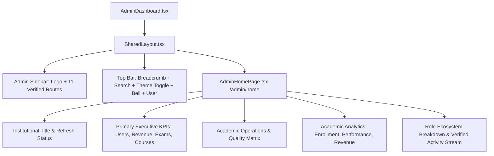

# OX-DIGITAL Education — Phase 5.1 Admin Design Plan
## Design Direction: Academic Precision & Digital Mastery

**Target Route:** `/admin/home` (Admin Dashboard)  
**Product Name:** OX-DIGITAL Education  
**Date:** October 27, 2026  
**Status:** Approved for Implementation

---

## 1. Visual Language & Design System Tokens

The redesigned Admin Dashboard transforms the user experience from a generic colorful SaaS template into a prestigious, high-density academic institution portal.

### Color Palette

| Token | Dark Mode Value | Light Mode Value | Institutional Purpose |
| :--- | :--- | :--- | :--- |
| **Primary Background** | `#090b10` (Deep Obsidian) | `#f8fafc` (Academic Slate/Ivory) | Root application surface |
| **Card & Surface** | `#0f131d` (Subtle Charcoal) | `#ffffff` (Pure White) | Primary content containers |
| **Elevated Surface** | `#161c28` (Charcoal Layer) | `#f1f5f9` (Neutral Slate) | Hover states, table headers, stat wells |
| **Border & Divider** | `border-slate-800/90` | `border-slate-200` | Subtle, clean architectural borders |
| **Institutional Accent** | `#9e1b1b` (Brand Crimson) | `#9e1b1b` (Brand Crimson) | Active menu states, key badges, primary metrics |
| **Text Primary** | `text-slate-100` (`#f8fafc`) | `text-slate-900` (`#0f172a`) | High-contrast Arabic typography |
| **Text Secondary** | `text-slate-400` (`#94a3b8`) | `text-slate-500` (`#64748b`) | Labels, metadata, timestamps |
| **Status Success** | `text-emerald-400` / `bg-emerald-950/40` | `text-emerald-600` / `bg-emerald-50` | Completed submissions, passing rates |
| **Status Warning / Alert**| `text-amber-400` / `bg-amber-950/40` | `text-amber-600` / `bg-amber-50` | Students at risk, alerts |

### Strict Anti-Patterns Eliminated
- No rainbow card gradients (violet, pink, cyan, green, orange all mixed together).
- No oversized decorative orbs, neon glows, or heavy blur filters.
- No simulated data or mock counters.
- No changes to non-admin dashboards.

---

## 2. Dashboard Architecture & Component Hierarchy

---

## 3. Detailed Component Specifications

### A. Admin Navigation Sidebar (Integrated in `SharedLayout.tsx`)
- **Brand Header:**
  - Official logo: `/logo.jpeg`
  - Title: `OX-DIGITAL Education`
  - Subtitle: `لوحة تحكم الإدارة العامة`
  - Header styling: Institutional Crimson `#9e1b1b` in both light and dark themes.
- **Active Route Highlighting:**
  - Active item indicator: Clean crimson background (`bg-[#9e1b1b] text-white shadow-sm`), eliminating the previous purple gradient.
  - Hover item: `hover:bg-slate-800` (Dark) / `hover:bg-slate-100` (Light).
- **Verified Route Inventory (11 items):**
  1. لوحة التحكم (`/admin/home`)
  2. الملف الشخصي (`/admin/profile`)
  3. إدارة المستخدمين (`/admin/users`)
  4. إدارة الطلاب (`/admin/students`)
  5. إدارة الدورات (`/admin/courses`)
  6. الامتحانات (`/admin/exams`)
  7. الواجبات (`/admin/homework`)
  8. المساعد الذكي (`/admin/chatbot`)
  9. التقارير (`/admin/reports`)
  10. كشف الخطر (`/admin/risk`)
  11. الاشتراكات (`/admin/subscriptions`)
- **Action Footers:**
  - الإعدادات (`Settings`)
  - تسجيل الخروج (`LogOut` with crimson hover state)

### B. Institutional Top Navigation
- **Breadcrumb:** `الرئيسية / الإدارة المركزية / لوحة التحكم`
- **Global Search:** Search input with clean border and keyboard shortcut hint.
- **Interactive Light/Dark Toggle:** Sun/Moon button with persistent `localStorage` synchronization (`edu-theme`).
- **Notification Bell:** Live unread count badge connected to `notificationService.getUnreadCount()`.
- **Admin Profile Pill:** Name `المدير العام`, role `إدارة المنظومة`, and high-contrast avatar.

### C. Executive Overview & KPI Metrics (`AdminHomePage.tsx`)
Connected directly to `data.overview`:
1. **Executive Row (4 Core Cards):**
   - **إجمالي المستخدمين:** `data.overview.totalUsers` (with active user sub-badge)
   - **الدورات والمحاضرات:** `data.overview.totalCourses` courses / `data.overview.totalVideos` lessons
   - **التقييمات والامتحانات:** `data.overview.totalExams` exams / `data.overview.totalSubmissions` submissions
   - **الإيرادات المالية:** `data.overview.monthlyRevenue` (Current Month EGP)
2. **Quality & Academic Integrity Panel:**
   - **معدل النجاح الأكاديمي:** `data.overview.passRate`%
   - **معدل إتمام الواجبات:** `data.overview.completionRate`%
   - **متوسط درجات الامتحانات:** `data.overview.averageExamScore`%
   - **حالات الخطر الأكاديمي:** `data.overview.atRiskStudents` (Amber alert badge)
3. **Role Distribution Ecosystem:**
   - Rendered from `data.roleDistribution`:
     - طلاب أونلاين (`ONLINE_STUDENT`)
     - طلاب سنتر (`CENTER_STUDENT`)
     - معلمون ومحاضرون (`TEACHER`)
     - أولياء أمور (`PARENT`)
     - مدراء النظام (`ADMIN`)

### D. Analytics & Visualizations
Using Recharts with customized institutional themes:
1. **اتجاه التسجيلات الشهرية (Monthly Enrollment Trend):**
   - Area chart with crimson stroke `#9e1b1b` and subtle gradient fill.
   - Clean Cartesian grid, Arabic month labels.
2. **متوسط الأداء حسب الدورة (Course Performance):**
   - Bar chart with crimson bars and rounded corners (`radius={[6, 6, 0, 0]}`).
   - Y-Axis constrained to 0-100 scale.
3. **مؤشر الإيرادات الشهرية (Monthly Revenue Curve):**
   - Clean line chart with emerald stroke `#10b981` and discrete data points.
4. **النشاطات الأخيرة على المنصة (Verified Activity Stream):**
   - Feeds directly from `data.recentActivities`.
   - Displays authentic timestamps and status dots (`info`, `success`, `warning`).

---

## 4. Error, Loading, and Empty State Handling

- **Loading State:** Refined institutional spinner with brand logo and message `جاري تحميل مؤشرات لوحة التحكم المركزية...`.
- **Empty State:** When arrays or overview metrics are empty or null, render dignified academic placeholders (`—` or `لا توجد بيانات مسجلة حالياً`) rather than broken layouts.
- **Error State:** If `analyticsService.getAdminAnalytics()` encounters an error, display an inline institutional warning banner with an immediate "إعادة المحاولة" (Retry) action without crashing the layout.

---

## 5. Non-Admin Dashboard Protection Gate

To guarantee 100% safety for the Teacher, Student Center, Student Online, and Parent dashboards:
- `SharedLayout.tsx` will introduce an `'academic-crimson'` preset in `colorPresets`.
- `AdminDashboard.tsx` will specify `gradientFrom="academic-crimson"` (or custom admin header styling).
- The existing presets (`indigo-600`, `emerald-600`, `cyan-600`, `green-600`, `violet-600`) will remain untouched so other dashboards retain their exact expected behavior and appearance.
- All non-admin components will remain completely unedited.
