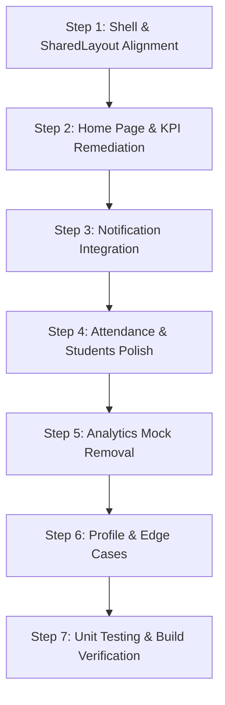

# OX-DIGITAL Education — Phase 5.3 Teacher Dashboard Design & Implementation Plan

**Date:** October 28, 2026  
**Target:** Teacher Dashboard (`/teacher/*`)  
**Design Direction:** **Academic Precision & Digital Mastery**  
**Authorized Project Root:** `D:\OX-DIGITAL\Mathe\Mathteachersmartplatform-main`  
**Status:** **PLANNING ONLY (AWAITING USER APPROVAL PRIOR TO IMPLEMENTATION)**

---

## 1. Design Direction: Academic Precision & Digital Mastery

In alignment with the institutional design standard established in Phases 4, 5.1, and 5.2, the redesigned Teacher Dashboard will discard generic green palettes and gradients in favor of the authorized OX-DIGITAL institutional identity:

### Design Tokens & Visual Hierarchy
- **Foundations:**
  - Dark Mode: Deep obsidian background (`#090b10`), charcoal card surfaces (`#0f131d` / `#161c28`), border slate-800 (`#1e293b`).
  - Light Mode: Crisp ivory background (`#f8fafc` / `#f1f5f9`), pure white card surfaces (`#ffffff`), border slate-200 (`#e2e8f0`).
- **Institutional Accent:** Restrained Institutional Crimson (`#9e1b1b`) used intentionally for primary brand badges, active tab indicators, and focal metric cards.
- **Semantic Accents:**
  - **Teal / Slate:** Used for courses, lessons, and content metadata.
  - **Blue:** Used for student rosters and exams.
  - **Amber:** Strictly reserved for actionable warnings (e.g., at-risk students, pending grading, late attendance).
  - **Red:** Failure, absences, and critical risk.
  - **Emerald:** Passing grades, present attendance, and verified submissions.
- **Typography:**
  - Headings: Cairo font, bold and authoritative.
  - Body & Numbers: Tajawal font, high legibility in Arabic RTL layout.
- **Anti-Patterns Explicitly Avoided:**
  - No generic neon emerald gradients (`from-emerald-500 to-teal-600`).
  - No decorative AI glowing orbs or floating background circles.
  - No oversized empty cards or decorative charts with fake data.
  - No unclickable buttons styled as interactive controls.

---

## 2. Proposed Information Architecture & Navigation

The proposed information architecture organizes the teacher's daily academic workflow into logical, task-oriented sections, preserving all existing working routes while adding the missing notification capabilities.

### Navigation Structure (`SharedLayout`)

| # | Section Label | Route | Icon | Action / Status |
| :- | :--- | :--- | :--- | :--- |
| 1 | **لوحة المؤشرات** (Overview) | `/teacher/home` | `Home` | **Preserve & Redesign**: Accurate KPIs, live at-risk queue, real shortcuts. |
| 2 | **المقررات الدراسية** (Courses) | `/teacher/courses` | `BookOpen` | **Preserve & Style**: Course authoring, lessons, video quizzes, Drive/YouTube. |
| 3 | **قائمة الطلاب** (Students) | `/teacher/students` | `Users` | **Preserve & Style**: Roster, filtering, CSV export, link to student reports. |
| 4 | **التقييمات والواجبات** (Assessments) | `/teacher/exams` | `ClipboardCheck` | **Preserve & Style**: Unified exam/homework creation, question builder, anti-cheat. |
| 5 | **بنك الأسئلة** (Question Bank) | `/teacher/questions` | `Database` | **Preserve & Style**: Math questions, tags, KaTeX previews, AI generation. |
| 6 | **سجل الحضور** (Attendance) | `/teacher/attendance` | `CalendarCheck` | **Preserve & Style**: Group selection, Egyptian grade order, batch save. |
| 7 | **التنبيهات المدرسية** (Notifications) | `/teacher/notifications` | `Bell` | **New Route Integration**: Live student submission alerts, unread badge counter. |
| 8 | **التحليلات والتقارير** (Analytics) | `/teacher/analytics` | `BarChart3` | **Remediate**: Eliminate fake charts, display honest course/subject metrics. |
| 9 | **أدوات الذكاء الاصطناعي** (AI Tools) | `/teacher/ai` | `Brain` | **Streamline**: Smart homework generator, question batch save, real AI session stats. |
| 10 | **الملف الشخصي** (Profile) | `/teacher/profile` | `User` | **Preserve & Fix**: Real statistics parsing, theme toggle, account credentials. |

*Sub-route preserved:* `/teacher/students/:id` (`StudentReportPage.tsx`) for detailed single-student academic performance reports.  
*Grading route preserved:* `/teacher/assessment/:id/review/:attemptId` (`AssessmentReviewPage.tsx`) for detailed submission review.

---

## 3. Detailed Page Redesign Plans

### 1. Teacher Home Page (`/teacher/home`)
- **Executive Header:**
  - Brand subtitle: `"منظومة المعلم الأكاديمية • OX-DIGITAL Education"`.
  - Date in authentic Egyptian Arabic format (`ar-EG`).
  - Manual Refresh button with spin animation (`تحديث البيانات`).
- **Verified KPI Row (4 Cards):**
  - **Card 1: إجمالي الطلاب المسجلين** (`totalStudents`) — With count of enrolled students.
  - **Card 2: المقررات الدراسية النشطة** (`totalCourses`) — Published courses count.
  - **Card 3: متوسط درجات التقييمات** (`averageScore`) — Displayed honestly as raw numeric score (or `'—'` if 0 attempts exist).
  - **Card 4: طلاب بحاجة لدعم ومتابعة** (`strugglingStudents`) — Filtered count of students with average < 50%.
- **Live At-Risk Queue (`طلاب بحاجة لدعم أكاديمي عاجل`):**
  - Displays top at-risk students derived from `GET /api/analytics/risk`.
  - Color-coded severity badge (`حرج` / `عالي` / `متوسط`).
  - Working action button `"عرض الملف"` navigating directly to `/teacher/students/:id`.
- **Subject Performance Table / Distribution:**
  - Replaces empty weekly progress chart with real data from `subjectPerformance` and `distributionData` (`ممتاز`, `جيد جداً`, `متعثر`).
- **Quick Teaching Shortcuts:**
  - Direct links to: "تسجيل حضور اليوم", "إنشاء تقييم جديد", "إضافة درس جديد".

---

### 2. Teacher Attendance Page (`/teacher/attendance`)
- **Visual Polish Only:** Retain the working state machine, deduplication, and bulk save logic.
- **Design Alignment:**
  - Replace green and legacy gray accents with institutional dark obsidian and crimson header accents.
  - Consistent badge styling:
    - `حاضر` (Present): Emerald badge (`bg-emerald-500/10 text-emerald-600 dark:text-emerald-400`).
    - `متأخر` (Late): Amber badge (`bg-amber-500/10 text-amber-600 dark:text-amber-400`).
    - `غائب` (Absent): Red badge (`bg-red-500/10 text-red-600 dark:text-red-400`).
    - `غير محدد` (Unset): Slate badge.
  - Clear floating/sticky save bar when changes are pending (`لديك تعديلات غير محفوظة في سجل الحضور`).

---

### 3. Teacher Students Page & Reports (`/teacher/students`, `/teacher/students/:id`)
- **Student Roster (`TeacherStudentsPage.tsx`):**
  - Professional tabular view with sticky headers.
  - Responsive cards on mobile viewport.
  - Real search filter across student names and emails.
  - Filter by enrollment type (`أونلاين` / `سنتر`) and academic status.
  - Retain CSV export feature (`تقرير_الطلاب.csv`).
  - Working row click / action navigation to `/teacher/students/:id`.
- **Student Report Page (`StudentReportPage.tsx`):**
  - Clean student profile header with email, grade, and registration type.
  - Real exam submissions list with direct link to detailed review.
  - Real homework submissions list with grading status badge (`درجة معتمدة` or `قيد التصحيح`).
  - Student video analytics progress bar and watch completion status.

---

### 4. Teacher Courses & Lessons (`/teacher/courses`)
- **Course Grid:**
  - Compact institutional cards showing course title, academic level, enrolled student count, and lesson count.
  - Clear actions: "إدارة المحتوى والدروس", "تعديل المقرر", "حذف".
- **Lesson Management:**
  - Clean modal/view for adding YouTube/Drive lessons, PDF materials, and interactive timestamp quizzes.
  - Honest status on video upload features (clearly indicating supported sources).

---

### 5. Teacher Exams & Question Bank (`/teacher/exams`, `/teacher/questions`)
- **Assessments View (`TeacherExamsPage.tsx`):**
  - Unified table showing exams and homeworks with type badges (`امتحان` / `واجب`).
  - Active timing status: `نشط حالياً`, `مجدول`, `منتهي`.
  - Settings indicators: Camera anti-cheat (`كاميرا مفعلة`), IP allowlist.
  - "عرض نتائج الطلاب" showing attempt counts and average score.
- **Question Bank (`TeacherQuestionBankPage.tsx`):**
  - Retain math formula rendering via KaTeX (`MathContent`).
  - Filter by academic level (`PREP_1`, `SEC_1`, etc.) and tags.
  - Streamline AI math question generator with direct preview and batch bank save.

---

### 6. Notifications Integration (`/teacher/notifications`)
- Create dedicated `TeacherNotificationsPage.tsx` (reusing the proven pattern from `ParentNotificationsPage.tsx`).
- Bind real unread notification count badge to the sidebar `Bell` icon in `TeacherDashboard.tsx`.
- Support filter tabs: "كافة التنبيهات" and "غير المقروءة".
- Real "تحديد كمقروء" (Mark as Read) action.

---

### 7. Teacher Analytics Page Remediation (`/teacher/analytics`)
- **Eliminate All Mock Data:**
  - Remove hardcoded `monthlyTrend`, `subjectRadar`, `homeworkCompletion`, and fake `predictions` arrays.
- **Honest Analytics Layout:**
  - Display verified high-level metrics: Total Students, Total Courses, Average Score, Struggling Students.
  - Render real `subjectPerformance` bar chart (derived from course exams).
  - Render real student level distribution (`ممتاز`, `جيد جداً`, `متعثر`).
  - Present an honest summary table of courses and exams rather than fabricated monthly graphs.

---

### 8. Teacher Profile Page (`/teacher/profile`)
- **Fix Data Parsing:** Update stats extraction to read `res.data.totalStudents` and `res.data.totalCourses` directly.
- **Remove Fabricated Content:** Remove fake rating `٤.٩` and fabricated badge `'أفضل معلم ٢٠٢٦'`.
- **Honest Profile Display:** Teacher name, email, phone, governorate, account ID, verified role badge, and password change link.

---

## 4. Component Reuse & Design System Integration

The redesign will leverage the tested UI component library established in prior phases:
- `SharedLayout.tsx`: Shell with institutional brand title `"OX-DIGITAL Education"`, subtitle with teacher name, `accentColor="crimson"`.
- `MathContent.tsx`: KaTeX rendering for math equations, exponents, and fractions.
- `QuestionPreview.tsx`: Visual preview of questions, options, diagrams, and explanations.
- `EmptyState.tsx`: Honest empty states with clear Arabic messaging.
- `LoadingState.tsx`: Unified institutional spinner with crimson accent.

---

## 5. Responsive Behavior Strategy

- **Desktop (>= 1024px):** Multi-column KPI grid (4 columns), dual-column charts, full data tables with sortable columns.
- **Tablet (768px - 1023px):** 2-column KPI grid, stacked charts, scrollable tables with sticky first column.
- **Mobile (< 768px):** Single-column stacked cards, mobile card view for student lists and exams (preventing horizontal table clipping), collapsible sidebar navigation with tap targets >= 44px.

---

## 6. Implementation Sequence (Post-Approval)

1. **Step 1:** Update `TeacherDashboard.tsx` to use institutional crimson tokens, add notification route and unread badge binding.
2. **Step 2:** Remediate `TeacherHomePage.tsx` KPI bindings (`totalStudents`, `averageScore`, `strugglingStudents`), remove fake weekly progress chart, wire at-risk buttons.
3. **Step 3:** Implement `TeacherNotificationsPage.tsx` connected to `notificationService`.
4. **Step 4:** Polish `TeacherAttendancePage.tsx`, `TeacherStudentsPage.tsx`, and `StudentReportPage.tsx` with OX-DIGITAL theme classes.
5. **Step 5:** Remediate `TeacherAnalyticsPage.tsx` by purging hardcoded mock arrays and presenting real subject/course performance.
6. **Step 6:** Fix data extraction in `TeacherProfilePage.tsx` and eliminate fabricated awards.
7. **Step 7:** Author comprehensive test suite (`TeacherDashboard.test.tsx`), run `tsc --noEmit`, execute all tests, and build.
