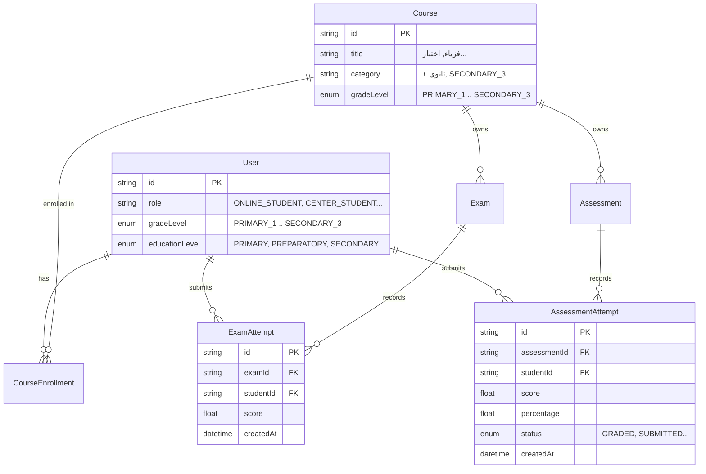

# OX-DIGITAL Education — Phase 6.1A
# Technical Assessment: Student Academic Ranking Defect & Resolution Architecture

**Audit Date:** November 1, 2026  
**Auditor:** Antigravity Autonomous Audit Agent  
**Target Repository:** `D:\OX-DIGITAL\Mathe\OX-DIGITAL-GITHUB`  
**Git Baseline:** `main` @ `0500b93` (Read-Only Verification Mode)  

---

## 1. Executive Summary

Phase 6.0 identified a critical data integrity defect in `services/analytics-service/src/controllers/analytics.controller.ts`:
```typescript
rank: 1 // Rank is hard to calculate accurately across all students without heavy DB load, so default 1.
```
This investigation conducted an exhaustive code-level and database-level audit to determine the complete blast radius of this hardcoded value, inspect available Prisma models and live database records, analyze grade-level and subject boundaries, and formulate technically sound ranking strategies.

### Key Technical Findings:
1. **Single Backend Origin:** The hardcoded rank originates solely in `GET /api/analytics/student/overview` (served by `getStudentOverview` in `analytics.controller.ts`, line 366). No other backend endpoint returns a rank.
2. **Active UI Surface Area:** The rank is actively rendered in the UI in exactly one location: `apps/frontend/src/app/components/student-center/ResultsPage.tsx` (lines 183–192) under the title "الترتيب التحصيلي التقريبي" ("المرتبة 1 بين طلاب المستوى الدراسي").
3. **Passive UI Surface Area:** In `apps/frontend/src/app/components/student-online/ResultsPage.tsx`, `rank` is present in state (lines 22, 54) but is not rendered in the JSX.
4. **Deliberate Prior Removal in Parent Views:** In `ParentChildrenPage.tsx` and `ParentReportsPage.tsx`, the rank card was previously removed as unsupported UI, verified by automated unit tests in `apps/frontend/src/app/test/ParentDashboard.test.tsx` (lines 181–213).
5. **Architectural Gap in Academic Dimensions:** The database schema (`packages/database/prisma/schema.prisma`) reliably captures `gradeLevel` as an enum (`PRIMARY_1` through `SECONDARY_3`), but **completely lacks an Academic Year field and a normalized Subject entity**.
6. **Live Data Baseline:** The live PostgreSQL database contains 2 enrolled students (`hosam@gmail.com` and `center@gmail.com`), both in `SECONDARY_3`. Currently, `ExamAttempt`, `Exam`, `Assessment`, and `AssessmentAttempt` contain **0 rows**.

---

## 2. Exhaustive Audit of Ranking Defect (Task A)

### 2.1 Backend Endpoint Analysis
The defect is contained in `services/analytics-service/src/controllers/analytics.controller.ts`:
- **Function:** `getStudentOverview(req: AuthRequest, res: Response)` (lines 340–371).
- **Route:** `GET /api/analytics/student/overview` (configured in `analytics.routes.ts`, line 30, protected by `verifyToken`).
- **Response Payload:**
  ```json
  {
    "gpa": 3.4,
    "attendanceRate": 100,
    "completedAssignments": 4,
    "rank": 1
  }
  ```
- **Code Inspection:**
  ```typescript
  // Line 362-367
  res.json({
    gpa,
    attendanceRate,
    completedAssignments: totalAssignments,
    rank: 1 // Rank is hard to calculate accurately across all students without heavy DB load, so default 1.
  });
  ```
- **Verification of Other Endpoints:**
  - `getAdminAnalytics`: Does not return any rank field.
  - `getParentAnalytics`: Does not return any rank field.
  - `getParentChildOverview`: Explicitly does not return any rank field.
  - `getTeacherAnalytics`: Does not return any rank field.
  - `getRiskAnalytics`: Computes risk classifications, no rank field.

### 2.2 Frontend Consumption & UI Display Audit
A search across all frontend source files (`apps/frontend/src`) revealed the following:

| Frontend Component | File Path | Consumption Mechanism | Rendered in DOM? | Exact UI Text / Selector |
| :--- | :--- | :--- | :---: | :--- |
| **Student Center Results** | `src/app/components/student-center/ResultsPage.tsx` | Calls `analyticsService.getStudentOverview()`, maps `overviewRes.data.rank` | **YES** (Active) | Line 189: `<div className="text-2xl font-extrabold ...">المرتبة {overview.rank}</div>`<br>Line 191: `<p>بين طلاب المستوى الدراسي</p>` |
| **Student Online Results** | `src/app/components/student-online/ResultsPage.tsx` | Calls `analyticsService.getStudentOverview()`, maps `overviewRes.data.rank` | **NO** (State only) | Stored in local state `overview.rank`, but card was omitted from JSX in Phase 5.3. |
| **Student Center Home** | `src/app/components/student-center/StudentHomePage.tsx` | Calls `analyticsService.getStudentOverview()` | **NO** | Extracts only `completedAssignments` (line 84). |
| **Student Online Home** | `src/app/components/student-online/StudentHomePage.tsx` | Calls `analyticsService.getStudentOverview()` | **NO** | Extracts only `completedAssignments` (line 84). |
| **Parent Children Page** | `src/app/components/parent/ParentChildrenPage.tsx` | N/A | **NO** | Explicitly removed. Enforced by `ParentDashboard.test.tsx` line 197. |
| **Parent Reports Page** | `src/app/components/parent/ParentReportsPage.tsx` | N/A | **NO** | Explicitly removed. Enforced by `ParentDashboard.test.tsx` line 209. |

### 2.3 Prisma Models & Academic Dimension Reliability
Analysis of `packages/database/prisma/schema.prisma` and live PostgreSQL tables:



#### Reliability of Academic Boundaries:
1. **Grade Level (`GradeLevel` enum):** **Reliable.** Both `User.gradeLevel` and `Course.gradeLevel` use the strongly typed enum (`PRIMARY_1` .. `SECONDARY_3`).
2. **Academic Year:** **Unreliable / Non-Existent.** There is no `academicYear` column on `User`, `Course`, or `ExamAttempt`. Historical records from 2024, 2025, and 2026 would currently be conflated unless bounded by date windows (`createdAt >= startOfAcademicYear`).
3. **Academic Subject:** **Unreliable / Non-Existent.** The database has no `Subject` entity. `Course.category` contains unconstrained strings (in the live DB, Course 1 has `'ثانوي ١'` and Course 2 has `'SECONDARY_3'`). `analytics.controller.ts` uses `attempt.exam.course.title` as a makeshift subject, conflating course titles with subject disciplines.
4. **Dual Assessment Schemas:** The platform has two concurrent assessment schemas:
   - **Legacy Schema:** `Exam` and `ExamAttempt` (records raw `score: Float`, has no `status` field, retakes are unflagged).
   - **Unified Schema:** `Assessment` and `AssessmentAttempt` (records `score`, `totalPoints`, `percentage`, and `status: AttemptStatus`).

---

## 3. Academic Ranking Strategies (Task B)

To eliminate the hardcoded `rank: 1` defect, two technically sound strategies have been formulated.

### Strategy 1: Grade-Level Overall Academic Ranking
**Scope:** Ranks a student against all active students within the identical `User.gradeLevel`.

1. **Eligible Students:**
   - Active users with `role IN ('ONLINE_STUDENT', 'CENTER_STUDENT')`.
   - Must have `User.gradeLevel` equal to the requesting student's grade level.
   - Must have at least the minimum required graded assessments (see Threshold below).
2. **Eligible Assessments:**
   - Graded attempts in courses matching the student's `gradeLevel`.
   - Date-bounded to the current academic period (e.g. `createdAt >= academicPeriodStart`).
3. **Retake & Attempt Policy:**
   - **Authoritative Rule:** Only the **latest attempt** per assessment (`DISTINCT ON (examId, studentId) ORDER BY createdAt DESC`) or the **highest attempt** (`MAX(score)`) contributes to the student's cumulative average.
4. **Score Aggregation Formula:**
   $$\text{StudentAverage} = \frac{\sum_{i=1}^{N} \text{Percentage}_i}{N}$$
   Where $\text{Percentage}_i = \left(\frac{\text{Score}_i}{\text{TotalPoints}_i}\right) \times 100$.
5. **Tie-Breaking Rule:**
   - Use `DENSE_RANK() OVER (ORDER BY student_avg DESC)`.
   - Example: Scores [95, 95, 90] result in ranks [1, 1, 2]. Avoids arbitrary alphabetical or ID-based tie-breakers.
6. **Insufficient Data & Zero-Record Policy:**
   - **Minimum Assessment Threshold:** A student must complete at least **3 graded assessments** before receiving a rank.
   - If assessments completed < 3, return `rank: null` and `rankStatus: "INSUFFICIENT_DATA"`.
   - The UI displays: `"الترتيب: قيد الاحتساب (يتطلب إكمال 3 تقييمات على الأقل)"` rather than a false rank.

---

### Strategy 2: Grade-Level Subject-Specific Academic Ranking
**Scope:** Ranks a student within their specific `User.gradeLevel` and a specific academic subject/course.

1. **Eligible Students:**
   - Students enrolled in courses associated with the specified subject/course (`CourseEnrollment`).
   - Matching `User.gradeLevel`.
2. **Eligible Assessments:**
   - Only assessments belonging to courses mapped to that subject.
3. **Score Aggregation Formula:**
   $$\text{SubjectAverage} = \frac{\sum_{k \in \text{SubjectExams}} \text{LatestScore}_k}{\sum_{k \in \text{SubjectExams}} \text{TotalPoints}_k} \times 100$$
4. **Tie-Breaking Rule:**
   - `DENSE_RANK() OVER (ORDER BY subject_avg DESC)`.
5. **Insufficient Data Policy:**
   - Minimum 2 assessments completed within the subject.
   - If not met, return `rank: null`.

---

## 4. Query Performance, Indexing & Caching Architecture

### 4.1 SQL Performance
Executing a multi-table join and window function on every `getStudentOverview` call can cause database CPU spikes under high concurrency.
- **Required PostgreSQL Indexes:**
  ```sql
  CREATE INDEX IF NOT EXISTS idx_user_grade_role ON "User" ("gradeLevel", "role");
  CREATE INDEX IF NOT EXISTS idx_exam_attempt_student_created ON "ExamAttempt" ("studentId", "createdAt");
  CREATE INDEX IF NOT EXISTS idx_assessment_attempt_student_status ON "AssessmentAttempt" ("studentId", "status", "percentage");
  ```

### 4.2 Redis Caching & Invalidation Strategy
To guarantee sub-50ms response times without hitting PostgreSQL repeatedly:
1. **Cache Structure:** Redis Sorted Sets (ZSET) partitioned by grade level:
   `Key: leaderboard:grade:{gradeLevel}:{academicPeriod}`
   `Member: {studentId}`, `Score: {calculatedAverage}`
2. **Retrieval:**
   `ZREVRANK leaderboard:grade:SECONDARY_3 student_uuid` + 1 -> Returns exact rank in $O(\log(N))$ time.
3. **Invalidation / Refresh:**
   - **Event-Driven:** When a student submits an assessment and it is graded, push an event `student.assessment.graded` to a background worker to recalculate that single student's average and update their score in the Redis ZSET.
   - **Scheduled Daily Sync:** A nightly job regenerates the ZSET to guarantee synchronization with PostgreSQL.
   - **TTL:** Key TTL set to 24 hours.

---

## 5. Decisions Requiring Product Owner Approval

Before implementing any ranking strategy, the following four governance decisions must be explicitly approved:

| # | Decision Item | Option A (Recommended) | Option B (Alternative) | Operational Implication |
| :-: | :--- | :--- | :--- | :--- |
| **1** | **Scope of Ranking** | **Strategy 1 (Grade-Level Overall)** | **Strategy 2 (Per Subject / Course)** | Strategy 1 provides a unified grade-level cohort standing; Strategy 2 requires a Subject picker in the UI. |
| **2** | **Handling Retakes** | **Latest Attempt** | **Highest Attempt (Best Score)** | Latest attempt reflects current retention; Best score encourages student retakes. |
| **3** | **Minimum Assessments for Rank** | **3 Completed Assessments** | **1 Completed Assessment** | 3 assessments ensures statistical validity; 1 assessment provides instant gratification but high volatility. |
| **4** | **Insufficient Data Display** | **Explicit Unavailable State (`null`)** | **Do not display rank card at all** | Displaying "قيد الاحتساب" educates the student; hiding the card simplifies the layout. |

---

## 6. Interim Remediation Recommendation

While academic ranking decisions are under product review, **the hardcoded `rank: 1` must be immediately decommissioned**:
1. Return `rank: null` from `GET /api/analytics/student/overview`.
2. Update `student-center/ResultsPage.tsx` to handle `rank === null` by rendering `"الترتيب: غير متوفر حالياً"` or suppressing the card.
3. This prevents active student deception without introducing unapproved ranking algorithms.

