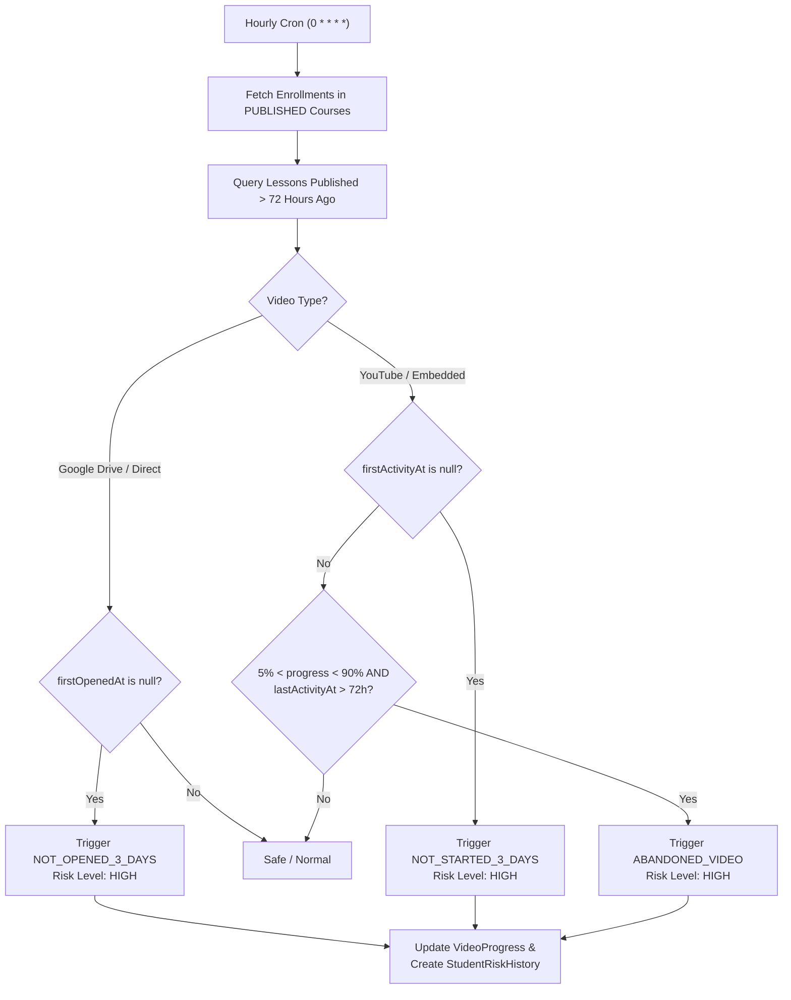

# OX-DIGITAL Education — Phase 6.1A
# Technical Verification: Student Risk Engine Architecture & Algorithmic Audit

**Audit Date:** November 1, 2026  
**Auditor:** Antigravity Autonomous Audit Agent  
**Target Repository:** `D:\OX-DIGITAL\Mathe\OX-DIGITAL-GITHUB`  
**Git Baseline:** `main` @ `0500b93` (Read-Only Verification Mode)  

---

## 1. Executive Summary

Phase 6.0 documentation referenced a composite deficit formula for evaluating student academic risk:
$$\text{RiskScore} = 0.40 \times \text{AttendanceDeficit} + 0.40 \times \text{AcademicDeficit} + 0.20 \times \text{InactivityDeficit}$$

This audit conducted an exhaustive verification of all risk evaluation implementations across `services/course-service/src/jobs/riskEngine.job.ts`, `services/analytics-service/src/controllers/analytics.controller.ts`, and consumer UI components.

### Definitive Technical Findings:
1. **The Documented Formula Does Not Exist:** The weighted deficit formula ($0.40/0.40/0.20$) was never written into application code. It was a conceptual proposal in documentation that diverged from the actual codebase.
2. **Three Disconnected Risk Subsystems:** The platform currently contains **three distinct, uncoordinated risk mechanisms**:
   - **Subsystem A (Video Delay Worker):** `services/course-service/src/jobs/riskEngine.job.ts` is an asynchronous BullMQ worker that monitors video inactivity (>72 hours) and sets `currentRiskLevel = 'HIGH'`.
   - **Subsystem B (Academic Assessment Risk API):** `services/analytics-service/src/controllers/analytics.controller.ts` (`getRiskAnalytics`) calculates an on-the-fly integer risk score ($0–100$) based on low exam scores and missing homework.
   - **Subsystem C (Admin KPI Risk Count):** `getAdminAnalytics` counts at-risk students as anyone with at least one exam score $< 50$.
3. **Complete Absence of Physical Attendance in Risk Calculations:** Neither Subsystem A nor Subsystem B evaluates the `Attendance` table. Physical absence or lateness in center sessions currently has **zero impact** on student risk classification.
4. **Data Isolation Between Services:** Subsystem A writes risk events into `VideoProgress` and `StudentRiskHistory`. However, Subsystem B never reads `StudentRiskHistory`. The teacher and admin risk dashboards display Subsystem B's on-the-fly exam scores, completely blind to the video delays tracked by Subsystem A.

---

## 2. Exhaustive Subsystem Walkthroughs

### 2.1 Subsystem A: Video Engagement Worker (`riskEngine.job.ts`)
- **Location:** `services/course-service/src/jobs/riskEngine.job.ts` (177 lines).
- **Execution Model:** BullMQ Queue (`RiskEngineQueue`) backed by Redis.
- **Schedule:** Scheduled via cron pattern `0 * * * *` (runs every hour at minute 0).
- **Graceful Fallback:** If `isRedisDisabled` or `REDIS_URL` is absent, logs warning and skips job without crashing.
- **Trigger Window:** Lessons published $\ge 72$ hours ago (`publishedAt <= new Date(Date.now() - 72 * 60 * 60 * 1000)`).

#### Detailed Logic Flow:


- **Persistence Target:**
  - `VideoProgress`: Updates `currentRiskLevel = 'HIGH'`, `currentRiskCode = 'NOT_OPENED_3_DAYS' | 'NOT_STARTED_3_DAYS' | 'ABANDONED_VIDEO'`, `riskDetectedAt = new Date()`.
  - `StudentRiskHistory`: Inserts a permanent audit row if no active unresolved record exists (`resolvedAt: null`).
- **Critical Limitation:** Does not evaluate exam attempts, attendance, or student login frequency. Only triggers `HIGH` risk for lesson video delays.

---

### 2.2 Subsystem B: Academic Risk API (`getRiskAnalytics`)
- **Location:** `services/analytics-service/src/controllers/analytics.controller.ts` (lines 509–614).
- **Execution Model:** Synchronous HTTP request (`GET /api/analytics/risk`), accessible by roles `ADMIN` and `TEACHER`.
- **Query Scope:** Fetches students with `examAttempts`, `submissions`, and `enrollments`. (Filtered by teacher's courses if called by a Teacher).

#### Scoring Algorithm:
```typescript
let riskScore = 0;
const reasons: string[] = [];

// Factor 1: Exam Average Score
if (examAvg !== null) {
  if (examAvg < 50) {
    riskScore += 50;
    reasons.push('درجات الامتحانات منخفضة جداً');
  } else if (examAvg < 65) {
    riskScore += 30;
    reasons.push('تراجع في مستوى الامتحانات');
  }
}

// Factor 2: Failed Exams Count
const failedExams = examAttempts.filter(a => a.score < 50).length;
if (failedExams >= 3) {
  riskScore += 30;
  reasons.push(`رسوب في ${failedExams} امتحانات`);
}

// Factor 3: Missing Homeworks
if (student.enrollments.length > 0 && student.submissions.length === 0) {
  riskScore += 20;
  reasons.push('عدم تسليم واجبات');
}
```

#### Classification Thresholds:
$$\text{Inclusion Threshold: } \text{riskScore} \ge 40$$
- $\text{riskScore} \ge 80 \implies \text{'حرج' (Critical)}$
- $60 \le \text{riskScore} < 80 \implies \text{'عالي' (High)}$
- $40 \le \text{riskScore} < 60 \implies \text{'متوسط' (Medium)}$
- $\text{riskScore} < 40 \implies \text{Omitted from Risk Queue (Normal)}$

---

### 2.3 Subsystem C: Admin KPI At-Risk Counter
- **Location:** `services/analytics-service/src/controllers/analytics.controller.ts` (lines 38–43).
- **Implementation:**
  ```typescript
  const atRiskStudents = await db.user.count({
    where: {
      role: { in: ['ONLINE_STUDENT', 'CENTER_STUDENT'] },
      examAttempts: { some: { score: { lt: 50 } } }
    }
  });
  ```
- **Operational Reality:** A student who scored 48% on a single diagnostic quiz 6 months ago, but scored 95% on all subsequent exams, is permanently counted in the Admin KPI as "At-Risk".

---

## 3. Discrepancy Matrix: Documented vs. Implemented

| Dimension | Documented Theoretical Model | Subsystem A (`course-service`) | Subsystem B (`analytics-service`) |
| :--- | :--- | :--- | :--- |
| **Formula Structure** | Linear continuous weighted sum | Event-driven state machine | Additive discrete integer heuristic |
| **Attendance Evaluation**| Evaluates Attendance Deficit ($40\%$) | **Completely Ignored** | **Completely Ignored** |
| **Academic Evaluation** | Evaluates Academic Deficit ($40\%$) | **Completely Ignored** | Low average ($+30$ to $+50$), Fail count ($+30$) |
| **Inactivity Evaluation** | Inactivity Deficit ($20\%$) | Lesson video inactivity $> 72\text{h}$ | Missing homework submissions ($+20$) |
| **Risk Levels** | Low ($<35$), Med ($35–65$), High ($>65$) | Always `HIGH` | Med ($40–59$), High ($60–79$), Critical ($\ge 80$) |
| **Execution Trigger** | Periodic cron job | Hourly BullMQ background job | Real-time on-demand HTTP request |
| **Database Output** | Projected table update | Writes to `VideoProgress`, `StudentRiskHistory` | Returns ephemeral JSON response; no DB write |
| **Dashboard Consumer** | Theoretical unified alert | None (unconnected) | Teacher & Admin Risk pages |

---

## 4. Key Vulnerabilities & Architectural Gaps

1. **Center Student Attendance Blindspot:**
   Physical center students with zero attendance records are never flagged as at-risk by either Subsystem A or Subsystem B, provided they have not submitted a failing exam.
2. **Notification Disconnect:**
   Neither Subsystem A nor Subsystem B dispatches active alerts (email, SMS, or in-app notifications) to parents. The `Notification` table is not populated when a student enters critical risk.
3. **Data Inconsistency Between Dashboards:**
   The Admin Overview KPI displays `atRiskStudents` from Subsystem C, whereas clicking through to the Risk Management queue displays students filtered by Subsystem B. The numbers do not match.

---

## 5. Architectural Harmonization Recommendations

To create a genuine, unified Student Risk Engine:
1. **Unify into a Single Background Worker:** Relocate risk calculation into a centralized job in `analytics-service` that aggregates all three dimensions:
   - **Academic Factor (40%):** Average exam and homework percentages.
   - **Attendance Factor (40%):** Absence and lateness rates from the `Attendance` table.
   - **Engagement Factor (20%):** Video completion velocity and login recency.
2. **Persist Risk Profiles:** Create a unified `StudentRiskProfile` table with `currentScore`, `level`, `primaryReasons`, and `lastEvaluatedAt`.
3. **Connect to Parent Alerts:** When a student transitions into `HIGH` or `CRITICAL` risk, automatically generate a notification in the `Notification` table for linked parents.

