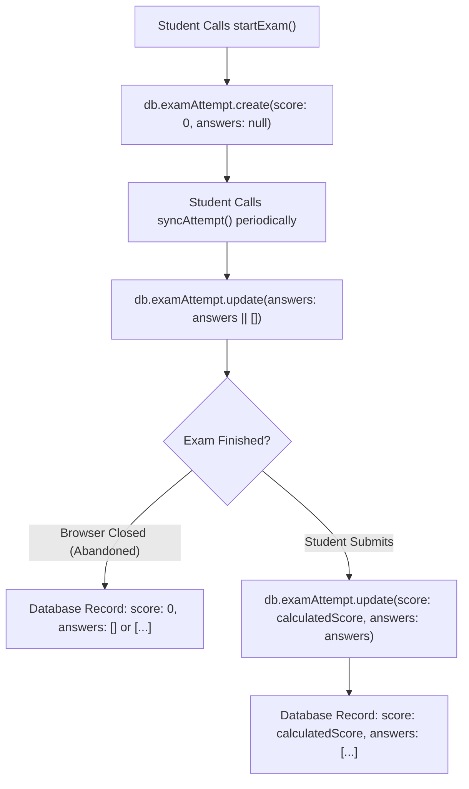
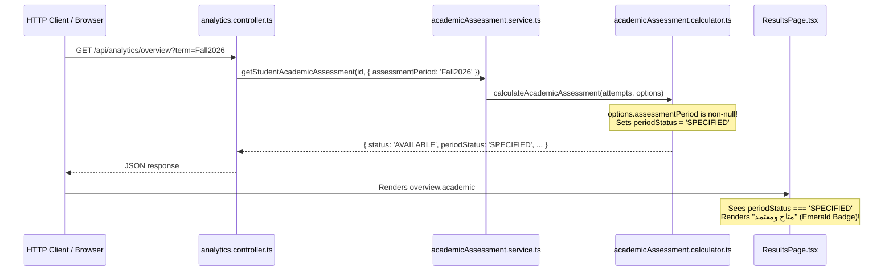

# OX-DIGITAL Education
# Phase 6.2B.2.1 — Execution Path Verification Report
## Deep-Dive Code Traversal & Lifecycle Trace

**Date:** November 1, 2026  
**Workspace:** `D:\OX-DIGITAL\Mathe\OX-DIGITAL-GITHUB`  
**Git Baseline:** `main @ 0500b93e65c24ed881349c4acea7f523332c5e9f` (`0500b93`)  
**Scope:** Exhaustive code traversal of all execution paths, data transformations, and state lifecycles for academic assessment.

---

## 1. `ExamAttempt` Lifecycle Trace



### 1.1 Step-by-Step Code Analysis (`services/course-service/src/controllers/exam.controller.ts`)
1. **Creation / Initialization (`startExam`, lines 427–433):**
   ```typescript
   const attempt = await db.examAttempt.create({
     data: {
       studentId: userId,
       examId,
       score: 0
     }
   });
   ```
   *Finding:* `answers` is omitted and stored as `null`. `score` is initialized to `0`.
2. **Periodic Autosave (`syncAttempt`, lines 531–541):**
   ```typescript
   const existingAttempt = await db.examAttempt.findFirst({
     where: { studentId: userId, examId },
     orderBy: { createdAt: 'desc' }
   });
   if (existingAttempt) {
     await db.examAttempt.update({
       where: { id: existingAttempt.id },
       data: { answers: answers || [] }
     });
   }
   ```
   *Critical Finding:* If a student starts an exam and triggers autosave before answering anything (or with empty answers), `answers` in PostgreSQL is updated from `null` to `[]`.
3. **Submission (`submitAttempt`, lines 463–511):**
   ```typescript
   calculatedScore = (correctCount / questions.length) * 100;
   attempt = await db.examAttempt.update({
     where: { id: existingAttempt.id },
     data: {
       score: calculatedScore,
       answers: answers || []
     }
   });
   ```
   *Critical Finding:* The database record resulting from `submitAttempt` has `score: calculatedScore` and `answers: []` or `[...]`.
   *Conclusion:* If an exam is abandoned after `syncAttempt` ran, the database record has `score: 0` and `answers: []`. An empty array `answers: []` is identical between an abandoned exam and an empty-answer submission! The database schema provides **zero persisted evidence** (`submittedAt`, `status`, `isGraded`) to distinguish an abandoned attempt from a submitted attempt.

---

## 2. `AssessmentAttempt` Lifecycle Trace

### 2.1 Step-by-Step Code Analysis (`services/course-service/src/controllers/assessment.controller.ts`)
1. **Creation / Initialization (`startAssessment`, lines 215–245):**
   ```typescript
   const newAttempt = await tx.assessmentAttempt.create({
     data: {
       assessmentId,
       studentId,
       status: 'STARTED',
       startedAt: now,
       expiresAt
     }
   });
   ```
   *Finding:* Created with explicit `status: 'STARTED'`.
2. **Autosave & Timeout during Taking (`saveAttempt`, lines 305–319):**
   ```typescript
   if (attempt.expiresAt && now >= attempt.expiresAt) {
     await db.assessmentAttempt.update({
       where: { id: attempt.id },
       data: { status: 'TIME_EXPIRED', submittedAt: now }
     });
     return res.status(403).json({ message: 'انتهى وقت المحاولة', code: 'EXAM_TIME_EXPIRED' });
   }
   ```
   *Critical Finding:* If time expires while saving, `status: 'TIME_EXPIRED'` is saved, but `score`, `totalPoints`, and `percentage` remain `null`.
3. **Final Submission (`submitAssessment`, lines 414–473):**
   ```typescript
   let status: AttemptStatus = 'SUBMITTED';
   if (attempt.expiresAt && now >= attempt.expiresAt) {
     status = 'TIME_EXPIRED';
   }
   ...
   const percentage = totalPoints > 0 ? (score / totalPoints) * 100 : 0;
   if (status !== 'TIME_EXPIRED') {
     status = 'GRADED';
   }
   ...
   updated = await tx.assessmentAttempt.update({
     where: { id: attempt.id },
     data: {
       status,
       submittedAt: now,
       answers: answersToSave,
       score,
       totalPoints,
       percentage
     }
   });
   ```
   *Finding:* When submitted normally, `status: 'GRADED'` with persisted `score`, `totalPoints`, and `percentage`. When submitted after expiration, `status: 'TIME_EXPIRED'` with auto-graded `score`, `totalPoints`, and `percentage`.

---

## 3. `TIME_EXPIRED` Dual-Path Semantics

| Path | Controller Origin | Persisted Status | Persisted Score / Total / Pct | Calculator Behavior (`calculator.ts` L152–165) |
|---|---|---|---|---|
| **Path 1: Interrupted Timeout** | `saveAttempt` line 315 | `'TIME_EXPIRED'` | `null` / `null` / `null` | **Rejected / Excluded** (line 159 checks non-null and excludes) |
| **Path 2: Auto-Graded Submission** | `submitAssessment` line 467 | `'TIME_EXPIRED'` | `score` / `totalPoints` / `percentage` | **Accepted as Eligible Graded Assessment** (lines 154–156 verify numbers & consistency) |

*Conclusion:* The calculator's conditional handling of `TIME_EXPIRED` exactly matches the two runtime paths in `assessment.controller.ts`.

---

## 4. Maximum-Marks Provenance & Normalization Trace

1. **`AssessmentAttempt`:**
   - Source: `assessment.totalPoints` in `Assessment` model (Float, default 100).
   - Calculation: Sum of question points `totalPoints += (q.points || 1)`.
   - Persistence: Directly persisted in `assessmentAttempt.totalPoints` and `assessmentAttempt.percentage`.
   - Calculator Normalization: Lines 185–195 check `rawPct` against `(numScore / totalPoints) * 100` within 0.5% tolerance.
   - *Result:* Mathematically sound and verified.
2. **`ExamAttempt`:**
   - Source: `Exam` model in `schema.prisma` has **NO `totalPoints`** column.
   - Controller Calculation: `(correctCount / questions.length) * 100` saved into `score: Float`.
   - Calculator Check: Line 109 checks `att.totalPoints ?? att.exam?.totalPoints`. Because neither exists in the schema or runtime query, `totalPoints` is undefined.
   - Calculator Action: Sets `hasUnverifiableCompletion = true` and skips the attempt without defaulting to 100.
   - *Result:* Safely prevented from producing distorted percentages.

---

## 5. Academic Period Propagation Trace



*Vulnerability:* The parameter `term` is completely unverified. PostgreSQL has no `AcademicTerm` entity to validate `"Fall2026"`. Any caller can spoof an officially approved academic term by appending `?term=...` to the URL.

---

## 6. Assessment Identity & Retake Conflict Trace

1. Grouping Key: `const assessmentId = att.assessmentId || att.examId;` (line 86).
2. Clean Map: `gradedAttemptsByAssessment = new Map<string, any[]>()`.
3. If `attempts.length > 1`:
   - Sets `hasRetakeConflict = true`.
   - Halts calculation and immediately returns `status: 'BLOCKED_PENDING_POLICY'`, `average: null`, `retakeConflict: true`.
4. If an assessment has 1 graded attempt and 1 in-progress attempt:
   - In-progress attempt is filtered in step 2.
   - `attempts.length === 1`.
   - `hasRetakeConflict` remains `false`.
   - Does NOT mistake an unfinished attempt for a graded retake.

---

## 7. ResultsPage Rendering Matrix

| Returned Status | Returned `periodStatus` | Badge Rendered | Sub-Label | Numerical Average Rendered? |
|---|---|---|---|---|
| `AVAILABLE` | `'UNSPECIFIED'` | `"متاح (فترة غير محددة)"` (Blue) | `"متوسط حسابي (فترة غير محددة)"` | **YES** (`{average}%`) |
| `AVAILABLE` | `'SPECIFIED'` | `"متاح ومعتمد"` (Emerald) | `"متوسط حسابي معتمد"` | **YES** (`{average}%`) |
| `BLOCKED_PENDING_POLICY` | Any | `"معلق (سياسة الإعادة)"` (Amber) | `"محاولات إعادة متعددة (OD-11)"` | **NO** (`"معلق (قيد الاعتماد)"`) |
| `BLOCKED_UNVERIFIABLE_COMPLETION` | Any | `"غير قابل للتحقق"` (Rose) | `"اكتمال غير موثق"` | **NO** (`"غير متاح"`) |
| `INSUFFICIENT_DATA` | Any | `"بيانات غير كافية"` (Amber) | `"يتطلب 3 تقييمات على الأقل"` | **NO** (`"قيد الاحتساب (n / 3)"`) |
| `null` / `undefined` | Any | `"بيانات غير كافية"` (Amber) | `"يتطلب 3 تقييمات على الأقل"` | **NO** (`"قيد الاحتساب (0 / 3)"`) |

