# Phase 6.2C.2.1 — Final Findings & Approval Gates Report
## Comprehensive Audit Synthesis, Defect Matrix & Deployment Readiness Evaluation

**Workspace:** `D:\OX-DIGITAL\Mathe\OX-DIGITAL-GITHUB`  
**Git Baseline:** `main @ 0500b93e65c24ed881349c4acea7f523332c5e9f`  
**Audit Mode:** STRICTLY READ-ONLY FORENSIC AUDIT  
**Audit Date:** November 2026  
**Auditor:** Independent AI Engineering & Migration Auditor  

---

## 1. Executive Summary

This report concludes the **Phase 6.2C.2.1 Independent Post-Implementation Code & Migration Audit** for the OX-DIGITAL Education platform. 

The audit rigorously evaluated the changes delivered in Phase 6.2C.2, including:
1. Pure calculation engine implementation of **OD-01** (Simple Arithmetic Mean), **OD-02** (Minimum Three Assessments), **OD-11** (Latest Attempt Retake Policy), and **OD-12** (Rolling Window Evaluation Period).
2. Prisma Schema adjustments adding `Exam.totalPoints` and `ExamAttempt` lifecycle fields (`status`, `submittedAt`, `isGraded`, `totalPoints`, `percentage`, `updatedAt`).
3. PostgreSQL Migration DDL in `packages/database/prisma/migrations/20261102_exam_lifecycle_alignment/migration.sql`.
4. Historical data remediation script in `services/course-service/src/scripts/backfillExamAttempts.ts`.
5. Course service attempt lifecycle controllers (`startAttempt`, `syncAttempt`, `submitAttempt`, `reportViolation`).
6. Analytics and User service query consumer updates.
7. Frontend Results page presentations and Arabic localization in both Student Center and Student Online applications.

### Overall Audit Verdict
```
================================================================================
AUDIT VERDICT: CONDITIONAL PASS — BLOCKED PENDING DEPLOYMENT HARDENING
================================================================================
- Code and Mathematical Calculation:    PASS (100% compliant with OD-01, 02, 11, 12)
- Frontend Presentation & Parity:       PASS (100% bit-for-bit parity, 0 visual defects)
- Automated Test Regression:            PASS (219/219 tests pass, 34/34 academic tests)
- Database Migration DDL:               BLOCKED (High risk of data vacuum & point fabrication)
- Historical Backfill Script:           BLOCKED (Timestamp fabrication & missing idempotency)
================================================================================
```

The mathematical calculation engine and frontend interfaces are completely verified, functionally sound, and ready for production. However, **the database migration and historical backfill scripts MUST NOT be executed in their current state on any production or staging environment containing real student records.** 

---

## 2. Consolidated Defect & Finding Matrix

The following table consolidates all verified findings, categorized by severity, component, and operational impact:

| Finding ID | Severity | Component / File | Code Location | Description of Defect & Operational Impact | Required Remediation |
| :--- | :---: | :--- | :--- | :--- | :--- |
| **DEF-01** | **HIGH** | `analytics-service`<br>`user-service` | `analytics.controller.ts:30, 50, 591`<br>`user.controller.ts:178` | **Pre-Backfill Data Vacuum**: Filter `where: { OR: [{ status: 'GRADED' }, { isGraded: true }] }` excludes all historical attempts upon migration DDL execution (since DDL sets defaults `status='STARTED'` and `isGraded=false`). Platform GPA, exam averages, and pass rates drop to 0 until backfill completes. | Sequence migration and backfill atomically or include transitional fallback `(status='STARTED' AND score > 0)`. Post-backfill, change filter to composite `status='GRADED', isGraded=true`. |
| **DEF-02** | **HIGH** | `packages/database` | `schema.prisma:137`<br>`migration.sql:5` | **Semantic Maximum Points Fabrication**: Migration adds `totalPoints Float? @default(100)` to `Exam`. PostgreSQL assigns 100 marks to all historical exams, distorting grading for short quizzes or custom exams originally graded out of 5, 10, or 20 points. | Change column definition to `totalPoints Float?` (nullable without default), or compute `Exam.totalPoints` dynamically from `SUM(Question.points)` during backfill. |
| **DEF-03** | **HIGH** | `course-service` | `backfillExamAttempts.ts:91, 97, 104` | **Historical Timestamp Fabrication**: Script assigns `submittedAt = new Date(att.createdAt)` for all legacy graded records where completion time was unrecorded. This fabricates instantaneous (0-second) submissions in the database audit trail. | Set `submittedAt = null` for legacy records where real submission time is unknown, and update calculator to fallback to `submittedAt ?? createdAt`. |
| **DEF-04** | **MEDIUM** | `course-service` | `backfillExamAttempts.ts:46-52` | **Missing Backfill Idempotency Filter**: Script queries all attempts (`db.examAttempt.findMany()`) without scoping to unmigrated records (`where: { status: 'STARTED', isGraded: false }`). Re-running the script in production risks overwriting modern records with fabricated timestamps. | Add explicit `where` clause to backfill query restricting processing strictly to legacy rows. |
| **DEF-05** | **MEDIUM** | `course-service` | `exam.controller.ts:582` | **Autosave Mutability on Expired Attempts**: `syncAttempt` check `if (existingAttempt.status !== 'GRADED' && existingAttempt.status !== 'CHEATING')` permits delayed autosave payloads to overwrite answers on attempts in `TIME_EXPIRED` or `SUBMITTED` states. | Restrict `syncAttempt` strictly to `if (existingAttempt.status === 'STARTED' || existingAttempt.status === 'IN_PROGRESS')`. |
| **DEF-06** | **MEDIUM** | `course-service` | `exam.controller.ts:600-660` | **Missing Concurrency Protection in `submitAttempt`**: `findFirst` followed by `update` or `create` is not wrapped in `db.$transaction` or protected by optimistic concurrency controls, allowing race conditions on rapid retries. | Enclose attempt submission in Prisma interactive transaction (`db.$transaction`). |
| **DEF-07** | **MEDIUM** | `course-service` | `backfillExamAttempts.ts:92` | **Classification Conflict on Null Answers**: Script classifies attempts with `score > 0` as `GRADED_NORMAL` even if `answers` is null, conflicting with calculator logic that treats null answers as abandoned. | Verify `answers !== null` before classifying as `GRADED_NORMAL`. |
| **DEF-08** | **LOW** | `analytics-service` | `package.json` | **Backend Unit Test Harness Gap**: Absence of native backend unit test scripts in `analytics-service`; engine tested exclusively via frontend Vitest harness and synthetic Node scripts. | Add backend Jest or Vitest test script in `analytics-service` CI pipeline. |

---

## 3. Product Owner Decision Compliance Audit

### 3.1 OD-01: Simple Arithmetic Average
- **PO Mandate**: Calculate academic performance using the unweighted arithmetic mean of eligible graded assessments. No category weights, recency decay, or hidden coefficients.
- **Audit Findings**:
  - Pure arithmetic formula: `sum(percentages) / count`.
  - Floating-point rounding: safely rounded to 1 decimal place (`Math.round(val * 10) / 10`).
  - Equal weighting verified across variable total points ($10/10$ and $50/100$ yield exact $75.0\%$ mean).
  - **Verdict**: **100% COMPLIANT**.

### 3.2 OD-02: Minimum Academic Evidence
- **PO Mandate**: Minimum three eligible graded assessments ($N \ge 3$). If $< 3$, status must be `INSUFFICIENT_DATA` with `average: null`.
- **Audit Findings**:
  - Strict count check `if (eligibleAttempts.length < 3) return { status: 'INSUFFICIENT_DATA', average: null, eligibleAssessmentCount: ... }`.
  - Status and count properly bound to UI badge `غير متاح (بيانات غير كافية)`.
  - **Verdict**: **100% COMPLIANT**.

### 3.3 OD-11: Assessment Retake Policy
- **PO Mandate**: Group by `assessmentId`, select latest attempt (`submittedAt || createdAt` descending, then `id` descending). Single attempt counts once towards $N \ge 3$.
- **Audit Findings**:
  - Grouping and deduplication logic verified in `academicAssessment.calculator.ts` lines 122–148.
  - Deterministic tie-breaking verified in synthetic ESM runner across Scenarios A through G.
  - `retakeConflict` flag properly set when multiple graded attempts exist for a single assessment.
  - **Verdict**: **100% COMPLIANT**.

### 3.4 OD-12: Academic Evaluation Period (Rolling Window)
- **PO Mandate**: Filter attempts by sliding window `cutoff = Date.now() - durationDays * 86400000`. If unconfigured, status must be `PERIOD_CONFIGURATION_REQUIRED`. No hidden defaults permitted.
- **Audit Findings**:
  - If `durationDays` is undefined, null, or invalid, status returns `PERIOD_CONFIGURATION_REQUIRED`.
  - UI displays purple badge `معلق (إعداد الفترة)`.
  - When period is unspecified in lifetime mode, UI shows `متاح (فترة غير محددة)`.
  - **Verdict**: **100% COMPLIANT**.

---

## 4. Stage-Gate Evaluation

```mermaid
flowchart LR
    G1[Gate 1: Code & Math] -->|PASS| G2[Gate 2: UI Parity]
    G2 -->|PASS| G3[Gate 3: Test Regression]
    G3 -->|PASS| G4[Gate 4: Migration Safety]
    G4 -->|FAIL / BLOCKED| G5[Gate 5: Backfill Safety]
    G5 -->|BLOCKED| PROD[Production Deployment]

    style G1 fill:#e8f5e9,stroke:#2e7d32
    style G2 fill:#e8f5e9,stroke:#2e7d32
    style G3 fill:#e8f5e9,stroke:#2e7d32
    style G4 fill:#ffebee,stroke:#c62828
    style G5 fill:#ffebee,stroke:#c62828
    style PROD fill:#eeeeee,stroke:#9e9e9e
```



| Stage Gate | Evaluation Criteria | Result | Mandatory Actions Required to Unlock |
| :--- | :--- | :---: | :--- |
| **Gate 1: Code & Math Correctness** | Verification of OD-01, 02, 11, 12 arithmetic logic, zero-division guards, and tie-breaking algorithms. | **PASS** | None. Pure engine logic is sound. |
| **Gate 2: Frontend & UI Parity** | Bit-for-bit parity between Student Center and Student Online, Arabic string accuracy, badge colors. | **PASS** | None. Complete parity verified. |
| **Gate 3: Automated Test Regression** | Full regression run across application components without breakage. | **PASS** | 219/219 tests pass (129.61s). |
| **Gate 4: Database Migration Safety** | Zero data loss, non-blocking table alterations, no synthetic default pollution. | **BLOCKED** | 1. Resolve `totalPoints DEFAULT 100` issue on `Exam`.<br>2. Address vacuum window where historical records default to `STARTED` / `isGraded=false`. |
| **Gate 5: Historical Backfill Safety** | Idempotent execution, zero timestamp fabrication, forensic preservation of audit trail. | **BLOCKED** | 1. Prevent fabricating `submittedAt = createdAt`.<br>2. Add idempotency where clause `status='STARTED', isGraded=false`.<br>3. Enclose batch updates in safe transactional chunks. |

---

## 5. Remediation Roadmap for Phase 6.2C.2.2

Before authorizing Phase 6.2C.3 (live migration execution and staging deployment), the following six remediation items must be implemented:

### Step 1: Fix Pre-Backfill Data Vacuum in Query Consumers
In `services/analytics-service/src/controllers/analytics.controller.ts` and `services/user-service/src/controllers/user.controller.ts`:
Update the query filter to recognize legacy un-backfilled records until backfill is signed off:
```typescript
// Transitional safe query filter:
where: {
  OR: [
    { status: 'GRADED' },
    { isGraded: true },
    { status: 'STARTED', score: { gt: 0 } } // Protects platform metrics during migration window
  ]
}
```

### Step 2: Remove `DEFAULT 100` from `Exam.totalPoints`
In `packages/database/prisma/schema.prisma` and `migration.sql`:
```sql
-- Replace:
ALTER TABLE "Exam" ADD COLUMN "totalPoints" DOUBLE PRECISION DEFAULT 100;
-- With:
ALTER TABLE "Exam" ADD COLUMN "totalPoints" DOUBLE PRECISION;
```
Allow `Exam.totalPoints` to remain nullable until populated from `SUM(Question.points)` or configured by the instructor.

### Step 3: Eliminate Timestamp Fabrication in `backfillExamAttempts.ts`
In `services/course-service/src/scripts/backfillExamAttempts.ts`:
- Replace `submittedAt = new Date(att.createdAt)` with `submittedAt = null`.
- Update `academicAssessment.calculator.ts` tie-breaking comparator to:
  ```typescript
  const dateA = a.submittedAt ? new Date(a.submittedAt).getTime() : new Date(a.createdAt).getTime();
  const dateB = b.submittedAt ? new Date(b.submittedAt).getTime() : new Date(b.createdAt).getTime();
  ```
  This preserves the historical truth in the database while maintaining identical mathematical behavior.

### Step 4: Add Idempotency Scoping to Backfill Script
In `services/course-service/src/scripts/backfillExamAttempts.ts`:
```typescript
const legacyAttempts = await db.examAttempt.findMany({
  where: {
    status: 'STARTED',
    isGraded: false
  },
  include: { exam: true }
});
```

### Step 5: Tighten `syncAttempt` Lifecycle State Guard
In `services/course-service/src/controllers/exam.controller.ts`:
```typescript
// Replace line 582:
if (existingAttempt.status === 'STARTED' || existingAttempt.status === 'IN_PROGRESS') {
  // Allow autosave update
} else {
  return res.status(403).json({ error: 'Attempt is no longer active for autosave' });
}
```

### Step 6: Wrap `submitAttempt` in Database Transaction
Enclose attempt grading, answer evaluation, and status transition in `db.$transaction` to guarantee atomicity under concurrent requests.

---

## 6. Sign-Off & Handoff Summary

- **Phase Status**: Phase 6.2C.2.1 Independent Post-Implementation Code & Migration Audit is **COMPLETE**.
- **Audit Findings**:
  - Reports Generated:
    1. `PHASE_6_2C_2_1_INDEPENDENT_CODE_AUDIT.md`
    2. `PHASE_6_2C_2_1_MIGRATION_SQL_AND_BACKFILL_AUDIT.md`
    3. `PHASE_6_2C_2_1_TEST_AND_CROSS_SERVICE_VERIFICATION.md`
    4. `PHASE_6_2C_2_1_FINAL_FINDINGS_AND_APPROVAL_GATES.md`
- **Recommended Next Step**: Authorize **Phase 6.2C.2.2** (Strictly Targeted Remediation of the 6 identified migration and backfill defects) before any database migration is scheduled.
