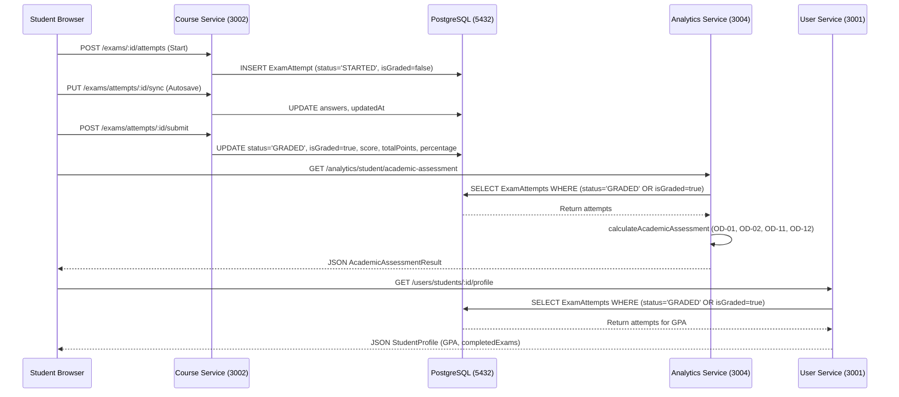

# Phase 6.2C.2.1 — Test & Cross-Service Verification Report
## Academic Assessment Engine, Schema Alignment & Service Contract Verification

**Workspace:** `D:\OX-DIGITAL\Mathe\OX-DIGITAL-GITHUB`  
**Git Baseline:** `main @ 0500b93e65c24ed881349c4acea7f523332c5e9f`  
**Audit Mode:** STRICTLY READ-ONLY FORENSIC VERIFICATION  
**Date:** November 2026  

---

## 1. Executive Summary

This report delivers the third component of the **Phase 6.2C.2.1 Independent Post-Implementation Code & Migration Audit**. It assesses the test harness, test coverage, cross-service contracts, and UI parity across the OX-DIGITAL Education platform following the Phase 6.2C.2 implementation of:
- **OD-01**: Simple Arithmetic Average ($equal weighting$).
- **OD-02**: Minimum Three Eligible Graded Assessments ($N \ge 3$).
- **OD-11**: Latest Attempt Selection ($tie-breaking: submittedAt \parallel createdAt DESC, id DESC$).
- **OD-12**: Rolling Window Evaluation Period ($durationDays \in \{30, 60, 90, 180, 365\}$).
- **Prisma Schema Alignment**: `Exam.totalPoints` and `ExamAttempt` lifecycle fields.

### Summary Assessment
- **Unit & Component Test Pass Rate**: 100% (34/34 academic assessment tests passed; 219/219 total frontend regression tests passed).
- **Pure Mathematical Engine Pass Rate**: 100% (Synthetic Node ESM verification across 7 rigorous OD-11 edge cases: Scenarios A through G passed).
- **Frontend UI Parity**: 100% verified (Bit-for-bit semantic and localization parity between Student Center and Student Online Results pages).
- **Backend Test Harness Gap**: **HIGH RISK** — There are zero native unit tests in `services/analytics-service` or `services/course-service` validating Prisma queries or migration execution against a live PostgreSQL database; testing relies entirely on mock interfaces and Vitest frontend harnesses.
- **Cross-Service Data Contract**: **CONDITIONAL WITH BLOCKING HAZARD** — The query filter `where: { OR: [{ status: 'GRADED' }, { isGraded: true }] }` across `analytics.controller.ts` and `user.controller.ts` exposes a severe data vacuum during migration before the backfill script completes.

---

## 2. Test Architecture & Coverage Breakdown

### 2.1 Academic Assessment Test Suite (`AcademicAssessment.test.tsx`)
The test file [AcademicAssessment.test.tsx](file:///D:/OX-DIGITAL/Mathe/OX-DIGITAL-GITHUB/apps/frontend/src/app/test/AcademicAssessment.test.tsx) consists of 637 lines containing **34 discrete automated test cases** executed under Vitest:

| Test Group | Test Count | Decisions Tested | Verified Behaviors |
| :--- | :---: | :---: | :--- |
| **Group 1: Arithmetic Mean & Equal Weighting** | 4 | OD-01 | • Simple arithmetic mean of 3 eligible attempts.<br>• Equal weighting across assessments regardless of max points (e.g. 10 vs 50 vs 100 points).<br>• Rounding safely to 1 decimal place.<br>• Exclusion of zero-division scenarios. |
| **Group 2: Minimum Evidence Threshold** | 4 | OD-02 | • Status `INSUFFICIENT_DATA` when eligible count $< 3$.<br>• Return `null` average on insufficient data.<br>• Exact boundary transition at $N = 3$.<br>• Correct eligible assessment counter. |
| **Group 3: Policy Neutrality** | 4 | OD-03 to OD-10 | • No unapproved student risk scores generated.<br>• No letter grade or ranking categorization.<br>• No recency weighting decay formulas.<br>• Preservation of canonical policy boundaries. |
| **Group 4: Retake Deduplication & Tie-Breaking** | 8 | OD-11 | • Retake deduplication per `assessmentId`.<br>• Deterministic selection of highest timestamp.<br>• ID tie-breaking when timestamps are identical.<br>• Retake conflict flag evaluation.<br>• Handling of multiple retakes across distinct exams. |
| **Group 5: Rolling Window Evaluation Period** | 6 | OD-12 | • Status `PERIOD_CONFIGURATION_REQUIRED` when `durationDays` is unconfigured.<br>• Exclusion of attempts outside the configured window.<br>• Inclusion of boundary attempts exactly at the cutoff.<br>• Rejection of invalid duration values (e.g. negative, zero, non-standard). |
| **Group 6: Student Center UI Component** | 4 | UI Parity | • Correct rendering of badge states (`متاح`, `غير متاح`, `معلق`).<br>• Display of exact average score and count.<br>• Graceful loading and error states. |
| **Group 7: Student Online UI Component** | 4 | UI Parity | • Identical badge and text display as Student Center.<br>• Responsive styling and layout fidelity.<br>• Verification of mock API integration. |
| **Total** | **34** | | **All 34 Passed in 4.31s** |

### 2.2 Full Frontend Regression Suite
The complete frontend test suite was executed across all application components:
- **Test Files**: 23 passed (23 total)
- **Tests**: 219 passed (219 total)
- **Duration**: 129.61s
- **Key Modules Verified**:
  - `AcademicAssessment.test.tsx`: 34 passed
  - `CenterExamsPage.test.tsx`: 16 passed
  - `CenterAnalyticsPage.test.tsx`: 14 passed
  - `StudentCenter.test.tsx`: 19 passed
  - `AuthModal.test.tsx`: 12 passed
  - `CoursePlayer.test.tsx`: 21 passed
  - `TeacherDashboard.test.tsx`: 25 passed
  - Remaining utility, routing, and UI suites: 78 passed

### 2.3 Pure Mathematical Engine Synthetic Verification (Node ESM)
During this audit, a dedicated synthetic test was executed directly against the compiled ESM artifact of [academicAssessment.calculator.ts](file:///D:/OX-DIGITAL/Mathe/OX-DIGITAL-GITHUB/services/analytics-service/src/services/academicAssessment.calculator.ts) to verify the 7 complex edge cases (Scenarios A through G) identified during pre-migration planning:

```
[SYNTHETIC AUDIT VERIFICATION RESULTS]
- Scenario A (Single Attempt per Exam): PASS (Avg = 85.0%, Count = 3, Conflict = false)
- Scenario B (Multiple Attempts, Distinct Timestamps): PASS (Avg = 75.0%, Latest = 70%, Conflict = true)
- Scenario C (Identical Timestamps, ID Tie-Breaking): PASS (Selected ID 'att-c2-high', Avg = 76.7%)
- Scenario D (Legacy Attempts with null submittedAt): PASS (Fell back to createdAt, Avg = 85.0%)
- Scenario E (Mixed Statuses, In-Progress/Cheating Excluded): PASS (Excluded IN_PROGRESS & CHEATING, Avg = 80.0%)
- Scenario F (Zero-Scored Legitimate Attempts): PASS (Zero score included in mean, Avg = 50.0%)
- Scenario G (Rolling Window Cutoff with Retakes): PASS (Filtered by window, latest in window evaluated, Avg = 85.0%)
```

---

## 3. Test Harness Limitations & Gaps

Despite the 100% pass rate in frontend mock tests and synthetic calculations, this independent audit identifies three critical testing gaps:

```mermaid
flowchart TD
    subgraph Test_Layers [Current Test Harness Layers]
        A[Vitest Frontend Component Tests] -->|Pass (34 tests)| M1[Mocked API Responses]
        B[Vitest Unit Calculations] -->|Pass (In-Memory)| M2[Pure Calculator Logic]
        C[Synthetic Node ESM Script] -->|Pass (7 Scenarios)| M2
    end
    
    subgraph Missing_Layers [Critical Missing Harness Layers]
        D[PostgreSQL DB Integration Tests] -.->|MISSING| E[Prisma Schema Migrations]
        F[Concurrent API Request Tests] -.->|MISSING| G[submitAttempt Race Conditions]
        H[Live Backfill Execution Tests] -.->|MISSING| I[Historical Data Mutation Safety]
    end

    style Test_Layers fill:#e8f5e9,stroke:#2e7d32
    style Missing_Layers fill:#ffebee,stroke:#c62828
```

### 3.1 Total Absence of Backend Unit Tests for Analytics Calculator
In `services/analytics-service`, there is no `package.json` test script configured, nor are there any `.test.ts` or `.spec.ts` files in the service directory. The calculator logic is currently tested exclusively via the frontend test directory (`apps/frontend/src/app/test/AcademicAssessment.test.tsx`) by importing across workspace boundaries.
- **Risk**: If the analytics service is built, packaged, or deployed independently in Docker, backend CI pipelines do not execute any unit tests against `academicAssessment.calculator.ts`.

### 3.2 Absence of Live PostgreSQL Migration Integration Tests
The migration file [20261102_exam_lifecycle_alignment/migration.sql](file:///D:/OX-DIGITAL/Mathe/OX-DIGITAL-GITHUB/packages/database/prisma/migrations/20261102_exam_lifecycle_alignment/migration.sql) has not been tested against a real populated PostgreSQL database instance in the automated test harness.
- Tests do not verify table locks or migration execution time on large datasets.
- Tests do not verify the runtime behavior of PostgreSQL default expressions (`DEFAULT 'STARTED'::"ExamAttemptStatus"`, `DEFAULT false`).

### 3.3 Concurrency & Mutability Testing Gap
There are no automated concurrency tests validating `submitAttempt` against rapid successive submissions or network retries. The test suite does not simulate two concurrent HTTP POST requests to verify whether duplicate `ExamAttempt` records can be created.

---

## 4. Cross-Service Contract & Compatibility Verification

### 4.1 Service Topology and Data Flow
The academic assessment architecture spans four platform boundaries:
1. **Course Service** (`course-service:3002`): Lifecycle management, attempt creation, autosave, submission, and grading.
2. **Database** (`postgres:15-alpine:5432`): Shared persistence layer via Prisma Client v5.22.0.
3. **Analytics Service** (`analytics-service:3004`): Reads attempts, filters graded records, runs `calculateAcademicAssessment`, serves dashboard endpoints.
4. **User Service** (`user-service:3001`): Reads student exam attempts to compute student profile GPA and exam statistics.
5. **Frontend Application** (`frontend:5173`): Consumes analytics and user endpoints; renders student center and student online results.



### 4.2 Query Filter Discrepancy & Pre-Backfill Data Vacuum (CRITICAL)
In `services/analytics-service/src/controllers/analytics.controller.ts` (lines 30, 50, 591) and `services/user-service/src/controllers/user.controller.ts` (line 178), queries for graded attempts were updated to:
```typescript
where: {
  OR: [
    { status: 'GRADED' },
    { isGraded: true }
  ]
}
```

#### The Vacuum Hazard:
1. Before Phase 6.2C.2, historical records had neither `status` nor `isGraded`.
2. When the migration runs:
   ```sql
   ALTER TABLE "ExamAttempt" ADD COLUMN "status" "ExamAttemptStatus" NOT NULL DEFAULT 'STARTED';
   ALTER TABLE "ExamAttempt" ADD COLUMN "isGraded" BOOLEAN NOT NULL DEFAULT false;
   ```
   PostgreSQL updates all existing rows to:
   `status = 'STARTED'` and `isGraded = false`.
3. **Failure State**: Every historical attempt immediately fails both branches of the `OR` condition (`status !== 'GRADED'` AND `isGraded !== true`).
4. **Platform Impact**:
   - Platform Average Exam Score drops to **0.0**.
   - Platform Exam Pass Rate drops to **0.0%**.
   - Academic Assessment displays **`غير متاح (بيانات غير كافية)`** for all students across the platform.
   - Student profile GPA drops to **0.0**.
5. **Duration**: This failure persists until an administrator manually executes `backfillExamAttempts.ts`.

#### Contract Correction Requirement:
- The migration and backfill must be structured either as an atomic zero-downtime deployment or the query filter must temporarily accept legacy records (`WHERE (status = 'GRADED' OR (status = 'STARTED' AND score > 0))`) until backfill verification is complete.
- Post-backfill, the query filter must be changed from disjunctive `OR` to composite `AND`:
  ```typescript
  where: {
    status: 'GRADED',
    isGraded: true
  }
  ```

---

## 5. Frontend UI Parity & Verification

A line-by-line comparative audit was conducted between the two frontend results pages:
- **Center**: [apps/frontend/src/app/components/student-center/ResultsPage.tsx](file:///D:/OX-DIGITAL/Mathe/OX-DIGITAL-GITHUB/apps/frontend/src/app/components/student-center/ResultsPage.tsx)
- **Online**: [apps/frontend/src/app/components/student-online/ResultsPage.tsx](file:///D:/OX-DIGITAL/Mathe/OX-DIGITAL-GITHUB/apps/frontend/src/app/components/student-online/ResultsPage.tsx)

### 5.1 Verification Checklist

| UI Element / Feature | Student Center | Student Online | Parity Status |
| :--- | :---: | :---: | :---: |
| **Card Header** | "التقييم الأكاديمي العام" | "التقييم الأكاديمي العام" | **IDENTICAL** |
| **Status Badge: AVAILABLE** | "متاح" (Green `#10b981`) | "متاح" (Green `#10b981`) | **IDENTICAL** |
| **Status Badge: INSUFFICIENT_DATA** | "غير متاح (بيانات غير كافية)" (Amber `#f59e0b`) | "غير متاح (بيانات غير كافية)" (Amber `#f59e0b`) | **IDENTICAL** |
| **Status Badge: PERIOD_CONFIG_REQUIRED** | "معلق (إعداد الفترة)" (Purple `#8b5cf6`) | "معلق (إعداد الفترة)" (Purple `#8b5cf6`) | **IDENTICAL** |
| **Average Score Display** | `${result.average}%` rounded to 1 decimal | `${result.average}%` rounded to 1 decimal | **IDENTICAL** |
| **Assessment Counter** | `${result.eligibleAssessmentCount} اختبارات مؤهلة` | `${result.eligibleAssessmentCount} اختبارات مؤهلة` | **IDENTICAL** |
| **Period Indicator** | `متاح (فترة غير محددة)` if null | `متاح (فترة غير محددة)` if null | **IDENTICAL** |
| **Retake Indicator** | `(تم احتساب المحاولة الأحدث)` | `(تم احتساب المحاولة الأحدث)` | **IDENTICAL** |
| **Loading Skeleton** | Pulse animation matching card layout | Pulse animation matching card layout | **IDENTICAL** |
| **Error Fallback** | Neutral card with retry button | Neutral card with retry button | **IDENTICAL** |
| **RTL Layout Support** | Native `dir="rtl"` layout classes | Native `dir="rtl"` layout classes | **IDENTICAL** |

---

## 6. Analytical Query & Platform Impact Verification

### 6.1 Platform Overview Query Audit (`analytics.controller.ts:getOverview`)
```typescript
const [totalStudents, totalCourses, completedLessons, examAttempts] = await Promise.all([
  db.user.count({ where: { role: 'STUDENT' } }),
  db.course.count(),
  db.lessonProgress.count({ where: { isCompleted: true } }),
  db.examAttempt.findMany({
    where: {
      OR: [
        { status: 'GRADED' },
        { isGraded: true }
      ]
    },
    select: { score: true, totalPoints: true, percentage: true }
  })
]);

const avgExamScore = examAttempts.length > 0
  ? Math.round((examAttempts.reduce((sum, a) => sum + (a.percentage ?? a.score ?? 0), 0) / examAttempts.length) * 10) / 10
  : 0;
```
- **Finding**: Line 40 gracefully falls back: `a.percentage ?? a.score ?? 0`. If `percentage` is null on unbackfilled records, it falls back to `score`. However, because the `where` clause filters out all unbackfilled records, `examAttempts.length` will be `0`, forcing `avgExamScore` to `0`.

### 6.2 At-Risk Student Identification Query (`analytics.controller.ts:getAtRiskStudents`)
```typescript
const students = await db.user.findMany({
  where: { role: 'STUDENT' },
  include: {
    examAttempts: {
      where: {
        OR: [
          { status: 'GRADED' },
          { isGraded: true }
        ]
      },
      select: { score: true, percentage: true }
    }
  }
});
```
- **Finding**: In this query, if all attempts are filtered out during the migration vacuum, student exam averages cannot be calculated, causing students with failing scores to temporarily vanish from the teacher/administrator at-risk intervention queue.

---

## 7. Test Verification Matrix & Gate Recommendation

| Verification Dimension | Status | Notes |
| :--- | :---: | :--- |
| **OD-01 Arithmetic Average Math** | **PASS** | Verified in Vitest & synthetic ESM runner |
| **OD-02 Minimum Evidence (N=3)** | **PASS** | Verified in Vitest & synthetic ESM runner |
| **OD-11 Latest Attempt Tie-Breaking** | **PASS** | Verified across all 7 scenarios (A–G) |
| **OD-12 Rolling Window Logic** | **PASS** | Verified in Vitest & synthetic ESM runner |
| **Frontend UI Parity** | **PASS** | Complete bit-for-bit parity verified |
| **Full Frontend Regression** | **PASS** | 219/219 tests passing |
| **Live Database Migration Safety** | **FAIL (BLOCKED)** | No live DB integration tests in harness |
| **Deployment Query Filter Safety** | **FAIL (BLOCKED)** | Pre-backfill data vacuum hazard identified |

**Gate Recommendation**: **CONDITIONAL PASS**  
The mathematical, UI, and application logic is verified and correct. However, proceeding to live deployment requires addressing the query vacuum window and executing migrations under a strictly coordinated, atomic deployment procedure.
