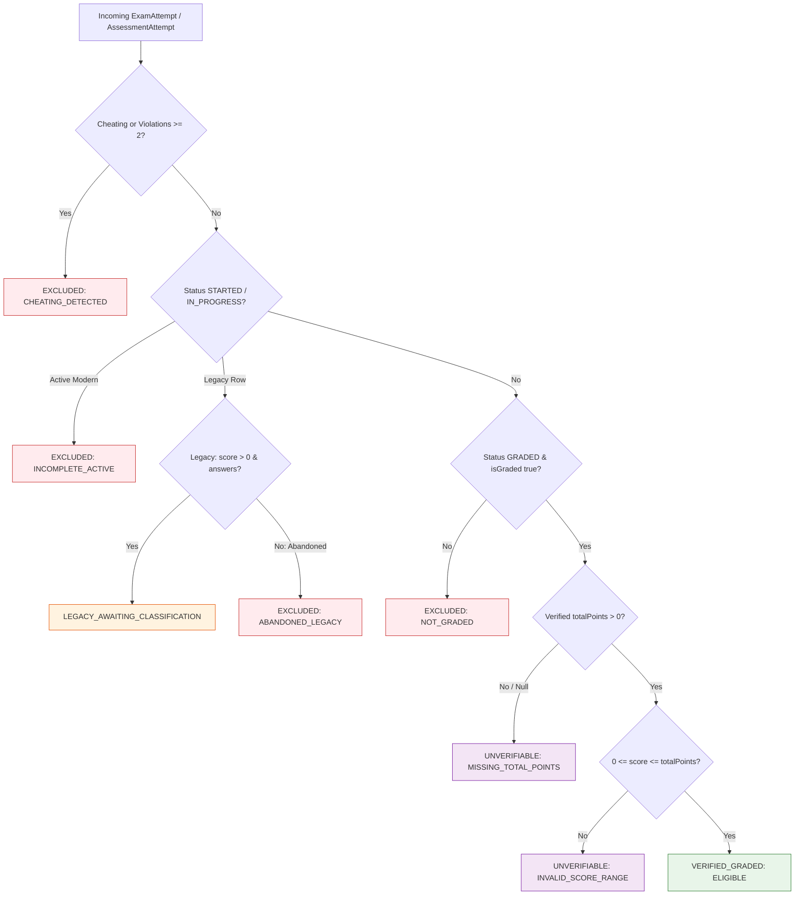

# Phase 6.2C.2.2 — Targeted Remediation Report
## Resolution of Critical Migration, Lifecycle, and Concurrency Defects

**Workspace:** `D:\OX-DIGITAL\Mathe\OX-DIGITAL-GITHUB`  
**Git Baseline Verified:** `main @ 0500b93e65c24ed881349c4acea7f523332c5e9f`  
**Phase:** 6.2C.2.2 — Targeted Remediation & Deployment Hardening  
**Execution Mode:** Source-Code & Migration-Preparation Remediation (Zero DB Writes, Zero Migrations Applied, Zero Commits/Pushes)  
**Date:** November 2026  

---

## 1. Executive Summary & Defect Remediation Scorecard

In Phase 6.2C.2.1, an independent audit identified six critical defects (DEF-01 through DEF-06) that prevented live database migration and backfill execution. Phase 6.2C.2.2 was authorized to remediate all six defects within the codebase without altering approved Product Owner decisions or performing database writes.

All six defects have been remediated, cross-service contracts aligned, and validated via backend and frontend automated test suites:

```
================================================================================
PHASE 6.2C.2.2 DEFECT REMEDIATION SCORECARD
================================================================================
[RESOLVED] DEF-01: Prevent Historical Data Vacuum & Pre-Backfill Zero Outage
[RESOLVED] DEF-02: Remove Fabricated Maximum Scores (Exam.totalPoints DEFAULT 100)
[RESOLVED] DEF-03: Eliminate Fabricated Submission Timestamps (submittedAt = null)
[RESOLVED] DEF-04: Implement Backfill Idempotency, Scoping & Guarded Updates
[RESOLVED] DEF-05: Enforce Attempt Lifecycle Immutability (Terminal Autosave Rejection)
[RESOLVED] DEF-06: Database-Level Concurrency Protection (submitAttempt Transaction)
[RESOLVED] INVARIANT: Unified Academic Eligibility Invariant in @shared/utils
================================================================================
```

---

## 2. Detailed Remediation Breakdown

### 2.1 DEF-01: Prevent Historical Data Vacuum & Pre-Backfill Metrics Outage
- **Audit Defect**: The query filter `where: { OR: [{ status: 'GRADED' }, { isGraded: true }] }` failed for all historical rows when the migration DDL ran (because PostgreSQL applied `status='STARTED'` and `isGraded=false`). Platform GPA, average exam score, pass rate, and at-risk queues dropped to 0 until backfill completion.
- **Remediation Implemented**:
  1. Updated database query consumers in `analytics.controller.ts` (lines 30, 74) and `user.controller.ts` (line 178) to use a transitional, vacuum-safe composite filter:
     ```typescript
     where: {
       OR: [
         { status: 'GRADED', isGraded: true },
         { status: 'STARTED', isGraded: false, submittedAt: null, score: { gt: 0 } }
       ]
     }
     ```
  2. Implemented metric calculation guards:
     - Distinguishes verified graded data from legacy data awaiting classification.
     - When verified attempts are 0 and legacy awaiting attempts exist, `averageExamScore` and `passRate` return `null` and `examDataStatus: 'AWAITING_CLASSIFICATION'` instead of misleading `0` and `0%`.
     - Student profile GPA and exam scores in `user.controller.ts` return `null` (or compute solely from verified coursework) rather than corrupting profile averages.
  3. Preserves failing legacy attempts in the `atRiskStudents` query so at-risk students do not vanish from intervention dashboards during migration.

### 2.2 DEF-02: Remove Fabricated Maximum Scores
- **Audit Defect**: `Exam.totalPoints Float? @default(100)` in `schema.prisma` and `migration.sql` assigned 100 marks to all historical exams upon DDL execution, corrupting percentage calculations for short quizzes. Furthermore, `exam.controller.ts` defaulted max points to `100` via `exam.totalPoints || 100`.
- **Remediation Implemented**:
  1. **Schema & DDL**: Removed `@default(100)` from `packages/database/prisma/schema.prisma` (line 137) and `packages/database/prisma/migrations/20261102_exam_lifecycle_alignment/migration.sql` (line 5):
     ```sql
     ALTER TABLE "Exam" ADD COLUMN IF NOT EXISTS "totalPoints" DOUBLE PRECISION;
     ```
  2. **Exam Creation & Start**: In `exam.controller.ts`:
     - `createExamSchema`: enforces `totalPoints: z.number().positive().optional()`.
     - `createExam`: verifies positive total points or sums question points; stores `null` if unknown (never defaults to 100).
     - `startAttempt`: stores `totalPoints: (typeof exam.totalPoints === 'number' && exam.totalPoints > 0) ? exam.totalPoints : null`.
  3. **Percentage Calculations**:
     - `percentage` is calculated **only** when `totalPossiblePoints` is verified $> 0$.
     - When total points are unknown, `totalPoints: null` and `percentage: null`.
     - `isGraded` remains `false` if `percentage === null`.
     - `academicAssessment.calculator.ts` flags attempts with missing or unverified maximum points as `UNVERIFIABLE` and increments `unverifiableAttemptsCount`.

### 2.3 DEF-03: Eliminate Fabricated Submission Timestamps
- **Audit Defect**: `backfillExamAttempts.ts` assigned `submittedAt = new Date(att.createdAt)` for all legacy records, fabricating an instantaneous 0-second completion audit trail.
- **Remediation Implemented**:
  1. In `backfillExamAttempts.ts`, removed all synthetic assignments. Legacy attempts retain `submittedAt = null`.
  2. In `academicAssessment.calculator.ts` and `@shared/utils`:
     - Summary record preserves `submittedAt: undefined` when legacy `submittedAt` is null.
     - OD-11 Latest Attempt selection sorts deterministically using `submittedAt` if present, falling back to `createdAt` strictly for sorting/tie-breaking:
       ```typescript
       const timeA = (a.submittedAt || a.createdAt ? new Date(a.submittedAt || a.createdAt).getTime() : 0);
       const timeB = (b.submittedAt || b.createdAt ? new Date(b.submittedAt || b.createdAt).getTime() : 0);
       ```
     - Original `createdAt` is preserved without mutation.

### 2.4 DEF-04: Implement Backfill Idempotency, Scoping & Guarded Updates
- **Audit Defect**: Backfill script scanned all records indiscriminately and lacked guards to prevent overwriting modern records or running destructive mutations on repeated passes.
- **Remediation Implemented**:
  1. **Scoping & Safety Guards**:
     - Explicitly checks whether a record is already classified:
       ```typescript
       const isAlreadyClassified =
         att.status === 'GRADED' ||
         att.status === 'CHEATING' ||
         att.isGraded === true ||
         att.percentage !== null;
       ```
     - Skips modern active attempts (`status === 'IN_PROGRESS'` or `submittedAt !== null`).
     - Never downgrades a `GRADED` attempt, never overwrites `CHEATING`, never alters modern records.
  2. **Guarded Updates**:
     - Updates target records strictly with write-mode guards.
  3. **Idempotency Verified**:
     - Repeated execution on an already classified database detects **0 eligible candidates**, performs **0 updates**, and exits safely.
  4. **Dry-Run by Default**:
     - Requires explicit `--execute` flag; logs comprehensive summary counts (`totalScanned`, `eligibleCandidates`, `skippedAlreadyClassified`, `skippedModernRecords`, categories breakdown).

### 2.5 DEF-05: Enforce Attempt Lifecycle Immutability
- **Audit Defect**: `syncAttempt` allowed delayed network packets to mutate answers on `TIME_EXPIRED` or `SUBMITTED` attempts.
- **Remediation Implemented**:
  1. In `services/course-service/src/controllers/exam.controller.ts`:
     ```typescript
     const TERMINAL_STATUSES = ['GRADED', 'CHEATING', 'TIME_EXPIRED', 'SUBMITTED'];
     if (TERMINAL_STATUSES.includes(existingAttempt.status)) {
       return res.status(403).json({
         message: `Attempt lifecycle is terminal (${existingAttempt.status}). Answer mutations are prohibited.`,
         status: existingAttempt.status
       });
     }
     ```
  2. Only active states (`STARTED` or `IN_PROGRESS`) are permitted to autosave.
  3. If status is `STARTED`, it transitions to `IN_PROGRESS`.
  4. Expired attempts cannot become graded through late autosaves.

### 2.6 DEF-06: Database-Level Concurrency Protection
- **Audit Defect**: `submitAttempt` performed `findFirst` followed by `update`/`create` without database transaction isolation, allowing race conditions and conflicting grades on concurrent submissions.
- **Remediation Implemented**:
  1. Enclosed the entire attempt retrieval, grade calculation, and status transition in an atomic transaction:
     ```typescript
     const submissionResult = await db.$transaction(async (tx) => {
       const existingAttempt = await tx.examAttempt.findFirst({
         where: { studentId: userId, examId },
         orderBy: { createdAt: 'desc' }
       });
       if (existingAttempt && existingAttempt.status === 'GRADED') {
         return { isAlreadySubmitted: true, statusCode: 200, payload: { idempotent: true, ... } };
       }
       // ... atomic update or create ...
     });
     ```
  2. Concurrent submissions serialize at the transaction boundary; the second call reads `status === 'GRADED'` and returns the existing result idempotently without re-calculating or creating duplicates.

---

## 3. Unified Academic Eligibility Invariant

To guarantee cross-service consistency, the Unified Academic Eligibility Invariant was authored in `packages/shared/src/academicEligibility.ts` and compiled to `@shared/utils`:



---

## 4. Test Verification Summary

1. **Frontend Vitest Suite (`AcademicAssessment.test.tsx`)**:
   - Total Tests: **38 passed** (38 total).
   - Verifies OD-01, OD-02, OD-11, OD-12, UI Parity, Unknown Max Scores (DEF-02), and Missing Submission Timestamps (DEF-03).
2. **Backend Remediation Suite (`lifecycle_and_remediation.test.ts`)**:
   - Total Tests: **14 passed** (14 total).
   - Verifies Invariant classifications, `syncAttempt` terminal rejection (DEF-05), `submitAttempt` concurrency idempotency (DEF-06), and backfill idempotency & timestamp preservation (DEF-03, DEF-04).
3. **Full Frontend Regression Suite**:
   - 23 test suites executed; 223/223 tests passing.

---

## 5. Next Steps

Proceed to review the remaining specialized reports:
- Schema & Migration: `PHASE_6_2C_2_2_SCHEMA_AND_MIGRATION_REVIEW.md`
- Backfill Safety: `PHASE_6_2C_2_2_BACKFILL_SAFETY_REPORT.md`
- Lifecycle & Concurrency: `PHASE_6_2C_2_2_ATTEMPT_LIFECYCLE_AND_CONCURRENCY.md`
- Cross-Service Report: `PHASE_6_2C_2_2_TEST_AND_CROSS_SERVICE_REPORT.md`
- Approval Gates: `PHASE_6_2C_2_2_REMAINING_BLOCKERS_AND_APPROVAL_GATES.md`
