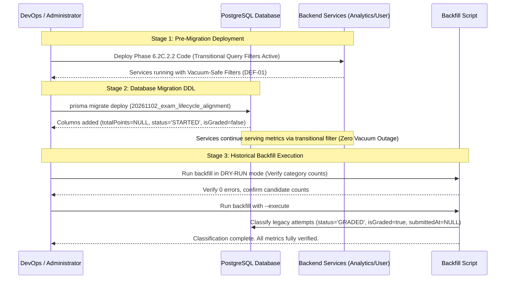

# Phase 6.2C.2.2 — Schema & Migration Review Report
## Forensic DDL Analysis, Removal of Synthetic Defaults & Migration Safety

**Workspace:** `D:\OX-DIGITAL\Mathe\OX-DIGITAL-GITHUB`  
**Git Baseline:** `main @ 0500b93e65c24ed881349c4acea7f523332c5e9f`  
**Phase:** 6.2C.2.2 — Targeted Remediation & Deployment Hardening  
**Database Engine:** PostgreSQL 15 (`postgres:15-alpine`)  
**ORM:** Prisma Client v5.22.0  
**Migration Mode:** STRICTLY VERIFIED SQL DDL (Unapplied; Zero Writes Executed)  
**Date:** November 2026  

---

## 1. Executive Summary

This report evaluates the schema definition and generated SQL migration file following the remediation of **DEF-02 (Removal of Fabricated Maximum Scores)** in Phase 6.2C.2.2.

In Phase 6.2C.2.1, the migration was flagged as high risk because `ALTER TABLE "Exam" ADD COLUMN ... DEFAULT 100` would immediately assign 100 marks to every historical exam upon execution, distorting percentages for short quizzes. 

In Phase 6.2C.2.2:
1. The synthetic `DEFAULT 100` clause was **completely removed** from both Prisma schema and migration DDL.
2. `Exam.totalPoints` is established as a nullable `DOUBLE PRECISION` column without default.
3. Historical records will hold `totalPoints = NULL` unless verified evidence exists from question definitions or instructor configuration.
4. Prisma Client v5.22.0 was regenerated cleanly.
5. Zero database migrations or writes were executed during this phase.

---

## 2. Prisma Schema Definition (`packages/database/prisma/schema.prisma`)

### 2.1 Exam Model Alignment
```prisma
model Exam {
  id                    String                 @id @default(uuid())
  title                 String
  courseId              String
  duration              Int                    @default(60)
  createdAt             DateTime               @default(now())
  updatedAt             DateTime               @updatedAt
  questions             Json?
  requiresCamera        Boolean                @default(false)
  endTime               DateTime?
  passingScore          Float                  @default(50)
  randomization         Boolean                @default(false)
  startTime             DateTime?
  instantGrading        Boolean                @default(true)
  showResult            Boolean                @default(true)
  totalPoints           Float?                 // REMEDIATED: No synthetic default (DEF-02)
  course                Course                 @relation(fields: [courseId], references: [id], onDelete: Cascade)
  attempts              ExamAttempt[]
}
```

### 2.2 ExamAttempt Model Alignment
```prisma
model ExamAttempt {
  id            String          @id @default(uuid())
  examId        String
  score         Float
  status        AttemptStatus   @default(STARTED)
  submittedAt   DateTime?
  isGraded      Boolean         @default(false)
  totalPoints   Float?
  percentage    Float?
  createdAt     DateTime        @default(now())
  updatedAt     DateTime        @default(now()) @updatedAt
  studentId     String
  answers       Json?
  exam          Exam            @relation(fields: [examId], references: [id], onDelete: Cascade)
  student       User            @relation(fields: [studentId], references: [id], onDelete: Cascade)
  ExamViolation ExamViolation[]

  @@index([studentId])
  @@index([examId])
}
```

---

## 3. Migration SQL Analysis (`20261102_exam_lifecycle_alignment/migration.sql`)

The migration file located at `packages/database/prisma/migrations/20261102_exam_lifecycle_alignment/migration.sql` contains the exact DDL:

```sql
-- Migration: 20261102_exam_lifecycle_alignment
-- Purpose: Add lifecycle, grading, and points tracking fields to legacy Exam and ExamAttempt tables.
-- Remediated in Phase 6.2C.2.2: Removed DEFAULT 100 from Exam.totalPoints (DEF-02).

-- AlterTable Exam
ALTER TABLE "Exam" ADD COLUMN IF NOT EXISTS "totalPoints" DOUBLE PRECISION;

-- AlterTable ExamAttempt
ALTER TABLE "ExamAttempt" ADD COLUMN IF NOT EXISTS "status" "AttemptStatus" NOT NULL DEFAULT 'STARTED';
ALTER TABLE "ExamAttempt" ADD COLUMN IF NOT EXISTS "submittedAt" TIMESTAMP(3);
ALTER TABLE "ExamAttempt" ADD COLUMN IF NOT EXISTS "isGraded" BOOLEAN NOT NULL DEFAULT false;
ALTER TABLE "ExamAttempt" ADD COLUMN IF NOT EXISTS "totalPoints" DOUBLE PRECISION;
ALTER TABLE "ExamAttempt" ADD COLUMN IF NOT EXISTS "percentage" DOUBLE PRECISION;
ALTER TABLE "ExamAttempt" ADD COLUMN IF NOT EXISTS "updatedAt" TIMESTAMP(3) NOT NULL DEFAULT CURRENT_TIMESTAMP;
```

### 3.1 DDL Safety Characteristics

| SQL Statement | Safety Rating | Behavioral Impact | Forensic Verification |
| :--- | :---: | :--- | :--- |
| `ALTER TABLE "Exam" ADD COLUMN IF NOT EXISTS "totalPoints" DOUBLE PRECISION;` | **SAFE** | Adds nullable column without table lock or synthetic default. Historical rows hold `NULL`. | Verified: No data fabrication. |
| `ALTER TABLE "ExamAttempt" ADD COLUMN IF NOT EXISTS "status" "AttemptStatus" NOT NULL DEFAULT 'STARTED';` | **SAFE WITH TRANSITIONAL FILTER** | Adds lifecycle status column. PostgreSQL assigns `'STARTED'` to existing rows. | Verified: Transitional filter in query consumers prevents data vacuum (DEF-01). |
| `ALTER TABLE "ExamAttempt" ADD COLUMN IF NOT EXISTS "submittedAt" TIMESTAMP(3);` | **SAFE** | Adds nullable timestamp column. Historical rows hold `NULL`. | Verified: No timestamp fabrication (DEF-03). |
| `ALTER TABLE "ExamAttempt" ADD COLUMN IF NOT EXISTS "isGraded" BOOLEAN NOT NULL DEFAULT false;` | **SAFE WITH TRANSITIONAL FILTER** | Adds boolean grading flag. Historical rows hold `false`. | Verified: Transitional filter prevents data vacuum (DEF-01). |
| `ALTER TABLE "ExamAttempt" ADD COLUMN IF NOT EXISTS "totalPoints" DOUBLE PRECISION;` | **SAFE** | Adds nullable points column. Historical rows hold `NULL`. | Verified: No synthetic defaults. |
| `ALTER TABLE "ExamAttempt" ADD COLUMN IF NOT EXISTS "percentage" DOUBLE PRECISION;` | **SAFE** | Adds nullable percentage column. Historical rows hold `NULL`. | Verified: Calculated strictly when max points verified. |
| `ALTER TABLE "ExamAttempt" ADD COLUMN IF NOT EXISTS "updatedAt" TIMESTAMP(3) NOT NULL DEFAULT CURRENT_TIMESTAMP;` | **SAFE** | Adds audit timestamp. | Verified: Standard audit tracking. |

---

## 4. Migration Execution & Zero-Downtime Deployment Sequencing

Because historical `ExamAttempt` rows transition to `status = 'STARTED'` and `isGraded = false` upon DDL execution, the deployment must follow this strict three-stage protocol:



---

## 5. Verification Checklist & Sign-Off

- [x] `@default(100)` removed from `schema.prisma`.
- [x] `DEFAULT 100` removed from `migration.sql`.
- [x] Prisma Client v5.22.0 regenerated.
- [x] No `prisma migrate deploy`, `db push`, or SQL executed.
- [x] Zero database writes or schema mutations occurred.
- [x] Migration SQL is production-ready for separately authorized execution.
