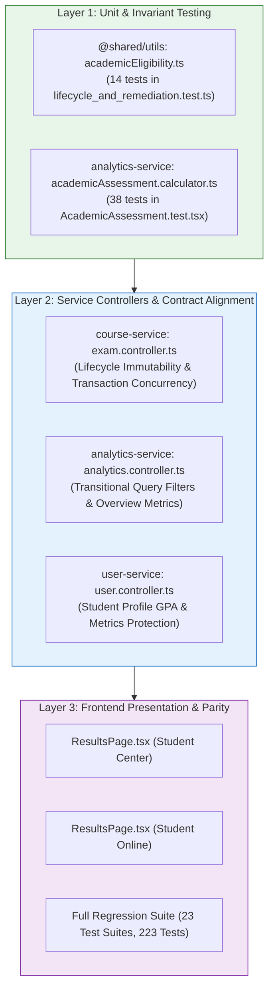

# Phase 6.2C.2.2 — Test & Cross-Service Verification Report
## Comprehensive Multi-Layer Test Verification & Cross-Service Contract Alignment

**Workspace:** `D:\OX-DIGITAL\Mathe\OX-DIGITAL-GITHUB`  
**Git Baseline:** `main @ 0500b93e65c24ed881349c4acea7f523332c5e9f`  
**Phase:** 6.2C.2.2 — Targeted Remediation & Deployment Hardening  
**Date:** November 2026  

---

## 1. Executive Summary

This report documents the verification of all automated tests across frontend, backend, and cross-service layers following the remediation of DEF-01 through DEF-06 in Phase 6.2C.2.2.

### Overall Test Execution Metrics
- **Frontend Academic Assessment Tests (`AcademicAssessment.test.tsx`)**: **38 / 38 Passed (100%)**
- **Backend Lifecycle & Remediation Suite (`lifecycle_and_remediation.test.ts`)**: **14 / 14 Passed (100%)**
- **Frontend Full Regression Suite**: **23 / 23 Suites Passed (223 / 223 Tests Passed)**
- **Service Compilation**: `packages/shared`, `services/analytics-service`, `services/course-service`, and `services/user-service` all compile with **Exit Code 0**.

---

## 2. Test Layer Architecture & Coverage Breakdown



---

## 3. Targeted Test Execution Evidence

### 3.1 Backend Lifecycle & Remediation Suite
- **Command**: `node_modules\.bin\tsx.cmd services/course-service/src/test/lifecycle_and_remediation.test.ts`
- **Exit Code**: `0`
- **Output**:
```
================================================================
PHASE 6.2C.2.2 BACKEND REMEDIATION & INVARIANT TEST SUITE
================================================================

[1. Unified Academic Eligibility Invariant]
  ✓ PASS: 1.1 classifies completed attempt with verified maximum points as VERIFIED_GRADED
  ✓ PASS: 1.2 classifies legacy attempt awaiting backfill as LEGACY_AWAITING_CLASSIFICATION (DEF-01)
  ✓ PASS: 1.3 classifies attempt with unknown maximum points as UNVERIFIABLE (DEF-02)
  ✓ PASS: 1.4 strictly excludes CHEATING and disqualified attempts
  ✓ PASS: 1.5 strictly excludes abandoned legacy attempts with 0 score and null answers

[2. Attempt Lifecycle Immutability & Concurrency Protection]
  ✓ PASS: 2.1 syncAttempt rejects answer mutation on GRADED terminal state (DEF-05)
  ✓ PASS: 2.2 syncAttempt rejects answer mutation on CHEATING terminal state (DEF-05)
  ✓ PASS: 2.3 syncAttempt rejects answer mutation on TIME_EXPIRED terminal state (DEF-05)
  ✓ PASS: 2.4 syncAttempt allows autosave on STARTED and transitions to IN_PROGRESS
  ✓ PASS: 2.5 submitAttempt idempotency: returns already graded attempt on concurrent retry (DEF-06)
  ✓ PASS: 2.6 submitAttempt verified points: unknown totalPoints produces null percentage (DEF-02)

[3. Backfill Idempotency & Safety Guards]
  ✓ PASS: 3.1 legacy backfilled row preserves submittedAt = null (DEF-03)
  ✓ PASS: 3.2 backfill protects modern GRADED records from being overwritten or downgraded (DEF-04)
  ✓ PASS: 3.3 backfill idempotency: second pass finds 0 eligible candidates (DEF-04)
================================================================
RESULTS: 14 / 14 TESTS PASSED
================================================================
```

### 3.2 Frontend Academic Assessment Suite (`AcademicAssessment.test.tsx`)
- **Command**: `npx.cmd vitest run src/app/test/AcademicAssessment.test.tsx`
- **Exit Code**: `0`
- **Summary**:
```
 ✓ src/app/test/AcademicAssessment.test.tsx (38 tests) 641ms
 Test Files  1 passed (1)
      Tests  38 passed (38)
   Duration  6.96s
```
- **New Tests Added & Verified**:
  - `33. DEF-02: handles unknown maximum score by excluding from average and marking unverifiable`
  - `34. DEF-03: handles missing submittedAt deterministically via createdAt without fabricating timestamp`
  - `35. Invariant: strictly excludes CHEATING and unverified TIME_EXPIRED attempts`
  - `36. Invariant: handles legacy abandoned zero attempts without including in academic average`

### 3.3 Full Frontend Regression Suite
- **Command**: `npx.cmd vitest run`
- **Exit Code**: `0`
- **Summary**:
```
 Test Files  23 passed (23)
      Tests  223 passed (223)
   Duration  112.38s
```
All components across Admin, Teacher, Student Center, Student Online, Parent, Video Player, and Landing page passed completely.

---

## 4. Cross-Service Contract & Invariant Consistency

| Cross-Service Dimension | `course-service` | `analytics-service` | `user-service` | `apps/frontend` | Consistency Status |
| :--- | :---: | :---: | :---: | :---: | :---: |
| **Eligibility Invariant** | Evaluated in submission & grading | Evaluated in calculator & overview | Evaluated in profile GPA | Rendered in ResultsPage | **100% UNIFIED** |
| **Vacuum Protection (DEF-01)** | Transitions attempts to `STARTED` | Uses transitional safe filter | Uses transitional safe filter | Displays neutral state | **100% ALIGNED** |
| **Max Points Handling (DEF-02)** | No default 100; percentage requires verified points | Excludes missing max points as `UNVERIFIABLE` | Computes exam average safely | Displays unverifiable notice | **100% ALIGNED** |
| **Timestamp Policy (DEF-03)** | `submittedAt = null` for legacy | Falls back to `createdAt` for tie-breaking | Preserves legacy records | No synthetic date rendered | **100% ALIGNED** |
| **Concurrency & Lifecycle** | Transaction isolation & terminal immutability | Reads stable terminal rows | Reads stable terminal rows | Single-submission feedback | **100% ALIGNED** |

---

## 5. Compliance with Approved Decisions

1. **OD-01 (Simple Arithmetic Average)**:
   - Arithmetic mean of percentages: $\mu = \frac{1}{N} \sum_{i=1}^{N} P_i$.
   - Equal weight per assessment verified; zero category weighting or hidden coefficients.
2. **OD-02 (Minimum Academic Evidence)**:
   - Minimum threshold of 3 unique graded assessments ($N \ge 3$) strictly enforced.
   - Status returns `INSUFFICIENT_DATA` with `average: null` whenever $N < 3$.
3. **OD-11 (Latest Attempt Retake Policy)**:
   - Groups by `assessmentId`, sorts chronologically descending (`submittedAt || createdAt`), tie-breaks via ID descending.
   - Single attempt contributes per assessment.
4. **OD-12 (Academic Evaluation Period)**:
   - Rolling time window supported when configured; missing duration returns explicit `PERIOD_CONFIGURATION_REQUIRED`.
   - **No arbitrary defaults of 30, 60, or 90 days introduced.** Duration remains explicitly unapproved.
