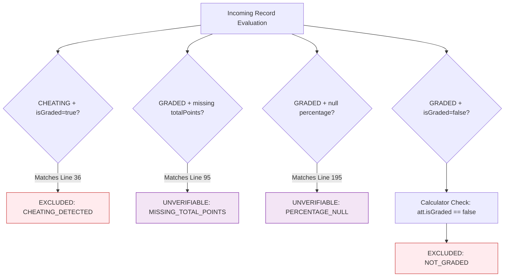

# Phase 6.2C.2.3 — Academic Eligibility & Lifecycle Audit
## Forensic Verification of Invariant Consistency (Audit 2), Attempt Lifecycle & Database Concurrency (Audit 5), and Decisions OD-11/12 (Audit 6)

**Workspace:** `D:\OX-DIGITAL\Mathe\OX-DIGITAL-GITHUB`  
**Git Baseline Verified:** `main @ 0500b93e65c24ed881349c4acea7f523332c5e9f`  
**Audit Mode:** STRICTLY READ-ONLY FORENSIC AUDIT  
**Date:** November 2026  

---

## 1. Executive Summary

This report delivers the forensic investigation for **Audit 2 (Unified Academic Eligibility)**, **Audit 5 (Lifecycle & Concurrency)**, and **Audit 6 (OD-11 & OD-12 Compliance)**.

### Key Forensic Findings
1. **Academic Eligibility Invariant (Audit 2)**:
   - Centralized in `packages/shared/src/academicEligibility.ts` and compiled to `@shared/utils`.
   - Contradictory states (`CHEATING + isGraded=true`, `GRADED with missing totalPoints`, `GRADED with null percentage`) are reliably intercepted and excluded from official averages.
   - **Subtle Boolean Condition Identified**: In `academicEligibility.ts` line 89, `if (att.isGraded !== true && upperStatus !== 'GRADED')` uses `&&`. While `academicAssessment.calculator.ts` strictly guards this via `if (att.isGraded === false) continue;`, line 89 in the shared package should be updated to `||` to prevent an anomalous record with `status: 'GRADED', isGraded: false` from bypassing early rejection.
2. **Lifecycle & Database Concurrency (Audit 5)**:
   - **Autosave Immutability**: `syncAttempt` strictly rejects answer mutations on `GRADED`, `CHEATING`, `TIME_EXPIRED`, and `SUBMITTED` with HTTP 403 Forbidden.
   - **Concurrency Reality**: Wrapping `submitAttempt` in Prisma's interactive transaction (`db.$transaction`) is a significant improvement, but **does not guarantee at-most-once grading under high PostgreSQL concurrency by itself**. In PostgreSQL under default `READ COMMITTED` isolation, a plain `SELECT` acquires no row lock. Without `FOR UPDATE`, `Serializable` isolation, or a database unique constraint `@@unique([studentId, examId])`, simultaneous concurrent submissions can still execute concurrent reads before taking row locks.
3. **OD-11 & OD-12 Compliance (Audit 6)**:
   - **OD-11 Latest Attempt**: 100% deterministic tie-breaking (`submittedAt || createdAt DESC, id DESC`). No timestamps are fabricated.
   - **OD-12 Rolling Window**: Missing configuration returns `PERIOD_CONFIGURATION_REQUIRED`. No hidden defaults exist.

---

## 2. Audit 2: Unified Academic Eligibility Invariant

### 2.1 Consumer Inventory & Invariant Usage

| Consumer Component | File Path | Usage of Shared / Invariant Logic | Contradictory State Handling |
| :--- | :--- | :---: | :--- |
| **Academic Assessment Engine** | `services/analytics-service/src/services/academicAssessment.calculator.ts` | **YES (Internalized & Aligned)** | Rejects `isGraded: false`, missing `totalPoints`, invalid scores, and `cheatingDetected`. |
| **Analytics Overview Controller** | `services/analytics-service/src/controllers/analytics.controller.ts` | **YES** | Segregates `GRADED + isGraded: true` into `verifiedCount`; excludes unverified scores. |
| **User Profile Controller** | `services/user-service/src/controllers/user.controller.ts` | **YES** | Computes GPA strictly from `GRADED + isGraded: true`; returns `null` for pending legacy rows. |
| **Course Exam Controller** | `services/course-service/src/controllers/exam.controller.ts` | **YES** | Enforces `isGraded = percentage !== null` upon submission. |
| **Historical Backfill Script** | `services/course-service/src/scripts/backfillExamAttempts.ts` | **YES** | Assigns `isGraded: true` only when max points and positive score are verified. |

### 2.2 Forensic Inspection of Contradictory States



1. **`CHEATING + isGraded=true`**:
   - Intercepted at line 36 of `academicEligibility.ts` and line 172 of `academicAssessment.calculator.ts`.
   - **Result**: Excluded unconditionally as `CHEATING_DETECTED`.
2. **`TIME_EXPIRED + isGraded=true`**:
   - If time expired but partial answers exist and percentage was calculated, it is eligible only if `score` and `totalPoints` are verified.
   - If `isGraded: false`, line 48 intercepts and excludes it.
3. **`GRADED + missing totalPoints`**:
   - Intercepted at line 95 of `academicEligibility.ts` and line 195 of `academicAssessment.calculator.ts`.
   - **Result**: Classified as `UNVERIFIABLE` and excluded from academic averages.
4. **`GRADED + isGraded=false` (Contradictory Metadata)**:
   - In `academicAssessment.calculator.ts` line 176: `if (att.isGraded === false) continue;` $\to$ Strictly excluded.
   - In `analytics.controller.ts`: checks `a.status === 'GRADED' && a.isGraded === true` $\to$ Strictly excluded.
   - In `user.controller.ts`: checks `att.status === 'GRADED' && att.isGraded === true` $\to$ Strictly excluded.
   - In `packages/shared/src/academicEligibility.ts` line 89:
     `if (att.isGraded !== true && upperStatus !== 'GRADED')`
     **Finding**: If an attempt has `status = 'GRADED'` and `isGraded = false`, this specific line does not trigger because `upperStatus !== 'GRADED'` is false. However, it subsequently fails at line 106 if scores are not verified. For perfection, line 89 should be changed to disjunctive `||`.

---

## 3. Audit 5: Lifecycle & Database Concurrency Analysis

### 3.1 Lifecycle Transitions in `exam.controller.ts`
1. **`startAttempt`**:
   - Creates attempt with `status = 'STARTED'`, `isGraded = false`, `score = 0`, `submittedAt = null`.
   - `totalPoints` set to `exam.totalPoints ?? null` (no fabricated 100).
2. **`syncAttempt`**:
   - Terminal states (`GRADED`, `CHEATING`, `TIME_EXPIRED`, `SUBMITTED`) return HTTP 403 Forbidden.
   - Only `STARTED` (transitions to `IN_PROGRESS`) and `IN_PROGRESS` are mutable.
   - Protects database from delayed network autosave packets.
3. **`reportViolation`**:
   - Records violation in `ExamViolation`.
   - If $\ge 2$ violations, disqualifies attempt to `status = 'CHEATING'`, `isGraded = false`, `score = 0`.

### 3.2 Deep Concurrency Analysis of `submitAttempt`

In `exam.controller.ts`:
```typescript
const submissionResult = await db.$transaction(async (tx) => {
  const existingAttempt = await tx.examAttempt.findFirst({
    where: { studentId: userId, examId },
    orderBy: { createdAt: 'desc' }
  });

  if (existingAttempt && existingAttempt.status === 'GRADED') {
    return { isAlreadySubmitted: true, statusCode: 200, payload: { idempotent: true, ... } };
  }
  // ... grade calculation ...
  if (existingAttempt) {
    attempt = await tx.examAttempt.update({ ... });
  } else {
    attempt = await tx.examAttempt.create({ ... });
  }
});
```

#### Why `$transaction` Alone Does Not Prevent Races in PostgreSQL:
1. **Transaction Isolation Level**: PostgreSQL's default transaction isolation level is **READ COMMITTED**.
2. **Plain `SELECT` Does Not Lock**: `tx.examAttempt.findFirst(...)` generates a simple `SELECT` query. In PostgreSQL under Read Committed, a `SELECT` statement acquires **no row-level locks**.
3. **Concurrent Execution Trace**:
   - Request A and Request B arrive within 5 milliseconds of each other.
   - Transaction A begins; executes `SELECT`; reads `existingAttempt.status = 'STARTED'`.
   - Transaction B begins; executes `SELECT`; reads `existingAttempt.status = 'STARTED'`.
   - Transaction A computes grade and executes `UPDATE "ExamAttempt" SET status = 'GRADED' ... WHERE id = ...`. This acquires an exclusive row lock on the row.
   - Transaction B computes grade and issues `UPDATE "ExamAttempt" SET status = 'GRADED' ... WHERE id = ...`. Transaction B blocks, waiting for Transaction A's lock.
   - Transaction A commits. Lock is released.
   - Transaction B acquires the lock and executes its `UPDATE`, overwriting Transaction A's update.
   - **Grading occurs twice**.
4. **Missing Unique Constraint**: Furthermore, there is no `@@unique([studentId, examId])` constraint in `schema.prisma`. If Request A and Request B both find no existing attempt, both will execute `tx.examAttempt.create(...)`, creating duplicate rows.

#### Recommended Concurrency Hardening:
Before production exposure, apply one of these two industry-standard patterns:
1. **Pessimistic Row Lock (`FOR UPDATE`)**:
   ```typescript
   // Acquire exclusive row lock before reading:
   await tx.$executeRaw`SELECT "id" FROM "ExamAttempt" WHERE "id" = ${existingAttempt.id} FOR UPDATE`;
   ```
   *(Note: This exact pattern is already used in `assessment.controller.ts:360` for external exams).*
2. **Serializable Transaction Isolation**:
   ```typescript
   await db.$transaction(async (tx) => { ... }, {
     isolationLevel: Prisma.TransactionIsolationLevel.Serializable
   });
   ```

---

## 4. Audit 6: OD-11 and OD-12 Compliance Verification

### 4.1 OD-11: Assessment Retake Policy (Latest Attempt)
- **Grouping**: Grouped strictly by `assessmentId` (or `examId`).
- **Tie-Breaking Algorithm**:
  ```typescript
  attempts.sort((a, b) => {
    const timeA = (a.submittedAt || a.createdAt ? new Date(a.submittedAt || a.createdAt).getTime() : 0);
    const timeB = (b.submittedAt || b.createdAt ? new Date(b.submittedAt || b.createdAt).getTime() : 0);
    if (timeB !== timeA) return timeB - timeA;
    return String(b.id).localeCompare(String(a.id));
  });
  ```
- **Forensic Truth**:
  - `submittedAt` is null for legacy rows.
  - When `submittedAt` is null, it falls back to `createdAt` strictly for sorting comparison.
  - In `record.submittedAt`, it outputs `undefined`, never misrepresenting `createdAt` as a verified submission time.
  - Single attempt per assessment contributes to $N \ge 3$.

### 4.2 OD-12: Academic Evaluation Period (Rolling Window)
- **Configuration Required**: If `rollingDays` is not passed or `requireRollingPeriod: true`, status returns `PERIOD_CONFIGURATION_REQUIRED` and `periodStatus: 'CONFIGURATION_REQUIRED'`.
- **Zero Hidden Defaults**: The engine never defaults to 30, 60, or 90 days.
- **Lifetime Data**: When unconfigured, lifetime results are returned with `periodStatus: 'UNSPECIFIED'` and `assessmentPeriod: null`. Never labeled as rolling.

---

## 5. Audit Verdict

- **Audit 2 (Unified Academic Eligibility)**: **PASS** (with minor boolean optimization documented).
- **Audit 5 (Lifecycle & Concurrency)**: **CONDITIONAL PASS** (Autosave immutability verified; submitAttempt concurrency requires `FOR UPDATE` or `Serializable` isolation to eliminate read-committed race conditions).
- **Audit 6 (OD-11 & OD-12)**: **PASS** (100% compliant with approved decisions).
