# Phase 6.2C.2.3 — Independent Remediation Audit
## Forensic Verification of Transitional Data Integrity (DEF-01) & Metrics Vacuum Mitigation

**Workspace:** `D:\OX-DIGITAL\Mathe\OX-DIGITAL-GITHUB`  
**Git Baseline Verified:** `main @ 0500b93e65c24ed881349c4acea7f523332c5e9f`  
**Audit Mode:** STRICTLY READ-ONLY FORENSIC AUDIT  
**Audit Date:** November 2026  

---

## 1. Executive Summary

This independent audit evaluates the remediation of **DEF-01 (Transitional Data Integrity & Vacuum Prevention)** implemented in Phase 6.2C.2.2.

The audit inspects the exact Prisma query filters, calculation loops, and metrics representations across `analytics-service` and `user-service`. The primary objective is to verify whether the transitional data strategy successfully prevents a platform-wide metrics blackout (where platform averages, GPA, and pass rates drop to zero between schema migration and backfill) without improperly injecting unverified legacy data into official calculations.

### Forensic Finding Summary
- **Pre-Backfill Vacuum Prevention**: **VERIFIED** — Historical attempts are captured by the transitional filter and prevented from silently dropping platform GPA to zero.
- **Metrics Representation of Unavailable Data**: **VERIFIED** — Unavailable/unclassified exam metrics return `null` and `examDataStatus: 'AWAITING_CLASSIFICATION'` rather than misleading `0.0` or `0.0%`.
- **Exclusion of Ambiguous Legacy Attempts**: **VERIFIED** — Legacy attempts with `score > 0` are counted as awaiting classification; they are **NOT** added to `verifiedScoreSum` or `verifiedCount` in official averages.
- **Academic Calculator Immunity**: **VERIFIED** — `academicAssessment.calculator.ts` strictly enforces `if (att.isGraded === false) continue;`, completely isolating official OD-01/OD-02 assessments from unmigrated legacy rows.

---

## 2. Forensic Query Inspection: `analytics.controller.ts`

### 2.1 The Overview Query (`getOverview`)
In `services/analytics-service/src/controllers/analytics.controller.ts`, lines 30–64:

```typescript
const examAttempts = await db.examAttempt.findMany({
  where: {
    OR: [
      { status: 'GRADED', isGraded: true },
      { status: 'STARTED', isGraded: false, submittedAt: null, score: { gt: 0 } }
    ]
  },
  select: {
    score: true,
    percentage: true,
    totalPoints: true,
    status: true,
    isGraded: true,
    exam: { select: { totalPoints: true } }
  }
});

let verifiedCount = 0;
let verifiedScoreSum = 0;
let verifiedPassCount = 0;
let legacyAwaitingCount = 0;

for (const a of examAttempts) {
  if (a.status === 'GRADED' && a.isGraded === true) {
    const maxPts = a.totalPoints ?? (a as any).exam?.totalPoints;
    if (typeof maxPts === 'number' && maxPts > 0) {
      const pct = a.percentage ?? Math.round(((a.score / maxPts) * 100) * 10) / 10;
      verifiedCount++;
      verifiedScoreSum += pct;
      if (pct >= 50) verifiedPassCount++;
    }
  } else if (a.status === 'STARTED' && a.isGraded === false) {
    legacyAwaitingCount++;
  }
}

const averageExamScore = verifiedCount > 0
  ? Math.round(verifiedScoreSum / verifiedCount)
  : (legacyAwaitingCount > 0 ? null : 0);
const passRate = verifiedCount > 0
  ? Math.round((verifiedPassCount / verifiedCount) * 100)
  : (legacyAwaitingCount > 0 ? null : 0);
```

### 2.2 Forensic Analysis: Pre-Backfill vs Post-Backfill Behavior

```mermaid
flowchart TD
    subgraph Pre_Backfill [Pre-Backfill Operational State]
        DDL[Migration DDL Runs] --> PopRows[Historical Rows: status='STARTED', isGraded=false, submittedAt=null]
        PopRows --> Q1[Transitional Query Captures score > 0]
        Q1 --> Loop1[Calculation Loop]
        Loop1 --> CheckBranch{status == 'GRADED' & isGraded == true?}
        CheckBranch -->|False: Matches else if| IncrAwaiting[legacyAwaitingCount++]
        IncrAwaiting --> Result1["averageExamScore: null<br>passRate: null<br>(Explicitly Unavailable)"]
    end

    subgraph Post_Backfill [Post-Backfill Operational State]
        BackfillExec[Backfill Script Runs with --execute] --> ClassifyRows[Verified Rows: status='GRADED', isGraded=true]
        ClassifyRows --> Q2[Query Captures Verified Rows]
        Q2 --> Loop2[Calculation Loop]
        Loop2 --> CheckBranch2{status == 'GRADED' & isGraded == true?}
        CheckBranch2 -->|True| CheckMaxPts{totalPoints > 0?}
        CheckMaxPts -->|True| IncrVerified["verifiedCount++<br>verifiedScoreSum += pct"]
        IncrVerified --> Result2["averageExamScore: Verified Mean<br>passRate: Verified Pass %"]
    end

    style Pre_Backfill fill:#fff3e0,stroke:#e65100
    style Post_Backfill fill:#e8f5e9,stroke:#2e7d32
```



1. **Which attempts are included before backfill?**
   - The query retrieves modern graded attempts (`status: 'GRADED', isGraded: true`) and unclassified legacy attempts with positive scores (`status: 'STARTED', isGraded: false, submittedAt: null, score: { gt: 0 }`).
   - Abandoned attempts (`score: 0` with null answers) fail `score: { gt: 0 }` and are excluded.
2. **Which attempts are included after backfill?**
   - After backfill, classified attempts have `status: 'GRADED'` and `isGraded: true`. They enter the `verifiedCount` and `verifiedScoreSum` calculations provided `totalPoints` is verified $> 0$.
3. **Does the transitional query mix verified and unverified records in averages?**
   - **NO**. The SQL query retrieves both candidate sets, but the in-memory loop segregates them into `verifiedCount` and `legacyAwaitingCount`.
   - `averageExamScore` and `passRate` are computed **exclusively** from `verifiedCount`.
4. **Are unavailable metrics represented honestly?**
   - **YES**. When `verifiedCount === 0` and `legacyAwaitingCount > 0`, both `averageExamScore` and `passRate` evaluate to **`null`** (not `0` and not `0%`).
   - Dashboards receiving `null` render neutral skeleton or "Awaiting Classification" states rather than false alarms.

---

## 3. Forensic Query Inspection: `user.controller.ts`

### 3.1 The Student Profile GPA & Exam Score Query
In `services/user-service/src/controllers/user.controller.ts`, lines 178–253:

```typescript
examAttempts: {
  where: {
    OR: [
      { status: 'GRADED', isGraded: true },
      { status: 'STARTED', isGraded: false, submittedAt: null, score: { gt: 0 } }
    ]
  },
  select: { score: true, status: true, isGraded: true }
}
```

And in user mapping:
```typescript
let examScore: number | null = null;
let validExamCount = 0;
let validExamSum = 0;
let legacyAwaitingExamCount = 0;

if (user.examAttempts && user.examAttempts.length > 0) {
  for (const att of user.examAttempts) {
    if (att.status === 'GRADED' && att.isGraded === true) {
      validExamCount++;
      validExamSum += (att.score || 0);
    } else if (att.status === 'STARTED' && att.isGraded === false) {
      legacyAwaitingExamCount++;
    }
  }
  if (validExamCount > 0) {
    examScore = Math.round(validExamSum / validExamCount);
  } else if (legacyAwaitingExamCount > 0) {
    examScore = null;
  } else {
    examScore = 0;
  }
}

let avgScore: number | null = null;
const subCount = user.submissions?.length || 0;
const subSum = user.submissions?.reduce((acc, curr) => acc + (curr.grade || 0), 0) || 0;
if (subCount > 0 || validExamCount > 0) {
  avgScore = Math.round((subSum + validExamSum) / (subCount + validExamCount));
} else if (legacyAwaitingExamCount > 0) {
  avgScore = null;
} else {
  avgScore = 0;
}
```

### 3.2 Audit Findings on GPA Calculation:
1. **Ambiguous Legacy Exclusion**: Legacy unclassified attempts (`status: 'STARTED'`, `isGraded: false`) increment `legacyAwaitingExamCount`. They are **never** added to `validExamSum` or `validExamCount`.
2. **GPA Integrity**: If a student has only legacy attempts awaiting classification, `examScore` is `null` and `avgScore` is `null` (or calculated strictly from verified homework submissions). The student's GPA is never corrupted to zero.
3. **Transition to Live**: As soon as `backfillExamAttempts.ts` runs with `--execute`, the attempts gain `isGraded: true` and `status: 'GRADED'`, immediately activating official calculation without further code modifications.

---

## 4. Analysis of the Transitional Condition (`score > 0`)

The transitional condition specifies:
`{ status: 'STARTED', isGraded: false, submittedAt: null, score: { gt: 0 } }`

### Specific Audit Findings on `score > 0`:
1. **Strengths**:
   - Accurately filters out legacy abandoned attempts ($score = 0$ with no answers) from the candidate pipeline.
   - Prevents empty or incomplete test starts from masquerading as pending graded exams.
2. **Boundary Limitation (Documented)**:
   - A legitimate student who took an exam, answered all questions, and scored exactly **$0\%$** will have `score == 0`.
   - During the transition window before backfill, this attempt will not match `score: { gt: 0 }`.
   - **Forensic Impact**: This student will not be included in `legacyAwaitingCount` during the temporary pre-backfill window. However, once the backfill script runs, `GRADED_ZERO` classification assigns `status: 'GRADED'` and `isGraded: true`, fully restoring the attempt to verified metrics.
   - **Conclusion**: This is an acceptable, safe trade-off because it errs on the side of excluding unverified records rather than admitting thousands of abandoned zero-score sessions.

---

## 5. Audit 1 Verdict

**VERDICT: PASS**  
The transitional queries and in-memory aggregation loops successfully prevent metrics outages while maintaining strict segregation between verified graded data and unclassified legacy attempts.
