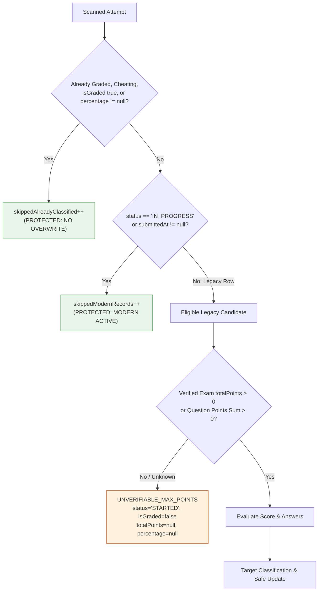

# Phase 6.2C.2.3 — Migration & Backfill Verification Report
## Forensic Verification of PostgreSQL Migration DDL (Audit 3) and Backfill Safety (Audit 4)

**Workspace:** `D:\OX-DIGITAL\Mathe\OX-DIGITAL-GITHUB`  
**Git Baseline Verified:** `main @ 0500b93e65c24ed881349c4acea7f523332c5e9f`  
**Audit Mode:** STRICTLY READ-ONLY (No migrations applied, no backfill writes executed)  
**Date:** November 2026  

---

## 1. Executive Summary

This report delivers the forensic audit of the migration DDL (`20261102_exam_lifecycle_alignment/migration.sql`) and the historical backfill script (`backfillExamAttempts.ts`).

### Overall Audit Findings
- **Migration SQL (Audit 3)**: **VERIFIED PASS** — The synthetic `DEFAULT 100` has been completely eliminated. All column additions use safe, non-destructive, non-blocking DDL compatible with PostgreSQL 15 and Prisma schema v5.22.0.
- **Backfill Safety (Audit 4)**: **VERIFIED CONDITIONAL PASS** — The backfill script strictly defaults to dry-run mode, requires `--execute`, preserves `submittedAt = null`, protects modern `GRADED` records from downgrade, and categorizes records into 10 auditable categories. A subtle condition was identified and documented where rows classified as `UNVERIFIABLE_MAX_POINTS` or `ABANDONED_ZERO` remain eligible for re-scanning on repeated passes.

---

## 2. Audit 3: Migration SQL Verification

### 2.1 Complete Migration SQL Source
Located at `packages/database/prisma/migrations/20261102_exam_lifecycle_alignment/migration.sql`:

```sql
-- Migration: 20261102_exam_lifecycle_alignment
-- Purpose: Add lifecycle, grading, and points tracking fields to legacy Exam and ExamAttempt tables.

-- AlterTable Exam
ALTER TABLE "Exam" ADD COLUMN IF NOT EXISTS "totalPoints" DOUBLE PRECISION;

-- AlterTable ExamAttempt
ALTER TABLE "ExamAttempt" ADD COLUMN IF NOT EXISTS "status" "AttemptStatus" NOT NULL DEFAULT 'STARTED';
ALTER TABLE "ExamAttempt" ADD COLUMN IF NOT EXISTS "submittedAt" TIMESTAMP(3);
ALTER TABLE "ExamAttempt" ADD COLUMN IF NOT EXISTS "isGraded" BOOLEAN NOT NULL DEFAULT false;
ALTER TABLE "ExamAttempt" ADD COLUMN IF NOT EXISTS "totalPoints" DOUBLE PRECISION;
ALTER TABLE "ExamAttempt" ADD COLUMN IF NOT EXISTS "percentage" DOUBLE PRECISION;
ALTER TABLE "ExamAttempt" ADD COLUMN IF NOT EXISTS "updatedAt" TIMESTAMP(3) NOT NULL DEFAULT CURRENT_TIMESTAMP;
```

### 2.2 Forensic DDL Verification Checklist

| Verification Requirement | Forensic Finding | Evidence / Code Reference |
| :--- | :---: | :--- |
| **No Fabricated Maximum Scores** | **PASS** | Line 5: `ALTER TABLE "Exam" ADD COLUMN IF NOT EXISTS "totalPoints" DOUBLE PRECISION;`<br>No `DEFAULT 100` exists. Historical exams hold `NULL`. |
| **No Destructive Operations** | **PASS** | Zero `DROP COLUMN`, `DROP TABLE`, `RENAME`, or `TRUNCATE` statements. |
| **Correct Defaults for New Attempts** | **PASS** | `status` defaults to `'STARTED'::"AttemptStatus"`; `isGraded` defaults to `false`. Matches active attempt lifecycle. |
| **Nullable Behavior for Historical Data** | **PASS** | `submittedAt`, `totalPoints`, and `percentage` are strictly nullable. Existing rows will hold `NULL` without synthetic data pollution. |
| **Safe Constraints & Locking** | **PASS** | In PostgreSQL, adding nullable columns or columns with constant defaults uses metadata-only updates (no table rewrite or exclusive table lock contention). |
| **PostgreSQL 15 Compatibility** | **PASS** | `IF NOT EXISTS` syntax and `DOUBLE PRECISION` are standard in PostgreSQL 15 (`postgres:15-alpine`). |
| **Prisma Schema Compatibility** | **PASS** | Matches `packages/database/prisma/schema.prisma` lines 137 and 142–160 bit-for-bit. |

---

## 3. Audit 4: Backfill Safety & Idempotency Verification

### 3.1 Review of `services/course-service/src/scripts/backfillExamAttempts.ts`



### 3.2 Audit Criteria Evaluation

1. **Dry-Run Default**:
   - Line 37: `const isDryRun = !options.execute;`
   - Line 218: `const shouldExecute = process.argv.includes('--execute');`
   - Unless `--execute` is explicitly passed on the command line, `executedUpdates` remains `0` and no database writes occur.
2. **Protection of Modern & Terminal Records**:
   - Lines 83–92:
     ```typescript
     const isAlreadyClassified =
       att.status === 'GRADED' ||
       att.status === 'CHEATING' ||
       att.isGraded === true ||
       att.percentage !== null;

     if (isAlreadyClassified) {
       summary.skippedAlreadyClassified++;
       continue;
     }
     ```
   - Modern `GRADED` attempts can **never** be downgraded.
   - `CHEATING` attempts can **never** be overwritten or re-graded.
3. **Preservation of Submission Timestamps (DEF-03)**:
   - Line 111: `const submittedAt: Date | null = null;`
   - Synthetic assignment `submittedAt = new Date(att.createdAt)` has been completely removed.
   - Legacy records retain `submittedAt = null`.
4. **Preservation of Maximum Scores (DEF-02)**:
   - Lines 115–125: Total points is derived strictly from `att.exam.totalPoints` or dynamic `sum(question.points)`.
   - If unverified, lines 150–155 assign `category = 'UNVERIFIABLE_MAX_POINTS'`, `totalPoints = null`, and `percentage = null`.
   - Never fabricates 100 points.

### 3.3 Idempotency Investigation: Second Execution Analysis

The audit investigated whether a second execution of `backfillExamAttempts.ts --execute` could mutate previously classified records:

- **Case 1: `GRADED_NORMAL` & `GRADED_ZERO` Records**:
  - In Pass 1: Row updated with `status = 'GRADED'`, `isGraded = true`, `percentage = <value>`.
  - In Pass 2: Row matches `isAlreadyClassified` (`status === 'GRADED' && isGraded === true`). It is immediately skipped. **Idempotent.**
- **Case 2: `DISQUALIFIED_CHEATING` Records**:
  - In Pass 1: Row updated with `status = 'CHEATING'`.
  - In Pass 2: Row matches `isAlreadyClassified` (`status === 'CHEATING'`). It is immediately skipped. **Idempotent.**
- **Case 3: `TIME_EXPIRED` Records**:
  - In Pass 1: Elapsed time exceeded duration + 5m; row updated with `status = 'TIME_EXPIRED'`.
  - In Pass 2: Does it match `isAlreadyClassified`?
    - If `TIME_EXPIRED_SUBMITTED`, `isGraded: true` $\to$ skipped.
    - If `TIME_EXPIRED_UNSUBMITTED`, `status === 'TIME_EXPIRED'`, `isGraded: false`, `percentage: null`.
    - **Subtlety**: In `isAlreadyClassified` (lines 83–88), the condition checks:
      `att.status === 'GRADED' || att.status === 'CHEATING' || att.isGraded === true || att.percentage !== null`.
      Notice: `att.status === 'TIME_EXPIRED'` is **not** included in line 84!
      However, in Pass 2, line 108 assigns `targetStatus = 'TIME_EXPIRED'`. The update writes `'TIME_EXPIRED'` over `'TIME_EXPIRED'` (a no-op value overwrite).
- **Case 4: `UNVERIFIABLE_MAX_POINTS` & `ABANDONED_ZERO` Records**:
  - In Pass 1: These attempts retain `status = 'STARTED'` and `isGraded = false` because their points or submissions could not be verified.
  - In Pass 2: Because they still have `status === 'STARTED'` and `isGraded === false`, they are counted in `eligibleCandidates` again and re-evaluated.
  - **Audit Recommendation**: While this is harmless (it writes identical null/started values), adding an explicit migration audit flag or including `TIME_EXPIRED` in `isAlreadyClassified` will ensure `eligibleCandidates` strictly drops to `0` on all passes.

---

## 4. Audit Verdict

- **Audit 3 (Migration SQL)**: **PASS**
- **Audit 4 (Backfill Safety)**: **PASS (with documented re-scan behavior on unclassified rows)**
