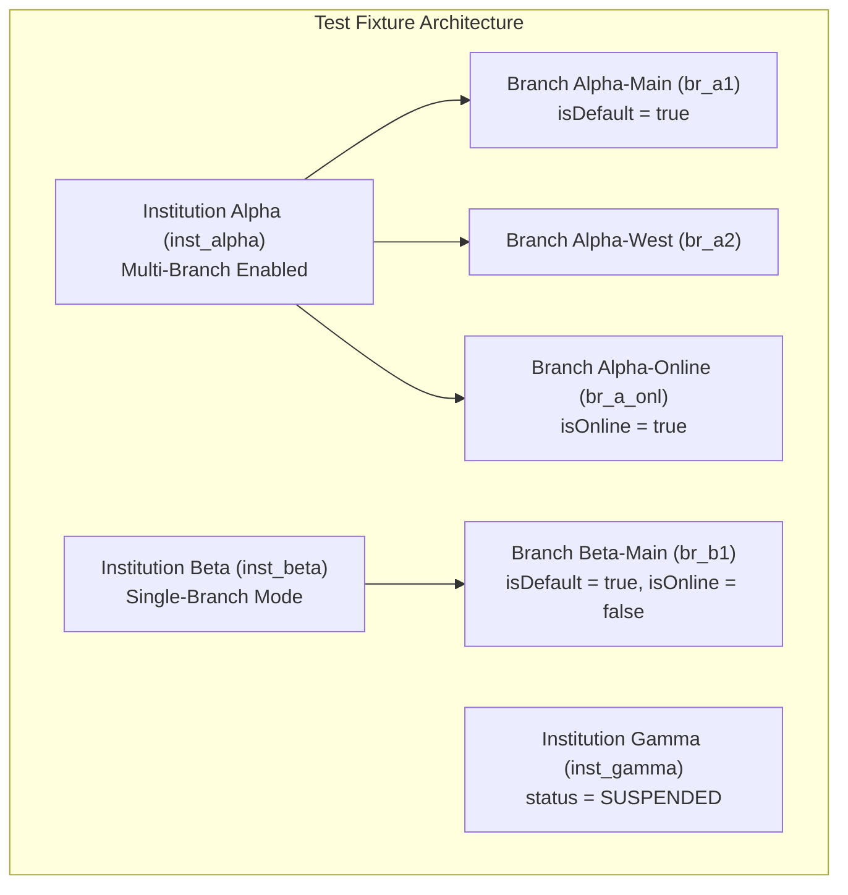

# OX-DIGITAL Education — Phase 7.1
# Acceptance & Quality Assurance Test Strategy

**Document ID:** `OD-7106-TEST-STRATEGY`  
**Workspace:** `D:\OX-DIGITAL\Mathe\OX-DIGITAL-GITHUB`  
**Execution Mode:** Quality Assurance & Testing Architecture Specification Only  
**Safety Status:** PRE-IMPLEMENTATION SPECIFICATION — ZERO TEST SCRIPTS RUN AGAINST PRODUCTION  

---

## 1. Executive Summary & Quality Mandate

The introduction of multi-tenancy, multi-branch attribution, and institutional governance to OX-DIGITAL Education is a mission-critical architectural shift. A single data leak between educational institutions constitutes a catastrophic failure of customer trust and data privacy.

This Test Strategy establishes the automated verification gates, negative security suites, regression benchmarks, and Definition of Done (DoD) required before any Phase 7.1 code may be merged or deployed.

> [!IMPORTANT]
> **Zero-Trust Multi-Tenancy Invariant:** No feature in Phase 7.1 is considered complete until it has passed both positive functional tests and explicit negative adversarial tests demonstrating that cross-tenant access is structurally impossible.

---

## 2. Test Architecture & Staging Environments

Testing multi-tenant boundaries requires a multi-tenant test fixture hierarchy:

### 2.1 Standard Test Personas

| Persona ID | Institution | Branch | Role | Purpose |
| :--- | :--- | :--- | :--- | :--- |
| `USER_PM_ALPHA` | `inst_alpha` | All (`br_a1`, `br_a2`, `br_a_onl`) | `PRIMARY_MANAGER` | Governance, centralized pricing, branch creation, cross-branch consolidated view. |
| `USER_BR_MGR_A1` | `inst_alpha` | `br_a1` | `ADMIN` (Branch Staff) | Branch-level administration, subordinate to Primary Manager. |
| `USER_TCH_ALPHA` | `inst_alpha` | `br_a1` | `TEACHER` | Academic delivery, lesson notes, attendance recording. |
| `USER_STU_ALPHA` | `inst_alpha` | `br_a1` | `STUDENT` | Course consumption, exam taking, fee payments. |
| `USER_PM_BETA` | `inst_beta` | `br_b1` | `PRIMARY_MANAGER` | Single-branch manager (transparent UX test target). |
| `USER_STU_BETA` | `inst_beta` | `br_b1` | `STUDENT` | Adversarial cross-tenant target student. |
| `USER_HACKER` | External | None | `UNAUTHORIZED` | Arbitrary unauthenticated or forged JWT attacker. |

---

## 3. Automated Test Suite Classification

### 3.1 Unit Test Suites (`npm run test:unit`)

1. **Tenant Context Provider (`tenantContext.test.ts`):**
   - Validates `AsyncLocalStorage` stores and retrieves `institutionId` across asynchronous tick boundaries.
   - Asserts isolation between concurrent parallel asynchronous execution chains.
   - Verifies exception throwing when accessed outside active tenant context.

2. **JWT Claims & Auth Utilities (`auth.test.ts`):**
   - Verifies JWT signing includes `institutionId`, `branchId`, `isPrimaryManager`.
   - Validates token parser extracts and rejects expired or malformed claims.
   - Confirms password hashing and token revocation lists (Redis blocklist).

3. **Prisma Client Tenant Extension (`prismaTenantExtension.test.ts`):**
   - Verifies that `findFirst`, `findMany`, `count`, `aggregate`, `updateMany`, and `deleteMany` automatically inject `{ institutionId }`.
   - Verifies that `create` automatically sets `institutionId` from context.
   - Asserts that explicit attempts to pass a differing `institutionId` in `data` throws an integrity error.

4. **Storage Key Generator (`storageAdapter.test.ts`):**
   - Validates multi-tenant S3/R2 path generation format: `tenants/{institutionId}/...`.
   - Verifies sanitization of branch identifiers and file extensions.

---

### 3.2 Integration Test Suites (`npm run test:integration`)

1. **Tenant Context Middleware Pipeline (`tenantContext.middleware.test.ts`):**
   - Tests extraction from `req.headers['x-institution-id']`.
   - Verifies comparison against decoded JWT token claims.
   - Asserts `403 Forbidden` if header does not match JWT token.
   - Asserts `403 Forbidden` if target institution is marked `SUSPENDED` or `ARCHIVED`.

2. **Cross-Service Header Propagation (`serviceBus.test.ts`):**
   - Simulates HTTP/gRPC call from `course-service` to `user-service`.
   - Verifies `x-institution-id` is preserved across service hops.

3. **Soft-Delete Lifecycle & Financial Preservation (`userLifecycle.test.ts`):**
   - Asserts `DELETE /api/v1/users/:id` executes soft-delete (`deletedAt IS NOT NULL`).
   - Verifies associated `Payment` records in database are **NOT deleted** and retain foreign key links.

---

### 3.3 Negative Cross-Tenant IDOR Attack Suites (`npm run test:security`)

This test suite is mandatory and runs automated adversarial attack simulations:

| Test Code | Attacker Persona | Target Resource | Method & Endpoint | Expected Result | Invariant Verified |
| :--- | :--- | :--- | :--- | :--- | :--- |
| **SEC-01** | `USER_PM_ALPHA` | User of `inst_beta` | `GET /api/v1/users/:beta_user_id` | `404 Not Found` | Cannot enumerate foreign users |
| **SEC-02** | `USER_PM_ALPHA` | User of `inst_beta` | `DELETE /api/v1/users/:beta_user_id` | `404 Not Found` | Cannot delete foreign users |
| **SEC-03** | `USER_TCH_ALPHA` | Course of `inst_beta` | `POST /api/v1/courses/:beta_course/lessons` | `404 Not Found` | Cannot mutate foreign course |
| **SEC-04** | `USER_STU_ALPHA` | Exam of `inst_beta` | `POST /api/v1/exams/:beta_exam/submit` | `404 Not Found` | Cannot submit foreign exams |
| **SEC-05** | `USER_PM_ALPHA` | Analytics of `inst_beta` | `GET /api/v1/analytics/admin?instId=beta` | `403 Forbidden` | Cannot view foreign financial stats |
| **SEC-06** | `USER_PM_ALPHA` | Payment of `inst_beta` | `GET /api/v1/payments/:beta_payment_id` | `404 Not Found` | Cannot inspect foreign payments |
| **SEC-07** | `USER_PM_BETA` | Branch of `inst_alpha` | `POST /api/v1/branches/:alpha_br/update` | `404 Not Found` | Cannot mutate foreign branch |
| **SEC-08** | `USER_HACKER` | Any resource | Any request with forged `x-institution-id` | `401 Unauthorized` | Forged headers rejected |
| **SEC-09** | Any user of `inst_gamma` | Any resource | `GET /api/v1/courses` | `403 Forbidden` | Suspended institution blocked |

---

### 3.4 WebSocket Isolation Test Suite (`npm run test:ws`)

1. **Room Segregation Verification:**
   - Client A (`inst_alpha`) connects and authenticates.
   - Client B (`inst_beta`) connects and authenticates.
   - Server broadcasts event `course:updated` to room `inst_alpha`.
   - **Assertion:** Client A receives the event; Client B receives **zero** packets.

2. **Global Room Elimination:**
   - Verify server rejects attempts by clients to join unpartitioned rooms (`join('admin')`, `join('teachers')`).
   - Verify unauthenticated socket connections are disconnected within 500ms.

---

### 3.5 Asynchronous & BullMQ Worker Isolation Tests (`npm run test:workers`)

1. **Risk Engine Partitioning (`riskEngine.test.ts`):**
   - Enqueue risk assessment job with payload `{ institutionId: 'inst_alpha' }`.
   - Worker must only fetch enrollments where `institutionId === 'inst_alpha'`.
   - Database query log inspected to verify `WHERE "institutionId" = 'inst_alpha'` is present.

2. **Dead Letter Queue (DLQ) & Poison Job Isolation:**
   - If a job for `inst_alpha` fails, it does not halt or delay job execution for `inst_beta`.

---

### 3.6 Single-Branch Transparent Compatibility Tests (`npm run test:e2e-singlebranch`)

In compliance with **OD-701**, single-branch institutions must operate without any unnecessary multi-branch overhead:

1. **Zero Branch Selector Displayed:**
   - Verify frontend dashboard for `USER_PM_BETA` renders without a branch dropdown.
   - Verify default branch is silently injected into API requests (`branchId = br_b1`).
2. **Seamless Operation:**
   - Creating courses, adding students, and taking attendance requires exactly the same number of user clicks as in the legacy platform.
3. **Branch Enablement Transition:**
   - Primary Manager toggles `isMultiBranchEnabled = true`.
   - Dashboard instantly displays branch selector and branch management settings without data migration or re-login.

---

### 3.7 Regression Test Plan for Legacy LMS Capabilities

Ensure existing features continue working without regression:
- Student enrollment in video courses.
- Video progress tracking and streaming.
- Homework submission and teacher grading.
- In-person attendance QR-code scanning.
- Automated quiz scoring and gradebook calculation.

---

## 4. Definition of Done (DoD) for Phase 7.1

Before any Phase 7.1 pull request is approved for merge, the following checklist must be satisfied in CI/CD:

- [ ] **1. Schema Invariants:**
  - `Institution`, `LegalEntity`, `Branch`, `InstitutionMember`, and `BranchAssignment` tables exist with complete relational integrity.
  - All foreign keys to financial/audit tables (`Payment`, `Attendance`) enforce `onDelete: Restrict`.
  - Zero raw physical `DELETE` statements on user accounts (`deletedAt` soft-delete enforced).

- [ ] **2. Auth & Identity:**
  - JWT tokens sign and verify `institutionId`, `branchId`, and `isPrimaryManager`.
  - Suspended institutions are structurally blocked at gateway and service levels.

- [ ] **3. Security & Isolation:**
  - 100% of negative IDOR test cases (SEC-01 through SEC-09) pass.
  - Prisma Client `$extends` query extension active on all services.
  - Zero unpartitioned global WebSocket rooms.

- [ ] **4. Usability & Business Logic:**
  - Single-branch institutions experience transparent bypass (OD-701).
  - Primary Manager possesses exclusive authority over branch creation and central pricing.
  - Online dimension branch correctly provisioned for digital courses.

- [ ] **5. Test Coverage & Quality Gates:**
  - Automated test coverage on tenant middleware and query extensions $\ge 95\%$.
  - End-to-end regression test suite passes with zero failures.
  - Zero TypeScript compiler warnings or lint errors.

---

*Authored by Antigravity Quality Assurance Agent under Product Owner mandate.*  
*Next Step: Pre-Implementation Readiness Report (`PHASE_7_1_PRE_IMPLEMENTATION_READINESS_REPORT.md`).*

