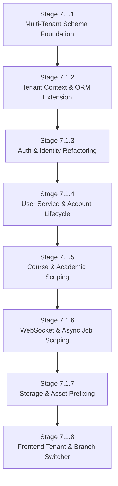

# OX-DIGITAL Education — Phase 7.1
# Engineering Implementation Breakdown & Staged Work Breakdown Structure

**Document ID:** `OD-7105-BREAKDOWN`  
**Workspace:** `D:\OX-DIGITAL\Mathe\OX-DIGITAL-GITHUB`  
**Execution Mode:** Architectural Planning & Work Breakdown Only  
**Safety Status:** PRE-IMPLEMENTATION SPECIFICATION — ZERO CODE/SCHEMA MUTATIONS AUTHORIZED IN PHASE 7.1  

---

## 1. Overview & Phased Staging Framework

This document decomposes Phase 7.1 (**Institution, Branch & Identity Foundation**) into **8 sequential, independently testable engineering stages**.

Each stage is strictly scoped to minimize blast radius, guarantee backward compatibility, prevent cross-tenant security vulnerabilities, and adhere to approved Product Owner decisions:
- **OD-701:** Single Primary Manager per institution; tenant root is Institution; single-branch transparent UX; subordinate branch operational roles.
- **OD-702:** Strict separation of SaaS Commercial Finance (Domain A) and Institution Internal Management (Domain B).
- **OD-703:** Unified General Ledger with Branch Dimensions.
- **OD-709:** Centralized financial approval authority.
- **OD-713:** Institution-anchored Legal Entity hierarchy.



---

## 2. Stage-by-Stage Detailed Engineering Specification

---

### Stage 7.1.1: Multi-Tenant Schema Models & Base Relations

#### 1. Scope & Objective
Establish core multi-tenancy models in `prisma/schema.prisma` without modifying existing business logic or breaking active database queries.

#### 2. Affected Files & Modules
- `prisma/schema.prisma`
- `prisma/migrations/20261102_phase7_1_tenant_models/migration.sql`

#### 3. Prisma Schema Modifications
- Add enum `InstitutionStatus { ACTIVE, SUSPENDED, ARCHIVED, PROVISIONING }`.
- Add enum `BranchStatus { ACTIVE, INACTIVE, ARCHIVED }`.
- Add enum `InstitutionMemberRole { PRIMARY_MANAGER, ADMIN, TEACHER, STAFF, ACCOUNTANT, STUDENT, PARENT }`.
- Add enum `AccountStatus { ACTIVE, SUSPENDED, DELETED, PENDING_VERIFICATION }`.
- Create models: `Institution`, `LegalEntity`, `Branch`, `InstitutionMember`, `BranchAssignment`, `Classroom`.
- Add nullable foreign keys `institutionId String?` and `branchId String?` to `User`, `Course`, `Payment`, `Attendance`, `Enrollment`, `Exam`, `ActivityLog`.

#### 4. Migration Requirements
- Migration type: **Expand-only (Additive)**.
- SQL includes `CREATE TABLE` for 6 new models, `CREATE INDEX CONCURRENTLY` on all tenant foreign keys.
- All newly added foreign key columns on pre-existing tables are strictly `NULLABLE`.

#### 5. Backfill Requirements
- None in this stage. Schema expansion only.

#### 6. API Changes
- None. (Internal database contract only).

#### 7. Frontend Changes
- None.

#### 8. Security Risks & Mitigation
- **Risk:** Schema migration locks heavy existing tables (`User`, `Payment`).
- **Mitigation:** Use PostgreSQL `CONCURRENTLY` for index generation; avoid table rewrites by keeping defaults null or non-computed.

#### 9. Automated Tests
- Unit: Prisma schema validation (`npx prisma validate`).
- Integration: DB migration up/down execution in test container.
- Verification: Confirm existing tests pass unaltered against expanded schema.

#### 10. Acceptance Criteria
- Prisma client generates without typing errors.
- All new models exist in DB with appropriate indexes and referential actions (`onDelete: Restrict`).
- Zero breakage in existing unit/integration test suites.

#### 11. Rollback Strategy
- Run `prisma migrate resolve --rolled-back` and revert migration file; drop newly created tables via down script.

---

### Stage 7.1.2: Tenant Context & Scoping Infrastructure (Prisma & Express)

#### 1. Scope & Objective
Implement request context isolation middleware and Prisma Client `$extends` query middleware to enforce mandatory `institutionId` scoping on all reads and writes.

#### 2. Affected Files & Modules
- `shared/src/tenant/tenantContext.ts` (AsyncLocalStorage context provider)
- `shared/src/tenant/tenantContext.middleware.ts` (Express tenant extraction & validation)
- `shared/src/prisma/prismaTenantExtension.ts` (Prisma `$extends` query filter)
- `shared/src/prisma/client.ts` (Extended Prisma Client factory)

#### 3. Prisma Schema Modifications
- None.

#### 4. Migration Requirements
- None.

#### 5. Backfill Requirements
- None.

#### 6. API Changes
- Standard request headers defined:
  - `x-institution-id`: Tenant identifier (Required for API requests).
  - `x-branch-id`: Optional active branch context header.

#### 7. Frontend Changes
- None (Middleware foundation only).

#### 8. Security Risks & Mitigation
- **Risk:** Tenant context leak across asynchronous event loops or unhandled promises.
- **Mitigation:** Strict Node.js `AsyncLocalStorage` encapsulation; if context is missing, Prisma extension throws `TenantContextMissingError` blocking query execution.

#### 9. Automated Tests
- Unit: `tenantContext.test.ts` (AsyncLocalStorage scope isolation across concurrent async calls).
- Unit: `prismaTenantExtension.test.ts` (Verify automatic injection of `institutionId` into `findMany`, `update`, `delete`).
- Negative Test: Attempting a query without tenant context throws security exception.

#### 10. Acceptance Criteria
- Prisma Client transparently injects `{ institutionId: ctx.institutionId }` into queries.
- Bypass mechanisms are restricted to explicitly whitelisted platform admin background routines.

#### 11. Rollback Strategy
- Remove Prisma extension from client initialization; fall back to vanilla Prisma client.

---

### Stage 7.1.3: Auth & Identity Refactoring (`auth-service`)

#### 1. Scope & Objective
Update authentication pipelines, JWT token issuance, and session verification to embed cryptographically validated tenant context (`institutionId`, `branchId`, `isPrimaryManager`, `accountStatus`).

#### 2. Affected Files & Modules
- `services/auth-service/src/controllers/auth.controller.ts`
- `services/auth-service/src/services/auth.service.ts`
- `services/auth-service/src/routes/auth.routes.ts`
- `shared/src/types/auth.types.ts`
- `shared/src/middleware/auth.middleware.ts`

#### 3. Prisma Schema Modifications
- None (Leverages models created in Stage 7.1.1).

#### 4. Migration Requirements
- None.

#### 5. Backfill Requirements
- Execute canonical legacy anchor backfill (OD-7104) so legacy test accounts resolve to `INST-LEGACY-001`.

#### 6. API Changes
- `POST /api/v1/auth/login`:
  - Request: `{ email, password, institutionSlug? }`.
  - Response: Includes `user.institutionId`, `user.activeBranchId`, `user.isPrimaryManager`, `user.allowedBranches`.
- Access Token JWT Claims Payload:
  ```json
  {
    "userId": "usr_123",
    "email": "manager@institution.com",
    "role": "MANAGER",
    "institutionId": "inst_001",
    "branchId": "br_001",
    "isPrimaryManager": true,
    "permissions": ["*"]
  }
  ```
- `POST /api/v1/auth/switch-branch`: New endpoint for managers to switch active operational branch context.

#### 7. Frontend Changes
- Auth state updated in client storage (`localStorage` / cookies) to store `institutionId` and active `branchId`.

#### 8. Security Risks & Mitigation
- **Risk:** User forging `x-institution-id` header to hijack another tenant's account.
- **Mitigation:** `auth.middleware.ts` verifies that `req.headers['x-institution-id']` matches the cryptographic `institutionId` signed in the verified JWT. Mismatch triggers immediate `403 Forbidden` and security audit log.

#### 9. Automated Tests
- Unit: Token generation and claim verification.
- Integration: Login flow produces valid multi-tenant claims.
- Negative Test: Tampered `institutionId` in header rejected with `403`.
- Negative Test: Suspended institution (`status = SUSPENDED`) rejects login with `403 Institution Suspended`.

#### 10. Acceptance Criteria
- All newly issued JWTs contain tenant claims.
- Primary Manager role (OD-701) correctly recognized across auth endpoints.
- Single-branch institutions automatically default to active branch without requiring extra UI clicks.

#### 11. Rollback Strategy
- Revert JWT claim generator to legacy format `{ userId, role, email }`; redeploy auth-service.

---

### Stage 7.1.4: User Service & Account Lifecycle (`user-service`)

#### 1. Scope & Objective
Refactor `user-service` to strictly scope all user queries, creations, updates, and deletions by tenant; replace physical cascade deletions with compliant soft-deletions.

#### 2. Affected Files & Modules
- `services/user-service/src/controllers/user.controller.ts`
- `services/user-service/src/services/user.service.ts`
- `services/user-service/src/routes/user.routes.ts`

#### 3. Prisma Schema Modifications
- Ensure `User.deletedAt DateTime?` and `User.accountStatus AccountStatus` are indexed.

#### 4. Migration Requirements
- None.

#### 5. Backfill Requirements
- None.

#### 6. API Changes
- `GET /api/v1/users`: Scoped to calling user's `institutionId`. Supports filter `?branchId=...`.
- `POST /api/v1/users`: Automatically associates created user with caller's `institutionId` and specified `branchId`.
- `DELETE /api/v1/users/:id`: Converted from `prisma.user.delete` to soft-delete:
  - Sets `deletedAt = new Date()`, `accountStatus = 'DELETED'`, `isActive = false`.
  - Preserves all associated `Payment`, `Attendance`, and `Enrollment` records.

#### 7. Frontend Changes
- User management table adds "Branch" column filter (hidden if institution has only 1 branch).

#### 8. Security Risks & Mitigation
- **Risk:** Admin from Institution A invoking `GET /api/v1/users/:id` or `DELETE /api/v1/users/:id` for a user belonging to Institution B (IDOR).
- **Mitigation:** Query forced through `tenantWhere(req, { id })` requiring `{ id, institutionId: req.user.institutionId }`. Non-existent or other-tenant record returns `404 Not Found`.

#### 9. Automated Tests
- Integration: Admin of Inst A cannot query, update, or delete users of Inst B (IDOR test suite).
- Data Integrity Test: Soft-deleting a user retains all associated `Payment` records in database.

#### 10. Acceptance Criteria
- Zero cross-tenant user visibility.
- Destruction of legal/payment records via `DELETE /users/:id` is 100% prevented.

#### 11. Rollback Strategy
- Git revert `user.controller.ts` changes; deploy previous service container.

---

### Stage 7.1.5: Course & Academic Service Scoping (`course-service`)

#### 1. Scope & Objective
Remediate cross-tenant IDOR vulnerabilities across courses, lessons, homework, exams, and attendance management; enforce tenant validation on all course CRUD operations.

#### 2. Affected Files & Modules
- `services/course-service/src/controllers/course.controller.ts`
- `services/course-service/src/controllers/attendance.controller.ts`
- `services/course-service/src/controllers/lesson.controller.ts`
- `services/course-service/src/controllers/exam.controller.ts`

#### 3. Prisma Schema Modifications
- Enforce relation `Course.institutionId -> Institution.id` with `onDelete: Restrict`.
- Enforce relation `Attendance.branchId -> Branch.id`.

#### 4. Migration Requirements
- Phase D migration executed in staging: NOT NULL constraint applied to `Course.institutionId`.

#### 5. Backfill Requirements
- All orphaned courses mapped to canonical legacy institution.

#### 6. API Changes
- `GET /api/v1/courses`: Returns courses scoped strictly to `req.user.institutionId`.
- `POST /api/v1/courses`: Automatically attaches `institutionId` from JWT; rejects request if caller attempts to assign course to another institution.
- `DELETE /api/v1/courses/:id`: Verifies `{ id, institutionId }`; blocks deletion if active enrollments or financial transactions exist.

#### 7. Frontend Changes
- Course creator includes branch attribution selector (options: "All Branches / Online" or specific physical branch).

#### 8. Security Risks & Mitigation
- **Risk:** Teacher or Admin tampering with URL parameters to delete another institution's curriculum.
- **Mitigation:** Dual-layer protection: Prisma `$extends` query filter plus explicit controller assertion `if (course.institutionId !== req.user.institutionId) throw new NotFoundException()`.

#### 9. Automated Tests
- Integration: IDOR attack matrix testing all course endpoints across two distinct institution fixtures.
- Unit: Attendance recording correctly validates that the student, course, and branch belong to the same institution.

#### 10. Acceptance Criteria
- 100% of course-service endpoints reject cross-tenant manipulation with `404` or `403`.
- Online courses correctly attributed to the Online/Head-Office branch dimension (OD-701).

#### 11. Rollback Strategy
- Restore previous controller methods while maintaining read-only tenant checks.

---

### Stage 7.1.6: WebSocket & Background Job Scoping

#### 1. Scope & Objective
Partition real-time WebSocket communication and BullMQ asynchronous workers by institution to prevent cross-tenant notification leaks and commingled batch jobs.

#### 2. Affected Files & Modules
- `services/course-service/src/index.ts` (Socket.IO server)
- `shared/src/websocket/socketTenantAuth.ts` (Socket authentication middleware)
- `services/course-service/src/jobs/riskEngine.job.ts` (BullMQ dropout risk worker)
- `services/course-service/src/jobs/notification.job.ts`

#### 3. Prisma Schema Modifications
- None.

#### 4. Migration Requirements
- None.

#### 5. Backfill Requirements
- None.

#### 6. API Changes
- Socket Handshake: Client must provide valid JWT containing `institutionId` in `auth.token`.
- Dynamic Rooms: Sockets join rooms formatted as `inst_{institutionId}`, `inst_{institutionId}:br_{branchId}`, `inst_{institutionId}:usr_{userId}`.
- Global rooms (`admin`, `teachers`) completely removed.

#### 7. Frontend Changes
- WebSocket client connection passing JWT auth payload on connect.

#### 8. Security Risks & Mitigation
- **Risk:** Unauthorized client joining another institution's room or listening to global broadcast channels.
- **Mitigation:** Strict handshake validation; rejection of connection if token invalid or institution suspended. Room names restricted to server-side assignment only.

#### 9. Automated Tests
- Integration: Socket client connected with Inst A token cannot receive messages broadcast to Inst B room.
- Job Worker Test: BullMQ `riskEngine` processes jobs partitioned by `institutionId` and records results with tenant validation.

#### 10. Acceptance Criteria
- Zero cross-institution real-time message delivery.
- BullMQ jobs track `institutionId` in payload and execute inside tenant AsyncLocalStorage.

#### 11. Rollback Strategy
- Revert socket middleware and restore previous room names if real-time disconnects spike.

---

### Stage 7.1.7: Storage & Upload Asset Prefixing

#### 1. Scope & Objective
Enforce tenant-isolated directory structures in Cloudflare R2 / AWS S3 storage adapters to prevent asset collision and unauthorized asset discovery.

#### 2. Affected Files & Modules
- `services/course-service/src/adapters/storage.adapter.ts`
- `shared/src/storage/tenantStorage.service.ts`

#### 3. Prisma Schema Modifications
- `Attachment` model: Add `institutionId String`.

#### 4. Migration Requirements
- None.

#### 5. Backfill Requirements
- Existing files remain accessible via legacy path fallback while new uploads enforce prefixing.

#### 6. API Changes
- Storage key path pattern updated:
  - *Legacy format:* `${userId}/${uuid}.${ext}`
  - *New multi-tenant format:* `tenants/${institutionId}/branches/${branchId || 'default'}/${category}/${uuid}.${ext}`
- Signed URL generation requires matching caller `institutionId`.

#### 7. Frontend Changes
- File upload components propagate active `branchId` to upload endpoints.

#### 8. Security Risks & Mitigation
- **Risk:** User enumerating S3 keys to download private exam sheets or proprietary course material from another institution.
- **Mitigation:** Presigned URLs generated strictly after verifying tenant ownership in the database; storage key contains high-entropy UUID prefixed by `institutionId`.

#### 9. Automated Tests
- Unit: Storage key generator produces compliant tenant-prefixed keys.
- Integration: Uploading a file in Inst A sets S3 key containing `inst_A` and saves metadata with matching `institutionId`.

#### 10. Acceptance Criteria
- All new file uploads are physically segregated by `institutionId` in object storage.
- Presigned download requests validate tenant identity.

#### 11. Rollback Strategy
- Retain dual-path resolver in `storage.adapter.ts` to seamlessly serve both legacy and prefixed assets.

---

### Stage 7.1.8: Frontend Tenant & Branch Context (Branch Switcher & Single-Branch UX)

#### 1. Scope & Objective
Implement frontend state management and UI components for tenant awareness, including the institution brand header, multi-branch switcher for managers, and transparent single-branch bypass (OD-701).

#### 2. Affected Files & Modules
- `frontend/src/context/TenantContext.tsx`
- `frontend/src/components/layout/BranchSwitcher.tsx`
- `frontend/src/components/layout/Header.tsx`
- `frontend/src/services/apiClient.ts`

#### 3. Prisma Schema Modifications
- None.

#### 4. Migration Requirements
- None.

#### 5. Backfill Requirements
- None.

#### 6. API Changes
- Axios/Fetch interceptor updated to inject `x-institution-id` and `x-branch-id` into all outgoing HTTP headers.

#### 7. Frontend Changes
- **Branch Switcher Component:**
  - If `institution.isMultiBranchEnabled === false` (Single-Branch): Component is completely hidden from UI; system automatically defaults to primary branch.
  - If `institution.isMultiBranchEnabled === true` (Multi-Branch): Dropdown appears in header allowing Primary Manager to switch active branch context or select "Consolidated (All Branches)".
- Branch context change updates local storage and triggers React Query cache invalidation.

#### 8. Security Risks & Mitigation
- **Risk:** User altering branch ID in frontend local storage to access unauthorized branch data.
- **Mitigation:** Frontend context is purely UI; backend API enforces strict RBAC and tenant authorization on every request.

#### 9. Automated Tests
- Cypress/Playwright E2E: Single-branch institution user sees zero branch dropdowns (clean, non-confusing UI).
- E2E: Multi-branch manager can toggle between Branch A and Branch B and observe filtered data tables.
- Unit: Axios interceptor accurately appends `x-institution-id` from auth store.

#### 10. Acceptance Criteria
- Seamless, friction-free experience for single-branch institutions (OD-701).
- Smooth branch switching with instant UI update for multi-branch institutions.
- Zero broken views or failed API requests due to missing headers.

#### 11. Rollback Strategy
- Feature flag `VITE_ENABLE_BRANCH_SWITCHER=false` disables switcher UI and defaults headers to primary branch.

---

## 3. Implementation Dependency Matrix

| Stage | Name | Prerequisites | Unblocks |
| :--- | :--- | :--- | :--- |
| **7.1.1** | Schema Models | None | 7.1.2, 7.1.3 |
| **7.1.2** | Tenant Context & ORM Extension | 7.1.1 | 7.1.3, 7.1.4, 7.1.5 |
| **7.1.3** | Auth & Identity Refactoring | 7.1.1, 7.1.2 | 7.1.4, 7.1.6, 7.1.8 |
| **7.1.4** | User Service & Account Lifecycle | 7.1.2, 7.1.3 | 7.1.5 |
| **7.1.5** | Course & Academic Scoping | 7.1.2, 7.1.4 | 7.1.6, 7.1.7 |
| **7.1.6** | WebSocket & Async Job Scoping | 7.1.3, 7.1.5 | 7.1.8 |
| **7.1.7** | Storage & Upload Prefixing | 7.1.2, 7.1.5 | 7.1.8 |
| **7.1.8** | Frontend Tenant & Branch Context | 7.1.3, 7.1.4, 7.1.5 | Phase 7.1 Acceptance |

---

*Authored by Antigravity Architecture Agent under Product Owner mandate.*  
*Next Step: Acceptance & Test Strategy (`PHASE_7_1_ACCEPTANCE_AND_TEST_STRATEGY.md`).*

