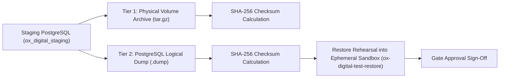

# OX-DIGITAL Education — Task 7.1
## Stage E.1: Staging Backup, Restore Rehearsal & Recovery Architecture

**Authorized Workspace:** `D:\OX-DIGITAL\Mathe\OX-DIGITAL-GITHUB`  
**GitHub Repository:** `https://github.com/hosamsamer019/ox-digital-Education.git`  
**Current Git HEAD:** `0500b93e65c24ed881349c4acea7f523332c5e9f` (branch `main`)  
**Scope:** Staging Infrastructure Disaster Recovery & Restore Rehearsal Architecture  
**Execution Mode:** SPECIFICATION & SAFETY AUDIT ONLY (NO BACKUP OR RESTORE EXECUTED)  
**Date:** November 2, 2026  

---

## 1. Executive Summary & Recovery Boundary Principles

> [!CAUTION]
> **Cardinal Disaster Recovery Invariant:**  
> **A backup is NOT accepted as valid until a physical restore rehearsal succeeds in an isolated sandbox.**  
> Furthermore, **DDL rollback is NEVER equivalent to data restoration.** Dropping columns via SQL down-migrations cannot un-modify mutated records, restore overwritten relations, or recover quarantined entities. Complete, reliable recovery requires restoring the immutable pre-migration database snapshot.

This document establishes the Staging backup protocol, checksum verification mechanisms, and sandbox restore rehearsal requirements that must be physically executed before applying the Task 7.1 migration or executing the tenancy backfill script.

---

## 2. Staging Backup Prerequisites & Multi-Tier Architecture

To protect staging integrity during benchmark rehearsals, two independent backup tiers are required:



### 2.1 Tier 1: Physical Docker Volume Archive (Raw Storage)
- **Mechanism:** Direct archival of the host storage directory mounted by `ox-digital-staging-postgres-data`.
- **Command Specification (Design Only):**
  ```bash
  docker run --rm \
    -v ox-digital-staging-postgres-data:/data:ro \
    -v /var/backups/ox-staging:/backup \
    alpine:3.18 tar -czvf /backup/pre_task71_staging_vol_$(date +%Y%m%d_%H%M%S).tar.gz /data
  ```
- **Guarantees:** Captures identical block-level data files, tablespaces, transaction logs (WAL), and PostgreSQL internal catalogs.

### 2.2 Tier 2: Logical PostgreSQL Custom-Format Dump
- **Mechanism:** Consistent logical export using PostgreSQL `pg_dump` with custom binary compression (`-F c`).
- **Command Specification (Design Only):**
  ```bash
  docker exec -t ox-digital-staging-postgres \
    pg_dump -U ox_staging_admin -d ox_digital_staging -F c -b -v -f /var/lib/postgresql/data/pre_task71_staging_logical.dump
  ```
- **Guarantees:** Allows fine-grained, object-level inspection, table-by-table restore, and schema-only dry-runs.

### 2.3 Checksum & Metadata Manifest
Every backup operation must automatically generate a signed metadata manifest (`backup_manifest.json`):
```json
{
  "backupTimestamp": "ISO-8601",
  "stagingDatabaseName": "ox_digital_staging",
  "postgresVersion": "PostgreSQL 15.x",
  "artifacts": [
    {
      "filename": "pre_task71_staging_vol_20261102.tar.gz",
      "type": "PHYSICAL_VOLUME_ARCHIVE",
      "sha256": "3a8b...[calculated_hash]",
      "sizeBytes": 0
    },
    {
      "filename": "pre_task71_staging_logical.dump",
      "type": "LOGICAL_CUSTOM_DUMP",
      "sha256": "7f9c...[calculated_hash]",
      "sizeBytes": 0
    }
  ],
  "authorizedBy": "Staging DevOps Lead"
}
```

---

## 3. Mandatory Restore Rehearsal Protocol

A pre-migration backup cannot be certified for production or staging safety based solely on file creation. A **Restore Rehearsal** must be executed against a dedicated, isolated test container:

### 3.1 Rehearsal Sandbox Setup
1. An ephemeral container `ox-digital-test-restore` is spun up on an isolated, non-routable docker network.
2. The logical dump `pre_task71_staging_logical.dump` is restored into the sandbox via `pg_restore`:
   ```bash
   pg_restore -U ox_staging_admin -d ox_digital_staging_test -v /backup/pre_task71_staging_logical.dump
   ```

### 3.2 Automated Restore Validation Assertions
The rehearsal is deemed successful **only** when the sandbox database satisfies eight validation checks:

| Check # | Validation Target | Automated Assertion Query / Tool | Acceptance Criteria |
| :---: | :--- | :--- | :--- |
| **R-1** | **Restore Exit Status** | `pg_restore` process exit code | Must equal `0` (Zero errors). |
| **R-2** | **Catalog Readability** | `SELECT current_database(), version();` | Matches PostgreSQL 15-alpine. |
| **R-3** | **28-Model Table Integrity** | `SELECT count(*) FROM information_schema.tables WHERE table_schema = 'public';` | Exactly matches pre-backup table count. |
| **R-4** | **Row Count Equivalence** | Dynamic count query across all 28 models | $\Delta_{\text{rows}} = 0$ for every single table. |
| **R-5** | **Primary Key Integrity** | PK presence check on `User`, `Payment`, `Course` | 100% PK constraints active. |
| **R-6** | **Foreign Key Consistency** | `SELECT conname FROM pg_constraint WHERE contype = 'f';` | 100% foreign keys valid and enforced. |
| **R-7** | **Index Health** | `SELECT indexrelname FROM pg_stat_user_indexes WHERE idx_scan IS NOT NULL;` | Zero corrupt or invalid indexes. |
| **R-8** | **Representative Data Read** | Sample query on synthetic users and payments | Identical hash/checksum to pre-backup sample. |

---

## 4. Recovery Boundaries & Failure Dynamics

### 4.1 Why DDL Rollback Fails to Recover Data
- Executing down-migrations (`ALTER TABLE DROP COLUMN`) simply drops schema columns.
- If the backfill script updated existing user roles, modified course references, or deleted records prior to failure, dropping `institutionId` leaves those corrupted mutations permanently baked into the underlying rows.
- **Rule:** DDL rollback is only valid if zero data rows were mutated. Once a backfill executes `UPDATE` statements, **cold backup restoration is the only safe recovery mechanism**.

### 4.2 Handling Mid-Execution Backfill Interruptions
- Because `scripts/backfill_task_7_1_tenancy.ts` is designed with idempotency (skipping records where `institutionId IS NOT NULL`), transient crashes do not require an immediate database wipe.
- The operator can safely restart the backfill script.
- However, if the interruption was caused by a data corruption bug, the operator must trigger **Full Cold Restore** using the verified Tier 1 volume snapshot.

### 4.3 Production Isolation Boundary
- All Staging backup artifacts and test restore containers reside strictly on the isolated staging host.
- Zero backup traffic, SSH tunnels, or pg_dump connections may touch production hosts or networks.

---

## 5. Governance Classification

```
BACKUP_SPECIFICATION: VERIFIED_IN_SOURCE
RESTORE_REHEARSAL_DESIGN: VERIFIED_IN_SOURCE
PHYSICAL_BACKUP_EXECUTION: NOT_EXECUTED (PENDING_STAGING_EXECUTION_AUTHORIZATION)
RESTORE_REHEARSAL_STATUS: NOT_TESTED (AWAITING_CONTAINER_BOOT)
```

