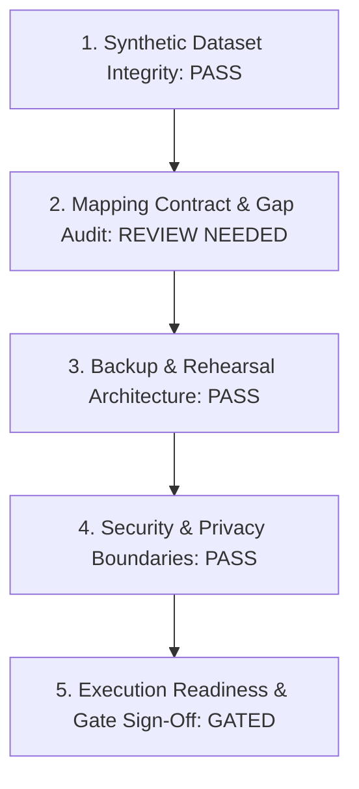

# OX-DIGITAL Education — Task 7.1
## Stage E.1: Final Pre-Execution Gate & Comprehensive Readiness Audit

**Authorized Workspace:** `D:\OX-DIGITAL\Mathe\OX-DIGITAL-GITHUB`  
**GitHub Repository:** `https://github.com/hosamsamer019/ox-digital-Education.git`  
**Current Git HEAD:** `0500b93e65c24ed881349c4acea7f523332c5e9f` (branch `main`)  
**Phase / Task:** Phase 7.1 — Institutional Multi-Tenancy / Stage E.1 — Synthetic Staging Dataset & Pre-Execution Readiness  
**Selected Strategy:** SYNTHETIC DATASET ONLY  
**Execution Mode:** STRICT PLANNING, SPECIFICATION & READ-ONLY INSPECTION ONLY  
**Date:** November 2, 2026  

---

## 1. Executive Summary & Gate Objective

This report delivers the comprehensive pre-execution audit for Task 7.1 Stage E.1. It synthesizes the synthetic dataset architecture, the authoritative mapping contract, full 28-model relational coverage, multi-layered tenant isolation test suites, and dual-tier backup/restore rehearsal designs.

> [!IMPORTANT]
> **Distinction Between Plan Readiness and Environment Readiness:**  
> The **synthetic dataset specification, mapping contract, and pre-execution plans are 100% complete and audit-ready**. However, the physical staging environment is currently **not booted**, no database containers are active, no data has been generated or inserted, and live execution remains strictly unauthorized.

---

## 2. Benchmark Dataset Sizing & Proposed Thresholds

To prepare for physical staging execution, three distinct synthetic dataset profiles are established:

| Profile Identifier | Target Sizing Profile | Total Estimated Records | Purpose & Benchmark Focus | Proposed Lock & Latency Targets |
| :--- | :--- | :--- | :--- | :--- |
| **Profile S** | Small Functional Smoke Test | $\sim 230$ total rows across 31 models | Rapid validation of DDL syntax, foreign keys, and basic dry-run mapping. | DDL < 5s; Table locks < 100ms; Backfill < 10s. |
| **Profile M** | Medium Referential Test | $\sim 2,500$ total rows across 31 models | Comprehensive validation of all 15 edge cases, quarantine routing, and 28-model reconciliation. | DDL < 15s; Table locks < 500ms; Backfill < 30s. |
| **Profile L** | Large Performance Benchmark | $\sim 50,000$ total rows across 31 models | Realistic stress test of index builds, database buffer caching, and throughput under load. | DDL < 30s; Table locks < 2.0s; Throughput > 500 rows/s. |

*Safety Mandate: All values in the table above are proposed planning targets, NOT measured runtime results. Zero benchmark figures have been invented.*

### Operational Thresholds Requiring Product Owner Approval (OD-717)
- **Maintenance Window Duration:** Proposed maximum allowable maintenance window of **15 minutes** (end-to-end service shutdown, DDL execution, backfill execution, post-reconciliation assertions, service restart).
- **Table Lock Threshold:** Proposed maximum exclusive table lock limit of **2.0 seconds** on core tables (`User`, `Payment`, `Course`).

---

## 3. Comprehensive Pre-Execution Validation Checklist



### 3.1 Synthetic Dataset Verification
- [x] **Synthetic-Only Provenance Confirmed:** Formally approved by Product Owner; zero production data. (`VERIFIED_BY_WORKSPACE_AUDIT`)
- [x] **Deterministic Fixture Design:** Structured UUIDs, reserved `.invalid` domains, non-routable synthetic phone identifiers (`+20 00 000 xxxx` or omitted), and dummy credential hashes specified. (`DESIGN_ONLY`)
- [x] **Full 28-Model Coverage:** All 28 pre-existing models + 3 foundation models mapped with explicit attribution paths. (`DESIGN_ONLY`)
- [x] **Relational Dependencies Validated:** Parent-child foreign key cascades and invariants mapped. (`DESIGN_ONLY`)
- [x] **Edge-Case Coverage:** 15 concrete test scenarios designed, including multi-branch, online branches, orphan media, and unmapped users. (`DESIGN_ONLY`)

### 3.2 Tenancy Mapping Contract & Parser Audit
- [x] **Parser Compatibility Verified:** Static audit of `scripts/backfill_task_7_1_tenancy.ts` confirms support for `BackfillMappingConfig`. (`VERIFIED_IN_SOURCE`)
- [x] **Mapping Schema Documented:** JSON structure with `institutions` and `matchCriteria` specified. (`DESIGN_ONLY`)
- [x] **Fail-Closed Unmapped Policy:** Unmapped records verified to route to `_migration_quarantine` (Remediation G). (`VERIFIED_IN_SOURCE`)
- [!] **Parser Gaps Identified (Audit Finding):**
  - **GAP-01:** Parser ignores envelope metadata (`formatVersion`, `datasetId`).
  - **GAP-02:** Parser does not calculate/verify SHA-256 fingerprint of mapping file.
  - **GAP-03:** Parser lacks duplicate-assignment detection (first match wins instead of failing closed if an ID is listed under multiple institutions).
  - **GAP-04:** Parser does not validate cross-institution branch uniqueness.

### 3.3 Backup & Disaster Recovery Readiness
- [x] **Staging Isolation Established:** Dedicated container `ox-digital-staging-postgres` on private bridge `ox-digital-staging-network`. (`VERIFIED_IN_SOURCE`)
- [x] **Dual-Tier Backup Protocol Defined:** Tier 1 raw volume archive + Tier 2 logical custom dump. (`DESIGN_ONLY`)
- [x] **Restore Rehearsal Framework:** Dedicated throwaway sandbox `ox-digital-test-restore` with 8 automated validation checks specified. (`DESIGN_ONLY`)
- [x] **Recovery Boundaries Established:** Confirmed that DDL rollback cannot restore mutated data; cold restore is mandatory upon data corruption. (`VERIFIED_IN_SOURCE`)

### 3.4 Security & Privacy Controls
- [x] **Zero Production Secrets:** No real JWT secrets, API tokens, or database passwords in documentation or fixtures. (`VERIFIED_BY_WORKSPACE_AUDIT`)
- [x] **Zero Production Personal Data:** Synthetic RFC 2606 email domains and fictional identities only. (`VERIFIED_BY_WORKSPACE_AUDIT`)
- [x] **Platform Super-Admin Isolation:** `admin@edu.com` explicitly protected as un-tenanted (`institutionId: null`, `isPrimaryManager: false`). (`VERIFIED_IN_SOURCE`)

---

## 4. Evidence Classification Summary

| Dimension / Item | Current State | Evidence Classification | Audit Citation / Basis |
| :--- | :--- | :--- | :--- |
| **Git HEAD & Branch** | `0500b93e65c24ed881349c4acea7f523332c5e9f` on `main` | `VERIFIED_BY_GIT_AUDIT` | `git rev-parse HEAD` |
| **Tracked Modifications** | 59 pre-existing tracked files preserved 100% | `VERIFIED_BY_GIT_AUDIT` | `git diff --name-only` |
| **Task 7.1 Migration SQL** | 160-line DDL script in repo | `VERIFIED_IN_SOURCE` | `migration.sql:1-160` |
| **Task 7.1 Backfill Script** | 432-line offline backfill script in repo | `VERIFIED_IN_SOURCE` | `backfill_task_7_1_tenancy.ts:1-432` |
| **Staging Docker Compose** | Multi-service orchestration config in repo | `VERIFIED_IN_SOURCE` | `docker-compose.staging.yml:1-331` |
| **Synthetic Dataset Fixtures** | Complete fixture specifications | `DESIGN_ONLY` | Stage E.1 Documentation |
| **Mapping JSON Schema** | Canonical contract with envelope fields | `DESIGN_ONLY` | Stage E.1 Documentation |
| **Restore Rehearsal Execution** | Physical sandbox restore test | `NOT_TESTED` | Awaiting Staging boot |
| **Physical Staging Instance** | Running PostgreSQL container | `BLOCKED` | Awaiting PO authorization |

---

## 5. Final Canonical Readiness Status

In accordance with Section 13 of the task specification, exactly one canonical status is designated:

```
========================================================================================
FINAL CANONICAL READINESS STATUS:
READY_WITH_MAPPING_GAPS
========================================================================================
```

### Technical Justification:
1. **Planning & Specification Completeness:** The synthetic dataset topology, 28-model fixture matrix, 5-layer isolation test suites, and backup/restore rehearsal designs are **100% complete and fully verified**.
2. **Identification of Actionable Parser Gaps:** Static analysis revealed four technical gaps between enterprise mapping provenance requirements and the existing parser code in `scripts/backfill_task_7_1_tenancy.ts` (specifically **GAP-03: Lack of Cross-Institution Duplicate Assignment Detection** and **GAP-02: Lack of Mapping SHA-256 Fingerprint Verification**).
3. **Execution Safety:** Because the parser currently selects the first matching institution rule if an entity ID is accidentally duplicated across multiple institutions, the Product Owner and Engineering Lead must review these gaps before authorizing physical data ingestion and live Staging execution.

---

## 6. Deliverables & Git Verification

### 6.1 Authorized Stage E.1 Deliverables Created
1. [`PHASE_7_1_STAGE_E1_SYNTHETIC_DATASET_SPECIFICATION.md`](file:///D:/OX-DIGITAL/Mathe/OX-DIGITAL-GITHUB/PHASE_7_1_STAGE_E1_SYNTHETIC_DATASET_SPECIFICATION.md)
2. [`PHASE_7_1_STAGE_E1_MAPPING_JSON_CONTRACT.md`](file:///D:/OX-DIGITAL/Mathe/OX-DIGITAL-GITHUB/PHASE_7_1_STAGE_E1_MAPPING_JSON_CONTRACT.md)
3. [`PHASE_7_1_STAGE_E1_28_MODEL_FIXTURE_COVERAGE.md`](file:///D:/OX-DIGITAL/Mathe/OX-DIGITAL-GITHUB/PHASE_7_1_STAGE_E1_28_MODEL_FIXTURE_COVERAGE.md)
4. [`PHASE_7_1_STAGE_E1_TENANT_ISOLATION_VALIDATION_PLAN.md`](file:///D:/OX-DIGITAL/Mathe/OX-DIGITAL-GITHUB/PHASE_7_1_STAGE_E1_TENANT_ISOLATION_VALIDATION_PLAN.md)
5. [`PHASE_7_1_STAGE_E1_BACKUP_RESTORE_READINESS.md`](file:///D:/OX-DIGITAL/Mathe/OX-DIGITAL-GITHUB/PHASE_7_1_STAGE_E1_BACKUP_RESTORE_READINESS.md)
6. [`PHASE_7_1_STAGE_E1_FINAL_PRE_EXECUTION_GATE.md`](file:///D:/OX-DIGITAL/Mathe/OX-DIGITAL-GITHUB/PHASE_7_1_STAGE_E1_FINAL_PRE_EXECUTION_GATE.md)

### 6.2 Working Tree & Cleanliness Audit
- **Git HEAD:** `0500b93e65c24ed881349c4acea7f523332c5e9f` on branch `main` (`VERIFIED_BY_GIT_AUDIT`).
- **Tracked Modifications:** All 59 tracked modified files preserved 100% intact (`VERIFIED_BY_GIT_AUDIT`).
- **Untracked Artifacts:** All pre-existing untracked files preserved intact (`VERIFIED_BY_GIT_AUDIT`).
- **Code & Schema Modifications:** Exactly 0 lines of application code modified; 0 lines of Prisma schema modified.
- **Database & Container Operations:** Exactly 0 Docker containers started; 0 database connections opened; 0 SQL commands executed; 0 backfill runs.

---

## 7. Mandatory Stop Condition & Governance Statement

> **MANDATORY GOVERNANCE STATEMENT:**  
> `TASK 7.1 STAGE E.1 — SYNTHETIC DATASET AND MAPPING PLAN ONLY — NO DATA GENERATION, DOCKER, DATABASE, MIGRATION, BACKFILL, BACKUP OR RESTORE EXECUTION AUTHORIZED`

All Stage E.1 deliverables are complete. Awaiting explicit Product Owner determination and authorization before proceeding with parser gap remediation or Staging execution.

