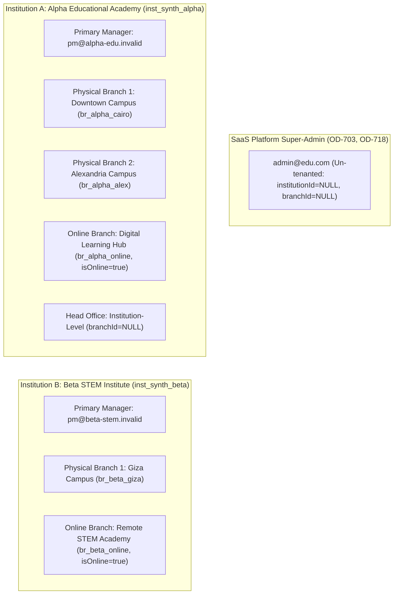

# OX-DIGITAL Education — Task 7.1
## Stage E.1: Synthetic Staging Dataset Specification & Topology Architecture

**Authorized Workspace:** `D:\OX-DIGITAL\Mathe\OX-DIGITAL-GITHUB`  
**GitHub Repository:** `https://github.com/hosamsamer019/ox-digital-Education.git`  
**Current Git HEAD:** `0500b93e65c24ed881349c4acea7f523332c5e9f` (branch `main`)  
**Phase / Task:** Phase 7.1 — Institutional Multi-Tenancy / Stage E.1 — Synthetic Staging Dataset & Pre-Execution Readiness  
**Dataset Strategy:** **SYNTHETIC DATASET ONLY** (Formally Approved by Product Owner)  
**Execution Mode:** STRICT PLANNING, SPECIFICATION & READ-ONLY INSPECTION ONLY  
**Database / Docker / Generation Authorization:** STRICTLY NOT GRANTED  
**Date:** November 2, 2026  

---

## 1. Executive Summary & Objective

In accordance with explicit Product Owner direction, all testing, benchmarking, and dry-run rehearsals for Task 7.1 Multi-Tenancy will execute strictly against a **100% synthetic dataset**. Zero production data, zero production-derived PII, and zero live student or financial records will be imported into the Staging environment.

This specification defines the deterministic data model, institutional topology, identity conventions, academic entity graphs, and mandatory edge cases required to thoroughly stress-test the schema migration (`20261102_task_7_1_institution_branch_foundation`) and the offline tenancy backfill script (`scripts/backfill_task_7_1_tenancy.ts`).

---

## 2. Strict Synthetic Identity, Security & Sanitization Conventions

To ensure zero risk of personal data leakage or external communication errors:

1. **Deterministic Prefixed UUIDs:** All synthetic entity primary keys will use predictable, structured strings formatted as valid UUIDs or prefixed hexadecimal identifiers (e.g., `00000001-0000-0000-0000-000000000001` or `usr_synth_a_pm_01`).
2. **Reserved Non-Deliverable Domain Names:** All generated email addresses must use the RFC 2606 / RFC 6761 reserved top-level domain `.invalid` (e.g., `primary.manager@alpha-edu.invalid`, `student.001@synth.invalid`). Under no circumstances may `.com`, `.org`, or real educational domains be generated.
3. **Synthetic Phone Numbers (Non-Routable):** Telephone numbers are strictly omitted or set to `NULL`. If a legacy database field requires a non-empty string, it must use the non-routable dummy test identifier `+20 00 000 0000` (utilizing the unassigned Egyptian national prefix `00` which cannot be routed by any telecom carrier). Under no circumstances may `0100`, `010`, or any active carrier prefix be used. External SMS and OTP notification gateways are strictly disabled in Staging.
4. **Synthetic Credential Hashes:** No plain text passwords, API keys, or operational JWT secrets are included in fixture definitions. Passwords are represented exclusively by a static, dummy bcrypt hash of a synthetic string (e.g., `$2a$10$SYNTHETIC_DUMMY_HASH_NOT_A_REAL_SECRET_0000000000000000`).
5. **No Assumed Pre-Existence:** Zero synthetic entities are assumed to already exist in the database. All records will be generated from this specification during an authorized generation run.

---

## 3. Institutional Topology & Hierarchy Architecture

The synthetic dataset models a realistic educational landscape spanning two distinct institutions, multiple physical campuses, dedicated digital branches, and an isolated SaaS Platform Super-Admin:

### 3.1 Topology Entities Specification

| Entity Identifier | Entity Type | Official Name & Code | Attribution Scope | Operational Role & Notes |
| :--- | :--- | :--- | :--- | :--- |
| `inst_synth_alpha` | `Institution` | Alpha Educational Academy (`ALPHA_EDU`) | Root Tenant A | Large multi-branch general education institution. |
| `br_alpha_cairo` | `Branch` | Downtown Cairo Campus (`ALPHA_CAIRO`) | Physical Campus | Flagship physical campus; `isOnline: false`, `isDefault: true`. |
| `br_alpha_alex` | `Branch` | Alexandria Campus (`ALPHA_ALEX`) | Physical Campus | Secondary physical branch; `isOnline: false`, `isDefault: false`. |
| `br_alpha_online` | `Branch` | Alpha Digital Hub (`ALPHA_ONLINE`) | Online Branch (OD-719) | Digital education branch; `isOnline: true`, `isDefault: false`. |
| `inst_synth_beta` | `Institution` | Beta STEM Institute (`BETA_STEM`) | Root Tenant B | Specialized science & technology academy. Completely isolated from Tenant A. |
| `br_beta_giza` | `Branch` | Giza Campus (`BETA_GIZA`) | Physical Campus | Physical branch; `isOnline: false`, `isDefault: true`. |
| `br_beta_online` | `Branch` | Beta Remote Portal (`BETA_ONLINE`) | Online Branch (OD-719) | Digital education branch; `isOnline: true`, `isDefault: false`. |
| `usr_synth_superadmin` | `User` | Platform Super-Admin (`admin@edu.com`) | Un-tenanted Root | Global SaaS operator. Must have `institutionId: null`, `branchId: null`, `isPrimaryManager: false`. |

---

## 4. Academic Record Graph & Relational Entities

To thoroughly test tenant isolation and backfill attribution, the fixture defines relational structures across all educational dimensions:

### 4.1 Teachers, Center Groups & Courses
- **Teacher Alpha 1 (`usr_synth_t_a1`):** Faculty member at Institution A. Teaches physical Center Groups at `br_alpha_cairo` and online courses at `br_alpha_online`.
- **Teacher Beta 1 (`usr_synth_t_b1`):** Faculty member at Institution B. Teaches STEM courses at `br_beta_giza`.
- **Physical Courses (`Course`):** Assigned directly to physical branches. Lessons, exams, and attendance are child entities.
- **Online Courses (`Course`):** Assigned to `br_alpha_online` (`isOnline: true`). Contains asynchronous lessons and video uploads.

### 4.2 Students, Enrollments & Attendance
- **Local Branch Students:** Students registered at physical campuses, attending center group sessions.
- **Online-Only Students:** Enrolled exclusively in online courses with zero physical attendance.
- **Dual-Enrollment Student (`usr_synth_s_hybrid`):** Enrolled in physical math courses at `br_alpha_cairo` and online physics at `br_alpha_online`. (Must cleanly resolve to Institution A across both).

### 4.3 Financial Payments (OD-708 Preservation Target)
- **Pre-Migration Payment Fixtures:** Payments created under legacy schema where `institutionId` and `branchId` are NULL.
- **Invariant Test:** Verify that 100% of payment rows are preserved, mapped to the student's parent institution, and that legacy `userId` cascading deletion has been replaced with `ON DELETE RESTRICT`.

---

## 5. Mandatory Edge-Case Fixture Specifications

To prove that the backfill protocol fails closed, quarantines ambiguous records, and prevents data corruption, the synthetic dataset includes fifteen specific test scenarios:

| # | Edge Case Scenario | Concrete Fixture Design | Expected Migration / Backfill Behavior | Governance Standard |
| :---: | :--- | :--- | :--- | :--- |
| **1** | **Strict Inter-Tenant Boundary** | Courses and students in Institution A vs Institution B. | Cross-tenant queries return 0 rows. Foreign keys strictly isolated. | OD-701, OD-703 |
| **2** | **Multi-Branch Intra-Tenant** | Courses assigned to `br_alpha_cairo` vs `br_alpha_alex`. | Shared institutional general ledger; segregated branch dimension. | OD-703 |
| **3** | **Identical Academic Role Across Tenants** | Teacher Alpha (`usr_synth_t_a1`) vs Teacher Beta (`usr_synth_t_b1`). | Each teacher scoped strictly to their respective institution. | OD-701 |
| **4** | **Multi-Context User (Hybrid Student)** | Student enrolled in physical branch and online branch of Institution A. | Both enrollments resolve cleanly to `inst_synth_alpha`. | UP-714 |
| **5** | **Branch-Specific Academic Entities** | `CenterGroup` and `Attendance` linked to `br_alpha_cairo`. | Branch FK populated or derived via parent group. | OD-722 |
| **6** | **Institution-Level Records (Head Office)** | `QuestionBank` belonging to Institution A with `branchId: null`. | Mapped to `institutionId` with null `branchId`. | OD-701 |
| **7** | **Online Branch Attribution** | Video lessons and online course enrollments. | Attributed to `br_alpha_online` (`isOnline: true`). | OD-719 |
| **8** | **Indirect Child Records** | `Submission`, `ExamAttempt`, `LessonQuiz`. | Tenancy verified via join to parent `Course.institutionId`. | Check 1–4 |
| **9** | **Deliberate Orphaned Media** | `ProcessedMedia` with `lessonId: null`. | Routed to `_migration_quarantine` under reason `OD_720_ORPHAN_MEDIA_COLD_ARCHIVAL`. | OD-720 |
| **10** | **Deliberate Unmapped Legacy User** | Legacy student `usr_synth_unmapped_01` omitted from `mapping.json`. | Routed to `_migration_quarantine` under `AMBIGUOUS_UNMAPPED_LEGACY_USER`. Row preserved intact. | Remediation G |
| **11** | **Conflicting Mapping Test Fixture** | A fixture designed with an ID assigned to both Institution A and B. | Backfill validation fails closed (`FATAL_INVALID_TENANT_MAPPING`). | Remediation G |
| **12** | **Missing Parent Foreign Key** | Deliberate child attempt pointing to non-existent exam ID. | Relational constraint engine rejects row; caught during pre-flight. | Integrity Rule |
| **13** | **Cascade-Sensitive Financial Records** | `Payment` rows linked to student accounts. | Deleting a user with payments is blocked with `foreign key violation` (`RESTRICT`). | OD-708 |
| **14** | **Large Benchmark Group** | Scaled batch of 1,000 synthetic students, 5,000 attendance rows, 1,000 payments. | Exercises index build latency and backfill throughput. | OD-717 |
| **15** | **SaaS Super-Admin Isolation** | User with email `admin@edu.com`. | Preserved with `institutionId: null`, `branchId: null`, `isPrimaryManager: false`. | OD-718 |

---

## 6. Synthesis & Fixture Generation Constraints

- **Status:** Complete design specification (`DESIGN_ONLY`).
- **Generation Safety:** No actual SQL insert scripts, JSON files, or database records will be generated or executed until explicit authorization is granted by the Product Owner in a subsequent stage.

