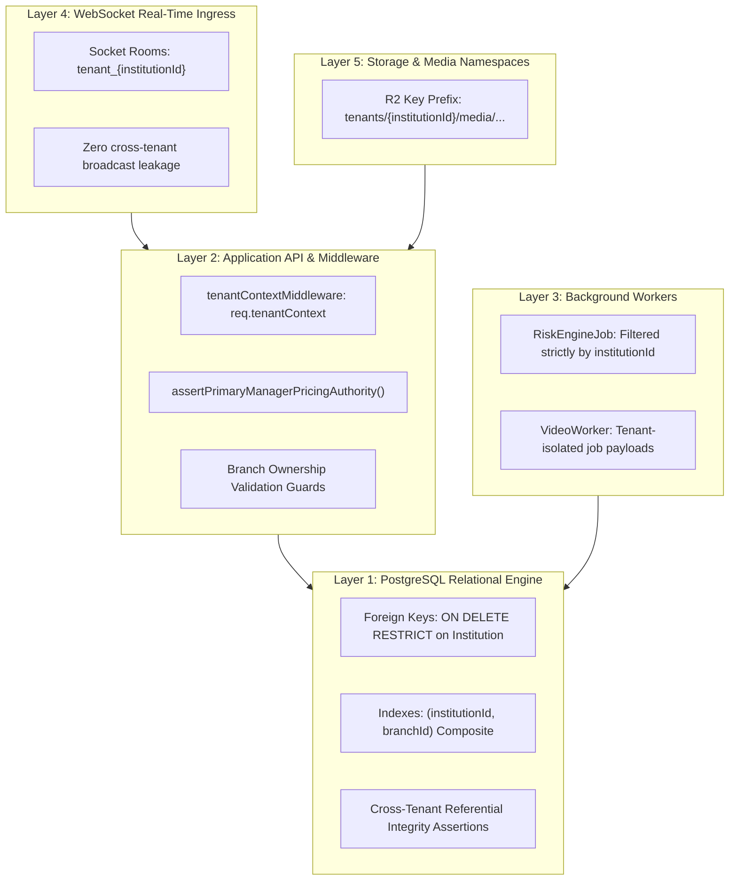

# OX-DIGITAL Education — Task 7.1
## Stage E.1: Multi-Tenant & Branch Isolation Validation Plan

**Authorized Workspace:** `D:\OX-DIGITAL\Mathe\OX-DIGITAL-GITHUB`  
**GitHub Repository:** `https://github.com/hosamsamer019/ox-digital-Education.git`  
**Current Git HEAD:** `0500b93e65c24ed881349c4acea7f523332c5e9f` (branch `main`)  
**Scope:** Multi-Layered Tenant & Branch Isolation Testing Framework  
**Execution Mode:** TEST DESIGN & ARCHITECTURAL VALIDATION PROTOCOL ONLY  
**Date:** November 2, 2026  

---

## 1. Executive Summary & Defense-in-Depth Model

Tenant isolation in OX-DIGITAL Education is architected across five distinct technical layers:
1. **Layer 1: Database Relational Constraints & Foreign Keys** (PostgreSQL Engine Level)
2. **Layer 2: Application Middleware & Domain RBAC Guards** (Express / Node.js Level)
3. **Layer 3: Asynchronous Background Jobs & Risk Engine Queues** (BullMQ / Worker Level)
4. **Layer 4: Real-Time Event & WebSocket Multiplexing** (Socket.io Level)
5. **Layer 5: Object Storage & Media Key Namespaces** (Cloudflare R2 / S3 Level)

This plan defines the concrete automated test scenarios to verify that cross-tenant access is structurally impossible across all five layers.

---

## 2. Five-Layer Isolation Validation Framework



---

## 3. Concrete Isolation Test Scenarios & Automated Assertions

### Scenario 1: Inter-Tenant Cross-Read Blocking (Database & API)
- **Objective:** Prove that a request authenticated as Institution A cannot read Institution B entities.
- **Assertion:**
  ```typescript
  // Automated Integration Test
  const res = await request(app)
    .get('/api/courses')
    .set('Authorization', tokenInstA)
    .expect(200);
  expect(res.body.courses.every(c => c.institutionId === 'inst_synth_alpha')).toBe(true);
  expect(res.body.courses.some(c => c.institutionId === 'inst_synth_beta')).toBe(false);
  ```

### Scenario 2: Inter-Tenant Cross-Write Blocking (Database & API)
- **Objective:** Prove that an actor in Institution A cannot update, enroll in, or modify an Institution B entity.
- **Assertion:**
  ```typescript
  const res = await request(app)
    .post('/api/courses/crs_synth_beta_chem_101/enroll')
    .set('Authorization', tokenStudentInstA)
    .expect(403); // Forbidden: Cross-tenant enrollment violation
  ```

### Scenario 3: Intra-Tenant Branch Access Restriction
- **Objective:** Prove that staff assigned to Branch 1 cannot access restricted administration of Branch 2 within the same institution.
- **Assertion:** API endpoints requiring `branchId` match fail with `403 FORBIDDEN` when invoked with non-matching branch token claims unless the user holds `isPrimaryManager: true`.

### Scenario 4: Institution-Level Record Accessibility
- **Objective:** Prove that institution-level records (`branchId: null`, e.g., institutional `QuestionBank` or head-office policies) are visible across all branches of that institution, but strictly hidden from other institutions.
- **Assertion:** SQL query for institution-level questions filters by `institutionId = $1` with zero records returned for foreign tenants.

### Scenario 5: Online Branch Scoping (OD-719)
- **Objective:** Verify that `Branch` with `isOnline: true` correctly tags digital student subscriptions and asynchronous course enrollments.
- **Assertion:** Assert `Course.branchId === br_alpha_online` and `Branch.isOnline === true`.

### Scenario 6: SaaS Platform Super-Admin Isolation (OD-703, OD-718)
- **Objective:** Prove that `admin@edu.com` operates globally without possessing institutional financial tenancy or becoming a Primary Manager.
- **Assertion:**
  ```sql
  SELECT "id", "email", "institutionId", "branchId", "isPrimaryManager"
  FROM "User"
  WHERE "email" = 'admin@edu.com';
  -- Assert: institutionId IS NULL, branchId IS NULL, isPrimaryManager = FALSE
  ```

### Scenario 7: Referential Disjointness (Zero Cross-Tenant Foreign Keys)
- **Objective:** Prove that no relational edge connects an entity of Institution A to an entity of Institution B.
- **Assertion (SQL Suite):**
  ```sql
  -- Course Enrollment cross-tenant check
  SELECT count(*) FROM "CourseEnrollment" ce
  JOIN "Course" c ON ce."courseId" = c."id"
  JOIN "User" u ON ce."userId" = u."id"
  WHERE c."institutionId" != u."institutionId";
  -- Must return 0
  
  -- Exam Attempt cross-tenant check
  SELECT count(*) FROM "ExamAttempt" ea
  JOIN "Exam" e ON ea."examId" = e."id"
  JOIN "Course" c ON e."courseId" = c."id"
  JOIN "User" u ON ea."studentId" = u."id"
  WHERE c."institutionId" != u."institutionId";
  -- Must return 0
  ```

### Scenario 8: Background Job Tenant Scoping
- **Objective:** Prove that asynchronous jobs (`services/course-service/src/jobs/riskEngine.job.ts`) execute within explicit tenant partitions.
- **Assertion:** Verify BullMQ job payload contains `institutionId`; job query scopes all calculations to `where: { institutionId: job.data.institutionId }`.

### Scenario 9: Storage Object-Key Prefixing
- **Objective:** Prove that uploaded media assets cannot be overwritten or retrieved across tenants.
- **Assertion:** Object key format enforces `tenants/${institutionId}/courses/${courseId}/${assetId}`.

---

## 4. Execution Standard & Safety Caveat

- **Classification:** `DESIGN_ONLY`.
- **Evidence Standard:** Static design of test suites does not prove that tests have passed. All validation suites will be executed and recorded in the Stage E Benchmark Execution Report upon explicit authorization.

