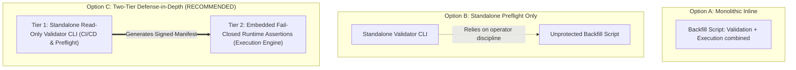
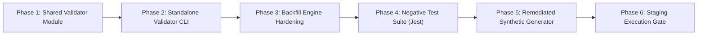

# OX-DIGITAL Education — Task 7.1
## Stage E.2: Mapping Validation Architectural Options & Dependency Ordering

**Authorized Workspace:** `D:\OX-DIGITAL\Mathe\OX-DIGITAL-GITHUB`  
**GitHub Repository:** `https://github.com/hosamsamer019/ox-digital-Education.git`  
**Current Git HEAD:** `0500b93e65c24ed881349c4acea7f523332c5e9f` (branch `main`)  
**Scope:** Architecture Evaluation for Mapping Validation & Pre-Execution Safety Hardening  
**Execution Mode:** ARCHITECTURAL TRADEOFF ANALYSIS & PLANNING ONLY  
**Date:** November 2, 2026  

---

## 1. Executive Summary & Objective

This document evaluates the architectural strategies for implementing the mapping validation remediations (GAP-01 through GAP-04) and establishes the implementation dependency roadmap for subsequent authorization stages.

Three implementation options are evaluated:
- **Option A:** Inline Integration into Backfill Script.
- **Option B:** Standalone Preflight Validator CLI.
- **Option C:** Two-Tier Defense-in-Depth Architecture (Recommended).

---

## 2. Evaluation of Implementation Strategies

### 2.1 Detailed Trade-Off Matrix

| Strategy Option | Architectural Pattern | Advantages | Vulnerabilities & Risks | Architectural Verdict |
| :--- | :--- | :--- | :--- | :--- |
| **Option A: Inline Integration** | Embed all validations directly into `scripts/backfill_task_7_1_tenancy.ts`. | Single codebase; zero duplicate code. | Validations cannot be run in CI/CD or offline without instantiating database dependencies. If validation code has bugs, execution logic may partially trigger. | *Sub-optimal for enterprise auditing.* |
| **Option B: Standalone Preflight CLI** | Build a dedicated CLI script (`scripts/validate_tenancy_mapping.ts`). | Completely decoupled; zero DB connections; can run in local pre-commit or CI/CD pipelines. Emits auditable JSON validation reports. | **Critical Operator Bypass Risk:** If an operator bypasses the validator and runs the backfill script directly, the backfill engine remains vulnerable to first-match-wins collisions (GAP-03). | *Insufficient defense.* |
| **Option C: Two-Tier Defense-in-Depth** | **Tier 1:** Standalone read-only validator CLI. **Tier 2:** Embedded fail-closed assertions inside backfill engine. | **Maximum Safety:** Standalone tool provides deep linting, manifest generation, and CI/CD validation. Runtime engine acts as an immovable gatekeeper, guaranteeing that even unauthorized script executions fail closed. | Requires maintaining core disjointness logic in a shared module (`packages/shared/src/tenant/mappingValidator.ts`). | **STRONGLY RECOMMENDED** |

---

## 3. Explicit Recommendation: Option C Architecture

We recommend **Option C (Two-Tier Defense-in-Depth)** for the following architectural reasons:

1. **Separation of Concerns (Tier 1):** The standalone validator (`scripts/validate_tenancy_mapping.ts`) can be executed by data engineers, administrators, and automated CI pipelines to inspect mapping files, calculate SHA-256 hashes, and verify entity disjointness without requiring database access or Prisma Client instantiation.
2. **Immovable Safety Gatekeeper (Tier 2):** Even if an operator accidentally invokes `scripts/backfill_task_7_1_tenancy.ts` directly with an unvalidated mapping file, the internal disjointness engine executes before any database mutation, completely eliminating the first-match-wins flaw (GAP-03).
3. **Shared Verification Core:** To avoid code divergence, the underlying validation rules (GAP-01 through GAP-04) will reside in a shared, pure TypeScript module (`packages/shared/src/tenant/mappingValidator.ts`), imported by both the standalone CLI and the backfill script.

---

## 4. Implementation Dependency Roadmap (Stage E.3 Prerequisite Sequence)

Upon explicit Product Owner authorization to proceed to implementation in Stage E.3, the remediation must execute in the following strict sequential phases:

### Phase Breakdown:
- **Phase 1 (Shared Logic):** Create pure verification module implementing disjointness algorithms, envelope validation, and branch uniqueness.
- **Phase 2 (Standalone CLI):** Implement `scripts/validate_tenancy_mapping.ts` to output canonical SHA-256 manifests and validation reports.
- **Phase 3 (Backfill Script Hardening):** Update `scripts/backfill_task_7_1_tenancy.ts` to import shared validator and assert disjointness before Phase 2 hierarchy provisioning.
- **Phase 4 (Negative Automated Tests):** Implement the 12 negative test cases from [`PHASE_7_1_STAGE_E2_MAPPING_NEGATIVE_TEST_MATRIX.md`](file:///D:/OX-DIGITAL/Mathe/OX-DIGITAL-GITHUB/PHASE_7_1_STAGE_E2_MAPPING_NEGATIVE_TEST_MATRIX.md) in Jest/Vitest.
- **Phase 5 (Synthetic Generator Hardening):** Update phone generation to non-routable format (`+20 00 000 xxxx`) and enforce un-authenticatable credential hashes.
- **Phase 6 (Execution Gate Review):** Present passing test results to Product Owner for Staging execution sign-off.

