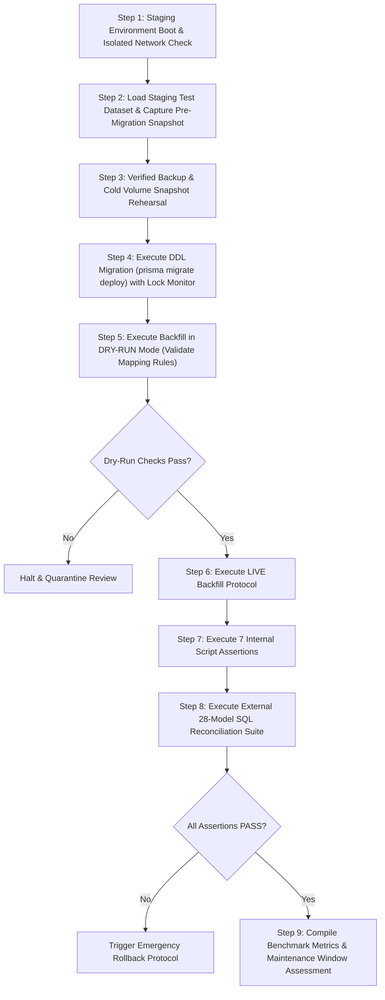

# OX-DIGITAL Education — Task 7.1
## Stage E: Backfill Static Safety Audit & Staging Benchmark Plan

**Workspace:** `D:\OX-DIGITAL\Mathe\OX-DIGITAL-GITHUB`  
**GitHub Repository:** `https://github.com/hosamsamer019/ox-digital-Education.git`  
**Current Git HEAD:** `0500b93e65c24ed881349c4acea7f523332c5e9f` (branch `main`)  
**Target Backfill Script:** `scripts/backfill_task_7_1_tenancy.ts`  
**Execution Mode:** STRICT READ-ONLY STATIC AUDIT & BENCHMARK DESIGN (EXECUTION STRICTLY NOT AUTHORIZED)  
**Date:** November 2, 2026  

---

## 1. Executive Summary

This document presents a static code audit of the offline tenancy backfill script (`scripts/backfill_task_7_1_tenancy.ts`) and establishes a rigorous benchmark protocol to measure migration and backfill performance in the staging environment.

The backfill protocol implements **Alternative B (Full Authoritative Offline Backfill during a scheduled maintenance window)**, as mandated by approved architectural decision **OD-716**.

---

## 2. Static Safety Audit of `backfill_task_7_1_tenancy.ts`

| Audit Criteria | Implementation in Script | Code Location | Safety Finding | Evidence Status |
| :--- | :--- | :--- | :--- | :--- |
| **Explicit Authoritative Mapping** | Requires valid `BackfillMappingConfig` with `targetInstitutionId`, `targetInstitutionCode`, and `defaultBranchId`. Fails closed if missing. | `lines 67-98, 113` | Complies with Remediation G. Prohibits synthetic tenant invention. | `VERIFIED_IN_SOURCE` |
| **Explicit Branch Attribution** | Maps users/groups/courses to explicit physical branch or online branch (`lines 204-232, 274, 294, 315`). | `lines 204-232` | Explicit attribution; no synthetic branch defaults. | `VERIFIED_IN_SOURCE` |
| **No Synthetic Tenants** | If an entity does not match approved criteria, it is **never** assigned a fake tenant; it is routed to quarantine. | `lines 278-283, 297-300, 318-321, 338-341` | Absolute compliance. Preserves data integrity. | `VERIFIED_IN_SOURCE` |
| **Dry-Run Support** | Controlled by `isDryRun = options.dryRun ?? true`. In dry-run mode, all database mutations are bypassed. | `lines 104, 143-160, 192, 247, 269, 291` | Fully implemented. Safe for pre-flight testing. | `VERIFIED_IN_SOURCE` |
| **Deterministic Rerun & Idempotency** | Hierarchy uses `upsert` (`lines 193-232`). Entities with existing `institutionId` are skipped (`lines 256, 287, 305, 327`). Quarantine uses `ON CONFLICT DO NOTHING`. | `lines 151, 193, 256, 287` | Fully idempotent. Can be safely rerun if interrupted. | `VERIFIED_IN_SOURCE` |
| **Quarantine & Cold Archival** | Unmapped entities and orphan media written to `_migration_quarantine` with JSONB payload. | `lines 142-161, 371-375` | Fully complies with OD-720 cold archival mandate. | `VERIFIED_IN_SOURCE` |
| **OD-708 Payment Invariant** | Initial payments captured (`line 169`). 100% preservation check (`lines 408-412`). Branch kept null for historical transactions (`line 335`). | `lines 169, 325-342, 408-412` | Zero payment deletions possible. Absolute preservation. | `VERIFIED_IN_SOURCE` |
| **Super-Admin Protection** | `admin@edu.com` is isolated: `institutionId` and `branchId` forced to null, `isPrimaryManager=false`. | `lines 245-254, 417-420` | Complies with OD-703 and OD-718. | `VERIFIED_IN_SOURCE` |
| **In-Memory Batching Observation** | Fetches entity sets via `findMany()` into Node memory without cursor pagination. | `lines 166-171` | Safe for staging test volumes (< 10,000 rows). For high-scale production, cursor batching (`take: 500`) should be added. | `PARTIALLY_VERIFIED` |

---

## 3. Seven Automated Integrity Checks in Backfill Script

The script embeds seven automated post-backfill validation checks (`lines 398-426`):

1. **Check 1: User Exact Primary-Key Set Equality** — Asserts that no user was dropped, duplicated, or lost.
2. **Check 2: Course Exact Primary-Key Set Equality** — Asserts all courses exist with identical keys.
3. **Check 3: Payment 100% Row-Level Preservation (OD-708)** — Asserts zero payments were deleted or altered.
4. **Check 4: Attendance Row Count Preservation** — Asserts historical attendance rows are preserved intact.
5. **Check 5: Platform Super-Admin Isolation (OD-718)** — Asserts `admin@edu.com` remains tenant-free.
6. **Check 6: ProcessedMedia OD-720 Cold Archival** — Asserts orphan media records are quarantined.
7. **Check 7: Authoritative Mapping Compliance (Remediation G)** — Asserts only approved mappings were applied.

---

## 4. Controlled Staging Benchmark Execution Plan

### 4.1 Benchmark Objective
To measure physical lock contention, query latency, CPU/memory consumption, and end-to-end execution duration on a representative PostgreSQL staging instance, providing empirical evidence to establish the production maintenance window duration (OD-717).

### 4.2 Metrics to Measure & Instruments

| Metric | Target Measurement | Measurement Tool / Instrument | Target Benchmark Threshold | Threshold Approval Status |
| :--- | :--- | :--- | :--- | :--- |
| **Migration DDL Duration** | Total execution time of `prisma migrate deploy` | Container execution timer (`time`) | < 30 seconds | Engineering Standard |
| **Max Table Lock Duration** | Longest exclusive lock acquired on any existing table (`User`, `Payment`, `Course`) | `pg_stat_activity` / PostgreSQL lock monitor | < 2.0 seconds per table | Engineering Standard |
| **Longest Blocking Operation** | Individual statement runtime for foreign key validation | `log_min_duration_statement = 0` in PostgreSQL logs | < 1.5 seconds | Engineering Standard |
| **Backfill Script Duration** | Wall-clock execution time of `runTenancyBackfill()` | Script internal high-resolution timer | < 180 seconds (for test volume) | Engineering Standard |
| **Backfill Throughput** | Entities processed per second | `Total Entities / Duration (s)` | > 500 entities / second | Engineering Standard |
| **Peak Memory Utilization** | Maximum RAM consumed by the Node backfill process | `docker stats --no-stream` | < 512 MB RSS | Engineering Standard |
| **Peak Database CPU** | Maximum CPU core utilization during migration & backfill | Docker CPU metrics | < 80% of allocated core | Engineering Standard |
| **Storage Overhead** | PostgreSQL disk space increase before vs after | `SELECT pg_database_size('ox_digital_staging');` | < 15% increase (primarily indexes) | Engineering Standard |
| **Index Creation Latency** | Time required to build all 17 performance indexes | PostgreSQL query log timestamps | < 60 seconds aggregate | Engineering Standard |
| **Referential Failures** | Integrity constraint violations during backfill | Script error logs & Check assertions | **0 (Zero Tolerance)** | **Approved Invariant** |
| **Reconciliation Discrepancies** | Unexplained discrepancies in 28-model counts | Pre/post reconciliation query diff | **0 (Zero Tolerance)** | **Approved Invariant** |
| **Total Maintenance Window** | End-to-end downtime from service shutdown to restart | Orchestration timer | Target < 15 minutes | **Pending PO Approval (OD-717)** |

*Note: In accordance with governance rules, zero benchmark results are invented. Real values will be recorded in the Stage E Benchmark Execution Report upon authorized run.*

---

## 5. Staging Execution Sequence (Step-by-Step)

---

## 6. Pre-Execution Safety Verifications

Before launching Step 4 (DDL Migration) in Staging, the operator must verify:
1. Docker network is `ox-digital-staging-network` and isolated from production.
2. PostgreSQL version is confirmed: `PostgreSQL 15.x`.
3. Pre-migration backup file exists, is non-empty, and has passed test restore.
4. The approved mapping JSON file is present and validated via `loadAndValidateMapping()`.
5. Product Owner execution authorization has been explicitly granted in writing.

