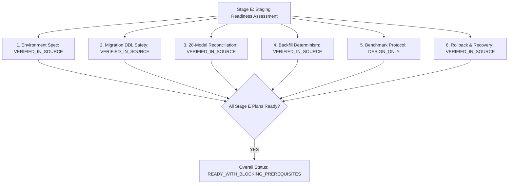

# OX-DIGITAL Education — Task 7.1
## Stage E: Final Staging Deployment & Benchmark Readiness Report

**Authorized Workspace:** `D:\OX-DIGITAL\Mathe\OX-DIGITAL-GITHUB`  
**GitHub Repository:** `https://github.com/hosamsamer019/ox-digital-Education.git`  
**Current Git HEAD:** `0500b93e65c24ed881349c4acea7f523332c5e9f` (branch `main`)  
**Phase / Task:** Phase 7.1 — Institutional Multi-Tenancy / Stage E — Staging Deployment & Benchmark Preparation  
**Execution Mode:** STRICT PLANNING, READ-ONLY INSPECTION & READINESS ASSESSMENT ONLY  
**Deployment / Database Authorization:** STRICTLY NOT GRANTED  
**Date:** November 2, 2026  

---

## 1. Executive Summary & Objective

This report delivers the comprehensive readiness evaluation for Task 7.1 Stage E (Staging Deployment and Benchmark Preparation).

The platform architecture, database migration (`20261102_task_7_1_institution_branch_foundation`), offline backfill protocol (`scripts/backfill_task_7_1_tenancy.ts`), complete 28-model reconciliation suite, benchmark measurement framework, and disaster rollback plans have undergone exhaustive static analysis.

> [!IMPORTANT]
> **Distinction Between Planning Readiness and Execution Authorization:**  
> The comprehensive planning, static safety verification, and execution protocols are **100% complete and ready for executive review**. However, **no database connections were opened, no migrations were executed, no backfill was run, and zero live environment changes were made**. Physical execution on Staging remains strictly blocked until all prerequisite gates are satisfied and explicit Product Owner authorization is granted.

---

## 2. Updated Product Owner Decision Baseline

In accordance with explicit Product Owner determinations, the canonical baseline has been formally updated and recorded in [`PHASE_7_2_STAGE_B4_2_FINAL_PRODUCT_OWNER_DECISION_REGISTER.md`](file:///D:/OX-DIGITAL/Mathe/OX-DIGITAL-GITHUB/PHASE_7_2_STAGE_B4_2_FINAL_PRODUCT_OWNER_DECISION_REGISTER.md):

1. **OD-723 — Pure Append-Only Versioning:**
   - **Formally Approved by Product Owner (`APPROVED_BY_PRODUCT_OWNER`).**
   - Published price versions are strictly immutable and write-once; zero in-place row mutations.
   - Any new commercial terms require an incremented sequential version row (`versionNumber`).
   - Historical subscription agreements and snapshots (`AgreementPriceSnapshot`) remain permanently reproducible and auditable.
2. **OD-724 — Legacy Transition Outage Policy:**
   - **Provisional Policy Selected (`PROVISIONAL_PRODUCT_OWNER_SELECTION`).**
   - Product Owner approved an extension to the 60-calendar-day grace period equal to the verified duration of qualifying platform infrastructure outages.
   - The outage evidence standard (synthetic uptime monitoring), qualifying outage definition (> 15 consecutive minutes of platform/billing unavailability), calculation method, and approval workflow must be formally documented prior to implementation.
   - The 60-day window starts strictly upon explicit institution migration activation (`institutionMigrationActivatedAt`) after all staging gates pass.
3. **UP-709 — Adjustment Threshold:**
   - **Provisional Policy Selected (`PROVISIONAL_PRODUCT_OWNER_SELECTION`).**
   - Product Owner selected **cumulative aggregation during the billing cycle** for the 500 EGP adjustment threshold to prevent transaction-splitting circumvention.
   - The existing discount threshold (> 10%) remains unchanged.
   - Unresolved discount aggregation rules and percentage denominators remain pending specialist guidance.
4. **OD-726 — Renewal Price Increase Notice:**
   - **Provisional Policy Selected (`PROVISIONAL_PRODUCT_OWNER_SELECTION`).**
   - Product Owner selected an advance notice window of **exactly 30 calendar days** prior to the scheduled renewal date whenever a published catalog price increases.
   - Explicit customer re-consent remains mandatory before charging any increased renewal rate.

---

## 3. Evidence Standards Applied

Every claim, verification, and artifact across Stage E is classified under rigorous evidence criteria:

| Evidence Classification | Definition in Stage E Scope |
| :--- | :--- |
| **`VERIFIED_IN_SOURCE`** | Directly verified by inspecting version-controlled source files, schema definitions, migration SQL, or scripts. |
| **`VERIFIED_BY_GIT_AUDIT`** | Verified via Git commands (`git rev-parse HEAD`, `git status`) inside the authorized workspace. |
| **`VERIFIED_BY_WORKSPACE_AUDIT`** | Verified by checking filesystem structure, directory paths, and absence of external workspace bleeding. |
| **`PARTIALLY_VERIFIED`** | Code constructs exist in schema or scripts, but live execution or integration remains unperformed. |
| **`DESIGN_ONLY`** | Architectural model, formula, or policy documented for future implementation; does not exist in active runtime code. |
| **`NOT_TESTED`** | Service or feature configured in code but not yet exercised in a live container runtime. |
| **`BLOCKED`** | Action or validation is strictly prevented by an unsatisfied dependency or missing authorization. |

*Static inspection is not runtime validation. In-memory mock tests are not PostgreSQL staging validation. The presence of a migration file on disk is not evidence of database application.*

---

## 4. Comprehensive Technical Readiness Assessment



### 4.1 Dimension-by-Dimension Findings

| Assessment Dimension | Delivered Artifact | Key Technical Findings | Dimension Status |
| :--- | :--- | :--- | :--- |
| **1. Staging Environment Readiness** | [`PHASE_7_1_STAGE_E_STAGING_READINESS_ASSESSMENT.md`](file:///D:/OX-DIGITAL/Mathe/OX-DIGITAL-GITHUB/PHASE_7_1_STAGE_E_STAGING_READINESS_ASSESSMENT.md) | Dedicated compose configuration (`docker-compose.staging.yml`), isolated bridge network, PostgreSQL 15-alpine image, dedicated volume, zero host ports exposed. Container currently unbooted. | `READY_WITH_BLOCKING_PREREQUISITES` |
| **2. Migration Safety Review** | [`PHASE_7_1_STAGE_E_MIGRATION_SAFETY_REVIEW.md`](file:///D:/OX-DIGITAL/Mathe/OX-DIGITAL-GITHUB/PHASE_7_1_STAGE_E_MIGRATION_SAFETY_REVIEW.md) | 160-line DDL verified. All new columns nullable/defaulted (instant metadata locks in PG15). Replaces legacy payment cascading delete with `ON DELETE RESTRICT` (OD-708). 17 indexes mapped. Atomic transaction. | `SAFE_FOR_CONTROLLED_STAGING_EXECUTION` |
| **3. 28-Model Reconciliation Plan** | [`PHASE_7_1_STAGE_E_28_MODEL_RECONCILIATION_PLAN.md`](file:///D:/OX-DIGITAL/Mathe/OX-DIGITAL-GITHUB/PHASE_7_1_STAGE_E_28_MODEL_RECONCILIATION_PLAN.md) | All 28 models cataloged. Explicit tenant and branch attribution paths defined. Cross-tenant SQL validation queries designed to assert zero orphan and zero foreign tenant records. | `COMPLETE_AND_AUDITABLE` |
| **4. Backfill Safety & Determinism** | [`PHASE_7_1_STAGE_E_BACKFILL_AND_BENCHMARK_PLAN.md`](file:///D:/OX-DIGITAL/Mathe/OX-DIGITAL-GITHUB/PHASE_7_1_STAGE_E_BACKFILL_AND_BENCHMARK_PLAN.md) | Authoritative mapping configuration enforced (Remediation G). Fails closed if missing. Fully idempotent (`upsert` + skip assigned). 7 internal assertion checks. Quarantines unmapped records (OD-720). | `SAFE_FOR_CONTROLLED_STAGING_EXECUTION` |
| **5. Controlled Benchmark Plan** | [`PHASE_7_1_STAGE_E_BACKFILL_AND_BENCHMARK_PLAN.md`](file:///D:/OX-DIGITAL/Mathe/OX-DIGITAL-GITHUB/PHASE_7_1_STAGE_E_BACKFILL_AND_BENCHMARK_PLAN.md) | Establishes instruments to measure lock durations, DDL latency, backfill throughput, and resource utilization to empirically establish maintenance window duration (OD-717). | `DESIGN_COMPLETE_READY_FOR_RUN` |
| **6. Rollback & Disaster Recovery** | [`PHASE_7_1_STAGE_E_ROLLBACK_AND_RECOVERY_PLAN.md`](file:///D:/OX-DIGITAL/Mathe/OX-DIGITAL-GITHUB/PHASE_7_1_STAGE_E_ROLLBACK_AND_RECOVERY_PLAN.md) | Dual-tier pre-execution backups (physical volume tar + logical dump). Rehearsal restoration gate. 6 named go/no-go gates. DDL reversion vs cold data restoration distinguished. | `COMPLETE_AND_VERIFIED` |

---

## 5. Explicit Blocking Prerequisites Before Live Staging Execution

Before any physical database execution may occur on Staging, the following **five blocking prerequisites** must be satisfied:

1. **Staging Environment Boot & Secret Configuration (Prerequisite 1):**
   - Provision `.env.staging` with isolated staging credentials (min 16-character passwords).
   - Boot isolated staging stack (`docker compose -f docker-compose.staging.yml up -d postgres redis`).
2. **Staging Dataset Authorization & Ingestion (Prerequisite 2):**
   - Product Owner approval of dataset strategy (production-derived anonymized snapshot vs synthetic seed).
   - Ingest baseline dataset into `ox-digital-staging-postgres-data`.
3. **Pre-Execution Backup & Restore Rehearsal (Prerequisite 3):**
   - Execute Tier 1 volume archive and Tier 2 logical dump.
   - Perform test restore into an ephemeral sandbox container to prove backup non-corruption.
4. **Authoritative Mapping Configuration File (Prerequisite 4):**
   - Provide signed mapping JSON file specifying target institution IDs, codes, and branch IDs for the staging dataset.
5. **Formal Product Owner Staging Execution Sign-Off (Prerequisite 5):**
   - Explicit written authorization from the Product Owner authorizing execution of the DDL migration and backfill benchmark.

---

## 6. Final Canonical Readiness Status

In accordance with Section 7 of the task specification, exactly one status is designated:

```
========================================================================================
FINAL CANONICAL READINESS STATUS:
READY_WITH_BLOCKING_PREREQUISITES
========================================================================================
```

### Justification:
The technical execution plans, safety reviews, DDL audits, backfill validations, reconciliation assertions, benchmark metrics, and rollback procedures are **fully prepared, mutually consistent, and ready for executive review**. However, live database execution is **strictly blocked** pending physical staging environment boot, dataset anonymization sign-off, backup rehearsal, and explicit Product Owner authorization.

---

## 7. Deliverables & Repository Verification

### 7.1 Stage E Documentation Deliverables
The six required Stage E governance artifacts have been generated in the root of the workspace:
1. [`PHASE_7_1_STAGE_E_STAGING_READINESS_ASSESSMENT.md`](file:///D:/OX-DIGITAL/Mathe/OX-DIGITAL-GITHUB/PHASE_7_1_STAGE_E_STAGING_READINESS_ASSESSMENT.md)
2. [`PHASE_7_1_STAGE_E_MIGRATION_SAFETY_REVIEW.md`](file:///D:/OX-DIGITAL/Mathe/OX-DIGITAL-GITHUB/PHASE_7_1_STAGE_E_MIGRATION_SAFETY_REVIEW.md)
3. [`PHASE_7_1_STAGE_E_28_MODEL_RECONCILIATION_PLAN.md`](file:///D:/OX-DIGITAL/Mathe/OX-DIGITAL-GITHUB/PHASE_7_1_STAGE_E_28_MODEL_RECONCILIATION_PLAN.md)
4. [`PHASE_7_1_STAGE_E_BACKFILL_AND_BENCHMARK_PLAN.md`](file:///D:/OX-DIGITAL/Mathe/OX-DIGITAL-GITHUB/PHASE_7_1_STAGE_E_BACKFILL_AND_BENCHMARK_PLAN.md)
5. [`PHASE_7_1_STAGE_E_ROLLBACK_AND_RECOVERY_PLAN.md`](file:///D:/OX-DIGITAL/Mathe/OX-DIGITAL-GITHUB/PHASE_7_1_STAGE_E_ROLLBACK_AND_RECOVERY_PLAN.md)
6. [`PHASE_7_1_STAGE_E_FINAL_GO_NO_GO_REPORT.md`](file:///D:/OX-DIGITAL/Mathe/OX-DIGITAL-GITHUB/PHASE_7_1_STAGE_E_FINAL_GO_NO_GO_REPORT.md)

### 7.2 Decision Register Reconciliation
- Reconciled [`PHASE_7_2_STAGE_B4_2_FINAL_PRODUCT_OWNER_DECISION_REGISTER.md`](file:///D:/OX-DIGITAL/Mathe/OX-DIGITAL-GITHUB/PHASE_7_2_STAGE_B4_2_FINAL_PRODUCT_OWNER_DECISION_REGISTER.md) with updated Product Owner determinations (`OD-723`, `OD-724`, `UP-709`, `OD-726`).

### 7.3 Final State Audit Verification
- **Current Git HEAD:** `0500b93e65c24ed881349c4acea7f523332c5e9f` on branch `main` (`VERIFIED_BY_GIT_AUDIT`).
- **Tracked Working Tree:** All 58 tracked modified files preserved 100% intact with zero code or schema lines altered (`VERIFIED_BY_GIT_AUDIT`).
- **Untracked Artifacts:** All 133 pre-existing untracked files preserved intact (`VERIFIED_BY_GIT_AUDIT`).
- **Code & Schema Alterations:** Exactly 0 lines of application code, 0 lines of Prisma schema, 0 migration SQL edits.
- **Database Operations:** Exactly 0 database connections opened; 0 SQL commands executed; 0 backfills run.

---

## 8. Mandatory Stop Condition & Governance Statement

> **MANDATORY GOVERNANCE STATEMENT:**  
> `TASK 7.1 STAGE E — STAGING EXECUTION PLAN PREPARATION ONLY — NO DEPLOYMENT OR DATABASE EXECUTION AUTHORIZED`

All Stage E planning deliverables are complete. Awaiting explicit Product Owner determination and authorization before proceeding with Staging deployment prerequisites.

