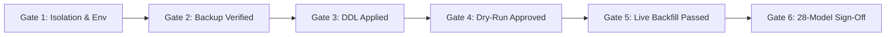

# OX-DIGITAL Education — Task 7.1
## Stage E: Comprehensive Rollback, Recovery & Disaster Containment Plan

**Workspace:** `D:\OX-DIGITAL\Mathe\OX-DIGITAL-GITHUB`  
**GitHub Repository:** `https://github.com/hosamsamer019/ox-digital-Education.git`  
**Current Git HEAD:** `0500b93e65c24ed881349c4acea7f523332c5e9f` (branch `main`)  
**Scope:** Stage E Staging Execution & Benchmark Rollback Architecture  
**Execution Mode:** STRICT READ-ONLY EMERGENCY PROCEDURE SPECIFICATION  
**Date:** November 2, 2026  

---

## 1. Executive Summary & Core Rollback Mandates

> [!CAUTION]
> **Fundamental Data Integrity Rule:**  
> **Reversing DDL schema statements DOES NOT restore modified data.**  
> If the backfill script executes mutations (`UPDATE "User"`, `UPDATE "Course"`, `UPDATE "Payment"`) and subsequently fails or is aborted, simply dropping the newly added columns will destroy backfill status without reversing relational changes. Therefore, **complete physical recovery requires restoring from a verified pre-migration cold backup**.

This document defines the end-to-end recovery procedures, checkpoint gates, and fail-safe controls to guarantee zero data loss, zero residual corruption, and instant recovery during Staging benchmark operations.

---

## 2. Pre-Execution Backup & Rehearsal Protocol

Before any migration or backfill command is issued in Staging:

### 2.1 Dual-Tier Backup Generation
Two independent backup tiers must be executed and verified:

1. **Tier 1: Physical Docker Volume Archive (Cold Storage)**
   ```bash
   # Create a compressed tar archive of the raw PostgreSQL database volume
   docker run --rm \
     -v ox-digital-staging-postgres-data:/data \
     -v /backup/staging:/backup \
     alpine:3.18 tar -czvf /backup/pre_task71_staging_volume_$(date +%Y%m%d_%H%M%S).tar.gz /data
   ```
2. **Tier 2: Consistent Logical PostgreSQL Dump**
   ```bash
   # Logical SQL dump with schema and data
   docker exec -t ox-digital-staging-postgres \
     pg_dump -U ox_staging_admin -d ox_digital_staging -F c -b -v -f /var/lib/postgresql/data/pre_task71_staging_logical.dump
   ```

### 2.2 Rehearsal Verification Gate
- **Integrity Test:** The logical dump must be validated using `pg_restore --list /backup/pre_task71_staging_logical.dump > /dev/null`.
- **Sandbox Test Restore:** The staging operator must perform a test restore into an ephemeral throwaway database container (`ox-digital-test-restore`) and verify that row counts for all 28 models match the pre-migration baseline exactly.
- **Sign-off:** The Staging Lead must sign off on backup completeness before proceeding to DDL execution.

---

## 3. Failure Scenarios & Targeted Recovery Procedures

### Scenario A: DDL Migration Execution Failure
- **Trigger:** `prisma migrate deploy` fails due to syntax error, timeout, lock conflict, or constraint failure.
- **Database State:** Prisma migrate executes within an atomic transaction. If any statement fails, PostgreSQL rolls back the transaction automatically.
- **Recovery Action:**
  1. Inspect PostgreSQL container logs: `docker logs ox-digital-staging-postgres --tail 100`.
  2. Verify catalog status: Check that `_prisma_migrations` recorded the failed migration.
  3. Resolve the underlying blocker (e.g., kill conflicting lock connections).
  4. If catalog requires cleanup, execute `npx prisma migrate resolve --rolled-back "20261102_task_7_1_institution_branch_foundation"`.
  5. Zero data restoration is needed because transaction atomicity prevented partial schema mutation.

---

### Scenario B: Backfill Interruption or Crash (Mid-Execution)
- **Trigger:** Process termination, Node OOM, container restart, or network interruption during live `runTenancyBackfill()`.
- **Database State:** The database contains partially backfilled rows (some users or courses have `institutionId` assigned, while others do not).
- **Recovery Action (Deterministic Idempotent Resume):**
  1. The backfill script is strictly idempotent:
     - All hierarchy models (`Institution`, `Branch`) use `upsert` (`lines 193-232`).
     - Entities that have already received an `institutionId` are explicitly bypassed (`lines 256, 287, 305, 327`).
     - Quarantine inserts use `ON CONFLICT DO NOTHING` (`line 151`).
  2. The operator simply re-runs the backfill script:
     ```bash
     npx ts-node scripts/backfill_task_7_1_tenancy.ts --mapping=path/to/mapping.json
     ```
  3. The script resumes cleanly from unassigned records without duplicating records or corrupting previous assignments.

---

### Scenario C: Post-Backfill Integrity Failure (Reconciliation Check Fails)
- **Trigger:** Any of the 7 internal checks fail (`Check 1` through `Check 7`) or the external 28-model SQL cross-tenant assertions detect violations.
- **Database State:** Data has been mutated in an inconsistent or invalid state.
- **Recovery Action (Full Cold Restore):**
  ```bash
  # 1. Stop all application services immediately to block incoming writes
  docker compose -f docker-compose.staging.yml stop auth-service user-service course-service analytics-service
  
  # 2. Stop and remove the corrupted database container
  docker compose -f docker-compose.staging.yml stop postgres
  docker compose -f docker-compose.staging.yml rm -f postgres
  
  # 3. Wipe corrupted volume and restore from verified Tier 1 volume snapshot
  docker volume rm ox-digital-staging-postgres-data
  docker volume create ox-digital-staging-postgres-data
  docker run --rm \
    -v ox-digital-staging-postgres-data:/data \
    -v /backup/staging:/backup \
    alpine:3.18 tar -xzvf /backup/pre_task71_staging_volume_*.tar.gz -C /
  
  # 4. Restart database container and verify health
  docker compose -f docker-compose.staging.yml up -d postgres
  
  # 5. Run 28-Model Pre-Execution Baseline Check to confirm 100% restoration
  ```

---

## 4. Go / No-Go Checkpoints & Named Authority Matrix

Execution through the staging benchmark is partitioned into six strict decision gates:



| Checkpoint Gate | Gate Criteria & Objective | Required Verification | Named Approving Authority | Rollback Trigger on Failure |
| :--- | :--- | :--- | :--- | :--- |
| **Gate 1: Environment Isolation** | Verify staging network isolation, volume identity, and PostgreSQL 15 configuration. | Network and environment inspection. | Staging DevOps Lead | Abort before boot. |
| **Gate 2: Backup & Restore Rehearsal** | Verify Tier 1 volume snapshot and Tier 2 logical dump restored in sandbox. | Checksum & row count match. | Database Administrator | Abort before any DDL execution. |
| **Gate 3: Migration DDL Application** | Execute `prisma migrate deploy`. Verify table locks and zero transaction aborts. | PostgreSQL error logs & lock monitoring. | Database Administrator | Automatic transactional rollback; resolve migration. |
| **Gate 4: Backfill Dry-Run Validation** | Execute `runTenancyBackfill({ dryRun: true })`. Review entity mapping counts. | Dry-run summary review; verify quarantine volume. | Technical Lead | Abort backfill; refine mapping rules. |
| **Gate 5: Live Backfill Execution** | Execute live backfill. Verify all 7 internal script validation checks report `PASS`. | Script console exit code 0; `overallStatus == 'PASS'`. | Technical Lead | Trigger Scenario B (resume) or Scenario C (full restore). |
| **Gate 6: External 28-Model SQL Reconciliation** | Execute independent SQL suite. Verify zero cross-tenant contamination. | 4 Cross-tenant assertions return 0 errors. | **Product Owner & Lead Architect** | Trigger Scenario C (Full Cold Restore). |

---

## 5. Post-Recovery Data Verification Protocol

Following any restore event, the database must be audited against the pre-execution baseline:
1. **Row Count Equivalence:** Verify all 28 models have identical row counts to pre-execution state.
2. **Payment Set Identity:** Verify `Payment` table has zero missing, modified, or orphan records (`OD-708`).
3. **Super-Admin State:** Verify `admin@edu.com` remains intact with original password hash and role.
4. **Clean Git State:** Verify that working tree and repository files remain untouched.

