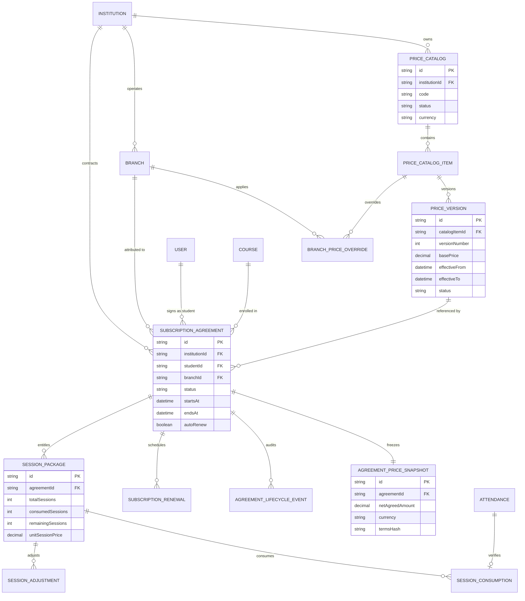
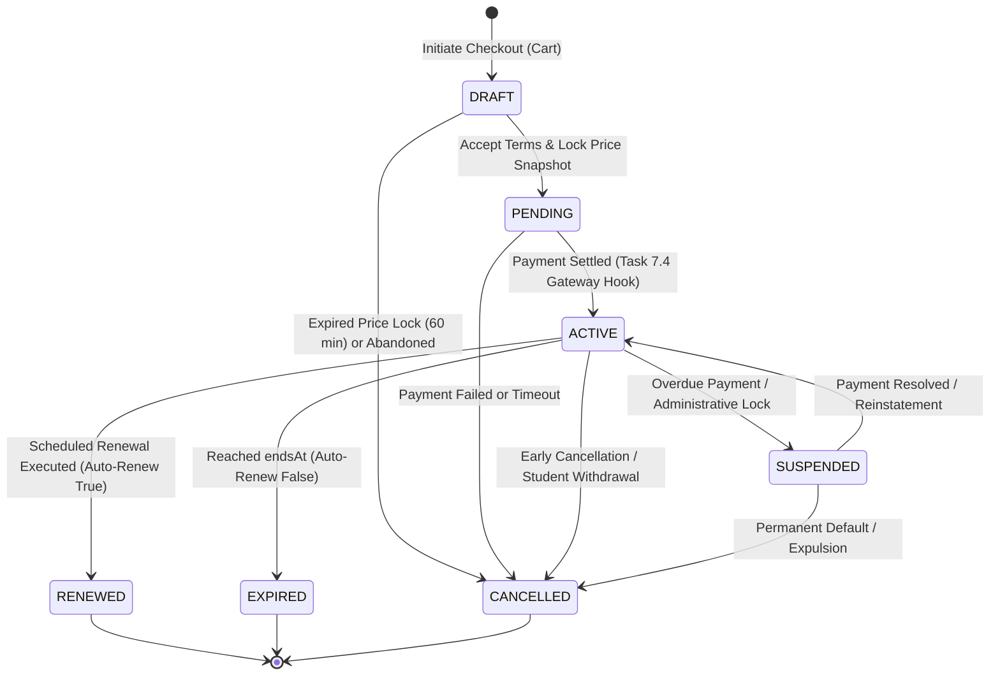
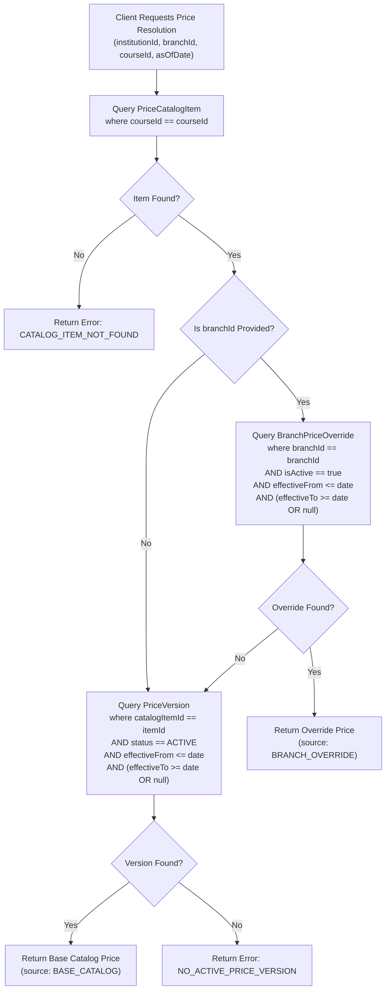

# Phase 7.2 — Stage B: Architecture Design
## Document 7: Master Architecture Synthesis & Final Design Report

**Workspace:** `D:\OX-DIGITAL\Mathe\OX-DIGITAL-GITHUB`  
**Git Repository:** `https://github.com/hosamsamer019/ox-digital-Education.git`  
**Git HEAD:** `0500b93e65c24ed881349c4acea7f523332c5e9f` (branch `main`)  
**Phase:** 7.2 — Pricing Catalog & Subscription Agreements  
**Stage:** Stage B — Architecture Design  
**Date:** November 2026  
**Final Status:** `TASK 7.2 — STAGE B ARCHITECTURE DESIGN COMPLETE — PRODUCT OWNER APPROVAL REQUIRED — IMPLEMENTATION NOT AUTHORIZED`  

---

## 1. Executive Master Synthesis

Phase 7.2 Stage B establishes the complete architectural blueprint for transitioning the OX-DIGITAL platform from an unversioned single-float pricing model (`Course.price Float`) into an institutional-grade, multi-tenant **Pricing Catalog and Subscription Agreement Engine**.

### Core Architecture Highlights:
1. **Tenant Integrity:** Every pricing and contractual record is strictly rooted in `Institution(id)` (OD-701) and attributed to an explicit physical campus or online branch (`Branch.isOnline: true`, OD-719).
2. **Immutable Contract Traceability:** Accepted student agreements freeze commercial terms via SHA-256 snapshotted records (`AgreementPriceSnapshot`), guaranteeing that subsequent catalog adjustments never mutate historical student obligations.
3. **Double-Entry & Accrual Compliance:** Commercial contracts (`SubscriptionAgreement`) are decoupled from billing (`Invoice`), cash collection (`PaymentTransaction`), and general ledger postings (`JournalEntry`), enforcing strict accrual revenue recognition (OD-704/705).
4. **Resilient Non-Breaking Migration:** A 3-phase rollout architecture guarantees zero downtime and zero access disruptions for existing students via dual-read and grandfathered agreement adapters.

---

## 2. Visual Architecture & System Flows

### 2.1 Entity-Relationship Model (ERD)



---

### 2.2 Subscription Agreement State Machine



---

### 2.3 Runtime Price Resolution Precedence Flow



---

## 3. Transaction Boundaries & Database Isolation Levels

Financial operations must withstand high concurrency and network partitions without generating phantom prices or double-deductions.

### 3.1 Checkout & Price Snapshot Creation
- **Isolation Level:** `READ COMMITTED` with `FOR UPDATE` row-level lock on `PriceVersion`.
- **Transaction Boundary:**
  1. Acquire lock on active `PriceVersion` (and `BranchPriceOverride` if applicable).
  2. Create `SubscriptionAgreement` in `PENDING` state.
  3. Insert immutable `AgreementPriceSnapshot` recording SHA-256 legal hash and exact decimal amount.
  4. Write audit record to `AgreementLifecycleEvent`.
  5. Commit transaction.

### 3.2 Price Version Publication & Supersession
- **Isolation Level:** `SERIALIZABLE`.
- **Transaction Boundary:**
  1. Validate date ranges against all existing versions of `catalogItemId`.
  2. Set preceding active version `effectiveTo = new.effectiveFrom - 1 second` and `status = SUPERSEDED`.
  3. Insert new `PriceVersion` with `status = ACTIVE`.
  4. Emit cache invalidation event across Redis/in-memory caches.

### 3.3 Session Package Consumption (Attendance Check-In)
- **Isolation Level:** `REPEATABLE READ`.
- **Transaction Boundary:**
  1. Select `SessionPackage` with `FOR UPDATE`.
  2. Verify `remainingSessions > 0` and `status == ACTIVE`.
  3. Insert `SessionConsumption` referencing `Attendance.id`.
  4. Decrement `remainingSessions` by 1 and increment `consumedSessions` by 1.
  5. Commit transaction.

---

## 4. Idempotency & Failure Scenarios Matrix

| Scenario | Risk | System Mitigation Architecture |
|---|---|---|
| **Duplicate Payment Webhook** | Double-activation or duplicate invoice creation. | Gateway webhook handler evaluates `Idempotency-Key` / `transactionId`. If agreement is already `ACTIVE`, system logs acknowledgment and returns `200 OK` without re-posting. |
| **Race Condition on Session Consumption** | Two teachers marking attendance for the same student concurrently in different classrooms. | PostgreSQL row lock (`FOR UPDATE`) on `SessionPackage` serializes the deduction. Database unique constraint on `attendanceId` prevents double-logging. |
| **Price Catalog Modification Mid-Checkout** | Primary Manager changes tuition price while student is entering credit card details. | Checkout binds strictly to the `AgreementPriceSnapshot` created at cart acceptance. Changing catalog rates has zero effect on pending or active agreements. |
| **Network Failure During Agreement Acceptance** | Client disconnects before receiving acceptance response. | Client retries `POST /agreements/:id/accept` with the identical `Idempotency-Key`. Server retrieves existing snapshot and returns `200 OK` safely. |

---

## 5. Architectural Deliverables Summary

The Phase 7.2 Stage B architectural documentation suite is complete:

1. [**`PHASE_7_2_STAGE_B_DATA_MODEL.md`**](file:///D:/OX-DIGITAL/Mathe/OX-DIGITAL-GITHUB/PHASE_7_2_STAGE_B_DATA_MODEL.md): Complete Prisma data model specifications for catalogs, versions, overrides, agreements, snapshots, events, and physical session packages.
2. [**`PHASE_7_2_STAGE_B_API_DESIGN.md`**](file:///D:/OX-DIGITAL/Mathe/OX-DIGITAL-GITHUB/PHASE_7_2_STAGE_B_API_DESIGN.md): RESTful endpoint specifications, request/response contracts, and error catalogs.
3. [**`PHASE_7_2_STAGE_B_ACCESS_CONTROL.md`**](file:///D:/OX-DIGITAL/Mathe/OX-DIGITAL-GITHUB/PHASE_7_2_STAGE_B_ACCESS_CONTROL.md): Dynamic LMS access engine (`checkLmsAccess`), legacy `CourseEnrollment` fallback hierarchy, and multi-layer tenant isolation.
4. [**`PHASE_7_2_STAGE_B_ACCOUNTING_INTEGRATION.md`**](file:///D:/OX-DIGITAL/Mathe/OX-DIGITAL-GITHUB/PHASE_7_2_STAGE_B_ACCOUNTING_INTEGRATION.md): 8-step financial lifecycle, illustrative double-entry journal postings, deferred revenue amortization, and branch revenue attribution.
5. [**`PHASE_7_2_STAGE_B_MIGRATION_ROLLOUT.md`**](file:///D:/OX-DIGITAL/Mathe/OX-DIGITAL-GITHUB/PHASE_7_2_STAGE_B_MIGRATION_ROLLOUT.md): Upstream Task 7.1 staging prerequisites, 3-phase dual-write strategy, and rollback procedures.
6. [**`PHASE_7_2_STAGE_B_DECISION_GATES.md`**](file:///D:/OX-DIGITAL/Mathe/OX-DIGITAL-GITHUB/PHASE_7_2_STAGE_B_DECISION_GATES.md): Unresolved policy register highlighting blocking gates **OD-721** and **OD-722** pending Product Owner approval.
7. [**`PHASE_7_2_STAGE_B_FINAL_DESIGN.md`**](file:///D:/OX-DIGITAL/Mathe/OX-DIGITAL-GITHUB/PHASE_7_2_STAGE_B_FINAL_DESIGN.md): This master synthesis document.

---

## 6. Verification of Strict Boundaries

- **Application Source Code Modifications:** 0 lines.
- **Prisma Schema Modifications:** 0 lines.
- **Migrations Created or Applied:** 0.
- **Database Connections / SQL Executed:** 0.
- **Git HEAD Unchanged:** `0500b93e65c24ed881349c4acea7f523332c5e9f` on branch `main`.
- **Pre-existing Working Tree Intact:** All 58 tracked modified files and 133 untracked files preserved.

---

## 7. Mandatory Final Status Declaration

```
TASK 7.2 — STAGE B ARCHITECTURE DESIGN COMPLETE — PRODUCT OWNER APPROVAL REQUIRED — IMPLEMENTATION NOT AUTHORIZED
```

