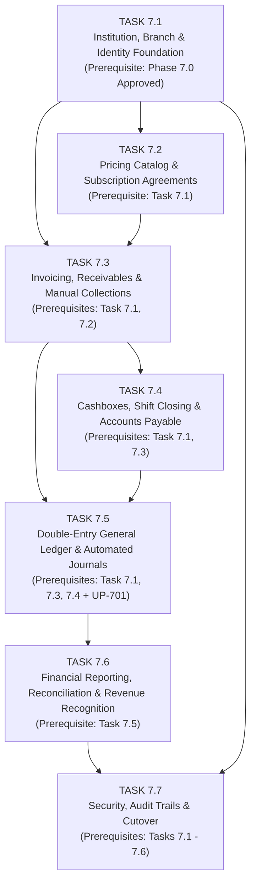

# OX-DIGITAL Education — Phase 7
# Master Financial Management Execution Framework & Admin Dashboard Architecture

**Document ID:** `OD-7000-MASTER-EXECUTION-PLAN`  
**Workspace:** `D:\OX-DIGITAL\Mathe\OX-DIGITAL-GITHUB`  
**Repository:** `https://github.com/hosamsamer019/ox-digital-Education.git`  
**Product:** OX-DIGITAL Education (Commercial Multi-Institution, Multi-Branch Educational Platform)  
**Execution Mode:** Architectural Planning & Master Task Framework Only (Strictly Read-Only Toward Code & Database)  
**Status:** **AUTHORITATIVE MASTER BLUEPRINT AWAITING PRODUCT OWNER APPROVAL (NOT IMPLEMENTED)**  

---

## 1. Executive Summary & Architectural Foundation

OX-DIGITAL Education is a commercial, multi-institution, multi-branch educational management platform. Phase 7 introduces the administrative financial management system, institutional double-entry accounting engine, multi-branch cash operations, and governance framework.

This master plan establishes an internally consistent, sequential, task-based execution structure across **Tasks 7.1 through 7.7**. It preserves all explicitly approved Product Owner decisions, maintains a strict separation of unresolved policies, and enforces rigorous safety constraints.

### 1.1 Binding Architectural Decisions (OD-701 through OD-708)
The following decisions have been formally approved by the Product Owner and serve as authoritative constraints:
1. **OD-701 (Institution Governance):** Exactly one Primary Manager per institution. The `Institution` is the sovereign tenant root (`institutionId`). Strict inter-institution data isolation. Transparent single-branch UX (auto-provisioned default branch). Subordinate operational roles. Centralized pricing and policies. Explicit Online/Head-Office branch dimension.
2. **OD-702 (Financial Domain Separation):** Absolute decoupling between OX-DIGITAL SaaS Commercial Finance (Domain A) and Institution Internal Financial Management (Domain B). Student tuition, lesson fees, and center cash collections must **NEVER** be recorded as OX-DIGITAL platform revenue. No shared ledgers, automatic balance netting, or automatic inter-domain settlement.
3. **OD-703 (Unified Institutional General Ledger):** Exactly ONE unified General Ledger per institution. Journal lines carry attributable branch dimensions/cost centers (`branchId`). Online/Head-Office operations use the dedicated Online Branch Dimension.
4. **OD-704 (Accrual Accounting Basis):** Accrual basis is mandated. Revenue is recognized when earned according to applicable service policy; expenses recognized when incurred. AR and AP are formally tracked. Cash-flow reporting is delivered alongside the Income Statement (P&L) and Balance Sheet. **Critical Invariant:** Invoicing does **NOT** automatically equal earned revenue.
5. **OD-705 (Progressive Online Subscription Revenue):** Online subscriptions are recognized ratably over the subscription term. Unearned future service value is credited to Deferred Revenue (Unearned Revenue Liability); earned portions are transferred periodically via automated journals.
6. **OD-706 (Physical Center Session Packages):** Centrally priced prepaid session packages. Enrollment creates the financial obligation; actual student attendance consumes exactly one session entitlement. **Absence Constraint:** Student absence must **NOT** automatically consume a session until a formal absence consumption policy is approved.
7. **OD-707 (Teacher Compensation):** Support for 4 manager-selected models: (1) Fixed monthly salary, (2) Per completed lesson, (3) Per qualifying student, (4) Percentage of group/course revenue. Monthly statements are branch-attributed. Cancelled lessons are not payable.
8. **OD-708 (Refunds & Student Withdrawal):** Prorated by service type (online unused term, package unused sessions, monthly actual delivered). Every refund requires recorded justification and manager approval. Non-destructive reversals, credit adjustments, and refunds; original financial records are never deleted.
   - **Payment Deletion Protection Invariant:** Historical financial transactions and payment records must **never** be silently or destructively deleted as a side effect of deleting or deactivating a user.

### 1.2 Pending Architectural Proposals (OD-709 through OD-715)
OD-709 (Approval Limits), OD-710 (Period Close), OD-711 (Opening Balances), OD-712 (Currency Policy), OD-713 (Legal Entity Structure), OD-714 (Electronic Invoicing), and OD-715 (Cashbox Discrepancies) represent proposals that have **NOT** been approved yet. They are tracked as pending in `PHASE_7_APPROVED_DECISIONS.md` and detailed as open policies in `PHASE_7_UNRESOLVED_POLICIES.md`.

---

## 2. Mandatory Admin / Manager Dashboard Architecture & Governance Scope

### 2.1 Administrative Capability Mandate
**The entire Phase 7 Financial Management System is an administrative product capability and MUST be implemented strictly inside the existing Admin / Manager Dashboard.**

Under no circumstances will a separate financial web application, portal, or micro-frontend be created. All financial management navigation, views, controls, workflows, and reports reside in `apps/frontend/src/app/components/admin/` and operate within `SharedLayout.tsx`.

### 2.2 Strict Non-Administrative Role Exclusion
- **Teachers, Students, and Parents MUST NOT receive internal financial administration screens, navigation items, accounting views, cashboxes, journals, or financial settings.**
- **Future Student/Parent Billing View (Separated & Read-Only):** Any future student/parent billing capability is explicitly separated from the administrative accounting system. It must be strictly limited to the user's own invoices, receipts, and outstanding balance in a read-only mode, and is marked for separate Product Owner scoping and approval. No student/parent billing screens are created in Phase 7.1–7.7 administrative work.

### 2.3 Staff Roles & Permissions Governance
To maintain strict governance integrity, the framework establishes clear boundaries between approved governance and unapproved operational permissions:
- **Approved by Product Owner:**
  - Exactly **one Primary Manager** per institution holding sovereign central authority over branches, pricing, and financial administration.
  - Operational roles, if introduced, remain strictly subordinate to the Primary Manager.
  - No independent branch owner or independent financial administrator exists by default.
- **NOT YET APPROVED (Awaiting Formal Product Owner Determination under UP-709):**
  - Detailed operational role definitions (e.g., Branch Manager, Accountant, Cashier).
  - Specific monetary financial approval limits and thresholds.
  - Cash collection permissions and receipt sign-off limits.
  - Refund approval authority and debit/credit adjustment permissions.
  - Journal entry creation and posting permissions.
  - Cashbox physical access and shift custody rules.
  - Branch-level financial delegation and separation-of-duties matrix.
- **Implementation Constraint:** Task 7.1 may inspect the existing authentication/authorization architecture and propose a role design, but **must NOT implement or enforce unapproved financial privileges**. All backend financial endpoints must enforce server-side authentication, tenant isolation, and approved permissions.

### 2.4 Proposed Administrative Navigation Tree (Financial Management)
All financial capabilities are organized into a dedicated, scalable navigation group: **الإدارة المالية (Financial Management)** within `AdminDashboard.tsx`:

```
Admin / Manager Dashboard Navigation
├── لوحة التحكم (Dashboard Home) [/admin/home]
├── إدارة المستخدمين (User Management) [/admin/users]
├── إدارة الطلاب (Student Management) [/admin/students]
├── إدارة الدورات (Course Management) [/admin/courses]
├── الامتحانات والواجبات (Exams & Homework) [/admin/exams, /admin/homework]
├── كشف الخطر والتقارير الأكاديمية (Academic Analytics) [/admin/risk, /admin/reports]
│
└── 🏛️ الإدارة المالية (Financial Management) [Group Header]
    ├── نظرة عامة مالية (Financial Overview) [/admin/finance/overview]
    ├── المؤسسة والكيانات القانونية (Institution & Legal Entities) [/admin/finance/institution]
    ├── الفروع ومراكز التكلفة (Branches & Cost Centers) [/admin/finance/branches]
    ├── دليل الأسعار والخدمات (Pricing Catalog) [/admin/finance/pricing]
    ├── اتفاقيات واشتراكات الطلاب (Subscriptions & Agreements) [/admin/finance/agreements]
    ├── فواتير الطلاب (Student Invoices) [/admin/finance/invoices]
    ├── المقبوضات والتحصيل اليدوي (Manual Collections & Receivables) [/admin/finance/collections]
    ├── الاسترداد والتسويات (Refunds & Adjustments) [/admin/finance/refunds]
    ├── الخزائن النقدية (Cashboxes) [/admin/finance/cashboxes]
    ├── ورديات الصندوق (Cashier Shifts) [/admin/finance/shifts]
    ├── المصروفات التشغيلية (Operating Expenses) [/admin/finance/expenses]
    ├── الموردون وحسابات الدفع (Suppliers & Payables) [/admin/finance/suppliers]
    ├── مستحقات المعلمين (Teacher Compensation) [/admin/finance/teacher-compensation]
    ├── شجرة الحسابات (Chart of Accounts) [/admin/finance/chart-of-accounts]
    ├── قيود اليومية (Journal Entries) [/admin/finance/journal-entries]
    ├── دفتر الأستاذ العام (General Ledger) [/admin/finance/general-ledger]
    ├── القوائم والتقارير المالية (Financial Reports) [/admin/finance/reports]
    ├── التسوية والمطابقة (Reconciliation) [/admin/finance/reconciliation]
    ├── إقفال الفترات المالية (Period Closing - Policy Dependent) [/admin/finance/period-closing]
    ├── الإعدادات المالية (Financial Settings) [/admin/finance/settings]
    └── سجل التدقيق المالي (Financial Audit Trail) [/admin/finance/audit]
```

### 2.5 Role-to-Navigation & Permission Matrix (Subject to UP-709 Approval)

| Navigation Screen / Module | Route Path | Primary Manager | Proposed Branch Manager | Proposed Accountant | Proposed Cashier | Teacher / Student / Parent |
| :--- | :--- | :---: | :---: | :---: | :---: | :---: |
| **Financial Overview** | `/admin/finance/overview` | Full (Consolidated) | Branch Only (Prop.) | Full (Prop.) | Hidden | **NO ACCESS** |
| **Institution & Legal Entities** | `/admin/finance/institution` | Full Manage | Hidden | View Only (Prop.)| Hidden | **NO ACCESS** |
| **Branches & Cost Centers** | `/admin/finance/branches` | Full Manage | View Assigned (Prop.)| View Only (Prop.)| Hidden | **NO ACCESS** |
| **Pricing Catalog** | `/admin/finance/pricing` | Full Manage | View Only (Prop.) | View Only (Prop.)| View Only (Prop.)| **NO ACCESS** |
| **Subscriptions & Agreements** | `/admin/finance/agreements` | Full Manage | Branch Only (Prop.) | Full Manage (Prop.)| View Only (Prop.)| **NO ACCESS** |
| **Student Invoices** | `/admin/finance/invoices` | Full Manage | Branch Only (Prop.) | Full Manage (Prop.)| View/Print (Prop.)| **NO ACCESS** |
| **Manual Collections & Receivables** | `/admin/finance/collections` | Full Manage | Branch Only (Prop.) | Full Manage (Prop.)| Record Cash (Prop.)| **NO ACCESS** |
| **Refunds & Adjustments** | `/admin/finance/refunds` | Full Approve | Submit Only (Prop.)| Review/Submit (Prop.)| Hidden | **NO ACCESS** |
| **Cashboxes** | `/admin/finance/cashboxes` | Full Manage | Branch Only (Prop.) | Audit Only (Prop.)| Assigned Only (Prop.)| **NO ACCESS** |
| **Cashier Shifts** | `/admin/finance/shifts` | Full / Override | Branch Review (Prop.)| Audit Only (Prop.)| Open/Close Shift (Prop.)| **NO ACCESS** |
| **Operating Expenses** | `/admin/finance/expenses` | Full Approve | Submit Branch (Prop.)| Review/Submit (Prop.)| Record Petty Cash (Prop.)| **NO ACCESS** |
| **Suppliers & Payables** | `/admin/finance/suppliers` | Full Manage | Submit Bill (Prop.) | Full Manage (Prop.)| Hidden | **NO ACCESS** |
| **Teacher Compensation** | `/admin/finance/teacher-compensation` | Full Approve | Branch Review (Prop.)| Calculate/Review (Prop.)| Hidden | **NO ACCESS** |
| **Chart of Accounts** | `/admin/finance/chart-of-accounts` | Full Manage | Hidden | Full Manage (Prop.)| Hidden | **NO ACCESS** |
| **Journal Entries** | `/admin/finance/journal-entries` | Full Post/Reverse | Hidden | Create/Post (Prop.)| Hidden | **NO ACCESS** |
| **General Ledger** | `/admin/finance/general-ledger` | Full View | Hidden | Full View (Prop.) | Hidden | **NO ACCESS** |
| **Financial Reports** | `/admin/finance/reports` | Full Consolidated | Branch P&L (Prop.) | Full Reports (Prop.)| Hidden | **NO ACCESS** |
| **Reconciliation** | `/admin/finance/reconciliation` | Full Approve | Cash Match (Prop.) | Full Reconcile (Prop.)| Shift Count (Prop.)| **NO ACCESS** |
| **Period Closing** *(Pending OD-710)*| `/admin/finance/period-closing` | Policy Dependent | Hidden | Checklist Review (Prop.)| Hidden | **NO ACCESS** |
| **Financial Settings** | `/admin/finance/settings` | Full Manage | Hidden | View Only (Prop.)| Hidden | **NO ACCESS** |
| **Financial Audit Trail** | `/admin/finance/audit` | Full Inspect | Hidden | Inspect Own (Prop.)| Hidden | **NO ACCESS** |

> [!IMPORTANT]
> **Server-Side Authorization Invariant:**  
> Hiding a frontend navigation item is an ergonomic convenience, not security. **Every single backend API endpoint must independently enforce:**
> 1. Cryptographic Authentication (`userId`).
> 2. Institutional Tenant Scope (`institutionId`).
> 3. Branch Scope (`branchId`) where applicable.
> 4. Role & Permission Verification against approved policies.

### 2.6 Screen Inventory & Incremental Rollout Schedule
Screens are introduced strictly in lockstep with their respective implementation task:
```
Task 7.1  ──>  Institution & Legal Entities (/institution), Branches (/branches)
Task 7.2  ──>  Pricing Catalog (/pricing), Subscriptions & Agreements (/agreements)
Task 7.3  ──>  Student Invoices (/invoices), Manual Collections (/collections), Refunds (/refunds)
Task 7.4  ──>  Cashboxes (/cashboxes), Shifts (/shifts), Expenses (/expenses), Suppliers (/suppliers), Teacher Compensation (/teacher-compensation)
Task 7.5  ──>  Chart of Accounts (/chart-of-accounts), Journal Entries (/journal-entries), General Ledger (/general-ledger)
Task 7.6  ──>  Financial Overview (/overview), Financial Reports (/reports), Reconciliation (/reconciliation)
Task 7.7  ──>  Financial Settings (/settings), Audit Trail (/audit), Period Closing (policy-dependent) (/period-closing)
```

### 2.7 Branch Scope Switching & Single-Branch Transparent UX (OD-701)
- **Single-Branch Institutions:** When an institution operates with a single branch (`isMultiBranchEnabled = false`), the branch switcher dropdown is **completely hidden** from the UI header. All operations transparently default to the auto-provisioned primary branch.
- **Multi-Branch Institutions:** When multi-branch operations are enabled (`isMultiBranchEnabled = true`), a persistent **Branch Switcher Dropdown** appears in the top navigation bar of `SharedLayout.tsx`.
  - The **Primary Manager** can switch active branch context or view **"Consolidated — All Branches"**.
  - Subordinate **Branch Staff** are locked to their assigned branch without switcher capability.

---

## 3. Authoritative Accounting Architecture

The accounting system is governed by accrual accounting principles (OD-704) and strict domain separation (OD-702):

### 3.1 Invoice Issuance vs. Revenue Recognition
The system must **NEVER** apply a universal journal rule to every invoice. The accounting framework strictly separates and distinguishes the following independent events:
1. **Invoice Issuance:** Formally creates the billing document with line items, tax metadata, and payment terms.
2. **Recognition of Accounts Receivable (AR):** Establishes the student's legal financial obligation.
3. **Cash Collection:** Records the receipt of cash or other manually confirmed funds; settles the receivable or advances a liability. **Collection alone must NOT automatically create earned revenue.**
4. **Service Delivery:** The physical teaching of a lesson or elapsed period of a digital subscription.
5. **Revenue Recognition:** The formal transfer of value to earned revenue based on service delivery.
6. **Deferred Revenue Release:** Periodic amortization of unearned liability into earned income.
7. **Refunds and Credit Adjustments:** Non-destructive adjustments reversing unearned balances or disbursing funds.

#### Accounting Treatments by Service Type:
- **A. Earned Service:** When an educational service has already been delivered prior to billing and revenue is earned, the entry recognizes earned revenue and the corresponding receivable when appropriate.
- **B. Future Online Subscription (OD-705):** For a subscription covering a future service period, consideration received or billed is credited to **Deferred Revenue (Unearned Revenue Liability)** and recognized progressively/ratably over the service term.
- **C. Prepaid Physical Session Package (OD-706):** Preserves the unconsumed portion as a service obligation / deferred liability balance. Revenue is recognized only as sessions are consumed via actual attendance under OD-706.
- **D. Collection:** Cash collection settles the relevant receivable or advances the applicable liability balance. It does not automatically create earned revenue.

> [!NOTE]
> **No Invented Account Numbers:** Final Chart of Accounts numbering and posting templates require formal accounting validation under **UP-701**. No hardcoded account numbers or universal templates are finalized prior to that determination.

### 3.2 Physical Session Package Accounting
In physical center operations, session packages must strictly distinguish the following **9 dimensions**:
1. **Package amount sold:** Total agreed nominal billing amount.
2. **Amount collected:** Cash or confirmed funds received to date.
3. **Outstanding amount:** Uncollected receivable balance ($Sold - Collected$).
4. **Total sessions purchased:** Total session entitlement count.
5. **Sessions actually attended/consumed:** Verified sessions delivered via confirmed student attendance.
6. **Remaining sessions:** Unused entitlement count ($Purchased - Attended$).
7. **Earned service value:** Value of delivered sessions based on validated recognition formula.
8. **Unconsumed service value:** Value of remaining sessions held as an outstanding service obligation.
9. **Refundable amount:** Unconsumed portion subject to OD-708 refund terms and administrative fee policies.

#### Rules for Physical Packages:
- Actual student attendance consumes exactly one session entitlement.
- Student absence does **NOT** automatically consume a session (absence policy governed by UP-712).
- Collection of payment does **NOT** mean the entire package has been earned.
- Remaining sessions must remain visible in administrative reports as an outstanding service obligation.
- Every session must retain student, teacher, group, branch, and date attribution.
- The accounting recognition method and valuation of consumed sessions (e.g., linear straight-line unit price vs tiered) must be formally validated under **UP-714** before Task 7.5 posting templates are finalized.

### 3.3 Period Closing and Reopening Policy
- **OD-710 remains PENDING / NOT APPROVED.**
- Monthly period locking is **NOT** an approved requirement. No specific close workflow or reopening permissions are finalized.
- Period closing is **NOT** a hard prerequisite for Task 7.7.
- Task 7.7 focuses on transaction immutability, audit trails, reconciliation, and cutover controls.
- Any period-close, lock, or reopen behavior remains explicitly policy-dependent until OD-710 receives formal Product Owner approval.

### 3.4 Currency Policy Scope
- **OD-712 remains PENDING / NOT APPROVED.**
- **Currency policy (OD-712)** is distinct from **exchange rate provenance (UP-708)**.
- The current implementation scope does **NOT** assume multiple currencies or foreign-exchange accounting.
- **EGP is a provisional initial scope assumption** for the first release, requiring Product Owner confirmation prior to Task 7.2 pricing or Task 7.5 GL templates.
- Any foreign-exchange journals, currency revaluation, and exchange difference accounting must wait for explicit policy approval.

### 3.5 Online Payment Gateway Scope
- The current Phase 7 implementation scope is strictly **manual financial administration**.
- Institutional staff will create financial obligations, issue invoices, record manual cash collections or confirmed bank transfers, record expenses, review outstanding balances, and reconcile cashboxes.
- **NO online payment gateway (Stripe, Paymob, Fawry) is required in the current scope.**
- Gateway integration is completely removed from mandatory Task 7.3 acceptance criteria.
- Merchant routing and settlement integrations are optional future extensions only (tracked under UP-703) and do not block manual collections.

### 3.6 Double-Entry Balance Invariant & Immutability
- Every posted journal entry in the General Ledger must satisfy:
  $$\sum \text{Debits} = \sum \text{Credits}$$
- Unbalanced journal entries are rejected at the ORM and database check-constraint levels.
- Posted financial records, invoices, payments, and journal entries are permanently immutable. Corrections are performed exclusively via linked reversing entries or adjustment vouchers.

---

## 4. Sequential 7-Task Execution Framework

---

### TASK 7.1 — Institution, Branch & Identity Foundation

#### 1. Objective
Establish the institutional tenant root, branch hierarchy (with seamless single-branch support under OD-701), primary manager authority, tenant-scoped user memberships, and design non-destructive protections for historical financial and academic records.

#### 2. Prerequisites
Phase 7.0 Approved Decisions (OD-701, OD-702, OD-703).  
*(Note: Audit and migration plans are Task 7.1 Stage B deliverables, NOT pre-task blocking prerequisites).*

#### 3. Approved Product Decisions
- OD-701: Single Primary Manager; `Institution` tenant root; auto-provisioned default branch; online dimension branch. Subordinate operational roles.
- OD-702: Domain A (SaaS) vs Domain B (Institution) strict isolation.
- OD-703: Unified General Ledger with branch dimensions.
- OD-708: Historical financial transactions and payment records must never be silently or destructively deleted.

#### 4. Unresolved Policy Dependencies
- UP-709: Staff Operational Roles & Financial Delegation Limits (Pending OD-709).
- UP-713: Legal Entity Structure (Pending OD-713; **not a prerequisite for Task 7.1**).
- UP-715: User Lifecycle & Historical Financial Protection Design (Evaluated in Stage B).

#### 5. Revised Staged Execution Sequence for Task 7.1

```
┌─────────────────────────────────────────────────────────────────────────────┐
│                       TASK 7.1 STAGED EXECUTION SEQUENCE                    │
├─────────────────────────────────────────────────────────────────────────────┤
│ STAGE A: Read-Only Discovery                                                │
│   └── Inspect identity, relational, academic, financial schemas & services  │
│   └── Inspect auth, JWT, session, WebSocket, worker, and storage flows      │
│   └── Zero database writes or schema migrations                             │
│                                 │                                           │
│ STAGE B: Architecture and Migration Design                                  │
│   └── Produce PHASE_7_1_CURRENT_STATE_AUDIT.md                              │
│   └── Produce PHASE_7_1_LEGACY_DATA_MIGRATION_PLAN.md                       │
│   └── Design Institution & Branch models (OD-701 single/multi-branch)       │
│   └── Map existing records to initial institution and default branch        │
│   └── Evaluate payment protection & user lifecycle options (UP-715)         │
│   └── Design safe backfill & expand-and-contract schema progression         │
│                                 │                                           │
│ STAGE C: Product Owner Review Gate                                          │
│   └── Present complete audit, migration design, and schema proposals        │
│   └── STOP: Await explicit Product Owner approval before any DB mutation    │
│                                 │                                           │
│ STAGE D: Authorized Implementation (Post-Approval)                          │
│   └── Implement approved models, tenant-scoping middleware, and auth claims │
│   └── Apply safe non-destructive migrations (no resets, no truncations)     │
│   └── Implement tenant isolation across APIs, workers, sockets, storage     │
│                                 │                                           │
│ STAGE E: Verification and Completion                                        │
│   └── Execute automated unit, integration, and negative SEC-01..09 suites   │
│   └── Verify data preservation invariants and auth compatibility            │
│   └── Deliver Task 7.1 Completion Report -> STOP                            │
└─────────────────────────────────────────────────────────────────────────────┘
```

#### 6. Task 7.1 Design-Review Deliverables (Output of Stage B)
1. `PHASE_7_1_CURRENT_STATE_AUDIT.md`: Forensic audit of 24 tables, 5 microservices, WebSockets, background workers, and storage adapters.
2. `PHASE_7_1_LEGACY_DATA_MIGRATION_PLAN.md`: Deterministic legacy ownership resolution, non-blocking 4-phase rollout plan, dry-run backfill script architecture, and manual review quarantine protocol.
3. **Data Preservation & Lifecycle Proposal:** Technical evaluation of options to satisfy the payment protection invariant (Restrict, soft deletion, archival, relationship redesign) and user lifecycle analysis without assuming `deletedAt` as already decided.

#### 7. Backend Implementation Scope (Stage D)
- Implement `tenantContext.middleware.ts` verifying request headers against JWT claims.
- Extend Prisma client with query middleware throwing `TenantContextMissingError` if unscoped.
- Update `user-service`, `course-service`, and `auth-service` to enforce tenant filters across queries, workers, sockets, and storage.

#### 8. Frontend / Admin Dashboard Implementation Scope (Stage D)
- Introduce `/admin/finance/institution` (Profile, basic metadata).
- Introduce `/admin/finance/branches` (Branch list, branch creation, default/online tags).
- Add Branch Switcher component to `SharedLayout.tsx` (bypassed transparently if single-branch).

#### 9. API Contracts
- `GET /api/v1/institution`: Get current institution profile.
- `PUT /api/v1/institution`: Update institution profile (Primary Manager only).
- `GET /api/v1/branches`: List institution branches.
- `POST /api/v1/branches`: Create new branch (Primary Manager only).

#### 10. Authorization Requirements
- Only `PRIMARY_MANAGER` can create/archive branches or update institution profiles.
- Unapproved operational financial privileges are **NOT** implemented.

#### 11. Database and Migration Requirements (Critical Safety)
- Read-only audit before any SQL execution.
- Expand-only schema migration: Add tables and nullable columns with `CONCURRENTLY` indexes.
- No database reset, truncation, mass deletion, or destructive migration.
- Safe tenant backfill script with dry-run verification mode before applying non-null constraints.

#### 12. Automated Tests & Acceptance Criteria
- Unit: `tenantContext.test.ts`, `prismaTenantExtension.test.ts`.
- Integration: Header propagation across microservices.
- Security: SEC-01 through SEC-09 negative cross-tenant IDOR attack suite returns 100% `404` or `403`.
- Usability: Single-branch institutions operate with zero branch selector overhead.
- Compatibility: Existing login, authentication, and LMS workflows preserved.

#### 13. Rollback Strategy
- Revert Prisma extension; drop added tables via down migration script.

#### 14. Dependencies on Later Tasks
- Foundation required for all subsequent tasks (7.2 through 7.7).

---

### TASK 7.2 — Pricing Catalog & Subscription Agreements

#### 1. Objective
Build the centralized pricing engine, product/service catalog, subscription plans, lesson package tiers, student agreements with price-locking, and branch applicability rules.

#### 2. Prerequisites
Task 7.1 completed and signed off.

#### 3. Approved Product Decisions
- OD-701: Centralized pricing governed by Primary Manager.
- OD-703: Branch-attributable dimensions.
- OD-706: Prepaid session packages.

#### 4. Unresolved Policy Dependencies
- UP-708: Provisional currency confirmation. Scope assumes EGP provisional scope.

#### 5. Technical Scope
- Catalog of billable products (Online subscriptions, center lesson packages, private lessons, materials).
- Student agreement engine locking prices at agreement creation date.
- Discount rules and authorized promotional adjustments.

#### 6. Expected Data Models (Proposals for Review)
- `PricingProduct`, `PricingPlan`, `PriceBook`, `StudentAgreement`, `AgreementDiscount`.
- Enums: `ProductType { ONLINE_SUBSCRIPTION, CENTER_PACKAGE, PRIVATE_LESSON, MATERIAL }`, `AgreementStatus`.

#### 7. Backend Implementation
- Catalog service managing products, tiers, and EGP prices.
- Agreement creation service freezing unit price at time of agreement creation.

#### 8. Frontend / Admin Dashboard Implementation
- Introduce `/admin/finance/pricing`: Central catalog management table.
- Introduce `/admin/finance/agreements`: Student agreements list and agreement generator.

#### 9. API Contracts
- `GET /api/v1/pricing/products`: List billable products.
- `POST /api/v1/pricing/products`: Create/update product (Primary Manager only).
- `POST /api/v1/pricing/agreements`: Generate student agreement with frozen price.

#### 10. Authorization Requirements
- Primary Manager defines catalog prices. Branch Managers can view and select approved catalog items.

#### 11. Database and Migration Requirements
- Create pricing tables with foreign key to `Institution` (`onDelete: Restrict`).

#### 12. Data Preservation Requirements
- Updating a catalog price must **never** modify the price on existing signed `StudentAgreement` records.

#### 13. Automated Tests
- Price-locking unit tests asserting agreement amounts remain immutable across catalog price edits.

#### 14. Security Tests
- Branch staff cannot apply unauthorized discounts beyond configured limits.

#### 15. Acceptance Criteria
- Price changes apply strictly to future agreements.

#### 16. Rollback Strategy
- Revert pricing routes; disable agreement generation endpoint.

#### 17. Required Completion Report
- Task 7.2 Completion Report with price-lock verification test logs.

#### 18. Dependencies on Later Tasks
- Feeds student invoices and billings in Task 7.3.

---

### TASK 7.3 — Invoicing, Receivables & Manual Collections

#### 1. Objective
Implement student invoicing, accounts receivable tracking, manual cash collections (cash, verified bank transfers), installment allocations, credit adjustments, non-destructive refunds, and receivables aging. (Online gateways are strictly excluded).

#### 2. Prerequisites
Task 7.1 and Task 7.2 completed.

#### 3. Approved Product Decisions
- OD-704: Accrual accounting (invoices create AR; invoices do not immediately equal earned revenue).
- OD-706: Physical attendance consumes prepaid package sessions; absence does not automatically consume a session.
- OD-708: Prorated refunds with justification and manager approval; zero physical transaction deletions.

#### 4. Unresolved Policy Dependencies
- UP-702: Educational VAT & ETA Electronic Invoicing Treatment.
- UP-706: Student Refund Administrative Fees & Withdrawal Deadlines.
- UP-712: Student Absence Session Package Consumption Policy.
- UP-714: Consumed session valuation and recognition formula.

#### 5. Technical Scope
- Invoicing engine generating student bills for agreements and package renewals.
- Manual cash collection recording supporting full and partial installment settlements (Online gateway disabled).
- Non-destructive refund workflow creating credit notes and disbursement records.
- Receivables aging calculation (Current, 1-30, 31-60, 61-90, 90+ days).
- Explicit 9-dimension physical package tracking (sold, collected, outstanding, purchased sessions, attended sessions, remaining sessions, earned value, unconsumed obligation, refundable amount).

#### 6. Expected Data Models (Proposals for Review)
- `StudentInvoice`, `InvoiceLineItem`, `PaymentRecord`, `RefundRecord`, `CreditNote`, `SessionPackageBalance`.
- Enums: `InvoiceStatus { DRAFT, ISSUED, PARTIAL, PAID, CANCELLED }`, `PaymentMethod { CASH, BANK_TRANSFER, CHEQUE, POS_CARD }`.

#### 7. Backend Implementation
- Invoice generation and balance calculation services.
- Collection allocation engine applying cash receipts to outstanding invoice lines.
- Prorated refund engine calculating unused sessions / elapsed subscription time.

#### 8. Frontend / Admin Dashboard Implementation
- Introduce `/admin/finance/invoices`: Student invoice search, status badges, printable tax invoice.
- Introduce `/admin/finance/collections`: Manual cash receipt recording modal, installment tracker.
- Introduce `/admin/finance/refunds`: Refund request wizard, prorated balance calculation, manager sign-off.

#### 9. API Contracts
- `POST /api/v1/invoices`: Generate invoice from agreement.
- `POST /api/v1/collections`: Record manual cash collection against invoice.
- `POST /api/v1/refunds`: Submit refund request with justification reason.

#### 10. Authorization Requirements
- Cashier can record collections against assigned branch invoices.
- Refunds strictly require `PRIMARY_MANAGER` approval.

#### 11. Database and Migration Requirements
- Migration creating invoice, payment, and refund tables with `onDelete: Restrict`.

#### 12. Data Preservation Requirements
- Physical `DELETE` statements on `StudentInvoice` or `PaymentRecord` are strictly blocked.

#### 13. Automated Tests
- Test partial payment allocation updating invoice balance accurately.
- Test prorated refund calculation matching approved formulas.
- Test 9-dimension session package balance updates on attendance.

#### 14. Security Tests
- Cross-tenant payment recording blocked; cashier cannot collect on foreign branch invoice.

#### 15. Acceptance Criteria
- Receivables balance equals total invoiced minus total collected minus approved credits.
- Printable invoice contains complete tax and institutional metadata.
- Manual collections operate 100% without external payment gateway dependencies.

#### 16. Rollback Strategy
- Safe feature flag disabling invoice issuance while preserving database tables.

#### 17. Required Completion Report
- Task 7.3 Completion Report with reconciliation test evidence.

#### 18. Dependencies on Later Tasks
- Invoices and collections generate automated journal entries in Task 7.5.

---

### TASK 7.4 — Cashboxes, Shift Closing & Accounts Payable

#### 1. Objective
Implement physical branch cashbox management, cashier shift open/close with blind count discrepancy auditing, operating expense recording, supplier payables, and teacher compensation calculations (OD-707).

#### 2. Prerequisites
Task 7.1 and Task 7.3 completed.

#### 3. Approved Product Decisions
- OD-707: Teacher compensation across 4 models; monthly branch-attributed statements.

#### 4. Unresolved Policy Dependencies
- UP-704: Teacher Percentage Revenue-Share Base & Student Qualification.
- UP-705: Cashbox Discrepancy Tolerance Limits & Shortage/Overage Policy (Pending OD-715).
- UP-709: Financial Approval Authority Delegation Thresholds (Pending OD-709).

#### 5. Technical Scope
- Branch cashbox entity tracking current physical balance.
- Cashier shift lifecycle: Open shift $\rightarrow$ Collect/Disburse $\rightarrow$ Blind count close $\rightarrow$ Discrepancy escalation.
- Operational expense recording and supplier invoice processing (Accounts Payable).
- Teacher compensation engine calculating payroll statements based on attendance and enrollments.

#### 6. Expected Data Models (Proposals for Review)
- `Cashbox`, `CashierShift`, `CashTransaction`, `CashboxDiscrepancy`, `Supplier`, `SupplierBill`, `BillPayment`, `TeacherCompensationStatement`.
- Enums: `ShiftStatus { OPEN, CLOSED, DISCREPANCY_PENDING, RECONCILED }`, `DiscrepancyType { SHORTAGE, OVERAGE }`.

#### 7. Backend Implementation
- Blind count verification logic: Expected cash is concealed from cashier until physical count is submitted.
- Discrepancy handling service generating immutable audit records.
- Teacher payroll calculator implementing the 4 compensation models (OD-707).

#### 8. Frontend / Admin Dashboard Implementation
- Introduce `/admin/finance/cashboxes`: Branch cashboxes, active cashier, real-time balance.
- Introduce `/admin/finance/shifts`: Shift opening/closing wizard with blind cash count entry.
- Introduce `/admin/finance/expenses`: Operating expense voucher submission and approval.
- Introduce `/admin/finance/suppliers`: Supplier directory and accounts payable bills.
- Introduce `/admin/finance/teacher-compensation`: Monthly teacher compensation statement review.

#### 9. API Contracts
- `POST /api/v1/shifts/open`: Open cashier shift.
- `POST /api/v1/shifts/close`: Submit blind count and close shift.
- `POST /api/v1/expenses`: Submit operational expense voucher.
- `POST /api/v1/teacher-compensation/generate`: Generate monthly teacher statements.

#### 10. Authorization Requirements
- Cashier operates assigned cashbox shift. Primary Manager approves expenses above delegated limits, resolves discrepancies, and authorizes teacher statements.

#### 11. Database and Migration Requirements
- Create cashbox, shift, supplier, and teacher payroll models with strict tenant/branch scoping.

#### 12. Data Preservation Requirements
- Closed shifts and recorded cash transactions are immutable.

#### 13. Automated Tests
- Test blind count logic accurately flags shortages and overages without exposing system totals.
- Test teacher payroll calculation across each of the 4 models.

#### 14. Security Tests
- Cashier cannot close another cashier's active shift or access a cashbox at another branch.

#### 15. Acceptance Criteria
- Discrepancies cannot be deleted or hidden; each requires manager resolution.
- Teacher statements reconcile with lesson attendance and course enrollments.

#### 16. Rollback Strategy
- Revert shift endpoints; disable cash disbursement workflows.

#### 17. Required Completion Report
- Task 7.4 Completion Report with shift reconciliation and payroll test runs.

#### 18. Dependencies on Later Tasks
- Cash transactions and supplier bills post to General Ledger in Task 7.5.

---

### TASK 7.5 — Double-Entry General Ledger & Automated Journals

#### 1. Objective
Build the institutional double-entry General Ledger, Chart of Accounts, balanced journal engine, automated posting rules from business events, deferred revenue amortization (OD-705), and opening balances ingestion.

#### 2. Prerequisites
Tasks 7.1, 7.3, and 7.4 completed. UP-701 accounting validation completed.

#### 3. Approved Product Decisions
- OD-703: One unified General Ledger per institution with branch dimensions on journal lines.
- OD-704: Accrual accounting basis (invoicing does not equal revenue; service-based recognition).
- OD-705: Progressive revenue recognition for online subscriptions (Deferred Revenue liability).

#### 4. Unresolved Policy Dependencies
- UP-701: Statutory Chart of Accounts (COA) Structure & Posting Templates (**TRUE BLOCKER for Task 7.5**).
- UP-707: Institutional Fiscal Year Definition & Calendar Alignment.
- UP-710: Financial Period Closing Locking & Reopening Protocol (Policy dependent).
- UP-711: Opening Balances Migration & Cutover Reconciliation Rules.
- UP-714: Consumed session valuation and recognition formula.

#### 5. Technical Scope
- Chart of accounts management based on validated UP-701 templates.
- Balanced journal engine enforcing $\sum \text{Debits} = \sum \text{Credits}$.
- Automated posting rules distinguishing:
  - Invoicing future subscription ➔ Debit AR / Credit Deferred Revenue.
  - Invoicing physical package ➔ Debit AR / Credit Unearned Package Obligation.
  - Cash collection ➔ Debit Cashbox / Credit AR (no revenue impact).
  - Attendance/Lesson delivered ➔ Debit Unearned Obligation / Credit Tuition Revenue (OD-706).
  - Online subscription monthly elapsed ➔ Debit Deferred Revenue / Credit Subscription Revenue (OD-705).
  - Supplier Bill ➔ Debit Expense / Credit AP.

#### 6. Expected Data Models (Proposals for Review)
- `Account`, `JournalEntry`, `JournalLine`, `FiscalPeriod`, `OpeningBalanceBatch`.
- Enums: `AccountType { ASSET, LIABILITY, EQUITY, REVENUE, EXPENSE }`, `JournalStatus { DRAFT, POSTED, REVERSED }`.

#### 7. Backend Implementation
- Transactional posting service verifying balanced debits/credits within single database transaction.
- Automated journal dispatchers hooked into invoice, payment, expense, attendance, and payroll events.
- Subscription amortization cron job transferring earned revenue monthly.

#### 8. Frontend / Admin Dashboard Implementation
- Introduce `/admin/finance/chart-of-accounts`: Interactive account tree with running balances.
- Introduce `/admin/finance/journal-entries`: Journal entry list, manual entry modal, reversal trigger.
- Introduce `/admin/finance/general-ledger`: Detailed account ledger viewer with branch filtering.

#### 9. API Contracts
- `GET /api/v1/gl/accounts`: Get institutional Chart of Accounts tree.
- `POST /api/v1/gl/journals`: Post manual journal entry (Accountant / Manager).
- `POST /api/v1/gl/journals/:id/reverse`: Reverse posted journal entry with reason.

#### 10. Authorization Requirements
- Only Accountant or Primary Manager can create manual journals. Reversals require Primary Manager approval.

#### 11. Database and Migration Requirements
- Migration creating GL tables with database-level check constraints verifying debit/credit balance.

#### 12. Data Preservation Requirements
- Posted journal entries are strictly immutable. Corrections require linked reversing entries.

#### 13. Automated Tests
- Test database constraint rejects unbalanced journal entry (`Debits != Credits`).
- Test automated posting rules on invoice creation, payment collection, and attendance.

#### 14. Security Tests
- Cross-tenant journal posting is structurally blocked.

#### 15. Acceptance Criteria
- 100% of posted entries balance.
- Invoicing does NOT automatically recognize earned revenue immediately.
- Branch dimension accurately populated on all income and expense journal lines.

#### 16. Rollback Strategy
- Disable automated journal dispatchers; preserve existing journal tables.

#### 17. Required Completion Report
- Task 7.5 Completion Report with GL balance integrity verification logs.

#### 18. Dependencies on Later Tasks
- General ledger powers financial reports in Task 7.6.

---

### TASK 7.6 — Financial Reporting, Reconciliation & Revenue Recognition

#### 1. Objective
Deliver statutory and management financial reporting (Trial Balance, Income Statement, Balance Sheet, Cash Flow, Branch P&L), bank/cashbox reconciliation, and earned revenue recognition reporting.

#### 2. Prerequisites
Task 7.5 completed and signed off.

#### 3. Approved Product Decisions
- OD-703: Branch-attributable P&L and consolidated institutional reporting.
- OD-704: Accrual financial statement generation.
- OD-705: Deferred vs. earned subscription revenue reporting.

#### 4. Unresolved Policy Dependencies
- UP-708: Multi-currency reporting (Outside current scope; current scope assumes EGP).

#### 5. Technical Scope
- Financial report calculation engine aggregating posted journal lines.
- Branch profit & loss statements showing departmental revenue, direct costs, and branch net income.
- Consolidated institutional financial statements.
- Bank statement reconciliation tool matching bank lines against posted cash/bank receipts.
- Physical session package unconsumed liability vs earned revenue reports.

#### 6. Expected Data Models (Proposals for Review)
- `BankStatement`, `BankStatementLine`, `ReconciliationRecord`.
- Report DTOs and caching structures.

#### 7. Backend Implementation
- High-performance reporting queries utilizing indexed account classifications and branch dimensions.
- Reconciliation matching engine linking statement lines to GL entries.

#### 8. Frontend / Admin Dashboard Implementation
- Introduce `/admin/finance/overview`: Executive KPI dashboard (Revenue, Collections, Expenses, Cash, Net Income).
- Introduce `/admin/finance/reports`: Financial statement viewer (Income Statement, Balance Sheet, Trial Balance, Branch P&L) with PDF/Excel export.
- Introduce `/admin/finance/reconciliation`: Bank statement import and matching console.

#### 9. API Contracts
- `GET /api/v1/reports/trial-balance?startDate=...&endDate=...&branchId=...`
- `GET /api/v1/reports/income-statement?periodId=...&branchId=...`
- `GET /api/v1/reports/balance-sheet?asOfDate=...`
- `POST /api/v1/reconciliation/match`: Match bank line to GL entry.

#### 10. Authorization Requirements
- Primary Manager can view all branch reports and consolidated reports. Branch Manager can view assigned branch P&L only.

#### 11. Database and Migration Requirements
- Create reconciliation tables and composite indexes for fast ledger aggregation.

#### 12. Data Preservation Requirements
- Reporting is read-only against immutable ledger lines; no mutations to underlying records.

#### 13. Automated Tests
- Trial balance validation test: Total debits must equal total credits across all account types.
- Consolidation test: Sum of all branch P&L figures equals consolidated institution net income.

#### 14. Security Tests
- Branch Manager attempting to query consolidated or foreign branch reports returns `403`.

#### 15. Acceptance Criteria
- Financial reports generate in $< 2$ seconds.
- Balance Sheet satisfies $\text{Assets} = \text{Liabilities} + \text{Equity}$.

#### 16. Rollback Strategy
- Revert reporting endpoints; clear cached reporting tables.

#### 17. Required Completion Report
- Task 7.6 Completion Report with financial statement audit comparison.

#### 18. Dependencies on Later Tasks
- Enables cutover verification in Task 7.7.

---

### TASK 7.7 — Security, Audit Trails & Cutover

#### 1. Objective
Implement auditability, immutable posted transactions, reconciliation controls, cutover readiness, end-to-end security penetration testing, and policy-dependent period closing controls (OD-710).

#### 2. Prerequisites
Tasks 7.1 through 7.6 completed and verified.

#### 3. Approved Product Decisions
- OD-701, OD-702, OD-703, OD-704, OD-708: Core architectural boundaries.

#### 4. Unresolved Policy Dependencies
- UP-709: Financial Approval Authority Delegation Thresholds (Pending OD-709).
- UP-710: Financial Period Closing Locking & Reopening Protocol (Pending OD-710; not a hard blocker).
- UP-711: Opening Balances Migration & Cutover Reconciliation Rules.

#### 5. Technical Scope
- Comprehensive financial audit trail tracking every transaction, modification, and approval.
- Opening balance verification and cutover reconciliation engine.
- End-to-end regression and penetration test suites across all financial modules.
- Policy-dependent period close/lock/reopen controls prepared (active only if OD-710 approved).

#### 6. Expected Data Models (Proposals for Review)
- `FinancialAuditTrail`, `CutoverReconciliationLog`, `PeriodClosingChecklist` (policy-dependent).

#### 7. Backend Implementation
- Structured audit trail logger capturing actor, IP address, timestamp, pre-state, and post-state.
- Cutover balance validator asserting equality of opening debits and credits.

#### 8. Frontend / Admin Dashboard Implementation
- Introduce `/admin/finance/settings`: Institutional financial configurations.
- Introduce `/admin/finance/audit`: Comprehensive financial audit trail inspection console.
- Introduce `/admin/finance/period-closing`: Policy-dependent close wizard (if OD-710 approved).

#### 9. API Contracts
- `GET /api/v1/audit/financial`: Search financial audit trail.
- `POST /api/v1/cutover/verify`: Execute opening balance reconciliation check.

#### 10. Authorization Requirements
- Audit inspection restricted to Primary Manager and designated auditors.

#### 11. Database and Migration Requirements
- Create audit trail and cutover verification tables.

#### 12. Data Preservation Requirements
- Audit logs and financial records cannot be updated or deleted by any user or administrator.

#### 13. Automated Tests
- Immutability test: Any direct update/delete on posted transactions is blocked.
- Regression test: All financial and academic LMS workflows pass without regressions.

#### 14. Security Tests
- Comprehensive negative test suite covering privilege escalation, cross-tenant leaks, and SQL injection.

#### 15. Acceptance Criteria
- Complete system audit trail operational.
- Opening balances reconcile without synthetic transaction fabrication.
- All financial regression tests passing.

#### 16. Rollback Strategy
- Retain previous system state; disable cutover flag if reconciliation fails.

#### 17. Required Completion Report
- Task 7.7 Completion Report & Master System Sign-off Package.

#### 18. Dependencies on Later Tasks
- Final task. Unlocks commercial production cutover.

---

## 5. Master Task Dependency Graph



---

## 6. Execution Governance & Approval Gates

1. **Autonomous Routine Engineering:** When a task is formally authorized by the Product Owner, the agent autonomously implements models, services, Admin Dashboard UI components, and test suites within the task boundary without micro-prompting.
2. **Mandatory Stop Conditions:** Execution must halt immediately when:
   - A task is completed (stop and deliver completion report before starting next task).
   - Task 7.1 Stage C review gate is reached (stop and present audit/migration design before any schema/database mutation).
   - An unresolved policy requires business/legal determination (e.g., UP-701 before Task 7.5).
   - Any action risks data loss, schema reset, or destructive migration.
   - An external integration (gateway or tax API) would be activated.
   - A git commit or remote deployment is required.

---

*Authored and certified by Antigravity Architecture Agent under Product Owner mandate.*  
*Ready for Product Owner review. Implementation of Task 7.1 has NOT started.*
