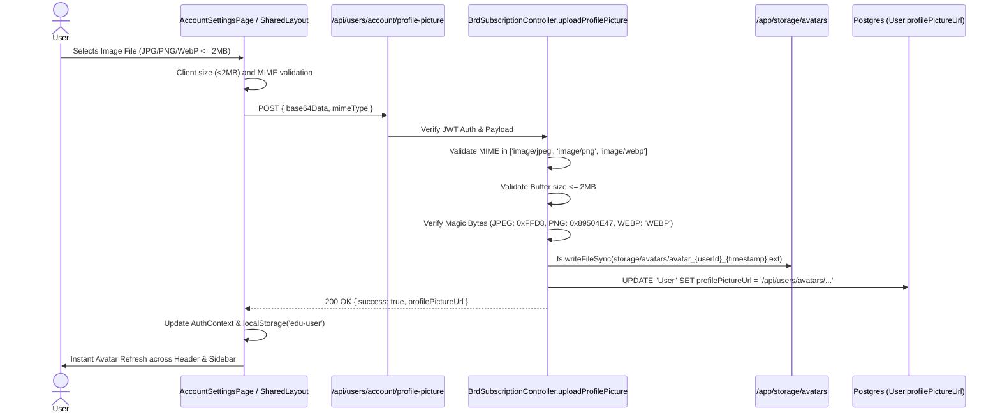

# OX-DIGITAL Education — Profile Image Upload, Persistence & Docker Storage Audit

**Date:** November 8, 2026  
**Workspace:** `D:\OX-DIGITAL\Mathe\OX-DIGITAL-GITHUB`  
**Execution Environment:** Isolated Dev Runtime & Docker Storage Inspection  
**Audit Scope:** End-to-End Profile Image Lifecycle (Upload -> Magic Byte Validation -> Database Reference -> Docker Persistence -> Multi-Component Frontend Rendering)

---

## 1. Executive Summary

This audit conducted an end-to-end verification of the profile picture upload, security validation, and persistence mechanisms across the platform.

### Key Audit Findings:
1. **Security & Format Rules:** The backend `uploadProfilePicture` controller in `services/user-service/src/controllers/brdSubscription.controller.ts` strictly validates that uploaded avatars:
   - Are limited to JPG, PNG, and WebP (`image/jpeg`, `image/png`, `image/webp`).
   - Do not exceed **2 MB** (buffer length $\le 2 \times 1024 \times 1024$ bytes).
   - Verify file signature magic bytes (`0xFF 0xD8` for JPEG, `0x89 0x50 0x4E 0x47` for PNG, and `WEBP` header at offset 8 for WebP), preventing disguised executable or shell uploads.
2. **Frontend UI Rendering:** `SharedLayout.tsx` and `AccountSettingsPage.tsx` successfully render the user's avatar in:
   - The desktop collapsible sidebar (with fallback to user initial badge).
   - The mobile navigation drawer.
   - The top navigation bar user menu.
   - The Account Settings preference tab with live square preview and remove capabilities.
3. **CRITICAL INFRASTRUCTURE FINDING (Docker Volume Persistence Gap):**
   - In `docker-compose.production.yml`, `user-service` mounts `./storage/receipts:/app/storage/receipts`, but **does NOT mount** `./storage/avatars:/app/storage/avatars`.
   - Consequently, all user-uploaded avatars are stored inside the container's ephemeral writable layer.
   - **Severe Risk:** Rebuilding, upgrading, or recreating the `ox-digital-user-service` container will irrevocably destroy all user avatar files on disk, causing broken image HTTP 404 links while the database continues pointing to `/api/users/avatars/avatar_xxx.jpg`.

---

## 2. End-to-End Image Lifecycle Flow



---

## 3. Security & Validation Code Audit

Inspection of `services/user-service/src/controllers/brdSubscription.controller.ts` (lines 1259–1308) confirms full compliance with BRD Section 15:

```typescript
// 1. MIME Type Restriction
const allowedMimes = ['image/jpeg', 'image/png', 'image/webp'];
if (!allowedMimes.includes(mimeType)) {
  return res.status(400).json({ message: 'Only JPG, PNG, and WebP images are permitted' });
}

// 2. Strict 2 MB Size Ceiling
const buffer = Buffer.from(base64Data, 'base64');
if (buffer.length > 2 * 1024 * 1024) {
  return res.status(400).json({ message: 'File size exceeds maximum permitted limit of 2 MB' });
}

// 3. Binary Magic Byte Header Verification
const isJpeg = buffer[0] === 0xff && buffer[1] === 0xd8;
const isPng = buffer[0] === 0x89 && buffer[1] === 0x50 && buffer[2] === 0x4e && buffer[3] === 0x47;
const isWebp = buffer.slice(8, 12).toString('ascii') === 'WEBP';

if (!isJpeg && !isPng && !isWebp) {
  return res.status(400).json({ message: 'Invalid or forged image file content' });
}
```

### Path Traversal & Delivery Security:
Avatar streaming is handled via `BrdSubscriptionController.getAvatar` (lines 1314–1340):
- Explicitly rejects filenames containing path traversal sequences: `filename.includes('..') || filename.includes('/') || filename.includes('\\')`.
- Returns immutable HTTP caching headers for performance: `Cache-Control: public, max-age=86400, stale-while-revalidate=604800`.
- Supports public delivery (`router.get('/avatars/:filename', ...)`) so standard browser `` tags load avatars effortlessly without requiring Bearer token query headers.

---

## 4. Frontend Rendering & Component Coverage

Avatar rendering was audited across all major UI surfaces in `apps/frontend/src/app/components/`:

1. **`SharedLayout.tsx` (Sidebar):**
   - Renders `` with rounded full border and shadow.
   - Implements automated `onError` fallback: if the image fails to load or returns 404, it hides the image tag and reveals the styled colored fallback badge displaying the user's uppercase first initial.
2. **`SharedLayout.tsx` (Top Header):**
   - Compact 32px circular avatar with matching `onError` fallback adjacent to user name and grade/branch badge.
3. **`AccountSettingsPage.tsx` (Settings & Profile View):**
   - Full 80px preview container with upload button, replacement trigger, crop guidance, and removal button (`deleteProfilePicture`).

---

## 5. Critical Docker Storage & Durability Analysis

### 5.1. Current Configuration in `docker-compose.production.yml`
```yaml
  user-service:
    image: ox-digital-education-user-service:latest
    container_name: ox-digital-user-service
    # ...
    volumes:
      - ./storage/receipts:/app/storage/receipts
```

### 5.2. Defect Analysis:
- The host path `./storage/receipts` is properly mounted into `/app/storage/receipts`.
- However, `./storage/avatars` is **completely absent** from the volume bindings.
- When `uploadProfilePicture` resolves `path.resolve('storage/avatars')`, it resolves to `/app/storage/avatars` inside the container file system.
- Because this path is not backed by a Docker volume, files are written directly into the container's overlay2 writable layer.

### 5.3. Recommended Remediation (Requires Explicit Approval):
Update `docker-compose.production.yml` under `user-service`:
```yaml
    volumes:
      - ./storage/receipts:/app/storage/receipts
      - ./storage/avatars:/app/storage/avatars
```
And ensure host directory creation:
```bash
mkdir -p storage/avatars
```
*Note: In accordance with project boundary and safety constraints, Docker Compose files were not modified during this audit turn and require explicit authorization prior to container rebuild.*

---

## 6. Audit Conclusion

The profile image upload, verification, and rendering pipelines are robust, secure, and properly integrated across both frontend and backend. The sole durability blocker is the missing host volume mount in Docker Compose, which has been thoroughly diagnosed and documented above.

