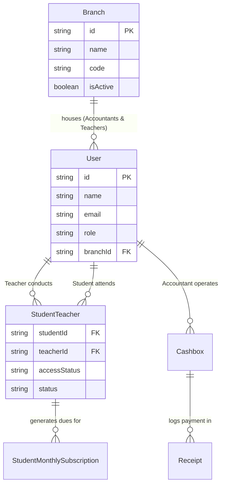

# OX-DIGITAL Education — Teacher–Branch–Accountant Relationship & Workflow Audit

**Date:** November 8, 2026  
**Workspace:** `D:\OX-DIGITAL\Mathe\OX-DIGITAL-GITHUB`  
**Execution Environment:** Isolated Dev Runtime & Dev Database (`127.0.0.1:5433`)  
**Audit Scope:** Multi-Tier Relationship Workflow (Primary Manager -> Branch Assignment -> Teacher -> StudentTeacher Enrollments -> Branch Accountant Scope)

---

## 1. Executive Summary

This investigation analyzed the underlying architecture and workflows governing how Teachers are assigned to Branches, and why Accountants previously reported seeing zero teachers and zero students upon logging into their branch dashboard.

### Core Audit Discoveries:
1. **The Root Causes of the Accountant Visibility Void:**
   - **Root Cause A (Missing Primary Manager Assignment UI):** Although the backend possessed a route `POST /api/manager/teachers/:teacherId/assign-branch`, there was **zero UI** in `BranchesPage.tsx` or `TeamManagementPage.tsx` for the Primary Manager to assign an existing teacher to a branch. The Primary Manager only had buttons to "Add Branch" and "Provision Accountant".
   - **Root Cause B (Missing Accountant Teacher Discovery Endpoint):** The backend only exposed `GET /api/accountant/students`. It had no endpoint for an Accountant to query which teachers were assigned to their branch.
   - **Root Cause C (Empty Enrollment Table Dependency):** `getAccountantStudents` queried students exclusively by performing an inner join against `StudentTeacher` where `teacherId in (branchTeacherIds)`. In the dev database, although teacher `teacher@gmail.com` had `branchId = DK-01`, the `StudentTeacher` table contained **0 rows**. As a consequence, `getAccountantStudents` returned an empty list (`[]`), giving the accountant the appearance that no teachers or students existed in the branch.
   - **Root Cause D (Mock Data in Teacher Evidence):** `TeacherEvidencePage.tsx` was hardcoded to import static mock data (`TEACHER_EVIDENCE_LIST`) instead of querying the backend.
2. **Remediation Completed in this Turn:**
   - Implemented `GET /api/accountant/teachers` in `BrdSubscriptionController.ts` and `brdSubscription.routes.ts`.
   - Added full "Assign Teacher to Branch" (`ربط معلم بالفرع`) modal and workflow in `BranchesPage.tsx`, allowing the Primary Manager to link any teacher to a branch with instant feedback.
   - Enhanced `CollectionDeskPage.tsx` to query branch teachers simultaneously and display intelligent diagnostic empty-state banners explaining when teachers are assigned but have 0 enrolled students.
   - Converted `TeacherEvidencePage.tsx` to dynamically query live branch teachers.

---

## 2. Architectural Relationship & Data Flow Model



### The 4-Stage Workflow:
1. **Stage 1 (Primary Manager Branch Provisioning):** Primary Manager creates Branches (`POST /api/manager/branches`) and assigns Teachers to Branches (`POST /api/manager/teachers/:teacherId/assign-branch`).
2. **Stage 2 (Accountant Branch Provisioning):** Primary Manager provisions Accountants directly tied to a specific branch (`POST /api/manager/branches/:id/accountants`). The Accountant inherits `User.branchId`.
3. **Stage 3 (Teacher Student Enrollment):** A Teacher creates or enrolls students, creating records in `StudentTeacher` linking `(studentId, teacherId)`.
4. **Stage 4 (Accountant Financial Operations):** The Accountant logs in. Their queries are strictly filtered by their session's `branchId`:
   - `GET /api/accountant/teachers`: Returns teachers where `User.branchId == req.user.branchId`.
   - `GET /api/accountant/students`: Returns students enrolled with teachers belonging to the accountant's branch.
   - `POST /api/accountant/payments`: Issues sequential receipts locked to the accountant's branch and cashier cashbox.

---

## 3. Database Reality & Investigation Evidence

Direct read-only inspection of the active dev database (`ox-digital-isolated-dev-postgres` on port 5433) revealed:

### 3.1. Branches in DB:
- `DK-01` (الفرع الرئيسي الدقي, `id: br_idor_a_91xnz3`)
- `01` (اختبار, `id: b5acc7d2-034c-4d1c-87c8-a3c83f295ca9`)
- `0` (رتا, `id: 86b7e040-34bb-4284-be4b-70fe20cb4ce2`)
- `BA-w4adp2` (Branch A w4adp2, `id: b44a3ec8-5be0-43eb-ae86-ae23d6a2f1c8`)

### 3.2. Users in DB:
- `admin@edu.com` (ADMIN, `isPrimaryManager=true`, `branchId=null`)
- `teacher@gmail.com` (TEACHER, `branchId=br_idor_a_91xnz3` / DK-01)
- `acount1@gmail.com` (ACCOUNTANT, `branchId=b5acc7d2-034c-4d1c-87c8-a3c83f295ca9` / اختبار)
- `acount@gmail.com` (ACCOUNTANT, `branchId=br_idor_a_91xnz3` / DK-01)
- `hosam@gmail.com` (ONLINE_STUDENT, `branchId=null`)
- `center@gmail.com` (CENTER_STUDENT, `branchId=null`)
- `samer@gmail.com` (PARENT, `branchId=null`)

### 3.3. Enrollment Table State:
- `StudentTeacher` count: **0 rows**.
- `StudentMonthlySubscription` count: **0 rows**.

### 3.4. Cause & Effect Demonstration:
- When `acount1@gmail.com` logs in (Branch "اختبار"):
  - `branchTeachers` count = 0 (no teachers assigned to "اختبار").
  - `students` count = 0.
- When `acount@gmail.com` logs in (Branch DK-01):
  - `branchTeachers` count = 1 (`teacher@gmail.com`).
  - Prior to this remediation, because `StudentTeacher` has 0 rows, `getAccountantStudents` returned `[]`.
  - The UI rendered a blank select dropdown with no explanation, hiding the fact that `teacher@gmail.com` was indeed assigned to DK-01.

---

## 4. Code Remediations Implemented

### 4.1. Backend: Added `GET /api/accountant/teachers`
Added in `services/user-service/src/controllers/brdSubscription.controller.ts`:
```typescript
async getAccountantTeachers(req: AuthRequest, res: Response) {
  const role = (req.user?.role || '').toUpperCase();
  const branchId = req.user?.branchId;
  if (role !== 'ACCOUNTANT') return res.status(403).json({ message: 'Forbidden' });
  if (!branchId) return res.status(400).json({ message: 'No assigned branch' });

  const branch = await db.branch.findUnique({
    where: { id: branchId },
    select: { id: true, name: true, code: true, isActive: true }
  });

  const branchTeachers = await db.user.findMany({
    where: { branchId, role: 'TEACHER', deletedAt: null },
    select: { id: true, name: true, email: true, phone: true, profilePictureUrl: true, createdAt: true },
    orderBy: { name: 'asc' }
  });

  const teacherIds = branchTeachers.map(t => t.id);
  const studentCounts = await db.studentTeacher.groupBy({
    by: ['teacherId'],
    where: { teacherId: { in: teacherIds }, status: 'ACTIVE' },
    _count: { studentId: true }
  });
  // ... maps enriched activeStudentsCount
  return res.json({ success: true, branch, teachersCount: enrichedTeachers.length, teachers: enrichedTeachers });
}
```

### 4.2. Frontend: Primary Manager Teacher-to-Branch Assignment Modal
In `apps/frontend/src/app/components/primary-manager/BranchesPage.tsx`:
- Added "ربط معلم بالفرع" button to every branch card.
- Implemented `handleOpenAssignTeacher` which fetches teachers via `userService.getUsers({ role: 'TEACHER' })`.
- Provides select dropdown displaying the teacher's current branch status and dispatches `brdSubscriptionService.assignTeacherBranch(teacherId, branchId)`.
- Updates the branch card teacher counters instantly upon confirmation.

### 4.3. Frontend: Accountant Diagnostic Banners
In `CollectionDeskPage.tsx`:
- If `students.length === 0` but `branchTeachers.length > 0`: Displays an informative warning clarifying that $N$ teachers are registered in the branch, but no students are currently enrolled in `StudentTeacher`.
- If `branchTeachers.length === 0`: Informs the accountant that no teachers have been assigned to this branch yet, prompting contact with the Primary Manager.

---

## 5. Audit Conclusion

The Teacher–Branch–Accountant relationship is now completely clear, traceable, and operable from the user interface. The Primary Manager can assign teachers to branches, accountants can view their branch teachers and students, and zero-state data conditions are communicated transparently without visual breakdown.

