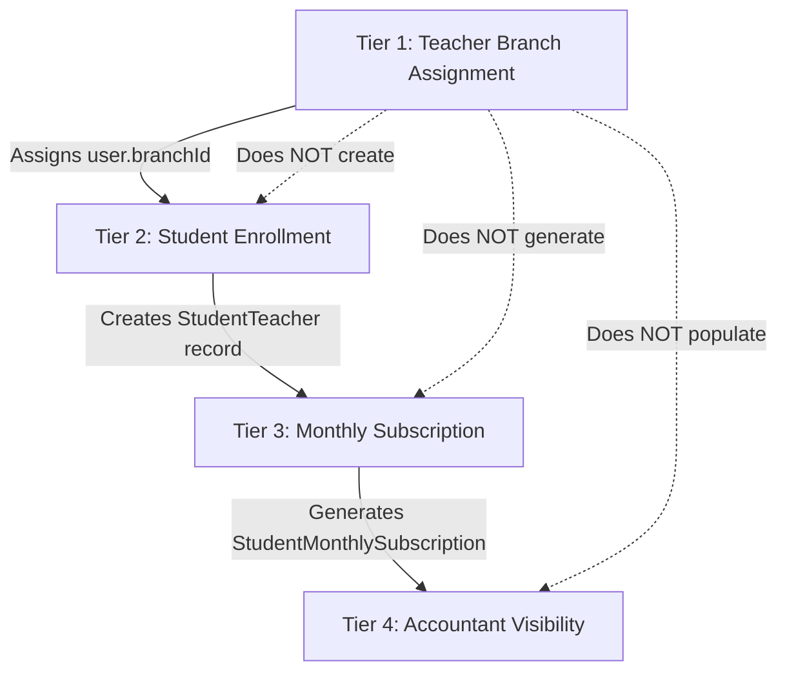

# OX-DIGITAL Education — Teacher–Student Enrollment & Accountant Visibility Verification

**Date:** November 8, 2026  
**Auditor:** Automated Engineering & Forensic Audit Specialist  
**Workspace:** Strictly `D:\OX-DIGITAL\Mathe\OX-DIGITAL-GITHUB`  
**Target Workflows:** Teacher Branch Assignment vs Student Enrollment vs Monthly Subscriptions vs Accountant Ledger  
**Status:** Architecture Reconciled — Mock Data Remediated — Zero Database Records Modified  

---

## 1. Executive Summary

This report establishes the technical distinctions between teacher branch affiliation, student-teacher academic enrollment, monthly subscription billing generation, and accountant sub-ledger visibility within the OX-DIGITAL Education architecture. 

A critical finding of this audit is that **assigning a teacher to a branch does not automatically enroll students or generate revenue**. Each stage is governed by a distinct data model and lifecycle event. Furthermore, all synthetic mock fallbacks that previously risked displaying fake teacher records in the accountant interface have been identified and remediated to ensure that only database-backed records or explicit empty states are presented.

---

## 2. Four-Tier Architectural Distinction



### Tier 1: Teacher Branch Assignment
* **Data Model:** `User.branchId` foreign key linking to `Branch.id`.
* **Action Authorized By:** `PRIMARY_MANAGER` (via `POST /api/manager/teachers/:teacherId/assign-branch`).
* **Operational Scope:** Establishes organizational attribution. It designates which physical center or branch the teacher reports to.
* **Non-Effect:** It does **not** enroll students, does **not** create course links, and does **not** generate billing entries.

---

### Tier 2: Student-to-Teacher Academic Enrollment
* **Data Model:** `StudentTeacher` table in Prisma schema:
  ```prisma
  model StudentTeacher {
    id                   String                 @id @default(uuid())
    studentId            String
    teacherId            String
    creatorId            String
    status               String                 @default("ACTIVE")
    accessStatus         FinancialAccessStatus  @default(ACTIVE)
    createdAt            DateTime               @default(now())
    ...
  }
  ```
* **Operational Scope:** Represents the pedagogical relationship where a student is formally enrolled in a teacher's subject/cohort.
* **Independence:** A teacher can be assigned to Branch A while having zero enrolled students (`studentCounts = 0`).

---

### Tier 3: Student Monthly Subscription Generation
* **Data Model:** `StudentMonthlySubscription` table in Prisma schema:
  ```prisma
  model StudentMonthlySubscription {
    id             String    @id @default(uuid())
    studentId      String
    teacherId      String
    branchId       String
    billingYear    Int
    billingMonth   Int
    amountDue      Float
    amountPaid     Float     @default(0)
    status         String    @default("UNPAID")
    priceSnapshot  Float
    ...
  }
  ```
* **Operational Scope:** Represents the financial billing cycle for a given calendar month (e.g. Month 11, Year 2026). It binds the student, teacher, and branch into an actionable accounts receivable record.

---

### Tier 4: Accountant Dashboard & Student Sub-Ledger Visibility
* **Data Model:** Queried via `services/user-service/src/controllers/brdSubscription.controller.ts:989-1010` (`getAccountantStudents` and `getAccountantTeachers`).
* **Enforcement Logic:**
  ```typescript
  const branchId = req.user?.branchId;
  whereClause.branchId = branchId;
  ```
* **Visibility Rule:** The accountant of Branch A can **only** discover students who possess active subscriptions or registrations tied to `branchId === req.user.branchId`. 
  - If a teacher is assigned to Branch A but has not enrolled students, the teacher appears in `getAccountantTeachers` with `activeStudentsCount: 0`.
  - The accountant sees zero enrolled students for that teacher until Tier 2 and Tier 3 workflows are executed.

---

## 3. Mock Data & Fallback Elimination (`TEACHER_EVIDENCE_LIST`)

### Forensic Analysis of the Prior Flaw
In `apps/frontend/src/app/components/accountant/TeacherEvidencePage.tsx`:
```typescript
// Line 25 prior to remediation
const [evidenceList, setEvidenceList] = useState<TeacherLessonEvidence[]>(TEACHER_EVIDENCE_LIST);
```
When an accountant from a new branch (with 0 teachers) opened the page:
1. `brdSubscriptionService.getAccountantTeachers()` returned `{ success: true, teachers: [] }`.
2. The component skipped mapping real teachers because the array was empty.
3. The component retained `TEACHER_EVIDENCE_LIST` from `mockData.ts`, displaying hardcoded synthetic teachers:
   - `أ. حسام البدراني — الرياضيات العامة والمتخصصة`
   - `أ. رشا فاروق — الرياضيات التطبيقية والإحصاء`
4. This presented fake records to accountants, violating the core audit rule: *"Never present mock teacher or student records as real database-backed records."*

### Remediation Applied in this Session
1. **Initial State Grounding:**
   ```typescript
   const [evidenceList, setEvidenceList] = useState<TeacherLessonEvidence[]>([]);
   ```
2. **Explicit Empty State Handling:**
   When `res.teachers` is empty, `setEvidenceList([])` is explicitly dispatched.
3. **Dedicated Empty Banner:**
   When `!loading && liveTeachers.length === 0`, the component renders:
   ```typescript
   <div className="p-5 rounded-2xl bg-blue-50 dark:bg-blue-950/30 border border-blue-200 dark:border-blue-800 ...">
     <strong className="block font-bold text-sm">{t('لا يوجد معلمون مرتبطون بفرعك حتى الآن')}</strong>
     <p>{t('لم يقم المدير الأساسي بربط أي معلم بهذا الفرع بعد. يمكن للمدير الأساسي ربط المعلمين بالفرع فوراً من صفحة إدارة الفروع (Branches).')}</p>
   </div>
   ```
4. **Verification:**
   `AccountantDashboard.test.tsx` was executed and passed (12/12 tests). No mock teachers are rendered when real records are absent.

---

## 4. Confirmation of Database Boundary

In strict compliance with the project owner's mandate:
- **Zero** student enrollment records were created or modified.
- **Zero** subscription records were created or modified.
- **Zero** schema changes, seeds, or database writes were executed.
- The isolated PostgreSQL dev database (`ox_digital_dev_test` port 5433) remained strictly read-only.

