# OX-DIGITAL Education — Phase 4: Workstream A
## Step A0: Pre-Implementation Schema Audit & Migration Plan
### Deliverable 5: Migration Dependency Order & Topological Sequencing

**Workspace:** `D:\OX-DIGITAL\Mathe\OX-DIGITAL-GITHUB`  
**Target:** `docs/phase-4/workstream-a/step-a0/MIGRATION_DEPENDENCY_ORDER.md`  
**Execution Mode:** STRICTLY READ-ONLY AUDIT & IMPLEMENTATION PLANNING  
**Date:** November 4, 2026 (Reconciled)  
**Author:** Lead Software Architect & Financial Systems Security Reviewer  

---

## 1. Executive Summary

Relational database migrations require strict adherence to **Topological Dependency Ordering**. Attempting to create a table before its referenced foreign key target exists, or adding non-nullable foreign keys without pre-existing parents, causes migration aborts (`relation does not exist` or `violates foreign key constraint`).

This document maps out the precise, verified topological order for all enums, tables, foreign keys, and indexes proposed for Phase 4 Workstream A.

---

## 2. Master Topological Dependency Graph

The Mermaid diagram below visualizes the exact dependency hierarchy:

```mermaid
flowchart TD
    subgraph PreExisting["Pre-Existing Core Tables (Task 7.1)"]
        INST["Institution"]
        BR["Branch"]
        USR["User"]
        LES["Lesson"]
        GRP["CenterGroup"]
        CRS["Course"]
    end

    subgraph Tier0["Tier 0: PostgreSQL Enums"]
        E1["CashboxStatus"]
        E2["CashboxMovementType"]
        E3["TransferStatus"]
        E4["ReconciliationStatus"]
        E5["AgreementStatus"]
        E6["PaymentAllocationMethod"]
    end

    subgraph Tier1["Tier 1: Master Financial & Infrastructure Tables"]
        CB["Cashbox<br/>(FK: Institution, Branch)"]
        SFA["StudentFinancialAccount<br/>(FK: Institution, User student)"]
        GPA["GroupPricingAgreement<br/>(FK: Institution, CenterGroup, Course)"]
        IDEM["FinancialIdempotencyRecord<br/>(FK: Institution)"]
        AUD["FinancialAuditEvent<br/>(FK: Institution, User)"]
    end

    subgraph Tier2["Tier 2: Operational Masters & State Machines"]
        CBM["CashboxMovement<br/>(FK: Institution, Cashbox, User)"]
        CBTR["CashboxTransferRequest<br/>(FK: Institution, Cashbox src/dst, User init/appr)"]
        DCR["DailyCashboxReconciliation<br/>(FK: Institution, Cashbox, User)"]
        EXP["ExpenseVoucher<br/>(FK: Institution, Cashbox, User prep/appr)"]
        AGR["StudentAgreement<br/>(FK: Institution, User student)"]
        LDE["LessonDeliveryEvidence<br/>(FK: Institution, Branch, CenterGroup, Course, Lesson, User teacher)"]
    end

    subgraph Tier3["Tier 3: Sub-Ledger Lines, Adjustments & Milestones"]
        PSI["PaymentScheduleItem<br/>(FK: StudentAgreement)"]
        REC["CollectionReceipt<br/>(FK: Institution, StudentAgreement, User cashier, Cashbox opt)"]
        ADJ["FinancialAdjustment<br/>(FK: Institution, StudentAgreement, User maker/checker)"]
    end

    subgraph Tier4["Tier 4: Bridge Tables & Revenue Recognition"]
        ALC["PaymentAllocation<br/>(FK: CollectionReceipt, PaymentScheduleItem)"]
        REV["RevenueRecognitionEntry<br/>(FK: StudentAgreement, LessonDeliveryEvidence)"]
    end

    INST --> CB
    BR --> CB
    INST --> IDEM
    INST --> AUD
    USR --> AUD

    E1 --> CB
    CB --> CBM
    E2 --> CBM
    USR --> CBM

    CB --> CBTR
    E3 --> CBTR
    USR --> CBTR

    CB --> DCR
    E4 --> DCR
    USR --> DCR

    CB --> EXP
    USR --> EXP

    INST --> AGR
    USR --> AGR
    E5 --> AGR

    LES --> LDE
    GRP --> LDE
    CRS --> LDE
    BR --> LDE
    USR --> LDE

    AGR --> PSI
    AGR --> REC
    CB --> REC
    USR --> REC
    AGR --> ADJ
    USR --> ADJ

    REC --> ALC
    PSI --> ALC
    E6 --> ALC

    AGR --> REV
    LDE --> REV
```

---

## 3. Step-by-Step Topological Execution Order

### Phase 1: PostgreSQL Enums (Tier 0)
PostgreSQL requires types to be defined before columns can reference them:
1. `CREATE TYPE "CashboxStatus" AS ENUM ('ACTIVE', 'SUSPENDED', 'CLOSED');`
2. `CREATE TYPE "CashboxMovementType" AS ENUM ('COLLECTION_INTAKE', 'EXPENSE_DISBURSEMENT', 'TRANSFER_OUT', 'TRANSFER_IN', 'ADJUSTMENT', 'DISCREPANCY_ADJUSTMENT');`
3. `CREATE TYPE "TransferStatus" AS ENUM ('DRAFT', 'PENDING_APPROVAL', 'APPROVED', 'IN_TRANSIT', 'COMPLETED', 'REJECTED', 'CANCELLED');`
4. `CREATE TYPE "ReconciliationStatus" AS ENUM ('BALANCED', 'DISCREPANCY_PENDING_INVESTIGATION', 'DISCREPANCY_RESOLVED');`
5. `CREATE TYPE "AgreementStatus" AS ENUM ('DRAFT', 'ACTIVE', 'COMPLETED', 'TERMINATED', 'DEFAULTED');`
6. `CREATE TYPE "PaymentAllocationMethod" AS ENUM ('EXPLICIT_DESIGNATION', 'SCHEDULED_MILESTONE');`

### Phase 2: Master Financial & Infrastructure Tables (Tier 1)
These models depend strictly on pre-existing core tables (`Institution`, `Branch`, `User`, `CenterGroup`, `Course`):
1. **`Cashbox`:**  
   - References: `Institution(id)`, `Branch(id)`.
   - Constraints: `pk_cashbox`, `fk_cashbox_institution`, `fk_cashbox_branch`, `unq_cashbox_code_institution`.
2. **`StudentFinancialAccount`:**  
   - References: `Institution(id)`, `User(id)` (student).
   - Constraints: `pk_student_financial_account`, `fk_sfa_institution`, `fk_sfa_student`, `unq_sfa_account_number_institution`.
3. **`GroupPricingAgreement`:**  
   - References: `Institution(id)`, `CenterGroup(id)` (optional), `Course(id)` (optional).
   - Constraints: `pk_group_pricing_agreement`, `fk_gpa_institution`.
4. **`FinancialIdempotencyRecord`:**  
   - References: `Institution(id)`.
   - Constraints: `pk_financial_idempotency`, `fk_idempotency_institution`, `unq_idempotency_key_institution`.
5. **`FinancialAuditEvent`:**  
   - References: `Institution(id)`, `User(id)` (nullable).
   - Constraints: `pk_financial_audit_event`, `fk_audit_institution`, `fk_audit_user`.

### Phase 3: Operational Masters & State Machines (Tier 2)
These models depend on Tier 1 (`Cashbox`) and pre-existing core tables:
1. **`CashboxMovement`:**  
   - References: `Institution(id)`, `Cashbox(id)`, `User(id)`.
   - Constraints: `pk_cashbox_movement`, `fk_movement_cashbox`, `fk_movement_user`.
2. **`CashboxTransferRequest`:**  
   - References: `Institution(id)`, `Cashbox(id)` (source & destination), `User(id)` (initiator & approver).
   - Constraints: `pk_cashbox_transfer_request`, `fk_transfer_src_cashbox`, `fk_transfer_dst_cashbox`, `fk_transfer_initiator`, `fk_transfer_approver`, `unq_transfer_number_institution`.
3. **`DailyCashboxReconciliation`:**  
   - References: `Institution(id)`, `Cashbox(id)`, `User(id)`.
   - Constraints: `pk_daily_cashbox_reconciliation`, `fk_reconciliation_cashbox`, `fk_reconciliation_user`, `unq_cashbox_reconciliation_date`.
4. **`ExpenseVoucher`:**  
   - References: `Institution(id)`, `Cashbox(id)`, `User(id)` (preparer & approver).
   - Constraints: `pk_expense_voucher`, `fk_expense_cashbox`, `fk_expense_preparer`, `fk_expense_approver`, `unq_expense_voucher_number_institution`.
5. **`StudentAgreement`:**  
   - References: `Institution(id)`, `User(id)` (student).
   - Constraints: `pk_student_agreement`, `fk_agreement_institution`, `fk_agreement_student`, `unq_agreement_number_institution`.
6. **`LessonDeliveryEvidence`:**  
   - References: `Institution(id)`, `Branch(id)`, `CenterGroup(id)`, `Course(id)`, `Lesson(id)`, `User(id)` (teacher & supervisor).
   - Constraints: `pk_lesson_delivery_evidence`, `fk_evidence_lesson`, `fk_evidence_course`, `fk_evidence_group`, `fk_evidence_teacher`, `fk_evidence_branch`, `fk_evidence_institution`.

### Phase 4: Sub-Ledger Lines, Adjustments & Milestones (Tier 3)
These models depend on Tier 2 (`StudentAgreement`, `Cashbox`):
1. **`PaymentScheduleItem`:**  
   - References: `StudentAgreement(id)`.
   - Constraints: `pk_payment_schedule_item`, `fk_schedule_agreement`, `unq_schedule_agreement_milestone`.
2. **`CollectionReceipt`:**  
   - References: `Institution(id)`, `StudentAgreement(id)`, `User(id)` (cashier), `Cashbox(id)` (optional till link).
   - Constraints: `pk_collection_receipt`, `fk_receipt_institution`, `fk_receipt_agreement`, `fk_receipt_cashier`, `fk_receipt_cashbox`, `unq_receipt_number_institution`.
3. **`FinancialAdjustment`:**  
   - References: `Institution(id)`, `StudentAgreement(id)`, `User(id)` (maker/checker).
   - Constraints: `pk_financial_adjustment`, `fk_adjustment_institution`, `fk_adjustment_agreement`, `fk_adjustment_user`.

### Phase 5: Bridge Tables & Revenue Recognition (Tier 4)
These models depend on Tier 3 (`PaymentScheduleItem`, `CollectionReceipt`) and Tier 2 (`LessonDeliveryEvidence`):
1. **`PaymentAllocation`:**  
   - References: `CollectionReceipt(id)`, `PaymentScheduleItem(id)`.
   - Constraints: `pk_payment_allocation`, `fk_allocation_receipt`, `fk_allocation_schedule_item`.
2. **`RevenueRecognitionEntry`:**  
   - References: `StudentAgreement(id)`, `LessonDeliveryEvidence(id)`.
   - Constraints: `pk_revenue_recognition_entry`, `fk_revenue_agreement`, `fk_revenue_evidence`, `unq_revenue_agreement_evidence`.

---

## 4. Sequencing of Deferred Specialist Models (Future Workstreams)

The remaining 6 baseline entities must NOT be created during Step A1:
1. **General Ledger Bridge (Sequenced Behind Gate 1 `UP-701`):**
   - `Account`, `AccountingPeriod`, `JournalEntry`, `JournalLine`.
   - Creation order: `Account` (with `parentId` self-relation) $\to$ `AccountingPeriod` $\to$ `JournalEntry` (with `reversalOfEntryId` self-relation) $\to$ `JournalLine` (with `Account`, `JournalEntry`, and `Branch` FKs).
2. **Teacher Compensation Module (Sequenced Behind Gate `UP-704`):**
   - `TeacherCompensationAgreement`, `TeacherPayable`.
   - Creation order: `TeacherCompensationAgreement` $\to$ `TeacherPayable`.

---

## 5. Summary Table of Proposed Migration Steps & Safety Classifications

| Step | Database Objects Created | Prerequisite Objects | Target Schema Impact | Risk Classification |
| :-: | :--- | :--- | :--- | :---: |
| **S1** | 6 PostgreSQL Enums | None | Type definitions in database | Low (Additive type creation) |
| **S2** | `Cashbox`, `FinancialIdempotencyRecord`, `FinancialAuditEvent` | Enums, `Institution`, `Branch`, `User` | 3 new independent tables | Low (Additive tables; zero core impact) |
| **S3** | `CashboxMovement`, `CashboxTransferRequest`, `DailyCashboxReconciliation`, `ExpenseVoucher`, `StudentAgreement`, `LessonDeliveryEvidence` | Tier 1 tables, `Lesson`, `Course`, `CenterGroup` | 6 new operational tables | Low (Additive tables; anchors to existing core) |
| **S4** | `PaymentScheduleItem`, `CollectionReceipt`, `FinancialAdjustment` | `StudentAgreement`, `Cashbox`, `User` | 3 sub-ledger tables | Low (Additive sub-ledger lines) |
| **S5** | `PaymentAllocation`, `RevenueRecognitionEntry` | `CollectionReceipt`, `PaymentScheduleItem`, `LessonDeliveryEvidence` | 2 bridge/revenue tables | Low (Additive bridge tables) |
| **S6** | 19 Composite & Performance Indexes | S1–S5 tables | Query acceleration & tenant bounds | Low (Non-blocking on new tables) |
| **S7** | Prisma Client Regeneration | Prisma Schema matching S1–S6 | Generates TypeScript types | Zero (Local code generation only) |

> [!NOTE]
> All risk classifications above reflect a **Design-Level Safety Assessment**. Actual runtime database safety must be verified through static validation (Step A1), staging execution testing (Step A3), and staging rollback verification (Step A5).
