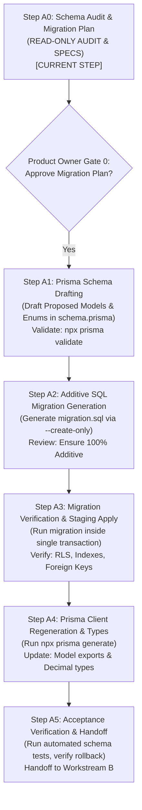

# OX-DIGITAL Education — Phase 4: Workstream A
## Step A0: Pre-Implementation Schema Audit & Migration Plan
### Deliverable 7: Workstream A Master Implementation Plan

**Workspace:** `D:\OX-DIGITAL\Mathe\OX-DIGITAL-GITHUB`  
**Target:** `docs/phase-4/workstream-a/step-a0/WORKSTREAM_A_IMPLEMENTATION_PLAN.md`  
**Execution Mode:** STRICTLY READ-ONLY AUDIT & IMPLEMENTATION PLANNING  
**Date:** November 4, 2026 (Reconciled)  
**Author:** Lead Software Architect & Financial Systems Security Reviewer  

---

## 1. Executive Summary

Workstream A ("Prisma Financial Models & Schema Migration") is the foundational database engineering track of Phase 4. It translates the frozen Phase 2 UI/UX design specifications and Phase 2.0A.3 entity taxonomy into production PostgreSQL relational tables via Prisma ORM.

This document establishes the step-by-step engineering plan, inputs, deliverables, verification commands, and governance stop gates for all six sub-steps of Workstream A (Steps A0 through A5).

---

## 2. Workstream A Sub-Step Breakdown & Gate Flow



---

## 3. Detailed Step-by-Step Engineering Specifications

### Step A0: Pre-Implementation Schema Audit & Migration Plan (Current Step)
* **Objective:** Audit the existing 31 models, reconcile against Phase 2.0A.3 entity taxonomy, map topological dependencies, and define zero-downtime rollback runbooks.
* **Execution Mode:** Strictly read-only; zero code or schema modifications.
* **Deliverables:** 8 audit documents under `docs/phase-4/workstream-a/step-a0/`.
* **Governance Stop Gate:** Must receive explicit Product Owner approval before proceeding to Step A1.

---

### Step A1: Prisma Schema Drafting & Syntax Validation
* **Prerequisite:** Formal Product Owner approval of Step A0.
* **Objective:** Add proposed operational financial models, infrastructure models, and enums to `packages/database/prisma/schema.prisma`.
* **Engineering Tasks:**
  1. Add 6 Enums: `CashboxStatus`, `CashboxMovementType`, `TransferStatus`, `ReconciliationStatus`, `AgreementStatus`, `PaymentAllocationMethod`.
  2. Add 3 Cashbox Models: `Cashbox`, `CashboxMovement`, `DailyCashboxReconciliation`.
  3. Add 2 Transfer & Voucher Models: `CashboxTransferRequest`, `ExpenseVoucher`.
  4. Add 7 Sub-Ledger Models: `StudentFinancialAccount`, `GroupPricingAgreement`, `StudentAgreement`, `PaymentScheduleItem`, `CollectionReceipt`, `PaymentAllocation`, `FinancialAdjustment`.
  5. Add 2 Academic Delivery & Revenue Models: `LessonDeliveryEvidence`, `RevenueRecognitionEntry`.
  6. Add 2 Infrastructure Models: `FinancialIdempotencyRecord`, `FinancialAuditEvent`.
  7. Add reverse relation fields to `Institution`, `Branch`, `User`, and `Lesson`.
* **Verification Command:**
  ```bash
  npx prisma validate --schema=packages/database/prisma/schema.prisma
  ```
* **Success Criteria:** Zero syntax errors; zero relation mismatch errors; clean formatting via `npx prisma format`.

---

### Step A2: Additive SQL Migration Generation
* **Prerequisite:** Successful completion of Step A1 (`npx prisma validate` passes).
* **Objective:** Generate a clean, version-controlled PostgreSQL migration script without touching the database.
* **Engineering Tasks:**
  1. Execute Prisma migration generator:
     ```bash
     npx prisma migrate dev --create-only --name add_phase2_financial_entities
     ```
  2. Inspect the generated `migration.sql` file in `packages/database/prisma/migrations/YYYYMMDDHHMMSS_add_phase2_financial_entities/`.
  3. Verify that the SQL contains **ONLY** `CREATE TABLE`, `CREATE TYPE`, `CREATE INDEX`, and `ALTER TABLE ... ADD CONSTRAINT`.
  4. Verify that zero `DROP TABLE`, `DROP COLUMN`, or `ALTER COLUMN TYPE` statements exist.
* **Success Criteria:** Verified SQL migration script containing exactly new additive tables, 6 enums, and associated indexes/constraints.

---

### Step A3: Migration Verification & Database Application
* **Prerequisite:** Successful completion and inspection of Step A2.
* **Objective:** Apply the migration to the staging database inside an isolated PostgreSQL transaction.
* **Engineering Tasks:**
  1. Create a database backup snapshot prior to execution.
  2. Apply the migration using Prisma Migrate:
     ```bash
     npx prisma migrate deploy
     ```
  3. Verify that all tables, foreign keys, and indexes are active in PostgreSQL `information_schema`.
  4. Verify that pre-existing academic records in `User`, `Course`, `Lesson`, and `Payment` remain 100% accessible and undamaged.
* **Success Criteria:** Migration applies with exit code 0; zero errors; database intact.

---

### Step A4: Prisma Client Regeneration & Model Exports
* **Prerequisite:** Successful completion of Step A3.
* **Objective:** Update the generated TypeScript client in `node_modules/@prisma/client` and export new financial types.
* **Engineering Tasks:**
  1. Run Prisma Client generator:
     ```bash
     npx prisma generate
     ```
  2. Verify that `@prisma/client` exports the new TypeScript interfaces (`Cashbox`, `StudentAgreement`, `CollectionReceipt`, etc.).
  3. Export model types from `packages/database/src/index.ts`.
  4. Verify TypeScript compilation:
     ```bash
     npm --prefix packages/database run build
     ```
* **Success Criteria:** Zero TypeScript compilation errors; type-safe access to all financial models.

---

### Step A5: Acceptance Testing & Handoff to Workstream B
* **Prerequisite:** Successful completion of Step A4.
* **Objective:** Perform automated smoke tests verifying schema invariants, multi-tenant scoping, and rollback procedures.
* **Engineering Tasks:**
  1. Write and execute an automated schema validation test script verifying:
     - Exact Decimal field precision (`db.Decimal(12, 2)`).
     - Unique constraints on `[institutionId, code]`, `[institutionId, receiptNumber]`, etc.
     - `ON DELETE RESTRICT` enforcement on all foreign keys.
     - Isolation and quarantine of `admin@edu.com`.
  2. Execute a dry-run test of `rollback_step_a1.sql` in an isolated shadow database to verify that rollback executes without error.
  3. Deliver `WORKSTREAM_A_COMPLETION_REPORT.md`.
* **Handoff Target:** Workstream B (Backend Financial API, Controllers, and Tenancy Middleware).

---

## 4. Traceability to Phase 2 Screens & Phase 2.0A.3 Baselines

| Phase 2 UI/UX Batch | Canonical Screen IDs | Supporting Workstream A Models |
| :--- | :--- | :--- |
| **Batch 1: App Shell** | `ASH-01` to `ASH-05` | `Institution`, `Branch`, `User` |
| **Batch 2: Primary Manager** | `PM-01` to `PM-09` | `CashboxTransferRequest`, `ExpenseVoucher`, `DailyCashboxReconciliation`, `StudentAgreement` |
| **Batch 3: Accountant Workspace** | `ACC-01` to `ACC-11` | `ExpenseVoucher`, `DailyCashboxReconciliation`, `CollectionReceipt`, `CashboxMovement` |
| **Batch 4: Student Financial Profile** | `SFP-01` to `SFP-08` | `StudentAgreement`, `PaymentScheduleItem`, `CollectionReceipt`, `PaymentAllocation`, `FinancialAdjustment` |
| **Batch 5: Cashbox Management** | `CBM-01` to `CBM-08` | `Cashbox`, `CashboxMovement`, `CashboxTransferRequest`, `DailyCashboxReconciliation` |
| **Domain 7: Center Attendance** | `TCH-EVD-01`, `REV-REC-01` | `LessonDeliveryEvidence`, `RevenueRecognitionEntry` |
| **Infrastructure & Security** | All Screens | `FinancialIdempotencyRecord`, `FinancialAuditEvent` |

---

## 5. Strict Governance Stop Gate

> [!IMPORTANT]
> **GOVERNANCE STOP GATE:**  
> Step A0 is strictly an audit and planning phase. Zero application code or schema files have been altered.  
> Execution must **STOP HERE** until explicit Product Owner review and authorization is granted to proceed to **Step A1: Prisma Schema Drafting**.
